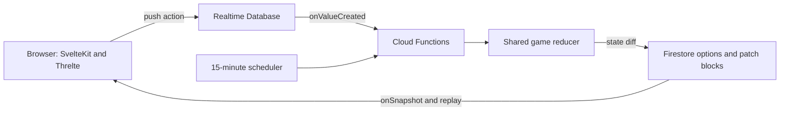

# Cluster I design review

This document records Cluster I’s design, implementation, experiments, and gaps. It is a historical review, not the forward implementation contract. [CLUSTER_II_MVP.md](CLUSTER_II_MVP.md) defines Cluster II’s design; [IMPLEMENTATION_PLAN.md](IMPLEMENTATION_PLAN.md) defines delivery.

## Sources and scope

Reviewed on 2026-10-20. The `../cluster` directory contains several projects, not one repository:

| Project | Role and evidence |
| --- | --- |
| `cluster/` | Main game, derived from `anicolao/firebase-template`. Reviewed source, configuration, tests, assets inventory, and commit history at [`39f1556`](https://github.com/anicolao/cluster/tree/39f155671672aa936a9fbf07462c9c6039139ef3), “Ship image from Andrew.” Package version: `0.0.3`; authors: Andrew Blackledge and Alex Nicolaou. |
| `star-exploration/` | Svelte/Threlte map and route experiment at `7cdfe36f91d9e00c3b06b465956169a6c004d50a`, plus local changes to `Scene.svelte` and its lockfile. Several ideas appear in the main game. |
| `uncharted/` | Checkout of `bpodgursky/uncharted`, a three.js visualization of nearby stars and exoplanets. Its README describes astronomical datasets, procedural stellar surfaces, visibility helpers, and orbit/free-look controls. It is a rendering reference, not Cluster gameplay. |
| `clusterjunk/work/` | Art working directory containing PNG/JPEG variants and transparent cutouts. The reviewed main application does not reference this directory. |
| `testproblem/` | Isolated TypeScript/Vitest reproduction with a `hello` function and test; no game mechanics. |

The main working tree also contains local Nix/direnv additions and a modified Bun lockfile. These are identified separately from the committed design below. Local agent databases, caches, dependencies, and generated coverage are not design authorities. The predecessor was inspected statically; this review does not certify a working build, live deployment, or passing runtime tests.

Source paths below are relative to the main predecessor unless a sibling project is named. Links pin the reviewed commit so later changes do not alter the evidence.

## Decisions to carry forward

| Area | Inherited decision | Implementation boundary |
| --- | --- | --- |
| Product | Slow real-time competition depends on diplomacy and cooperation; repeated games encourage different alliances. | README states the experience. Alliance rules and shared victory are absent from code. |
| Client | TypeScript, SvelteKit, and a statically hosted browser application. | SSR is disabled; Firebase supplies persistence and server execution. |
| Galaxy | Threlte/three.js renders an interactive 3D galaxy with shallow depth around a galactic plane. | Map navigation and route drawing work at the component level; routes are not fleet orders. |
| Backend | Firebase Auth, Realtime Database command submission, Cloud Functions processing, and Firestore state delivery. | Validation and concurrency handling are incomplete. |
| Rules | Shared TypeScript types and a reducer-style game transition function. | Only participation, lifecycle, and chat actions exist. |
| Persistence | Record state changes as patches and reconstruct state by replay. | Ordering, atomicity, retry handling, and bounded history are not complete. |
| Visibility | Store objects separately from the keys that grant players access. | The access model is an experiment using mock encryption. |
| Pacing | A server scheduler advances games every 15 minutes. | Ticks do not yet produce resources, resolve travel, or fight battles. |
| Identity | Google sign-in, persistent aliases, and eight star-themed avatar choices. | Avatars do not select a faction or confer bonuses. |
| Workflow | Bun, TypeScript checks, Biome, Vitest, Firebase emulators, and hosted PR previews. | Historical tooling versions and partial checks need reconciliation with Cluster II’s prompt enforcement. |

## Application architecture

The client submits commands; server functions compute state changes; clients subscribe to results.

The main packages are Svelte 4, SvelteKit 2, Vite 5, TypeScript 5, Threlte core 7/extras 8, Firebase, and UUIDs. These are recorded version families, not an instruction to reinstall old releases. `@ourway/svelte-firebase-auth` supplies sign-in; `@ourway/svelte-redux` and Redux Toolkit hold signed-in user state; `@ourway/patch` computes and applies state diffs. `@ourway/firestore-redux` is declared but is not used by the reviewed application code. Game state uses component-local state and Firestore listeners rather than the global Redux store.

Shared rules and types live in `functions/src/common`, exposed to the browser through the `$common/*` alias. The frontend and functions have separate package manifests, lockfiles, TypeScript settings, and Vitest configurations. Functions use CommonJS output in `lib/`; the frontend is an ES module project. Some imports rely on dependencies outside their own manifest, and the functions watch build uses bundled esbuild while its normal build uses `tsc`. Preserve shared rules code; explicitly resolve package boundaries and alias handling when restoring the build.

The SvelteKit root enables prerendering and disables SSR. The static adapter writes `build/`, and Firebase Hosting rewrites routes to `/index.html`. Git history records an unsuccessful Firebase SSR attempt followed by the static SPA choice. Library-packaging scripts and exports also remain from the template; they are not evidence that Cluster needs to ship as a component library.

Sources: [package manifest](https://github.com/anicolao/cluster/blob/39f155671672aa936a9fbf07462c9c6039139ef3/package.json), [Svelte configuration](https://github.com/anicolao/cluster/blob/39f155671672aa936a9fbf07462c9c6039139ef3/svelte.config.js), [functions manifest](https://github.com/anicolao/cluster/blob/39f155671672aa936a9fbf07462c9c6039139ef3/functions/package.json), `src/routes/+layout.ts`, `src/lib/store.ts`, `src/lib/users.ts`.

## Commands, storage, and replay

| Location | Purpose |
| --- | --- |
| Realtime DB `/users/{uid}/profile/{actionid}` | Submit alias/avatar changes. |
| Realtime DB `/users/{uid}/games/{actionid}` | Submit game creation and soft deletion. |
| Realtime DB `/games/{gameid}/{uid}/{actionid}` | Submit game actions. |
| Firestore `/users/{uid}` | Client-written sign-in information. |
| Firestore `/profiles/{uid}` | Server-maintained alias, avatar, and update timestamp. |
| Firestore `/games/{gameid}` | Public game options and participant summary. |
| Firestore `/games/{gameid}/blocks/{block}` | Timestamp-keyed JSON state patches, with initial/last timestamps. |
| Firestore `/gamekeys/{gameid}` | Server-only game key. |

`executeGameAction` reconstructs state, calls `game(gamekey, state, action)`, computes a diff, updates the game summary if options changed, and writes a patch. State is generated lazily when no prior tick exists; game creation itself only writes options and a game key.

Patch records use millisecond timestamps as field names. `writePatch` updates the most recent block; any update failure creates the next numbered block. The browser orders blocks by `initial_timestamp`, sorts numeric timestamp fields, and applies patches newer than its last timestamp. It decrypts changed objects or objects whose keys have newly become available. Subscriptions are removed when the page is destroyed.

This is a replayable **state-patch history**, not deterministic replay of commands. The reducer creates UUIDs and uses `Math.random()`, so replaying commands would not reproduce identical state.

Review these concrete gaps while retaining replay as the architecture:

- Server replay has no explicit block ordering, unlike the browser. Block numbering and timestamp ordering need a single contract.
- Two actions can read the same state and independently overwrite summaries or append conflicting patches. No transaction, serialization, or retry deduplication exists.
- Millisecond field keys can collide. Client filtering by a single latest timestamp can skip late-arriving patches.
- Options and patch writes are separate operations; lazy initialization can race too.
- Block rollover catches every update error rather than enforcing a size policy. There are no snapshots, compaction rules, command acknowledgements, or cleanup policy.
- The client does not establish a complete reset/recovery protocol for switching game IDs, reconnecting, or partial replay.

Sources: [server game processing](https://github.com/anicolao/cluster/blob/39f155671672aa936a9fbf07462c9c6039139ef3/functions/src/game.ts), [function entry points](https://github.com/anicolao/cluster/blob/39f155671672aa936a9fbf07462c9c6039139ef3/functions/src/index.ts), `src/routes/(game)/game/+page.svelte`, `notes`.

## Identity, access, and private information

Google authentication gates the game layout. It distinguishes loading, signed-out, and signed-in states; a ripple animation covers authentication startup. Profiles store an alias and avatar. Alias edits use a 500 ms delay and also submit on blur. The profile page lists other users, and lobby/profile pages subscribe to the entire profiles collection.

Firestore denies access by default, allows authenticated users to read all profiles and all game documents/patch blocks, and allows a user to write their own `/users/{uid}` document. Clients cannot directly write game state or read game keys. Realtime Database denies reads and allows writes under the authenticated user’s path.

These rules establish a command/result separation, but path ownership is not sufficient authorization. Game functions trust action-body `uid` and `creator` fields rather than binding them to the authenticated path UID. The game trigger accepts the same action union that includes server tick/start actions. The admin page has no separate role check; any signed-in user can submit create/delete requests. Payload validation, game membership, capacity, lifecycle permissions, and privileged actions need server enforcement.

The object/key model is explicit:

- `objects[objectId]` stores an encoded JSON string.
- `keys[objectId].key` wraps the object key for the server using the game key, where applicable.
- `keys[objectId][uid]` wraps the object key for a particular player.
- Clients receive shared patch streams but only materialize objects for which they can unwrap a key.

The code uses the first character of the UID as both a public and private key, single-character object keys, a fixed game key of `"8"`, and a prefix-insertion function named `encrypt`. **This is mock encryption, not confidentiality.** It establishes the desired per-object sharing interface, not a security implementation. Server-authoritative filtering and real cryptographic key distribution are alternatives to review before carrying this interface into production.

Every joining player currently receives keys to every star. Only their home-system development object receives their personal key. Thus the predecessor demonstrates visibility plumbing, not scanning, fog of war, or secure information trading. Granting access to old objects through a replayable history also requires an explicit decision about historical visibility and revocation.

Sources: [Firestore rules](https://github.com/anicolao/cluster/blob/39f155671672aa936a9fbf07462c9c6039139ef3/firestore.rules), [Realtime Database rules](https://github.com/anicolao/cluster/blob/39f155671672aa936a9fbf07462c9c6039139ef3/database.rules.json), [mock cryptography](https://github.com/anicolao/cluster/blob/39f155671672aa936a9fbf07462c9c6039139ef3/functions/src/common/crypt.ts), `src/lib/auth.ts`, `functions/src/index.ts`.

## Game lifecycle and pacing

`GameOptions` contains `name`, `autospawn`, `playerCount`, `playersNeeded`, `started`, optional `deleted` and `winner`, and players keyed by UID. A player record contains UID, alias, avatar, and public key. Alias/avatar values are copied into the game when joining.

The admin interface defaults to two players and autospawn enabled. It generates a two-word name from adjective and place-name lists. Creating a game resets participation and started status. Deletion marks `deleted: true`; the lobby hides it without deleting its history.

Joining adds a player once and decreases `playersNeeded`. Leaving removes the player and increases it. A full game starts on the next scheduled pass, not immediately on the final join. The start pass does not compute the first tick; that occurs on a later pass. Autospawn creates a fresh game with the same capacity when a waiting game starts. The lobby separates active joined games, completed joined games, and unstarted joinable games.

The scheduler runs every 15 minutes. Started games receive `compute_tick`; a winner stops further tick changes inside the reducer. After tick one, the predecessor randomly picks a winner with a 50% chance per tick. That is a lifecycle demonstration, not Cluster’s victory condition.

Lifecycle gaps include joins after start or beyond capacity, repeated joins assigning another free home star, leaving without releasing ownership or keys, and an unconstrained player count despite only two generated home stars. The scheduler does not filter deleted games, keeps processing completed games, and does not await autospawn creation. There is no catch-up policy, pause, configurable tick period, player elimination, or shared-victory representation.

Sources: [game state and reducer](https://github.com/anicolao/cluster/blob/39f155671672aa936a9fbf07462c9c6039139ef3/functions/src/common/gamestate.ts), [creation/deletion](https://github.com/anicolao/cluster/blob/39f155671672aa936a9fbf07462c9c6039139ef3/functions/src/metagame.ts), `functions/src/game.ts`, `src/routes/(game)/lobby/+page.svelte`, `src/routes/(game)/admin/+page.svelte`.

## Galaxy generation and entity model

Positions are three-number tuples. A star has `type: "star"`, stellar class, position, name, and a single `owner`, initially `"nobody"`. Home stars additionally have `homeStarIndex`. The type system permits O/B/A/F/G/K/M; generation selects O/A/G/M with equal probability.

The active generator creates two spiral arms, 180 degrees apart, with shallow vertical scatter:

| Parameter | Existing value or rule |
| --- | --- |
| Spiral radius | `R(theta) = A / log(B * tan(theta / (2*N)))` |
| Shape | `N = 8`, `B = 1.4`; normalize `A` so `abs(R(2π)) = 3` |
| Arm samples | 32 nominal steps, using indices 6–31 |
| Angle | `2π * (1 - i² / 32²)` |
| Neighborhood | Three random stars per sample; uniform unit-ball scatter, with Z compressed by `0.1` |
| Home systems | One per arm at sample index 19 |
| Centre | Six additional scattered stars |
| Total | 164 stars, including two home stars, derived from the loop counts |

Star/object IDs are UUIDs. Randomness is unseeded. Home stars are assigned in object iteration order, independent of faction affinity. A new home system receives a separate developments object with zero markets, one base, one camp, and zero stations.

Names combine a list of proper star names with prefixes, Roman numerals, letters, or suffixes. The probabilities are 5% bare name, 55% prefix/name, 20% name/numeral, 15% name/letter/numeral, and 5% name/suffix. No uniqueness check exists. `morestars.csv` is an additional catalogue; the generator uses the TypeScript list, not CSV coordinates or astronomical positions.

Keep the spiral topology, local neighborhoods, shallow 3D depth, named stars, and separate development objects visible as decisions. Review player-count scaling, starting fairness, minimum separation, navigation connectivity, seeded generation, and the conversion between scene units and light years. None is defined by the current generator.

The single `owner` field cannot express Cluster II’s independent orbital and surface control. Extend that model to satisfy VISION rather than preserving single ownership as a rule.

Sources: `functions/src/common/gamestate.ts`, [star names](https://github.com/anicolao/cluster/blob/39f155671672aa936a9fbf07462c9c6039139ef3/functions/src/common/starnames.ts), `functions/src/common/morestars.csv`.

## Galaxy presentation and interaction

The galaxy fills the viewport. Threlte supplies a background star field, orbit controls, HTML labels, pointer interaction, and gentle floating animation. A perspective camera starts at `[0, 0, 20]`, looks at the origin, and uses a 15-degree field of view. Six grey wireframe circles, at radii `0.5` through `3`, and vertical projection lines make the galactic plane legible.

Stars use animated procedural GLSL surfaces. Stellar class determines false colour: O/B blue, A grey-white, F pale yellow, G khaki, K orange, M coral. Home stars have radius `0.1`; ordinary stars use `0.03`. These sizes communicate gameplay significance rather than physical stellar radii. Hover is yellow; the final selected route star is green. Labels appear when the camera is within five scene units or the star is hovered, and scale with distance. Labels show name, owner UID, and the hardcoded development string `1/0/4/1`; that string is not real production data.

Clicking stars appends them to a local route, rendered as green cylinders between successive positions. There is no route validation, undo/clear control, persisted order, fleet selection, navigation limit, or travel simulation. The main component comments out nearest-neighbor highlighting. The `star-exploration` sibling actively highlights the three nearest neighbors, includes a view gizmo, and retains unused icosahedral home positions and camera-switching experiments. Treat those as alternative interaction ideas, not additional implemented game rules.

Game information and chat occupy right-edge sliding panels over the map. Panels use half the viewport width, green borders/translucent backgrounds, and 0.4-second transitions. The selected tab toggles its panel; switching tabs animates the border. “Hello,” “Wide button,” and “Tall button” are demonstration labels. Black backgrounds, purple text in the authenticated layout, and green interaction accents form the existing visual vocabulary.

The responsive and accessibility contract is not established. Clickable divs/images appear throughout, Svelte accessibility warnings are suppressed, and there are no keyboard map controls or phone-specific layouts. Preserve the map-first interface and panel interaction as reviewable choices; do not mistake warning suppression for an accessibility requirement.

Source: [Galaxy component](https://github.com/anicolao/cluster/blob/39f155671672aa936a9fbf07462c9c6039139ef3/src/lib/components/Galaxy.svelte), `src/routes/(game)/game/+page.svelte`, `src/routes/(game)/+layout.svelte`, sibling `star-exploration/src/lib/components/Scene.svelte`.

## Diplomacy and chat

Chat uses the same object/key distribution system as stars. A room contains a title and an initial chat entry mentioning its creator. Further messages are individual objects with `roomId`, `id`, `parentId`, `creator`, content, and timestamp. Each message points to the previously visible message or room, forming a linked history.

A room creator receives its key; other players initially receive `"badkey"`. Posting a message copies its parent’s key map. An exact `@UID` message grants the named player the key on that message. A newly admitted reader follows parent links, decrypts earlier messages, and reconstructs the room. The browser submits plaintext message content and its key to the backend, so this is not an end-to-end encrypted protocol even if the mock cipher were replaced.

This demonstrates selective diplomatic conversations and admission with access to earlier history. There is no formal alliance model, treaty, resource transfer, moderation, revocation, unread tracking, delivery acknowledgement, or robust concurrent-thread handling. The client’s latest-visible-parent rule can create branches, and client-provided timestamps are not authoritative ordering.

Sources: `functions/src/common/gamestate.ts` (`create_chat_room`, `post_chat`), `src/routes/(game)/game/+page.svelte` (`processNewObject`, `postChat`).

## Gameplay still to implement

| Cluster II mechanic | Evidence in the predecessor |
| --- | --- |
| Four factions and stellar affinities | Four generated classes and eight avatars; no faction selection, affinity matrix, or bonus calculation. |
| Markets, camps, bases, stations | Integer fields on a developments object and home-system defaults; no construction actions or costs. |
| Credits, fighters, infantry, science | No production, resource balances, spending, or transfer model. |
| Market focus and speculative income | Absent. |
| Separate orbital/surface control and credit escrow | Absent; stars have one owner. |
| Fleets, travel, range, and arrival | Route visualization and illustrative fleet sketches in `notes`; no fleet entity or reducer actions. |
| Square-law space combat and ground attrition | Absent. |
| Eight research technologies | Absent. |
| Scanning and partial intelligence | Per-object key distribution exists; all stars are disclosed on join. |
| Alliance incentives and victory thresholds | Product intent exists; code stores one randomly selected winner UID. |

The predecessor therefore supplies the platform and interaction foundation. The full economic and conquest rules come from Cluster II’s existing vision and recorded ruleset, not from hidden implementations in the old repository.

## Assets and provenance

The main repository contains eight portraits: `A1/A2`, `G1/G2`, `M1/M2`, and `O1/O2`, each in full, `-small`, and `-small128` WebP variants. The profile picker uses the 128 variants. Two portraits per class establish visual variety; they do not establish eight mechanically distinct factions.

`static/images/ship1.svg` is an Inkscape SVG added by commit `39f1556`, whose message attributes the ship image to Andrew. It is not wired into the reviewed renderer. Preserve that attribution when reusing it. The artwork working directory contains additional cutouts and variants, but their selection history is not documented in the main project.

The stellar noise shader includes attribution to Ian McEwan/Ashima Arts and an MIT-license notice. The sibling Uncharted README credits HYG, NASA exoplanet data, and Seed of Andromeda rendering techniques. Corona shader files retain temperature-colour experiments, but the active Galaxy component imports the dynamic vertex shader and false-colour noise fragment shader instead. Keep source/license notices with any reused shader or artwork; the game repository’s GPL text does not replace those notices.

Sources: `static/images/`, `src/routes/(game)/profile/+page.svelte`, `src/lib/components/*glsl`, sibling `uncharted/README.md`, [ship contribution](https://github.com/anicolao/cluster/commit/39f155671672aa936a9fbf07462c9c6039139ef3).

## Development, deployment, and verification

The predecessor uses Bun for installs and development, Biome for formatting/linting, strict TypeScript, and Vitest with V8 coverage. VS Code settings recommend Svelte, Biome, and test extensions. Husky runs `bun run ci` and `bun test` before commits. Cluster II already has its own prompt-history hook; preserve that enforcement when adding application checks.

Firebase configuration targets `cluster-7c384`. Hosting and Firestore deploy together through the root script; functions deploy separately. The checked-in functions runtime is Node 18. The PR workflow runs install, Biome CI, and frontend build, then publishes a Firebase Hosting preview for same-repository PRs using a repository service-account secret. It does not run tests, deploy backend functions/rules, or provision isolated backend state. The client’s Firebase project is fixed, so hosted previews point at the same configured backend. Review backend compatibility and preview data policy before reusing this deployment arrangement.

Emulator ports are Auth `9099`, Functions `5001`, Firestore `8080`, Hosting `5002`, and Realtime Database `9000`; emulator listeners bind to `0.0.0.0`. Non-production client code explicitly connects Firestore and Realtime Database emulators on localhost. Auth emulator connection is absent despite its configuration. Vite development, emulators, and function compilation are separate processes; no complete orchestration script exists.

`bin/version` generates client version metadata from package version, Git SHA, and dirty status. `bin/packagedist`, invoked after version changes, deploys and pushes tags/commits. These are useful historical workflow decisions, but a version bump with deployment side effects needs an explicit choice.

Local, uncommitted Nix configuration supplies Bun and an interactive Bash shell through a flake; direnv activates it and sets a project session variable. It does not define a complete pinned browser-test or Firebase runtime environment.

Test coverage is narrow: the root test checks `1 + 2`; functions tests cover joining, leaving, starting, tick progression, name generation, and mock cryptography. The chat test has its substantive assertions commented out. No browser journeys, visual regression, Firebase authorization tests, concurrency/retry tests, or galaxy fairness tests were found in the reviewed project. Passing these existing tests would not establish a playable or secure game.

Sources: [Firebase configuration](https://github.com/anicolao/cluster/blob/39f155671672aa936a9fbf07462c9c6039139ef3/firebase.json), [PR workflow](https://github.com/anicolao/cluster/blob/39f155671672aa936a9fbf07462c9c6039139ef3/.github/workflows/firebase-hosting-pull-request.yml), `src/lib/firebase.ts`, `functions/tests/common/`, `tests/index.test.ts`, `.husky/pre-commit`, `bin/version`, `bin/packagedist`, local `flake.nix` and `.envrc`.

## Review decisions

These questions isolate the choices that materially affect the next implementation. Everything else above remains the inherited baseline.

| Decision | Baseline to preserve | Choice to settle |
| --- | --- | --- |
| Client platform | Static SvelteKit/TypeScript with Threlte | Dependency versions and browser/device support. |
| Galaxy | Shallow 3D spiral, named stars, class colours, orbit controls | Player scaling, fair starts, scene/light-year units, and route editing. |
| Time | Server-driven 15-minute ticks | Tick configurability, catch-up, and command cutoffs. |
| Backend | Firebase command/result separation | Reuse `cluster-7c384` or establish a new project; preview/production data separation. |
| Persistence | Shared reducer and replayable changes | Serialization, authoritative ordering, idempotency, snapshots, and schema evolution. |
| Visibility | Selective access to individual objects | Server filtering versus real object encryption; history disclosure and revocation. |
| Identity | Google sign-in, alias, avatar | Admin permissions, faction selection, and profile visibility. |
| Diplomacy | Private rooms with selectively shared history | Membership management, alliance mechanics, and shared victory. |
| Control and economy | Separate development objects attached to stars | Extend ownership to orbit/surface and implement the existing ruleset. |
| Presentation | Fullscreen map, animated stars, sliding information panels | Final panel contents, touch/keyboard interaction, and accessibility. |
| Workflow | Bun, emulators, lint/type checks, unit tests, PR previews | Complete reproducible environment and end-to-end/security verification. |

No predecessor source, infrastructure, or assets are migrated by this document. It preserves the evidence and decision boundaries for review before those changes begin.
