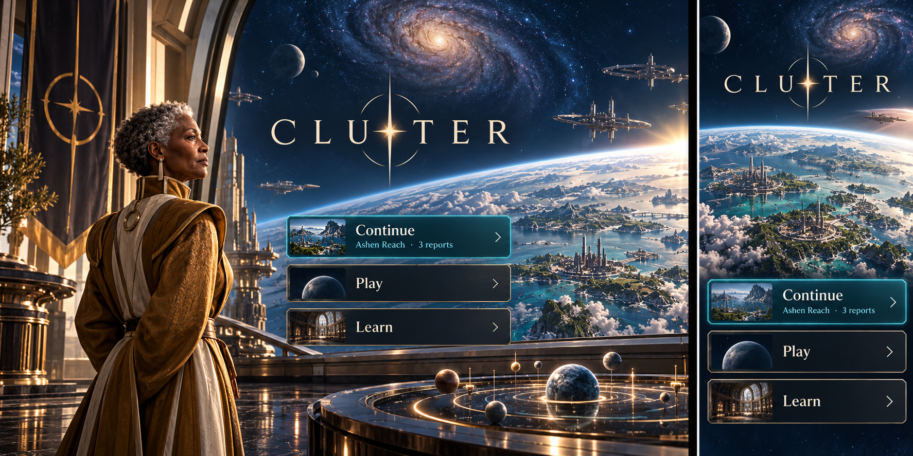
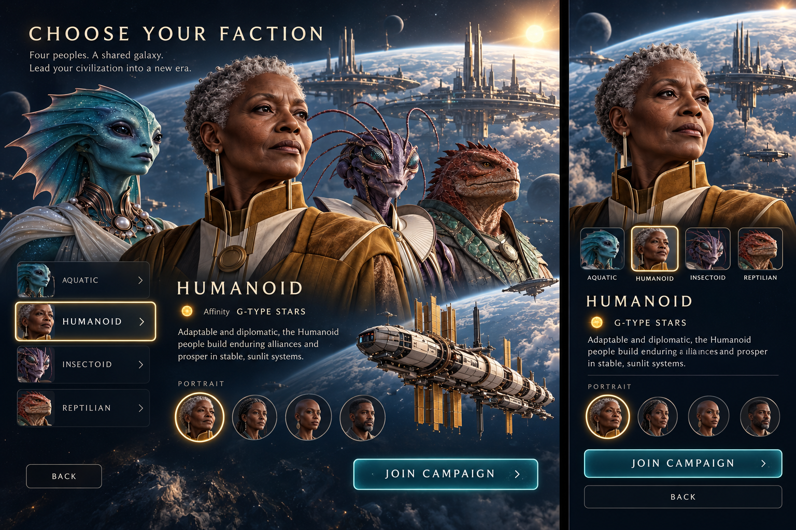
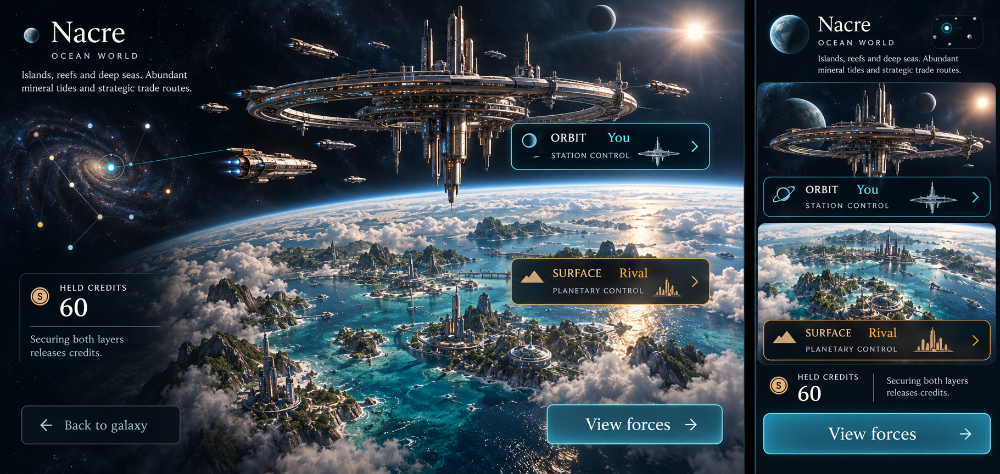
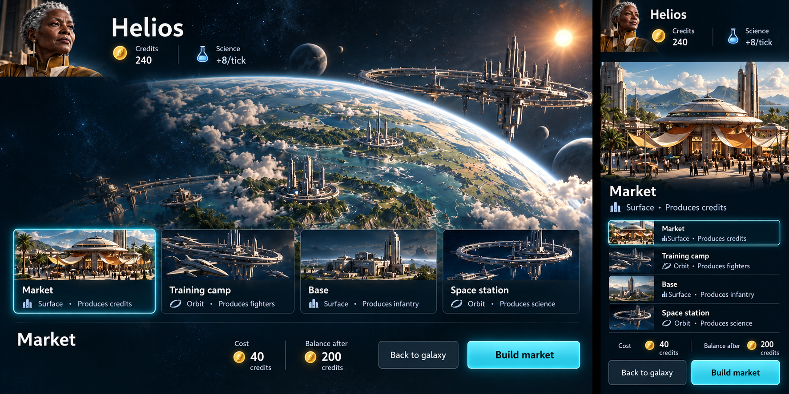
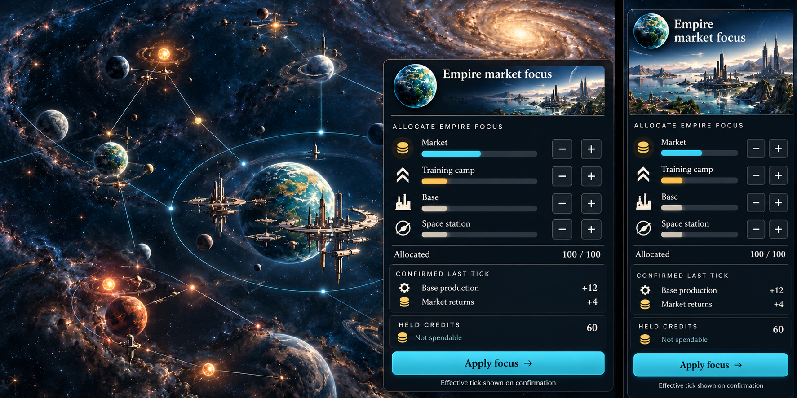
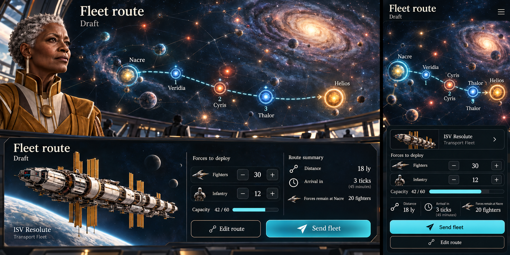
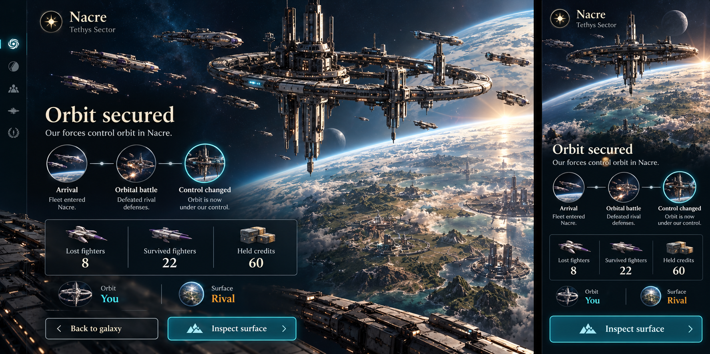
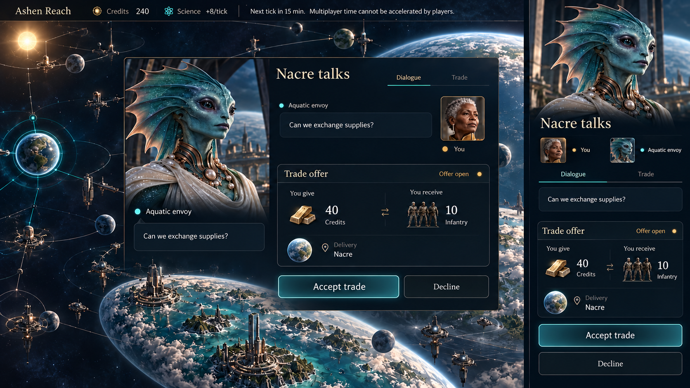
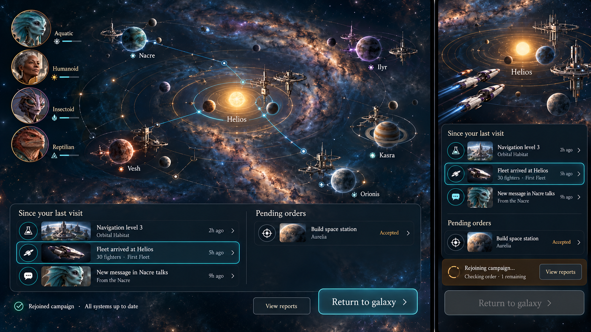
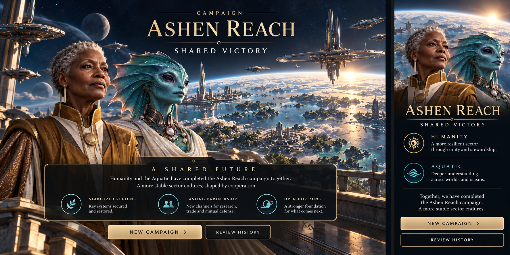

# Cluster II — command experience and visual direction

**Accepted visual direction: cinematic realism.** Expressive faction leaders, believable spacecraft, inhabited worlds and immense distances give diplomacy and conquest weight. The player commands an empire from a quiet observatory above a living galaxy.

**The galaxy is the interface.** Systems, fleets and relationships occupy recognizable places. Instruments open around the current subject; closing them returns to that place. The experience is a full-screen game, with no marketing header, persistent website sidebar or dashboard grid.

This document defines the intended experience. The illustrations are **generated concept mockups, not screenshots of an implemented application**. [VISION.md](VISION.md) and [CLUSTER_II_MVP.md](CLUSTER_II_MVP.md) define gameplay; [IMPLEMENTATION_PLAN.md](IMPLEMENTATION_PLAN.md) defines delivery. The selected [cinematic art board](docs/art/images/b-cinematic.png) supplies the visual language.

Mockup names, costs, capacities, progress, dates and force counts are illustrative fixtures. Generated lettering and incidental symbols are not production assets. Render exact names, accessible labels and authoritative values as real interface elements. The mockups do not settle faction bonuses, starting assets, construction timing, allocation units, research costs, fleet speed, alliance eligibility or victory thresholds. Those values come from the game's versioned ruleset. An unavailable rule-dependent action never appears as an unexplained promise.

## Versioned rules binding

[RULES_SPEC.md](RULES_SPEC.md) defines the step 0 rule choices for review; [TECHNICAL_CONTRACT.md](TECHNICAL_CONTRACT.md#7-clientux-binding) binds those choices to the screen families and UX story IDs. Under v0.1.0, lobbies start automatically when full, scans are passive, hostile ground assault follows orbital resolution automatically, and traveling fleets cannot reroute mid-leg. Victory is shared territorial control or a deadline draw; the generic individual-winner variant is not reachable. Mockup values remain illustrative. No change to cinematic composition or exact visual acceptance is implied by these rules.

## The visual promise

The galaxy feels vast; the next decision feels close. Deep navy space and nearly black gunmetal provide quiet ground for ivory text. Cyan marks selection, amber marks uncertainty, and restrained vermilion marks destructive consequences. These are interaction accents, not faction identity or stellar class colors. Shape, wording and position carry the same distinctions without color.

Leaders are people with whom the player can negotiate. Their eyes and expressions stay visible. Aquatic fins, humanoid faces, insectoid antennae and reptilian brows remain distinct at portrait scale. Faction determines mechanics; the selected portrait determines appearance. A portrait does not reveal a player's temperament or intentions.

Ships have recognizable hull silhouettes, materials and scale. A vessel illustration identifies a fleet; exact composition lives in its manifest. Planetary views contain both surface settlements and orbital structures. The two layers communicate separate possession; a dramatic orbital scene never implies that the surface has fallen.

Use restrained bevels, grounded shadows and shallow instrument lighting. Keep controls front-facing and readable rather than projecting essential text onto angled holograms. Bright stars and atmosphere sit away from text. Do not place a glowing outline around every object. The scene remains calm during a decision, even when battles or messages arrive elsewhere.

## One campaign, two compositions

### Desktop and large display

The galaxy owns the central field. A slim upper instrument rail names the campaign, empire, credits, science rate and next scheduled tick. Selecting a resource reveals its source ledger; rates are explicitly per tick. Fighter and infantry totals never masquerade as immediately spendable units when those forces occupy different systems.

A selected system or fleet opens an inspector at the right edge. A short lower command dock reaches Systems, Fleets, Research, Diplomacy and Activity. Each combines a recognizable symbol with a visible label. The empire portrait opens the game menu. The dock belongs to the command environment, not a website navigation bar.

Keep map context, selected subject and the current commitment visible together. Ledger, history and rules use bounded trays. Deep decisions can widen the inspector, but they do not stack multiple independent modal windows. Inspection temporarily replaces a tray and returns to its prior selection and scroll position.

At large-display sizes, expand map visibility and useful detail; do not stretch controls to fill the screen or reveal another player's view. Short desktop windows reduce atmospheric margins and move secondary detail into named tabs before they clip the primary action.

### Portrait phone

Compose for a single task. The compact upper rail shows campaign context and next tick; a resource control expands the empire ledger. The middle holds either a useful map region or the selected planetary/ship scene. A lower sheet holds the task and its named commitment above the device safe area.

The phone dock exposes Galaxy, Orders, Diplomacy and More. More reaches Systems, Economy, Research, Activity, Rules and the game menu. These are alternate routes to the same instruments, not separate game modes. Opening a task replaces the central detail; Back returns through inspection to the previous map selection. Draft edits survive this navigation within the campaign.

A sheet has explicit Expand and Collapse controls. Swiping is an optional shortcut. The screen does not require precision gestures to select stars, allocate forces or dismiss an overlay. A system list provides the same authorized facts and actions as the map. The primary action stays reachable while its details scroll inside a bounded region.

## Campaign flow

Enter → choose or resume a campaign → choose faction and portrait → join → enter the galaxy. During a campaign, the recurring loop is **review changes → inspect → decide → review consequences → commit → receive acknowledgement**. The server advances the campaign every fifteen minutes; the player has no End turn button.

Exploration, development, research and diplomacy remain available while fleets travel. Opening menus, reports or help does not pause the campaign. A new tick updates facts without stealing focus. If it invalidates a draft, the instrument preserves the player's intent, explains the changed constraint and requires a new review.

A campaign's pre-join briefing states its objective, cadence, participation rules and faction choices. The player can read the applicable rules before committing. Supported player counts and readiness conditions come from the campaign configuration; the interface does not assume a fixed lobby size or a new ready-up mechanic.

## Illustrated screen families

Each plate places a wide desktop composition on the left and a separately arranged portrait composition on the right. Plates establish visual hierarchy and emotional tone. The following interaction descriptions are the exact contract where a generated label or arrangement differs.

### 01 · Enter the observatory

**Play:** Continue returns to the last accessible active campaign. Play opens campaign selection. Learn opens the illustrated rules. When several campaigns are active, Continue names the last campaign and offers Change campaign. When none exists, omit Continue rather than disabling it without explanation.

**Signifiers and affordances:** Three distinct choices over a quiet inhabited-world vista. A small report count belongs to the named campaign. Sign in appears at the point of joining or resuming when needed; a returning player keeps their chosen destination through Google sign-in.

**Motion and transition:** A short approach settles into the command view. Reduced motion cuts directly. Signing out clears private views and drafts from the screen. An entry scene never previews confidential conversation text.

**Stories:** UX-01, UX-02, UX-15.

### 02 · Find a campaign and gather players

**Composition:** Reuse the entry scene with a bounded campaign manifest instead of its three choices. Active, Joinable and Completed sections are explicit. On phone, show one section at a time with readable rows; do not turn every campaign into a large promotional card.

**Play:** Select a campaign to read its objective, roster, capacity and start conditions. Join claims one available place after faction selection. An invitation opens the same briefing. Create is available to permitted players and shows only supported settings. Waiting players can inspect the roster and rules; leaving a waiting campaign follows its stated admission policy.

**Signifiers and affordances:** Named occupied places and remaining capacity. Copy: Join campaign; Waiting for players; Campaign full; This invitation is no longer available. A host's Start appears only when the rules and their permissions allow it. Scheduled starts display their actual time; never invent a manual start requirement.

**Motion and transition:** A joined place settles once. When the campaign starts, the same view reveals the home neighborhood; reconnect never claims another place or generates another home system.

**Stories:** UX-02.

### 03 · Choose a faction and a face

**Play:** Inspect Aquatic, Humanoid, Insectoid and Reptilian, their M/G/A/O affinities and the complete applicable bonus matrix. Select a mechanical faction, then choose an available portrait independently. Join campaign commits the presented selection. If campaign rules constrain faction availability, show the reason beside the choice.

**Signifiers and affordances:** One large readable face, four labeled faction choices, a restrained ship silhouette and a compact affinity comparison. “Portrait changes appearance” distinguishes cosmetic choice. Numbers and strengths come from the ruleset; a species illustration does not imply an extra ability.

**Motion and transition:** Selection changes the face and surrounding material accents without moving the controls. Join receives acknowledgement before the player appears in the roster. A failed claim preserves the selection and offers another valid choice.

**Stories:** UX-02, UX-03.

### 04 · Command the galaxy

**Play:** Pan, zoom and orbit a shallow spiral; select a system or fleet, center on home, search by known name, or open the equivalent Systems list. Filters for ownership, stellar class, known activity and visibility alter the view only. Selecting never sends forces.

**Signifiers and affordances:** Selection uses a ring and subject name. Stellar class has a letter; orbit and surface use separate owner marks. Current position, last-observed position and unknown location have different symbols and explicit status. Paths distinguish Draft, Accepted and Traveling through pattern and labels, not color alone.

**Motion and transition:** A user-requested Center moves to the subject. Incoming activity adds an indicator without changing camera or selection. Label density decreases with zoom, retaining the selected name and focused target. Overlapping targets open a named chooser rather than guessing the intended star.

**Stories:** UX-03, UX-07, UX-16.

### 05 · Inspect a system and its two owners

**Play:** Open Orbit or Surface to inspect entitled forces, developments and production. View forces opens a location-specific manifest. Build opens the construction instrument only for a layer the player can develop. An inaccessible layer remains inspectable to the extent intelligence permits.

**Signifiers and affordances:** Always name Orbit owner and Surface owner independently. Use You, the known owner, Unclaimed or Unknown; Unknown never means unclaimed. Credits held locally appear separately from spendable funds. Explain the rule: securing both layers releases held credits. Production identifies its recipient and affected layer.

**Motion and transition:** The star inspector expands into a planetary view while a locator preserves galactic context. Selecting a layer emphasizes its structure, not the entire ownership state. Closing restores the original map position. Planet art remains decorative; it is not a live spy camera revealing hidden developments.

**Stories:** UX-04, UX-09.

### 06 · Build a development

**Play:** Choose Market, Training camp, Base or Space station. Read location, output, prerequisites, price, timing and the balance after purchase; confirm Build market or the corresponding named action. Queue and cancellation controls exist only where supported by the ruleset, with any refund shown before commitment.

**Signifiers and affordances:** Market produces credits on the surface; training camp produces fighters in orbit; base produces infantry on the surface; space station produces science in orbit. Explain modifiers after the base output. Disabled copy names the remedy: Need 12 more credits; Requires orbital control. A queue entry shows actual status, not an animated progress guess.

**Motion and transition:** Pressing Build shows Sending order. Acknowledgement creates an accepted order; completion reveals the structure at the authoritative effective time. No optimistic building appears as already owned. The instrument remains open for another legal purchase with updated funds.

**Stories:** UX-05, UX-14.

### 07 · Understand income and choose market focus

**Play:** Open credits to reconcile starting funds, production, market returns, spending, transfers and held credits for a selected period. Select a permitted system breakdown. Change focus among the four development types and review Apply focus before submission.

**Signifiers and affordances:** Allocation shows the configured total and remaining amount. Plus/minus and numeric entry accompany any sliders. The preview names when a new focus becomes effective and which purchases qualify. Speculative returns are uncertain; do not present other players' future construction as guaranteed income or expose their private orders.

**Motion and transition:** Editing updates a clearly marked preview, not the confirmed ledger. Apply receives acknowledgement and displays its effective tick. Cancel restores the confirmed allocation. A new payout appears as one ledger entry; the same escrow release cannot animate or count twice.

**Stories:** UX-05, UX-06.

### 08 · Direct research

**Play:** Inspect all eight technologies, current level, accrued science, next cost, exact next effect and estimated completion. Choose Research navigation or the selected technology. Switching shows the ruleset's treatment of invested progress before submission. No invented branching tree or hidden prerequisite blocks access.

**Signifiers and affordances:** Scanning, Navigation, Terraforming, Investing, Formations, Melee, Recruiting and Innovation have labels and distinct symbols. Navigation shows ten light years of range per level; travel time is a separate fleet rule. Completion estimates state their assumed science rate and are not promises.

**Motion and transition:** A confirmed choice changes the research indicator. The next-level effect activates when the server says it does. A completion notice points to newly reachable or improved capabilities without forcing navigation. A pending switch does not display both projects as active.

**Stories:** UX-06, UX-07.

### 09 · Read intelligence honestly

**Composition:** Reuse the galaxy and research instruments with an Observation tab in the selected-object inspector. Place observation age beside the fact it qualifies, rather than hiding it in a tooltip.

**Play:** Inspect what is known, when it was observed and any permitted source attribution. Compare last-known forces and ownership without assuming they remain true. Review scanning capability and, where the rules allow it, shared observations. Do not add a manual scan command unless the rules provide one.

**Signifiers and affordances:** Current; Last observed 2 ticks ago; Unknown. A stale force count remains explicitly historical. Unknown values are an em dash plus “Unknown,” never zero. Navigation reach rings show reachability, not detection certainty. Forecasts distinguish known inputs from missing enemy information.

**Motion and transition:** A new authorized observation replaces the displayed report and updates its age. A missed scan does not move a known enemy marker using hidden state. A disappeared marker keeps its last-observed location and date where permitted, with no inferred present trajectory.

**Stories:** UX-07, UX-16.

### 10 · Assemble a fleet and review a route

**Play:** Select an owned origin and available forces. Set fighters and infantry, name the fleet when permitted, choose waypoints and review each leg's range, travel duration, arrival and remaining origin defense. Add/remove/reorder waypoints through buttons as well as direct map selection. Confirm Send fleet only after the full summary is available.

**Signifiers and affordances:** Draft route is dashed and numbered; unavailable legs state their problem. The manifest distinguishes available units, selected units, capacity and units left behind. Unknown defenders remain unknown. The summary states any known hostile arrival or passage consequence without manufacturing battle certainty.

**Motion and transition:** Sending leaves the draft visible with a pending state. Acknowledgement yields Accepted with authoritative departure and arrival. Actual departure changes it to Traveling. A rejection retains editable intent and explains the conflict; no optimistic ship movement subtracts units prematurely.

**Stories:** UX-08, UX-14.

### 11 · Follow orders already issued

**Composition:** Reuse the fleet instrument. Orders groups Draft, Accepted, Traveling and Resolved separately. Desktop keeps the selected route visible; phone shows one route with its next waypoint above the order details.

**Play:** Inspect a fleet's actual manifest and location. Load, unload, split, merge, cancel or reroute only where the rules permit. Preview the exact units, cost, timing and route changes before committing. A draft has Discard draft; an accepted order has Cancel order only when cancellation is legal.

**Signifiers and affordances:** Every actionable count names its location. Read-only enemy reports have no command controls. Disabled text says Departed; Cannot change this leg, or the actual rule-derived reason. “Arrives in 3 ticks” is accompanied by the scheduled local time in expanded detail.

**Motion and transition:** Travel interpolation expresses time between confirmed states and never invents arrival or visibility. Selecting another fleet does not silently issue the current draft. An accepted cancellation becomes Canceled once; uncertain outcomes remain Checking order.

**Stories:** UX-08, UX-14.

### 12 · Understand a battle and occupation

**Play:** Open an authorized combat report from Activity, a fleet or a system. Read known participants, relevant effectiveness, casualties, survivors and control changes. Inspect surface follows an orbital victory. A ground assault is a separate action only if the rules require and permit one; automatic ground resolution never gains a decorative Attack confirmation.

**Signifiers and affordances:** Separate Orbital battle and Ground battle results. “Orbit secured — surface remains rival-held” is explicit. Each casualty belongs to a named side and force type. Unknown opposing details remain omitted or labeled unknown. Explain escrow and output recipients after the actual control transition.

**Motion and transition:** Brief restrained aftermath emphasizes the result; no mandatory cinematic delays reading. A sequence of arrival, combat and control events follows the authoritative ordering. Capturing one layer does not recolor the other. Reduced motion shows the same report immediately.

**Stories:** UX-09.

### 13 · Negotiate privately

**Play:** Open a named conversation, inspect its participants, write a message and invite permitted participants. Before admitting someone, explicitly choose the allowed history scope: future messages or the specific earlier history to share. The invitation review names people and scope; there is no silent disclosure of the entire room.

**Signifiers and affordances:** Persistent participant access control; sent, pending and failed message states. A portrait gives the other empire presence without consuming the reading area. New messages show an unread marker while the player reads older ones. Alliance membership and conversation membership are visibly separate.

**Motion and transition:** Confirmed messages settle once. Failed drafts remain editable within the authorized campaign. Changes in access immediately close protected content and explain the available next step. Leaving a conversation never claims to erase what its participants previously read.

**Stories:** UX-10, UX-14.

### 14 · Form an alliance and settle an exchange

**Composition:** Use the diplomatic instrument's Alliance and Offers views. A proposal occupies a distinct decision surface, separate from ordinary chat. The depicted trade is an illustrative instance of this review surface.

**Play:** Review members, victory eligibility, information sharing and military permissions before proposing or accepting an alliance. Review precisely what leaving changes before Leave alliance. A trade names both parties, each permitted asset, quantity, source/destination where required, expiry and all conditions before Accept trade. Sending a message never forms an agreement.

**Signifiers and affordances:** Proposed, Open, Accepted, Settled, Declined, Expired and Withdrawn have explicit meanings. Show only states supported by the rules. A commitment's primary button names the agreement or exchange. Insufficient funds and changed terms require renewed review, not a silently smaller transaction.

**Motion and transition:** Acceptance waits for confirmation; settlement moves both sides together in the ledger. A delayed response never permits a second spend. Alliance admission reveals only the information actually granted. Leaving changes future access without scrubbing known history or promising an immediate escape from military consequences.

**Stories:** UX-11, UX-14.

### 15 · Return after time away

**Play:** Read Since your last visit, grouped into control changes, force arrivals/losses, research, economy and messages. Choose a report to inspect its subject. Return to galaxy dismisses the briefing without marking private messages as read. Recent and Earlier retain the full authorized activity history.

**Signifiers and affordances:** Separate completed events from upcoming orders. Name the period summarized and the latest confirmed tick. Prioritize threatened or lost holdings and rejected orders, then useful opportunities. Destructive events are not softened into a generic “activity” count.

**Motion and transition:** Restore the newest confirmed scene without replaying every old battle or flight. The briefing has a bounded list, stable reading position and a New activity control when more arrives. Centering on a report is explicit; merely reading it does not move the camera.

**Stories:** UX-12, UX-14.

### 16 · Recover without losing an order

**Composition:** Reuse the current screen beneath a quiet status strip. The phone side of plate 11 illustrates this variant. An unavailable campaign replaces private details with a concise recovery choice.

**Play:** Retry connection, keep reading accessible confirmed reports, or choose another campaign. For an uncertain command, Check order retries discovery or the same command identity; it does not submit a fresh purchase or fleet. Preserve unsent text and route choices in memory while access remains valid.

**Signifiers and affordances:** Rejoining campaign…; Checking order…; Order not sent; The available forces changed. Review your fleet; You no longer have access to this conversation. Distinguish disconnection from rejection. Do not instruct players to refresh the page to complete a move.

**Motion and transition:** Disable conflicting commitments while their outcomes are uncertain. Restore accepted state before enabling another command. Recovery never rerolls intelligence or redisplays a settled trade as open. Switching accounts or losing access clears protected views and drafts; returning does not invent a replacement identity.

**Stories:** UX-14, UX-15.

### 17 · Win together and inspect the campaign

**Play:** Read the actual objective, final qualifying control/resources, all eligible winners and the decisive settlement. Review history keeps each viewer's authorized knowledge boundaries. New campaign opens a fresh briefing; it does not reset the finished game or silently recreate an alliance.

**Signifiers and affordances:** Winning portraits have equal prominence. Explain why each empire qualifies and any rule-defined tie. No invented prestige currency, loot, ranked ladder or rewards. A player eliminated earlier can review only what their permissions allow; elimination and surrender follow the chosen ruleset rather than artwork.

**Motion and transition:** Finish authoritative settlement before showing results. A quiet lighting change replaces the order rail with review controls. Reject further gameplay commands and make ended-state controls read-only. Refresh or return opens the same retained result.

**Stories:** UX-13.

### 18 · Learn, adjust and leave the view

**Composition:** A compact command menu or illustrated codex opens over the current scene. The selected subject remains recognizable. Rules chapters use ordinary readable prose and diagrams inside a bounded tray; menus do not become a separate website.

**Play:** Return to galaxy, change campaign, open Rules, adjust motion/contrast/audio, manage notification preferences, or sign out. Help has contextual chapters for split control, development, market focus, research, intelligence, fleets, combat, alliances and victory. A cost or unavailable action links to its relevant rule.

**Signifiers and affordances:** “The campaign continues” appears in the menu. Leave view is separate from any rule-defined Leave campaign or Surrender. An irreversible departure has a consequence review and explicit final commitment. Ordinary closing and navigation do not ask for redundant confirmation.

**Motion and transition:** Focus enters the menu and returns to its source on close. Reading help does not discard a draft or stop a tick. A newly illegal action is revalidated when the player returns, with the changed reason shown inline.

**Stories:** UX-15, UX-16.

## State variants that reuse these screens

| Family | Required variants and behavior |
| --- | --- |
| Entry / campaign manifest | First visit; sign-in return; several active campaigns; no campaigns; empty joinable list; full/expired/started invitation; unsupported configuration; lost campaign access; completed campaign. One confirmed identity and place through retries. |
| Faction / portrait | Every faction and affinity; each available portrait; selected/taken/disallowed choice where relevant; invalid alias; pending join; concurrent last-place claim. Cosmetic choice never changes mechanics. |
| Galaxy / system | Empty search; crowded nodes; largest supported galaxy; home locator; neutral/owned/allied/rival/unknown orbit and surface; unknown versus zero forces; stale ownership; inaccessible object; no developments; escrow held/released. |
| Construction | All four types; wrong layer; unaffordable; missing prerequisite; available/accepted/building/completed states as rules require; legal queue/cancel/refund variants; tick changes cost or ownership during review. |
| Economy / focus | Zero income; production modifiers; spending; another player's eligible purchase; held credits; release once; invalid allocation; unchanged focus; pending effective tick; changing balance. Every displayed total reconciles. |
| Research / intelligence | All eight disciplines; zero science; completion; switching with retained or lost progress as specified; current/stale/unknown reports; changed reach; missing source access; no known enemy composition. |
| Fleet / orders | No units; no capacity; zero/partial/all allocation; out-of-range leg; multiple waypoints; disallowed passage; invalidated draft; accepted/not departed; traveling; arrived; legal split/merge/load/unload; rejected cancel/reroute; uncertain result. |
| Combat / control | Orbital-only victory; defended surface; ground victory; defeat; ties; zero force; simultaneous arrivals; allies; hidden participants; production changes; escrow held then released once; readable long reports. |
| Diplomacy / alliance | No conversations; pending/failed message; unread while reading history; invite declined; specific history scope; access revoked; alliance proposed/accepted/left; changed permissions; ineligible victory member. |
| Trade | Empty offer list; legal transfers only; changed or expired offer; insufficient balance at acceptance; concurrent acceptance/cancellation; one atomic settlement; no duplicated messages or ledger movements. |
| Return / recovery | Several ticks missed; overdue tick; backgrounded phone; network interruption before/after acceptance; unknown command outcome; access loss; newer state invalidates draft; navigation between campaigns; expired sign-in. |
| Results / reference | Individual/shared winner; configured tie; eliminated player; terminal command rejection; final history still private; new campaign; complete rules; local accessibility settings; unavailable audio/notifications omitted. |

## Information, time and notification rules

The primary time unit is the tick, with a readable local schedule in detail. The rail shows the next server-announced tick. When its scheduled time passes without a confirmed advance, say “Awaiting next tick”; do not advance production or arrivals from a device countdown. A forecast says “Estimated” and names relevant assumptions. Display the campaign timezone when showing an absolute schedule that might otherwise be ambiguous.

An action review names its effective time, not a blanket “next tick” promise. Cutoffs, queues, departure and research switches follow the ruleset. A submission near a cutoff either receives an authoritative effective tick or returns a changed-state review. The client does not decide which side of the cutoff it reached.

The in-game Activity history is the notification authority. Unread indicators are local reading aids, not evidence that an order succeeded. A command acknowledgement, order state and ledger entry establish that. Counts and timestamps retain the same meaning across map, trays and reports.

External notifications are opt-in supplements, introduced only with a supported delivery channel. Default text is privacy-preserving: “Your campaign has new activity.” Do not put private message bodies, hidden system names, enemy positions or trade details on a lock screen. In-game sound is optional and never the only warning. Notification preferences do not change game timing or military rules.

## Player language

Use concrete actions and consequences: **Build market**, **Send fleet**, **Research navigation**, **Apply focus**, **Accept trade**, **Invite to conversation**. Distinguish intent from result: **Draft route**, **Sending order**, **Accepted**, **Traveling**, **Arrived**. A failure names a remedy: **Need 12 more credits**; **This leg exceeds your range**; **Review the new trade terms**.

A report names actor, location and change: **Your fleet reached Helios**; **You secured Nacre's orbit**; **60 held credits released**. “Surface remains rival-held” is more useful than “Victory” alone. Attribution respects observation and membership permissions.

Keep infrastructure language out of player copy and accessible names. Do not expose database names, revisions, encryption providers, deployment paths or raw command IDs. Technical details belong in developer diagnostics. “Science,” “fighter,” “infantry,” “market” and “tick” retain their game meanings. The game menu never says Pause when other players and the server continue.

## Choreography

Motion explains an accepted change. It never controls resolution or substitutes for its lasting evidence.

| Moment | Normal motion | Reduced motion and lasting evidence |
| --- | --- | --- |
| Entry → galaxy | 400 ms shallow camera settle | Immediate view; same selection and focus. |
| Open instrument | 160 ms reveal from selected subject | Instant instrument; named context and focus. |
| Center map | 250 ms camera move on explicit request | Direct center; same subject named. |
| Choose faction | 180 ms crossfade, controls stay fixed | Immediate portrait and exact affinity details. |
| Submit command | Pressed feedback and pending label | Same pending state; no optimistic result. |
| Accept construction | 200 ms order-row emphasis | Accepted status with effective time. Structure waits for completion. |
| Depart / arrive | At most 350 ms local movement at the visible location | Exact location, manifest and order state. No hidden-route animation. |
| Battle result | 250 ms restrained ownership emphasis after resolution | Separate layer owners and complete readable report. |
| Income / escrow | 180 ms numeric emphasis after confirmation | Reconciled ledger and released/held label. |
| Research completes | 220 ms research marker emphasis | Level, effective effect and Activity entry. |
| Message / trade | 160 ms new-entry reveal, only when following latest | Pending/sent status or one settlement entry; no forced scroll. |
| Tick / recovery | Quiet rail update; no full-scene pulse or backlog | Latest confirmed state and a grouped return briefing. |
| Campaign ends | 300 ms dawn/portrait fade after final settlement | All eligible winners and objective breakdown immediately readable. |

Reduced motion removes camera interpolation, continuous decorative rotation, particles, shakes and flight flourishes. It preserves all facts and commands. Large galaxies cap particles and background animation independently of game state. A low-detail presentation retains the same authorized map and a fully functional list alternative.

Accepted commands remain valid even if their animation is interrupted. Repeated input cannot duplicate a command. Conflicting controls wait for an outcome; unrelated inspection stays available. New activity never closes an inspector, scrolls history or jumps to a battle without an explicit player action.

## Readability and control contract

- Use a full-screen surface at supported sizes. The document itself does not accidentally scroll. Named trays, lists and long rules chapters scroll within bounded regions, with visible continuation and reachable ends.
- Touch targets are at least 44 × 44 CSS pixels with nonoverlapping active regions. Dense stars may share visual space; a chooser or list resolves selection. Sliders, map gestures and waypoint dragging all have button/input alternatives.
- Body copy is at least 16 CSS pixels; compact secondary labels are at least 14. Essential text is not baked into art. Normal text meets a 4.5:1 contrast target; large text and essential control boundaries meet 3:1. Test actual composited backgrounds.
- Label every resource, owner, selected state and uncertainty. Do not reuse the same unlabeled M for Market and M-class. Display full Development and Stellar class names where context is ambiguous.
- Keyboard focus is visible. Tab reaches semantic controls in task order; Enter/Space activate; Escape closes optional inspection or exits draft selection without sending. A committed command is never undone by Escape.
- Modal reviews contain focus and return it on close; ordinary inspectors permit navigation to the map/list. Only the top active layer accepts input. Decorative art does not intercept pointer events.
- The map has a semantic Systems/Fleets alternative with the same permitted selection, observations and commands. Screen readers announce named outcomes and invalidated choices politely, without reading a ticking countdown every second.
- Support browser zoom and text enlargement. If detail no longer fits beside the map, use the phone-style task composition. No clipped prices, unreachable confirmations or hidden focus behind a sticky rail.
- Maintain safe-area padding and space for an on-screen keyboard. A message composer and numeric force field remain visible while typing. Sending a chat message and accepting a trade remain separate controls.
- Every private fact stays protected in visible text, accessibility output, tooltips, search indexes and notifications. Unknown fields are absent or explicitly unknown, not visually concealed with secret values still attached.

## Visual and end-to-end acceptance

These mockups are visual targets, not screenshot baselines or proof of working mechanics. Implement real semantic controls over separately managed art. Capture the actual application; never place a full-screen concept image beneath invisible hit targets and call it complete.

Use a shared illustrated-story helper. Each step performs a normal player action, waits for its acknowledged outcome, asserts the resulting game facts and geometry, then captures the settled screen. Load fonts, decode images and settle finite animations explicitly. Do not use fixed sleeps to hide races. Produce an illustrated story document with its viewport captures and named assertions.

Run phone **393 × 852**, desktop **1440 × 1000**, large display **3840 × 2160**, and short desktop **1280 × 720** at DPR 1. Test text enlargement and keyboard use separately. Pin browser, fonts, locale and timezone; fixtures fix the clock, map seed, ruleset, observations and command results. Keep reviewed platform-specific baselines where rendering differs.

Stable captures use reduced motion and a fixed authoritative clock. Require exact screenshot comparisons in that pinned environment: `maxDiffPixels: 0`, `threshold: 0`, retries 0. Baseline creation is an explicit reviewed operation, separate from verification; do not mask important fields or update expected images to hide a regression. A render change requires reviewing both images and behavior.

Geometry assertions verify the game surface has no overflow, primary actions stay visible, active targets do not overlap, and bounded lists expose all entries. Test first/last entries, long names, empty/large results, phone keyboard and focused controls. The map's painted lines may cross; its interaction alternatives must remain unambiguous.

Separate normal-motion tests observe one animation per confirmed action and confirm that reduced and normal motion end in the same state. Freeze an animation clock for intentional intermediate captures. Multi-tick recovery must not generate a burst of old battles or resource animations.

### Illustrated story inventory

Every arrow below is an acknowledged player outcome with an illustration in the eventual executable story. IDs here define required coverage; no story is claimed implemented by this document.

| Story | Journey / families | Required verification |
| --- | --- | --- |
| **UX-01 · Enter and return** | Entry → sign in when required → named active campaign (01) | No/one/several campaigns; destination survives sign-in; Continue restores the same identity and game; entry never leaks private previews. |
| **UX-02 · Join a campaign** | Manifest → briefing → faction → portrait → join → waiting → start (02–03) | Every configured player count, all affinities and portrait choices; full/expired invitation; simultaneous final-place claim; exactly one home allocation; refresh does not rejoin or restart. |
| **UX-03 · Read the galaxy** | Home → pan/zoom → select → search → Systems list → return (04) | Seeded fair home context; all four classes; separate ownership marks; overlapping targets; largest supported galaxy; no selection mutation; camera, focus and filters preserved. |
| **UX-04 · Understand split control** | System → orbit → surface → forces → ledger (05) | Owned/allied/rival/neutral/unknown states; unknown distinct from zero; output recipients; no unauthorized construction; held funds excluded from spendable balance. |
| **UX-05 · Develop an empire** | Inspect → each development → cost review → send → accepted → completed → ledger (06–07) | All four outputs and legal layers; exact price/modifiers/timing; funds cannot be overspent concurrently; no double order after lost response; queue/cancel semantics match rules. |
| **UX-06 · Direct the economy and science** | Focus draft → apply → effective tick → payout; research → switch → completion (07–08) | Valid allocation and cutoff; another player's eligible construction, no hidden plans; all eight technologies; correct progress/overflow/switch rules; range separate from speed; exact reconciled output. |
| **UX-07 · Explore with partial knowledge** | Unknown → permitted observation → stale report → changed scan → range preview (04,08–09) | Acquisition timestamp and source permissions; no reroll on retry; no current enemy movement leaked through stale icons; certainty only where justified; list/canvas/accessibility agree. |
| **UX-08 · Move forces** | Origin → allocate → waypoints → review → send → accepted → depart → arrive (10–11) | Conservation of fighters/infantry; capacity; each leg range and ETA; units left behind; no mutation on draft; legal load/unload/split/merge/cancel/reroute; stale order revalidation. |
| **UX-09 · Conquer both layers** | Hostile arrival → orbital report → held credits → surface resolution → escrow release (05,12) | Worked combat fixtures, casualties, survivors, ties/allies/simultaneous arrivals; independent owners; recipient-limited report facts; one release; no invented manual action in automatic phases. |
| **UX-10 · Negotiate with chosen participants** | Create room → message → invite → choose history scope → admit → unread → revoke (13) | Explicit participants and history disclosure; pending/failed draft recovery; no duplicate send; no forced scroll; future access revoked; previously learned data is not claimed erased. |
| **UX-11 · Cooperate and exchange** | Alliance review → accept → inspect permissions → offer → accept → settlement → leave (14) | Binding consent separate from chat; actual eligibility/permissions; partial intelligence sharing; asset destinations; expiry/cancel race; both sides settle once or neither; departure follows rules. |
| **UX-12 · Return informed** | Several ticks away → briefing → report → subject → older history → latest (15) | No historical animation burst; high-priority changes first; upcoming distinct from completed; no message-read side effect; new activity preserves reading position. |
| **UX-13 · Finish and begin again** | Objective reached → final settlement → individual/shared result → history → new briefing (17) | Correct winners, threshold and tie; terminal mutation rejection; retained per-viewer secrecy; finished record unchanged; new alliance not assumed. |
| **UX-14 · Recover an uncertain commitment** | Draft/pending → interruption → check outcome → accepted or editable rejection (06,10–16) | Lost response before/after application; no duplicated cost, movement, trade or message; changed ownership/funds; no cross-campaign draft; timely privacy cleanup on access loss. |
| **UX-15 · Navigate and learn safely** | Menu → contextual rules → settings → return → change campaign/sign out (01,16,18) | Campaign continues; full chapter coverage; no accidental surrender; sign-in/deep-link recovery at production and preview paths; no internal implementation jargon in player copy. |
| **UX-16 · Command through every input** | Keyboard list → inspect → allocate → commit → phone equivalent (04–18) | Named controls, equivalent permitted facts/actions, focus restoration, no hover/drag-only operation, text enlargement, contrast, safe areas, no clipped or overlapping active controls. |

Keep one complete multi-player campaign exercised through actual player commands: join → construct → research → travel → conquer orbit and surface → negotiate → exchange → shared victory. Focused fixtures cover rare edge cases; administrative state injection does not replace this main journey. Run separate authenticated players for races, diplomacy and information access.

### Engineering boundaries behind the experience

The service is authoritative. It authenticates the actor, validates each command, applies it once and publishes an ordered result. The client keeps Draft, Pending, Accepted and Resolved separate. A lost acknowledgement retries the same stable command identity or checks its outcome. Neither animation completion nor the device clock advances the game.

Visibility is enforced below the presentation layer. Real-mode unauthorized clients must not retrieve plaintext private state through histories, snapshots, direct requests, search, notifications or stale grants. Mock-mode development games exercise the same permissions and view paths but do not claim confidentiality against data inspection. Neither provider choice nor migration controls appears in the ordinary game interface.

A reconnect restores the latest authorized state before enabling dependent commitments. Old observations remain old. Revocation applies to future access, with the limits of previously disclosed information explicit. Combat history and completed campaigns retain those boundaries. Technical diagnostics are separate and must not collect private message contents or keys.

Production and preview URLs restore the same deployment-independent campaign identity through compatible clients. A path or deployment change never makes a new campaign or player. Test deep links, sign-in returns and recovery under both base paths. Configuration and balance values are loaded from the game's ruleset, not hardcoded from the pictures.

Review real screenshots with each implementation milestone: entry/factions/galaxy; construction/ledgers; research/intelligence; fleets/combat; diplomacy/trades; endings/recovery/accessibility. Each review checks the intended cinematic composition and its measurable behavior together.

## Mockup sources

Twelve paired plates live in [docs/ux/concepts](docs/ux/concepts). Their exact prompts, output names and reference roles are recorded in [docs/ux/prompts.json](docs/ux/prompts.json). The built-in image generation tool uses the selected cinematic art board as the visual reference. The assets remain concept art under the repository's [GPL-3.0-only license](LICENSE); production UI text, hit regions and live values remain semantic application content.
