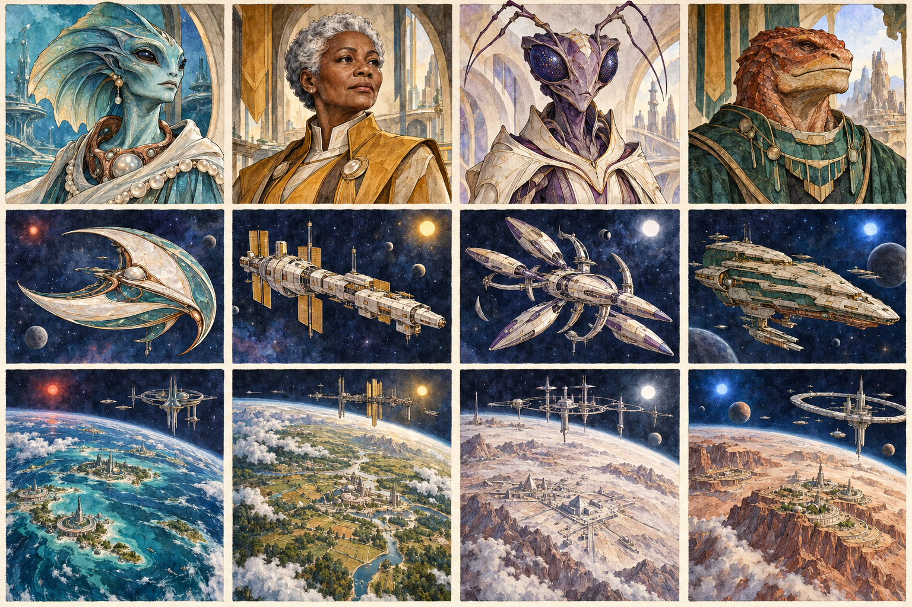
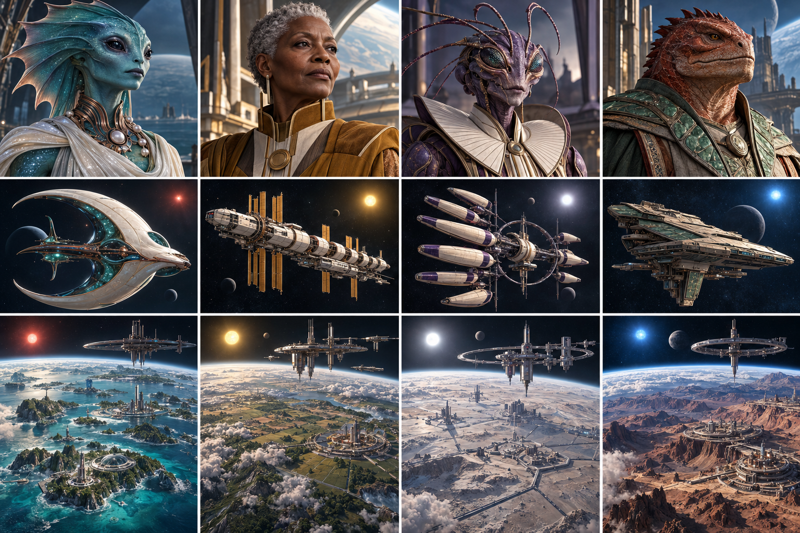
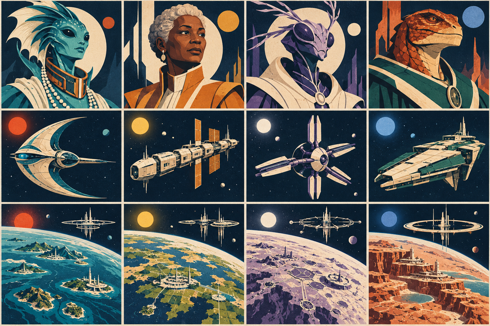
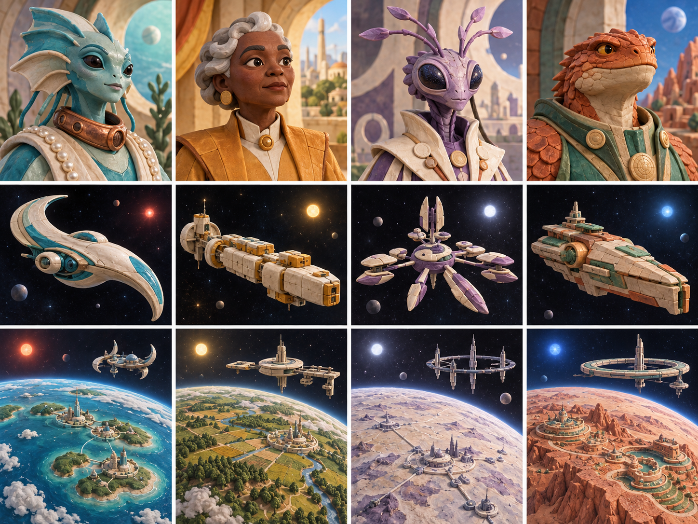

# Art direction options

Cluster’s art makes diplomacy personal and galactic territory desirable. Leaders express intelligence and agency; ships express distinct cultures; planets show the value of controlling a world and its orbit.

**Decision:** choose one of four visual directions below before UX design begins. **Implementation status:** these are generated comparison boards, not integrated game assets. No direction is selected. [README](../../README.md) and [VISION](../../VISION.md) remain the design contract; the costume, architecture and ship motifs here are art proposals, not new mechanics or faction lore.

## What carries forward

The old project in `../cluster` establishes a game about slow real-time conquest, cooperation and shifting alliances. Its `cluster/README.md` makes interdependence central. Its `cluster/static/images/{M,G,A,O}{1,2}.webp` collection contains eight character options; `cluster/src/routes/(game)/profile/+page.svelte` exposes their 128-pixel versions as profile avatars and displays player images at 64 pixels. The reviewed M1, G1, A1 and O1 originals use detailed ink contours, watercolor washes, jewel colors and armed science-fiction characters. The humanoid wears a closed helmet; the other silhouettes expose recognizable alien faces.

`cluster/src/lib/components/Galaxy.svelte` supplies a separate visual language: a Three.js/Threlte starfield, spectral star colors, procedural star shading, orbit controls and spatial guides. These are existing implementation details, not a requirement to imitate that rendering style in every illustration. The old `static/images/ship1.svg` contribution is attributed to Andrew in its commit history and is not wired into the reviewed renderer; these new ship concepts do not reuse it. The broader inheritance review is in [CLUSTER_II_DESIGN.md](../../CLUSTER_II_DESIGN.md). Source paths here are relative to the old project and document local review; no legacy images are copied into this repository.

Carry forward species variety, readable silhouettes, a sense of cosmic scale and the warmth of illustrated characters. Explore visible faces, diplomatic authority and a consistent medium across people, ships and worlds. The current vision fixes the M/aquatic, G/humanoid, A/insectoid and O/reptilian correspondence. In particular, the new aquatic portrait has unmistakable fin anatomy to distinguish it from the reptilian leader.

## Read the boards

Every board uses the same subject brief and layout, so the comparison emphasizes rendering style. Generated details vary between boards; these are not exact character turnarounds.

| Position | Column 1 | Column 2 | Column 3 | Column 4 |
| --- | --- | --- | --- | --- |
| Faction | M · Aquatic | G · Humanoid | A · Insectoid | O · Reptilian |
| Top row | Fin-crested diplomat | Silver-haired human leader | Antennae-bearing envoy | Broad-browed statesperson |
| Middle row | Crescent hull | Modular spine hull | Radial segmented hull | Terraced wedge hull |
| Bottom row | Ocean world | Temperate world | Mineral world | Arid world |

Planet panels include surface development and orbital structures to reflect split control. Their presence is illustrative; it does not specify new building types. Environmental star colors do not define faction or ownership colors.

## A · Watercolor space opera

Ink contours, translucent pigment and paper texture make this the closest evolution of the old portraits. Selective detail gives leaders personality; broad washes make space feel expansive. Pearl, teal, ochre and violet carry across portraits and vessels.

**Strength:** a distinctive, approachable diplomatic universe with continuity from the earlier project. **Tradeoff:** fine marks and irregular edges need deliberate simplification at avatar scale. Painted assets and a procedural galaxy need a shared palette and lighting discipline.

## B · Cinematic realism

Naturalistic materials, controlled rim lighting and large planetary atmospheres create a serious space opera. Faces and costumes carry political authority; engineering and settlement scale make conquest tangible.

**Strength:** emotional presence and convincing scale. **Tradeoff:** costly consistency across expressions, lighting and species anatomy; dark material detail can collapse at small sizes. This direction requires the strongest production control to avoid generic military science fiction.

## C · Graphic screenprint

Flat shapes, strong value groups, limited inks and restrained grain create a graphic identity across all three subjects. Silhouette and negative space do most of the work.

**Strength:** the strongest candidate for a coherent strategy-game visual language, with shapes that can inform later symbols and compact portraits. **Tradeoff:** fewer subtle facial and material cues; planetary grandeur depends on composition rather than surface detail. Small-size readability still needs an actual asset test.

## D · Sculpted 3D

Handmade clay and ceramic forms, simplified faces and soft studio lighting make leaders approachable while retaining distinct anatomy. Ships read as crafted miniatures; planetary globes use raised landforms and small settlements.

**Strength:** expressive personalities and a clear route toward animated portraits if the project chooses to fund them. **Tradeoff:** a generated still does not supply a model, rig or animation pipeline. Excessive softness can make political stakes feel lightweight.

## Choosing the direction

My recommendation is **C, graphic screenprint**, for its cohesive silhouettes and potential to remain legible alongside a dense strategy view. Choose **A** if warmth and continuity with the original illustrations matter more. **B** favors cinematic gravity; **D** favors approachable, dimensional characters. This is an art-direction judgment, not a measured usability result.

| Criterion | A · Watercolor | B · Cinematic | C · Screenprint | D · Sculpted |
| --- | --- | --- | --- | --- |
| Diplomatic tone | Warm, literary | Serious, dramatic | Deliberate, iconic | Expressive, inviting |
| Main identity cue | Contour and pigment | Face and material | Shape and value | Volume and expression |
| Small-portrait risk | Fine ink disappears | Shadows obscure faces | Minimal facial nuance | Forms become too similar |
| Production pressure | Brush consistency | Anatomy and lighting | Shape discipline | Model/style consistency |
| Link to old art | Strongest | Limited | Selective | Selective |

Choose a primary rendering language across leaders, ships and worlds. Record any desired borrowing precisely—such as A’s warmer palette applied to C’s shapes—then generate a focused confirmation board before treating the combination as settled.

After selection, validate the chosen art at 64- and 128-pixel portrait sizes, in grayscale, and with all four silhouettes side by side. Confirm that faction identity survives without color, that facial expressions remain readable, and that space backgrounds leave room for later information layers. Then define a production style sheet covering palette, contours, materials, lighting, portrait crops and asset export rules. UX design follows that decision.

## Assets and generation provenance

Four original boards contain sixteen leader portraits, sixteen ships and sixteen planetary scenes. Each board is one generated raster asset; its panels are comparison art, not individual production exports.

| Board | Exact generation prompt |
| --- | --- |
| [A · Watercolor](images/a-watercolor.png) | [a-watercolor.txt](prompts/a-watercolor.txt) |
| [B · Cinematic](images/b-cinematic.png) | [b-cinematic.txt](prompts/b-cinematic.txt) |
| [C · Screenprint](images/c-screenprint.png) | [c-screenprint.txt](prompts/c-screenprint.txt) |
| [D · Sculpted](images/d-sculpted-v2.png) | [d-sculpted.txt](prompts/d-sculpted.txt) |

Generated on 2026-10-20 with the built-in image generation tool. D uses a second generation with stronger clay-and-ceramic constraints after the first result resembled B too closely; only the selected version is included. The prompts use a shared subject brief with one medium-specific section per board. The old illustrations were visually reviewed as background research, not passed as image inputs. No named artist or franchise is requested. Assets and prompts are included under this repository’s [GPL-3.0-only license](../../LICENSE).
