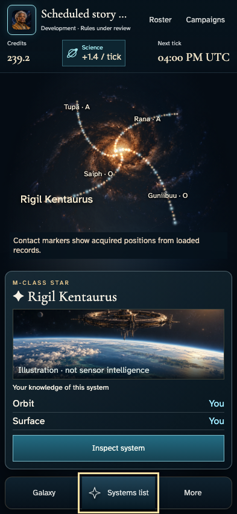
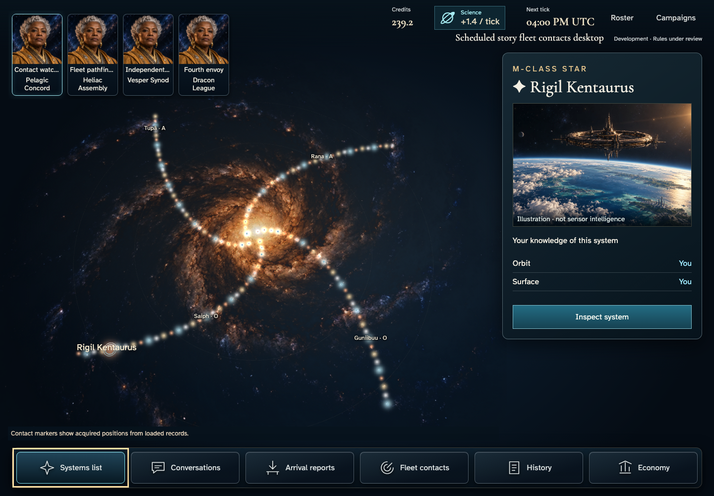
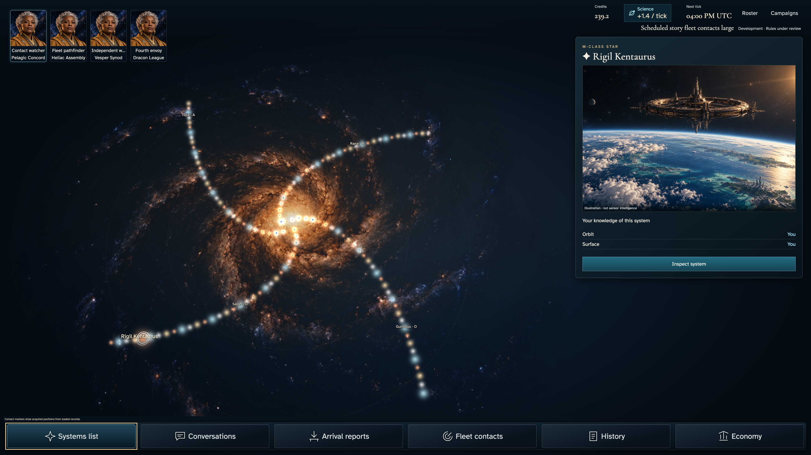
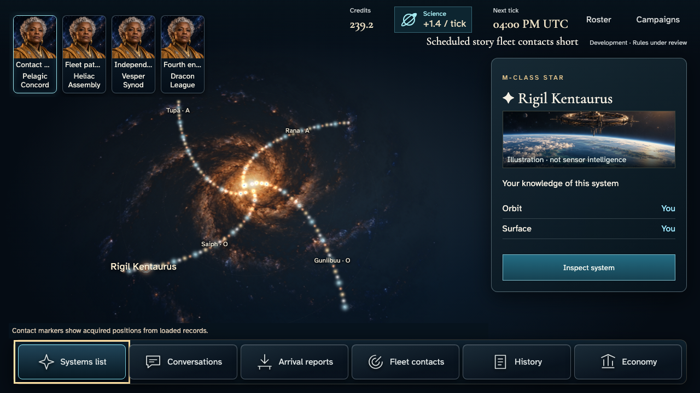

# Galaxy return composition — reviewer16:47

Plate03 and retained Linux contact024 phone show different interaction states: retained image follows keyboard Systems list→Overview after opening More. More remains expanded and the inspector is inert underneath, so the six-command drawer covers its art and ownership rows. This is not the default galaxy composition. The concrete correction dismisses that drawer when a camera action completes and makes the real Systems list control persistently accessible on phone; focus still returns to it. Other panel closure and authorized data remain unchanged.

Written UX03 requires readable chart/context, keyboard equivalent, and camera actions that do not mutate selection except Home. Full-catalogue overview necessarily frames the real catalogue; plate routes/planet facts must not be fabricated. Small framing, two-row header, artwork proportions and apparent label overlap remain separate comparison questions pending actual corrected-source measurement. This increment does not claim whole-screen fidelity.

Feature012 remains the actual four-player authenticated contact/recovery journey in Pantheon feature-local structure. Existing receipt/conservation/privacy assertions and240s/30s/10s budgets remain. Add phone drawer-dismissal and fully readable Inspect target checks at the existing overview viewpoint; preserve every previous viewpoint. All candidates remain unapproved. Timeout/transport hold213 is unchanged.

## Source-paired result

Clean83cb5de68b15cccec8bd3691600fe9c3fd2e7701; spec6906080f3734895e9821e3f341af43ee8d8cb9279e59916335ac5c9df3dddfaa. Four complete real-service journeys passed in2.0minutes with88 originals. Original240s/30s/10s limits, retries0/max-failures1, no snapshot updates. Darwin-arm64 reduced-motion candidates only; zero-tolerance comparison policy is unchanged, but this generation is not strict-reference acceptance. Nix Java21.0.11/Node24.18.0/Bun1.3.13; Functions Node22 declaration mismatch remains explicit. Check passes with one existing Svelte warning; lint and four story-policy cases pass.

All originals/narratives/manifests remain at /tmp/cluster-galaxy-214-candidates/stories/live-fleet-contacts; original-inventory.json records each byte hash. Only four overview originals and associated manifest/narrative metadata are copied here to avoid duplicating148MiB of unchanged evidence. Narrative relative image links for other steps require the retained full directory; these are not a complete copied family. Full raw run log remains/tmp/cluster-galaxy-214-run.log. No old evidence or approved reference changed.

## Plate comparison (implementation self-review, not independent approval)

[Approved plate03](../../../docs/ux/concepts/03-galaxy.png) and each unmodified overview original:

| Phone393×852 | Desktop1440×1000 |
| --- | --- |
|  |  |

| Large3840×2160 | Short1280×720 |
| --- | --- |
|  |  |

Confirmed correction: phone Overview now leaves the chart and contextual art/Orbit/Surface/Inspect readable, with Systems list focused in the compact dock. More remains an intentional drawer when requested; its destinations are available rather than removed. Desktop/large/short retain their global dock and original camera framing. Actual captures were inspected at all four sizes; large was viewer-scaled for composition, not native-resolution typography certification.

Remaining plate gaps: phone two-row HUD consumes more height; whole-catalogue view is much less spatially prominent than the concept's neighborhood view; selected-label text crosses the bright selection/star glow on phone/short/desktop/large. This is a contrast/marker collision visible in the corrected frames, not established duplicate HTML text. A future label treatment must reserve marker clearance and preserve selected/home visibility, rather than hide facts or change catalogue positions. Short art is a thin crop; plate's inhabited-world composition remains stronger. No invented connecting routes, planets, resources, rival ownership or faction portraits were added. All four chosen identities happen to use the same portrait; mechanical faction and avatar remain distinct.

Scope: full service journey assertions retained, including canonical conservation/private-projection corroboration; those administrative reads are not ordinary foreign-read denial. Keyboard overview and phone Inspect containment/hit checks passed. No new normal-motion or Linux execution, full-screen fidelity approval, timeout resolution or release claim. PR140 remains unchanged atd0804122 with application SUCCESS and strict FAILURE.
