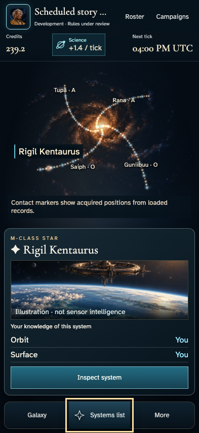
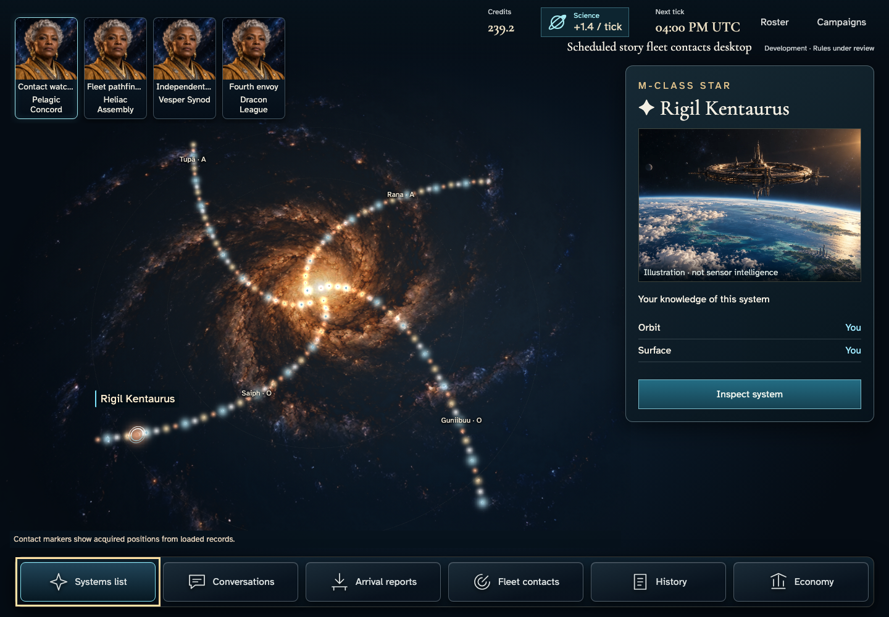
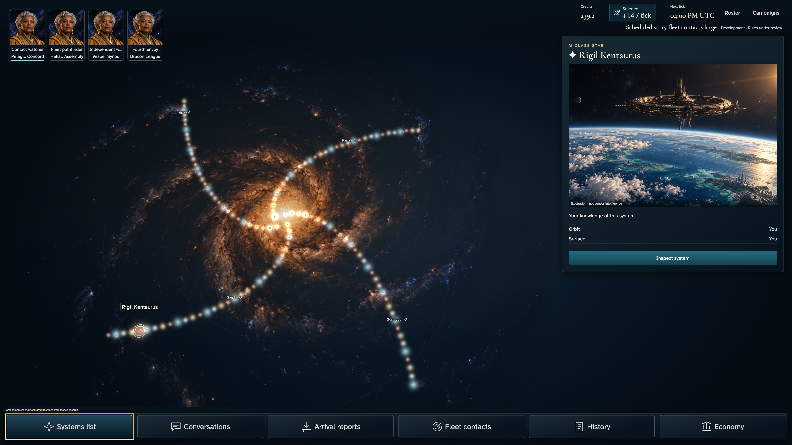
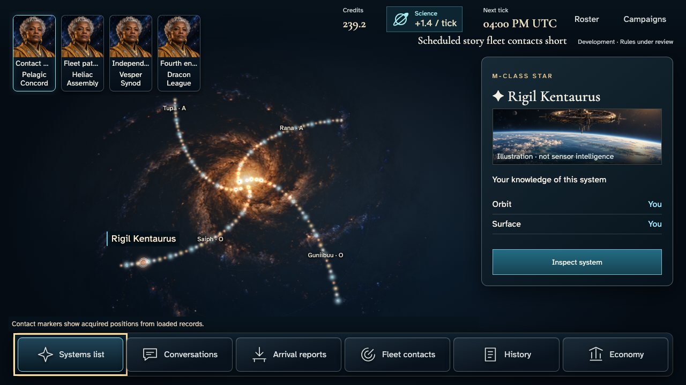

# Selected-name clearance

Reviewer16:57; UX03 requires selected name and ring, readable chart, preserved factual coordinates and keyboard equivalence. Existing HTML at world y0.5 overlaps selected glow whose billboard diameter is1.7world units. Screen projection changes that clearance with camera angle/zoom.

Correction anchors the HTML at the actual star and reserves its perspective-projected glow radius (minimum12CSSpixels) in the existing cartography allocator. Selected label tries above/below/right/left, retaining priority over home/other names; other labels avoid its glow too. A restrained dark label surface separates text from unrelated backdrop radiance. Camera, catalogue, ring, click targets, selection, real commands and authorization are unchanged. Active camera events/resize/selection recompute clearance without a continuous render loop.

Unit coverage exercises viewport edges and three projected radii across four map sizes, preserves input anchors, retains original collision/priority checks. Feature012 adds actual selected-name containment and marker clearance to the existing acknowledged Overview reading state, retaining all prior actions/privacy/conservation/reload checks and original240s/30s/10s budgets. Existing four-size214 evidence remains intact. Local generation is independent-review preparation, not reference approval. Timeout213, chart prominence/HUD and wider design/release gates remain open.

## Local evidence

Clean97d2fdd0: four complete journeys pass1.9minutes,88 retained Darwin-arm64 reduced-motion originals. Phone17.3s/desktop21.0s/large52.1s/short18.5s. Full originals/manifests/narratives remain at /tmp/cluster-label-215-candidates/stories/live-fleet-contacts; original-inventory.json binds all bytes. Four overview originals/manifests are copied here, not a complete second copy of the family. Source/spec hashes are in each manifest. No previous references changed.

Implementation self-review viewed every overview original: label now clears the star/ring, and system panel/dock remain readable. Large was viewed scaled for composition, not native typography certification. Compare [plate03](../../ux/concepts/03-galaxy.png) and prior [214](../galaxy-composition-214/README.md).

| Phone | Desktop |
| --- | --- |
|  |  |

| Large | Short |
| --- | --- |
|  |  |

Four cartography tests/198assertions pass; lint passes without new warnings after replacing non-null assertions with a truthiness type guard. That post-capture edit changes only explicit Boolean conversion of the existing filter predicate and TypeScript narrowing; returned marker set/coordinates are unchanged, unit assertions repeated. Story/spec/Scene/CSS remain exactly captured97d2fdd0. Check passes with one existing Svelte warning; four story-policy checks pass. Java21.0.11/Node24.18.0/Bun1.3.13 under offline Nix; Functions declared Node22 mismatch remains explicit.

## One Linux strict verification

New exact branch-only request contacts-label-verify.json binds its parent source and first attempt; no target140 update. Existing pinned Nix renderer/image is unchanged. Allowlist is only complete feature012, four projects, retries0/max-failures1/update-snapshots=none, strict mode and240s/30s/10s original budgets. Missing references remain nonzero and stop subsequent cases; they cannot certify later label checks. Five orchestration tests cover request source/repository/attempt isolation, exact selection/spec, serial build/setup failures, original nonzero exit and failure artifact retention. No retirement telemetry, resets, clock changes or production service changes. Required application/stories workflows remain unchanged.
