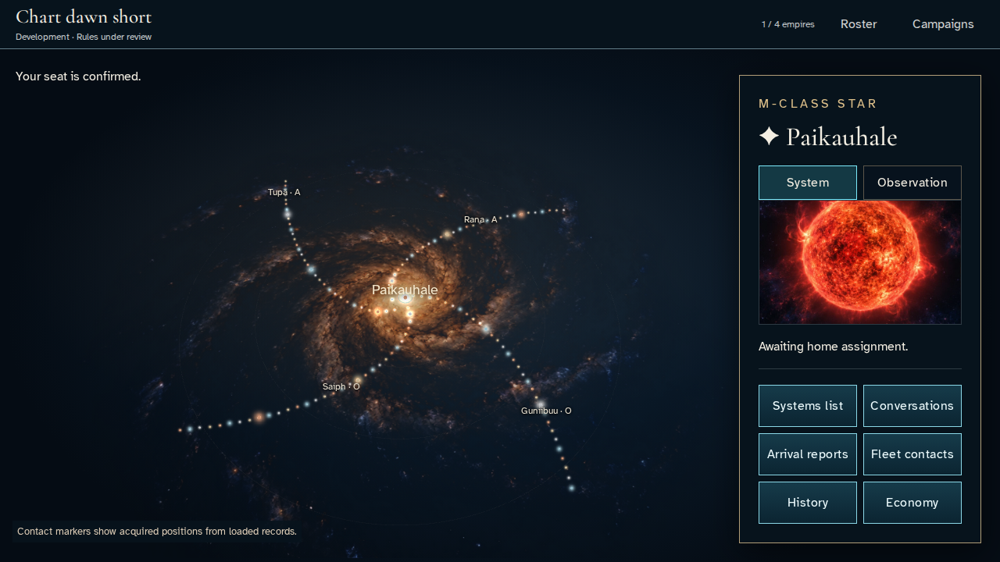
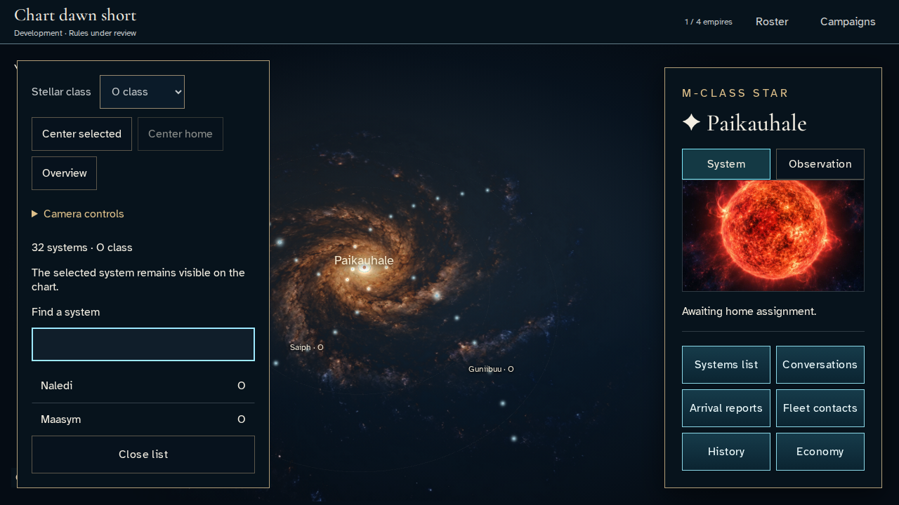
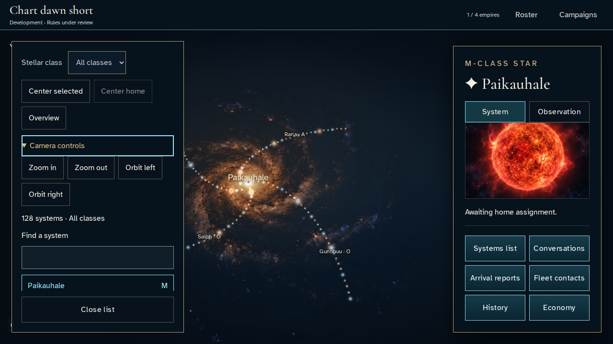
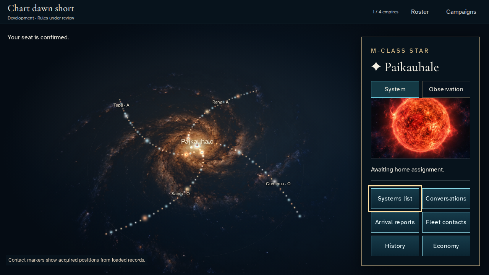
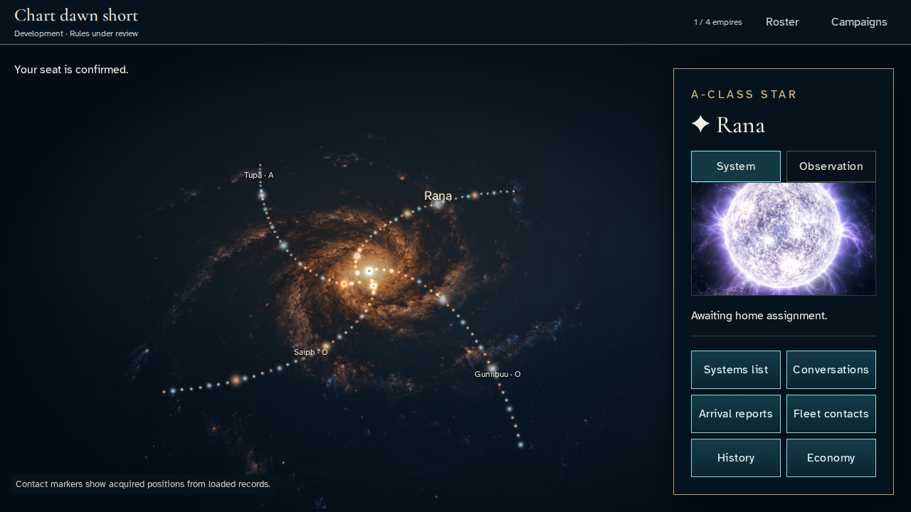
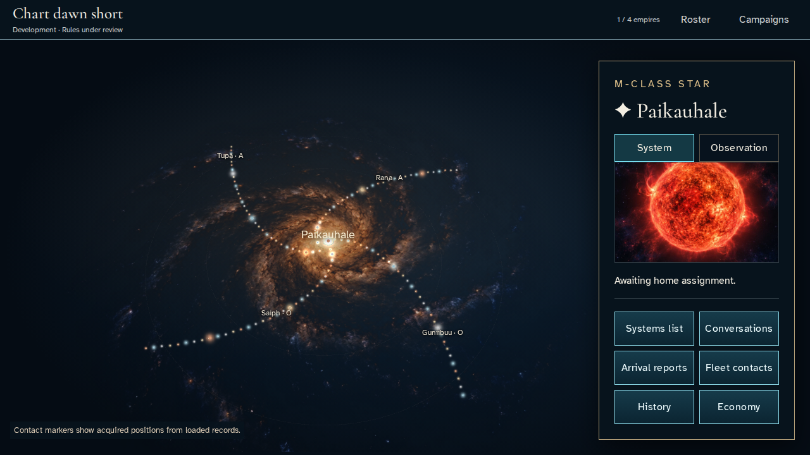

# Navigate the authoritative star catalogue with keyboard and pointer

**Exact comparison passed.** short · linux-arm64. Inventory: UX-03, UX-04, UX-15, UX-16.

A real waiting member filters the authoritative catalogue, uses keyboard camera controls, selects a named star and tests map-label clipping at the inspector boundary. No home exists before scheduled start. Fixed catalogue entropy makes the scene repeatable without invented star data or gameplay actions.

## 1. Create and join a waiting development campaign through ordinary sign-in/create/join controls. Grant emulator developer access and use the test loader’s fixed catalogue entropy. No scheduler or production clock is advanced.

Actor: **Test harness**. **Harness control; not a player action.**

Acknowledged outcome: Explicit test control; not a player action or hosted-service certification.

## 2. Inspect the waiting galaxy before a home has been assigned.

Actor: **Star envoy**.

Acknowledged outcome: The real canvas and selected system are visible.

- [x] The map fills the viewport under a slim campaign rail.

### Viewpoint: Star envoy

## 3. Open Systems list and filter the authoritative catalogue to O-class stars.

Actor: **Star envoy**.

Acknowledged outcome: Exactly 32 catalogued O-class systems match.

- [x] No home-centering action is available before home assignment.
- [x] The opaque list and bounded scroll region stay below the campaign rail.

### Viewpoint: Star envoy

## 4. Restore all stellar classes and expand Camera controls using the keyboard.

Actor: **Star envoy**.

Acknowledged outcome: Orbit left is available in the expanded controls.

- [x] Close list remains inside the viewport.

### Viewpoint: Star envoy

## 5. Activate Orbit left with Enter and observe the actual camera moving the selected star label.

Actor: **Star envoy**.

Acknowledged outcome: The list closes, focus returns and the map label moves.

- [x] The acknowledged navigation causes no uncaught application errors.

### Viewpoint: Star envoy

## 6. Reopen the list with Enter and restore the galaxy overview.

Actor: **Star envoy**.

Acknowledged outcome: The overview returns focus to Systems list.

- [x] The acknowledged navigation causes no uncaught application errors.

### Viewpoint: Star envoy

## 7. Select the named visible catalogue entry Rana and inspect its system details.

Actor: **Star envoy**.

Acknowledged outcome: The inspector identifies the selected authoritative star.

- [x] The inspector is opaque and map HTML labels are clipped to the chart viewport.

### Viewpoint: Star envoy

## 8. Reload the same campaign after navigation without fabricating a home or changing membership.

Actor: **Star envoy**.

Acknowledged outcome: The authoritative galaxy canvas recovers.

- [x] Navigation and reload caused no uncaught page errors.

### Viewpoint: Star envoy

