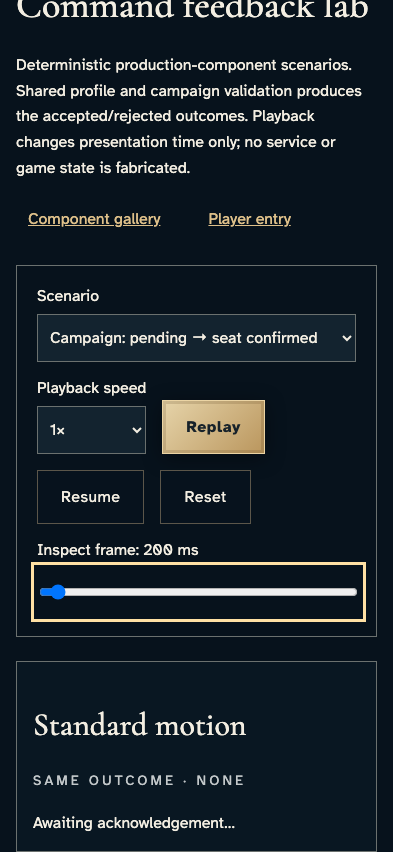
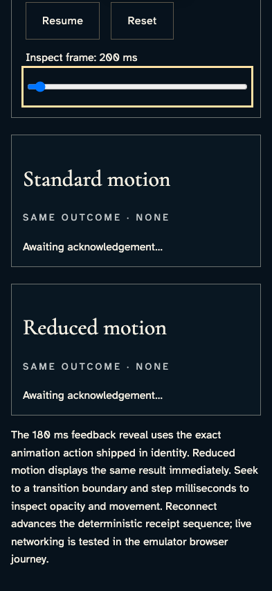
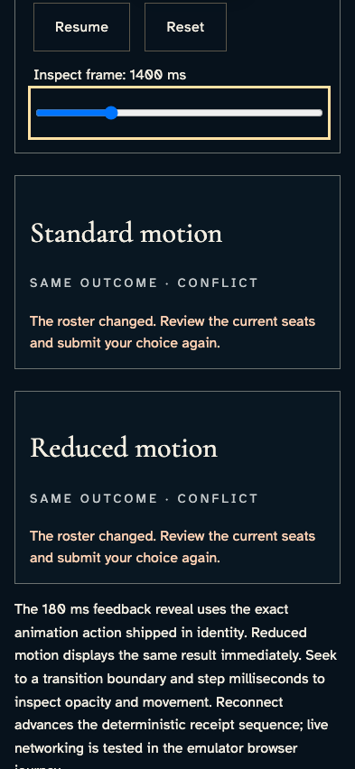
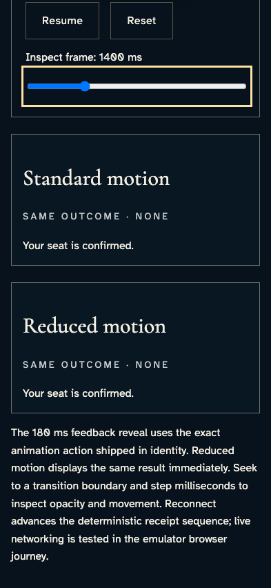
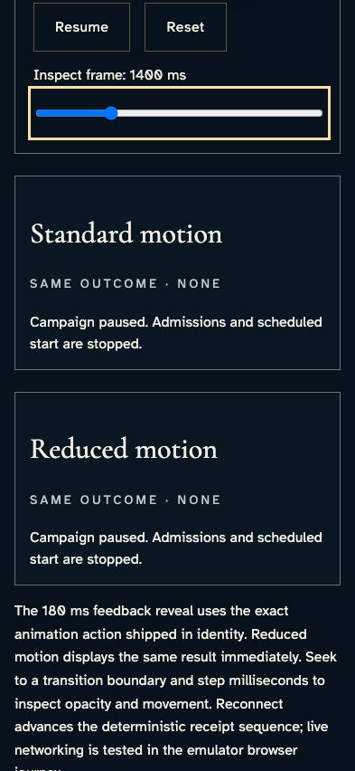
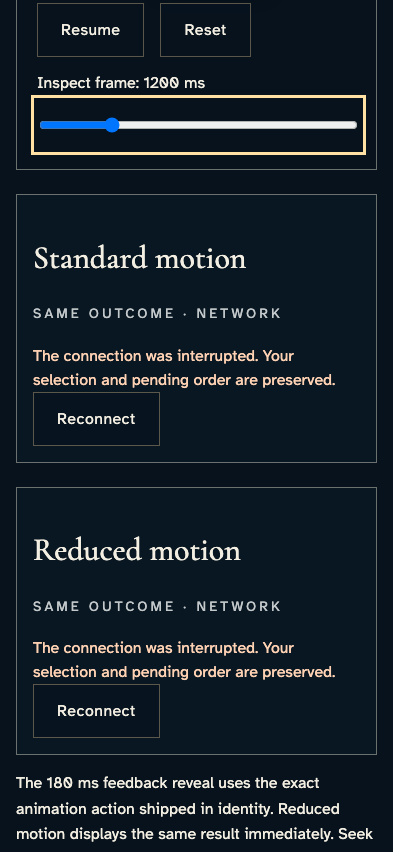
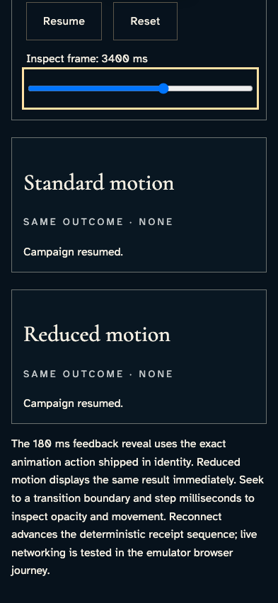
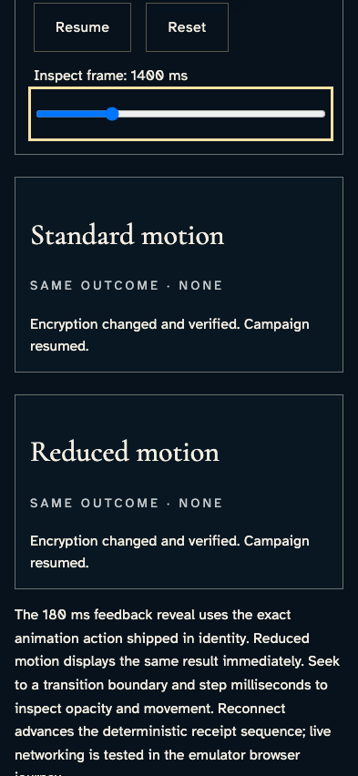

# Compare campaign receipt presentation in the production lab

**Exact comparison passed.** phone · darwin-arm64. Inventory: UX-02, UX-14, UX-16.

A developer reviews deterministic campaign feedback produced by the shipped validation, receipt-copy and animation code. These component scenarios exercise presentation parity, not live campaign commands, authorization or migration workers. Each paused animation is declared explicitly; all images retain exact comparison.

## 1. Select campaign-joined and inspect the acknowledged pending presentation in both motion modes.

Actor: **Developer**.

Acknowledged outcome: The selected component scenario reports “Awaiting acknowledgement”.

- [x] Reduced motion retains identical outcome text and the selected scenario remains explicit.

### Viewpoint: Developer · standard campaign motion

- [x] The labeled comparison and its full receipt are visible in the reference page.
- [x] Explicit paused motion: [aria-label="Standard motion comparison"], 1 animation(s), 180/180 ms; unchanged exact comparison.
- [x] Explicit paused motion: [aria-label="Reduced motion comparison"], 1 animation(s), 180/180 ms; unchanged exact comparison.

### Viewpoint: Developer · reduced campaign motion

- [x] The labeled comparison and its full receipt are visible in the reference page.
- [x] Explicit paused motion: [aria-label="Standard motion comparison"], 1 animation(s), 180/180 ms; unchanged exact comparison.
- [x] Explicit paused motion: [aria-label="Reduced motion comparison"], 1 animation(s), 180/180 ms; unchanged exact comparison.

## 2. Select campaign-conflict and inspect the acknowledged stale-roster presentation in both motion modes.

Actor: **Developer**.

Acknowledged outcome: The selected component scenario reports “roster changed”.

- [x] Reduced motion retains identical outcome text and the selected scenario remains explicit.

### Viewpoint: Developer · standard campaign motion

- [x] The labeled comparison and its full receipt are visible in the reference page.
- [x] Explicit paused motion: [aria-label="Standard motion comparison"], 1 animation(s), 180/180 ms; unchanged exact comparison.
- [x] Explicit paused motion: [aria-label="Reduced motion comparison"], 1 animation(s), 180/180 ms; unchanged exact comparison.

### Viewpoint: Developer · reduced campaign motion

- [x] The labeled comparison and its full receipt are visible in the reference page.
- [x] Explicit paused motion: [aria-label="Standard motion comparison"], 1 animation(s), 180/180 ms; unchanged exact comparison.
- [x] Explicit paused motion: [aria-label="Reduced motion comparison"], 1 animation(s), 180/180 ms; unchanged exact comparison.

## 3. Select campaign-joined and inspect the acknowledged seat-confirmed presentation in both motion modes.

Actor: **Developer**.

Acknowledged outcome: The selected component scenario reports “seat is confirmed”.

- [x] Reduced motion retains identical outcome text and the selected scenario remains explicit.

### Viewpoint: Developer · standard campaign motion

- [x] The labeled comparison and its full receipt are visible in the reference page.
- [x] Explicit paused motion: [aria-label="Standard motion comparison"], 1 animation(s), 180/180 ms; unchanged exact comparison.
- [x] Explicit paused motion: [aria-label="Reduced motion comparison"], 1 animation(s), 180/180 ms; unchanged exact comparison.

### Viewpoint: Developer · reduced campaign motion

- [x] The labeled comparison and its full receipt are visible in the reference page.
- [x] Explicit paused motion: [aria-label="Standard motion comparison"], 1 animation(s), 180/180 ms; unchanged exact comparison.
- [x] Explicit paused motion: [aria-label="Reduced motion comparison"], 1 animation(s), 180/180 ms; unchanged exact comparison.

## 4. Select campaign-paused and inspect the acknowledged paused presentation in both motion modes.

Actor: **Developer**.

Acknowledged outcome: The selected component scenario reports “Campaign paused”.

- [x] Reduced motion retains identical outcome text and the selected scenario remains explicit.

### Viewpoint: Developer · standard campaign motion

- [x] The labeled comparison and its full receipt are visible in the reference page.
- [x] Explicit paused motion: [aria-label="Standard motion comparison"], 1 animation(s), 180/180 ms; unchanged exact comparison.
- [x] Explicit paused motion: [aria-label="Reduced motion comparison"], 1 animation(s), 180/180 ms; unchanged exact comparison.

### Viewpoint: Developer · reduced campaign motion

- [x] The labeled comparison and its full receipt are visible in the reference page.
- [x] Explicit paused motion: [aria-label="Standard motion comparison"], 1 animation(s), 180/180 ms; unchanged exact comparison.
- [x] Explicit paused motion: [aria-label="Reduced motion comparison"], 1 animation(s), 180/180 ms; unchanged exact comparison.

## 5. Select campaign-resumed and inspect the acknowledged resume-interrupted presentation in both motion modes.

Actor: **Developer**.

Acknowledged outcome: The selected component scenario reports “connection was interrupted”.

- [x] Reduced motion retains identical outcome text and the selected scenario remains explicit.

### Viewpoint: Developer · standard campaign motion

- [x] The labeled comparison and its full receipt are visible in the reference page.
- [x] Explicit paused motion: [aria-label="Standard motion comparison"], 1 animation(s), 180/180 ms; unchanged exact comparison.
- [x] Explicit paused motion: [aria-label="Reduced motion comparison"], 1 animation(s), 180/180 ms; unchanged exact comparison.

### Viewpoint: Developer · reduced campaign motion

- [x] The labeled comparison and its full receipt are visible in the reference page.
- [x] Explicit paused motion: [aria-label="Standard motion comparison"], 1 animation(s), 180/180 ms; unchanged exact comparison.
- [x] Explicit paused motion: [aria-label="Reduced motion comparison"], 1 animation(s), 180/180 ms; unchanged exact comparison.

## 6. Select campaign-resumed and inspect the acknowledged resumed presentation in both motion modes.

Actor: **Developer**.

Acknowledged outcome: The selected component scenario reports “Campaign resumed”.

- [x] Reduced motion retains identical outcome text and the selected scenario remains explicit.

### Viewpoint: Developer · standard campaign motion

- [x] The labeled comparison and its full receipt are visible in the reference page.
- [x] Explicit paused motion: [aria-label="Standard motion comparison"], 1 animation(s), 180/180 ms; unchanged exact comparison.
- [x] Explicit paused motion: [aria-label="Reduced motion comparison"], 1 animation(s), 180/180 ms; unchanged exact comparison.

### Viewpoint: Developer · reduced campaign motion

- [x] The labeled comparison and its full receipt are visible in the reference page.
- [x] Explicit paused motion: [aria-label="Standard motion comparison"], 1 animation(s), 180/180 ms; unchanged exact comparison.
- [x] Explicit paused motion: [aria-label="Reduced motion comparison"], 1 animation(s), 180/180 ms; unchanged exact comparison.

## 7. Select campaign-migrated and inspect the acknowledged migration-verified presentation in both motion modes.

Actor: **Developer**.

Acknowledged outcome: The selected component scenario reports “Encryption changed and verified”.

- [x] Reduced motion retains identical outcome text and the selected scenario remains explicit.

### Viewpoint: Developer · standard campaign motion

- [x] The labeled comparison and its full receipt are visible in the reference page.
- [x] Explicit paused motion: [aria-label="Standard motion comparison"], 1 animation(s), 180/180 ms; unchanged exact comparison.
- [x] Explicit paused motion: [aria-label="Reduced motion comparison"], 1 animation(s), 180/180 ms; unchanged exact comparison.

### Viewpoint: Developer · reduced campaign motion

- [x] The labeled comparison and its full receipt are visible in the reference page.
- [x] Explicit paused motion: [aria-label="Standard motion comparison"], 1 animation(s), 180/180 ms; unchanged exact comparison.
- [x] Explicit paused motion: [aria-label="Reduced motion comparison"], 1 animation(s), 180/180 ms; unchanged exact comparison.

