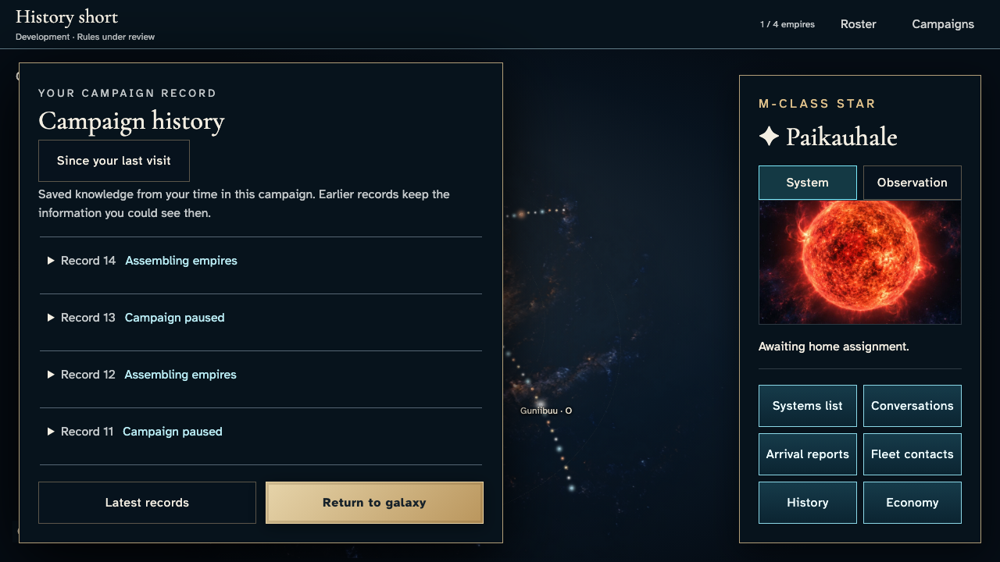
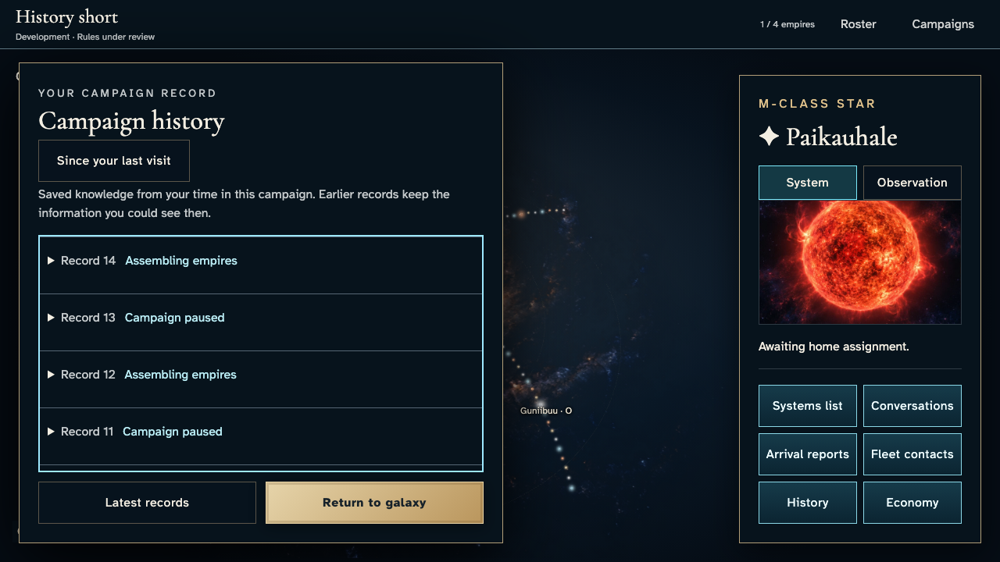
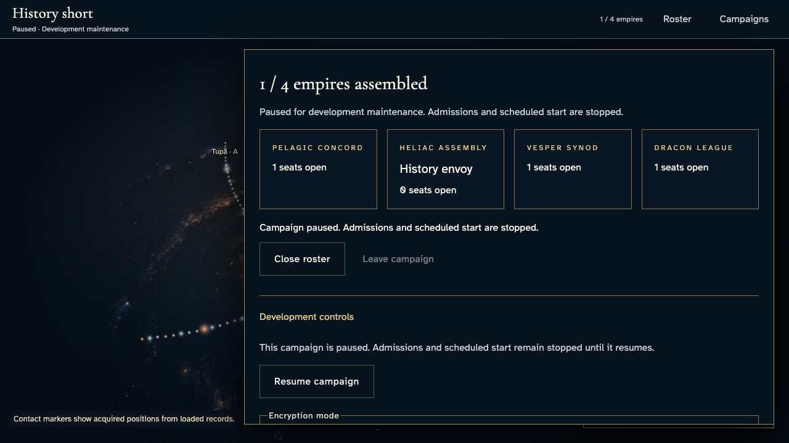
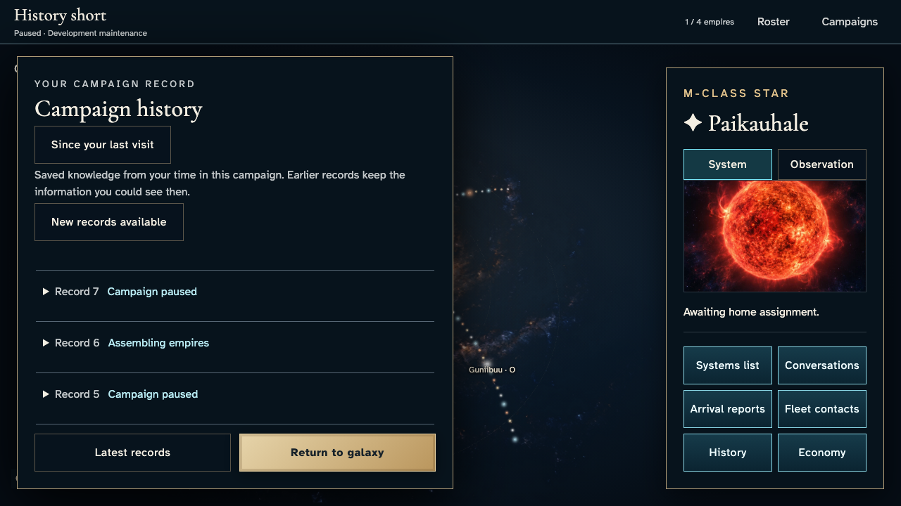
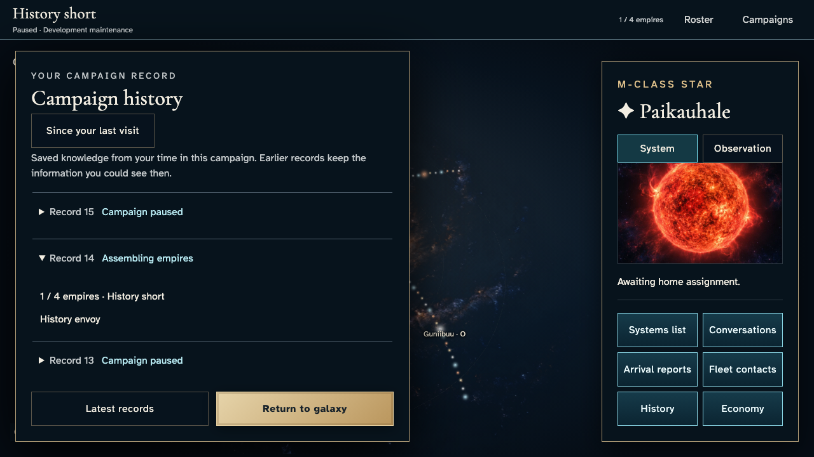
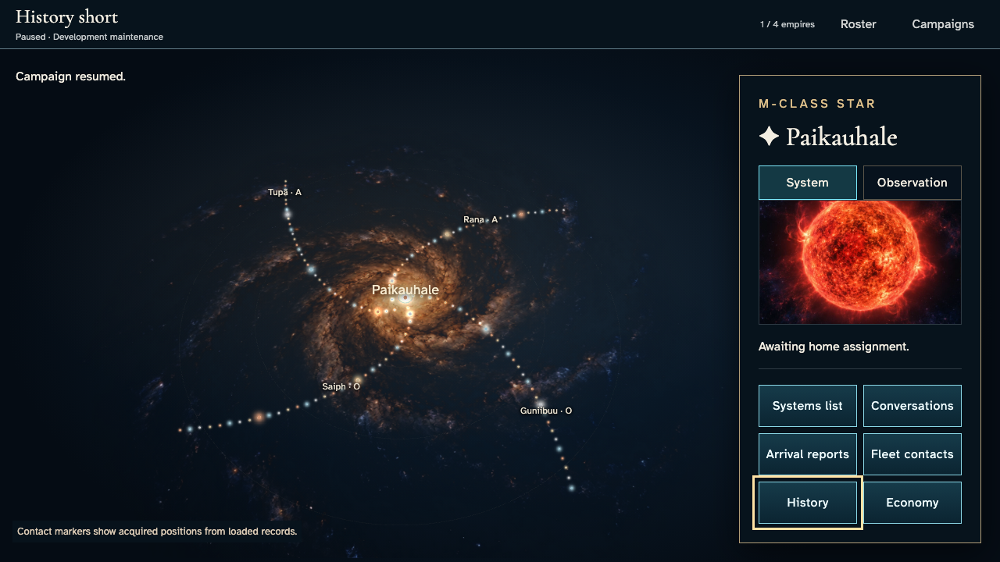
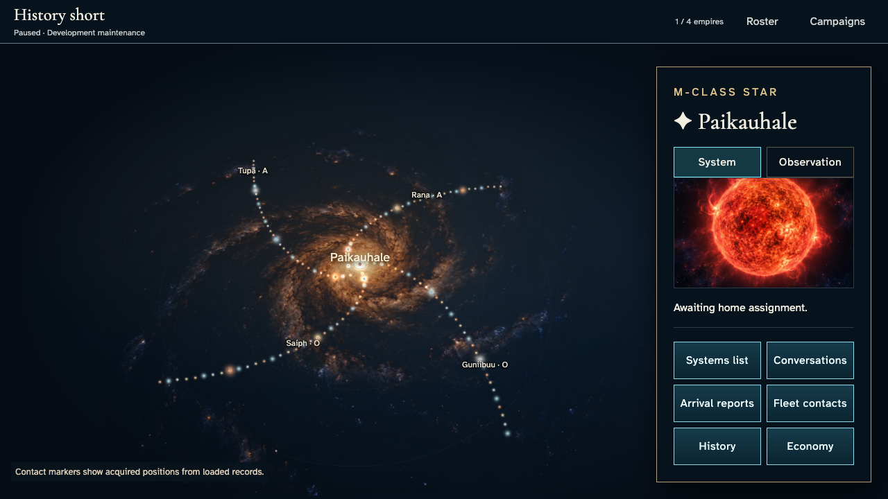

# Recover saved campaign records without losing your place

**Exact comparison passed.** short · darwin-arm64. Inventory: UX-12, UX-14, UX-16.

History envoy returns to a waiting development campaign, reads beyond the first page, receives another device’s changes without forced scrolling, explicitly recovers latest records, and restores the same selected system. Setup uses real UI and services with a test-only fixed catalogue input; keys, commands and persistence remain real.

## 1. Prepare a fixed-catalogue waiting campaign through ordinary sign-in/create/join UI, then twelve acknowledged host pause/resume actions. These establish existing history, not a claim of illustrated admission or hosted scheduling.

Actor: **Test harness**. **Harness control; not a player action.**

Acknowledged outcome: Explicit test control; not a player action or hosted-service certification.

## 2. Open ten saved records with the return control visible.

Actor: **History envoy**.

Acknowledged outcome: Ten authorized records finish loading.

- [x] The history dialog offers briefing and an always-visible return control.

### Viewpoint: History envoy — reading device

## 3. Traverse the briefing, return control and bounded records with the keyboard.

Actor: **History envoy**.

Acknowledged outcome: Focus returns to the bounded records after both modal wrap directions.

- [x] The return rail is still visible before any scrolling.

### Viewpoint: History envoy — reading device

## 4. Expand record 14 to read the saved roster.

Actor: **History envoy**.

Acknowledged outcome: The selected record reveals the saved commander.

- [x] Expanding a record preserves all ten loaded revisions.

### Viewpoint: History envoy — reading device

## 5. Load earlier records beyond the ten-record page boundary.

Actor: **History envoy**.

Acknowledged outcome: Thirteen member-accessible records are available.

- [x] The beginning of authorized history is reached.

### Viewpoint: History envoy — reading device

## 6. Open the same commander’s second authenticated device through its campaign URL; no account or game state is injected.

Actor: **Test harness**. **Harness control; not a player action.**

Acknowledged outcome: Explicit test control; not a player action or hosted-service certification.

## 7. Pause the campaign on another device while preserving the reading device’s place.

Actor: **History envoy — second device**.

Acknowledged outcome: The host command is acknowledged as paused.

- [x] The reading device signals new records without replacing its thirteen records or scrolling.

### Viewpoint: History envoy — second device

### Viewpoint: History envoy — reading device

## 8. Choose latest records and recover acknowledged revision 15.

Actor: **History envoy — reading device**.

Acknowledged outcome: Record 15 is present from persisted campaign history.

- [x] The current history page contains ten records.

### Viewpoint: History envoy — reading device

## 9. Close history with Escape and return to the same selected system.

Actor: **History envoy**.

Acknowledged outcome: The opening History control receives focus.

- [x] System selection survives reading history.

### Viewpoint: History envoy

## 10. Reload and recover the same saved latest record.

Actor: **History envoy**.

Acknowledged outcome: Persisted record 15 is recovered after reload.

- [x] Return to galaxy remains usable.

### Viewpoint: History envoy — reading device

## 11. Use Return to galaxy to finish reading after reload.

Actor: **History envoy**.

Acknowledged outcome: The history dialog closes and returns focus to its opening control.

- [x] The selected system still matches the previous visit.

### Viewpoint: History envoy

