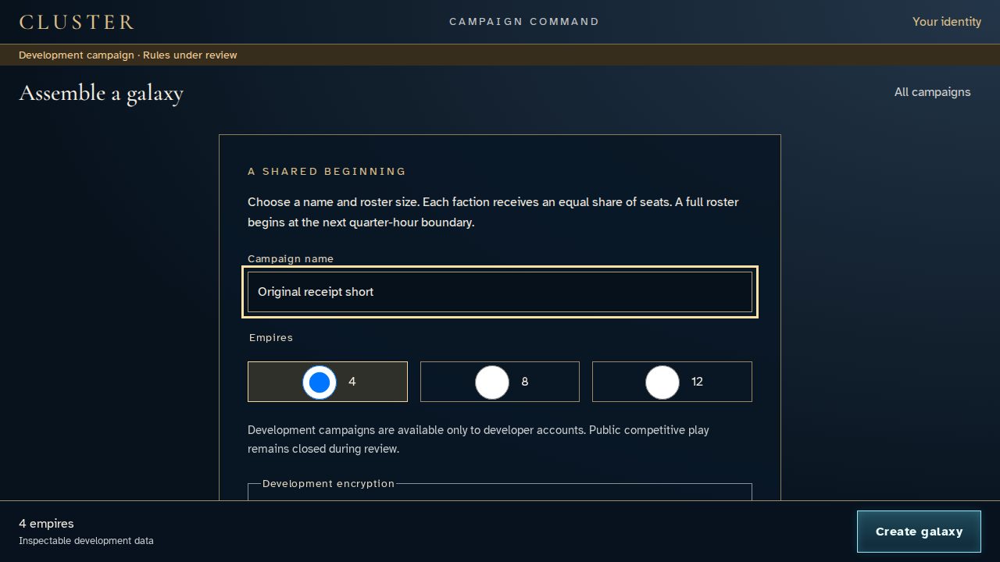
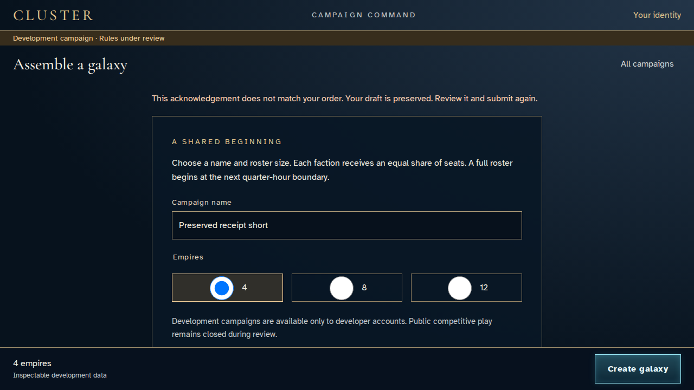
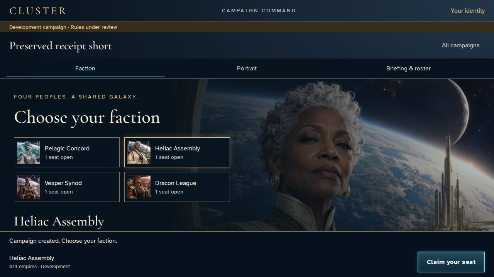
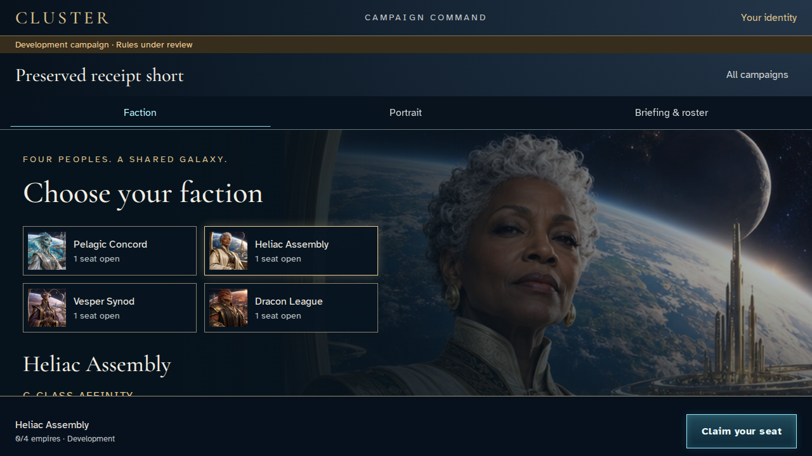

# Recover a galaxy proposal after a mismatched acknowledgement

**Exact comparison passed.** short · linux-arm64. Inventory: UX-02, UX-14, UX-16.

A developer creates one real waiting galaxy, then deliberately reuses its command UUID for a different proposal. The original remains unchanged, the proposal is retained and a fresh acknowledged command creates a distinct campaign. The fixed-catalogue harness supplies map entropy only; rules remain under review.

## 1. Prepare a saved identity and developer access through ordinary sign-in/save UI and explicit emulator authorization. The test loader fixes catalogue entropy. Reuse one command UUID only after identity setup; actual encryption, service authorization and persistence remain active.

Actor: **Test harness**. **Harness control; not a player action.**

Acknowledged outcome: Explicit test control; not a player action or hosted-service certification.

## 2. Name the first development galaxy before committing.

Actor: **Receipt envoy**.

Acknowledged outcome: The first proposal is ready for creation.

- [x] The proposed name is retained.

### Viewpoint: Receipt envoy

## 3. Create the original galaxy and reach its faction selection.

Actor: **Receipt envoy**.

Acknowledged outcome: The original galaxy is acknowledged by name.

- [x] The acknowledged campaign Original receipt short retains its recorded name and revision one.
- [x] No completed or mismatched order remains in durable recovery storage.

### Viewpoint: Receipt envoy

## 4. Return to campaigns and prepare a differently named galaxy.

Actor: **Receipt envoy**.

Acknowledged outcome: The replacement proposal is ready without changing the original.

- [x] The acknowledged campaign Original receipt short retains its recorded name and revision one.
- [x] The uncommitted proposal does not claim an already-created campaign.

### Viewpoint: Receipt envoy

## 5. The reused command ID cannot acknowledge this different galaxy. Preserve its name for a fresh creation.

Actor: **Receipt envoy**.

Acknowledged outcome: The mismatched-order alert is visible and focused.

- [x] The acknowledged campaign Original receipt short retains its recorded name and revision one.
- [x] No completed or mismatched order remains in durable recovery storage.
- [x] The proposal remains intact and can be committed as a fresh command.

### Viewpoint: Receipt envoy

## 6. Restore ordinary random command UUIDs without changing the proposal or either receipt.

Actor: **Test harness**. **Harness control; not a player action.**

Acknowledged outcome: Explicit test control; not a player action or hosted-service certification.

## 7. Commit the retained proposal with a fresh command ID and open the distinct acknowledged galaxy.

Actor: **Receipt envoy**.

Acknowledged outcome: The new galaxy is acknowledged by its retained name.

- [x] The acknowledged campaign Original receipt short retains its recorded name and revision one.
- [x] The acknowledged campaign Preserved receipt short retains its recorded name and revision one.
- [x] No completed or mismatched order remains in durable recovery storage.
- [x] The new galaxy has a distinct authoritative identity.

### Viewpoint: Receipt envoy

## 8. Reload the exact newly created campaign without selecting another directory match.

Actor: **Receipt envoy**.

Acknowledged outcome: The exact acknowledged galaxy recovers after reload.

- [x] The acknowledged campaign Preserved receipt short retains its recorded name and revision one.
- [x] No completed or mismatched order remains in durable recovery storage.

### Viewpoint: Receipt envoy

