# Admit independent commanders, assign homes and resume a chosen campaign

**Exact comparison passed.** phone · darwin-arm64. Inventory: UX-01, UX-02, UX-03, UX-14, UX-16.

Five independent saved commanders join two real campaigns through ordinary controls. Explicit test-only domain/browser clocks expose scheduled and overdue states before the real scheduler endpoint assigns distinct homes. Single and multiple memberships then recover the named last campaign through Continue. No roster, home, balance or receipt is injected; accelerated evidence does not certify hosted cadence.

## 1. Create five independent authenticated contexts and saved identities through ordinary UI; grant emulator development access. The loader fixes only the designated campaign catalogue/domain time; browser Date follows 12:01 UTC without stopping timers or fabricating responses.

Actor: **Test harness**. **Harness control; not a player action.**

Acknowledged outcome: Explicit test control; not a player action or hosted-service certification.

## 2. Propose Scheduled story dawn phone with four empires.

Actor: **Dawn envoy 1**.

Acknowledged outcome: The four-empire proposal is ready to commit.

- [x] No commander has an uncaught application error.

### Viewpoint: Dawn envoy 1

## 3. Create the real waiting galaxy before choosing a faction.

Actor: **Dawn envoy 1**.

Acknowledged outcome: Creation is acknowledged with faction selection.

- [x] No commander has an uncaught application error.

### Viewpoint: Dawn envoy 1

## 4. Review the available Heliac Assembly seat in Scheduled story dawn phone.

Actor: **Dawn envoy 1**.

Acknowledged outcome: The named faction is selected and commitment is available.

- [x] No commander has an uncaught application error.

### Viewpoint: Dawn envoy 1

## 5. Claim the reviewed seat and inspect the authoritative roster acknowledgement.

Actor: **Dawn envoy 1**.

Acknowledged outcome: The joining commander and host observe the acknowledged roster count.

- [x] No commander has an uncaught application error.

### Viewpoint: Dawn envoy 1

[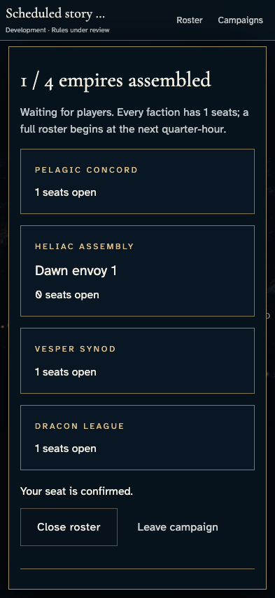](../../../../../../tests/browser/story-baselines/campaign-scheduled-start/phone/darwin-arm64/005-join-1-1-1-dawn-envoy-1.png)

## 6. Review the available Pelagic Concord seat in Scheduled story dawn phone.

Actor: **Dawn envoy 2**.

Acknowledged outcome: The named faction is selected and commitment is available.

- [x] No commander has an uncaught application error.

### Viewpoint: Dawn envoy 2

[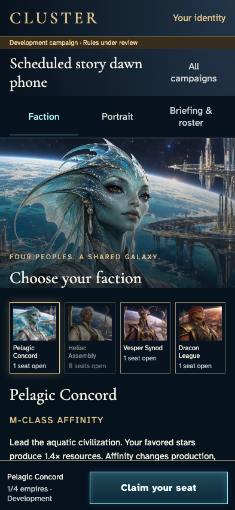](../../../../../../tests/browser/story-baselines/campaign-scheduled-start/phone/darwin-arm64/006-choose-1-2-1-dawn-envoy-2.png)

## 7. Claim the reviewed seat and inspect the authoritative roster acknowledgement.

Actor: **Dawn envoy 2**.

Acknowledged outcome: The joining commander and host observe the acknowledged roster count.

- [x] No commander has an uncaught application error.

### Viewpoint: Dawn envoy 2

### Viewpoint: Dawn envoy 1

## 8. Review the available Vesper Synod seat in Scheduled story dawn phone.

Actor: **Dawn envoy 3**.

Acknowledged outcome: The named faction is selected and commitment is available.

- [x] No commander has an uncaught application error.

### Viewpoint: Dawn envoy 3

[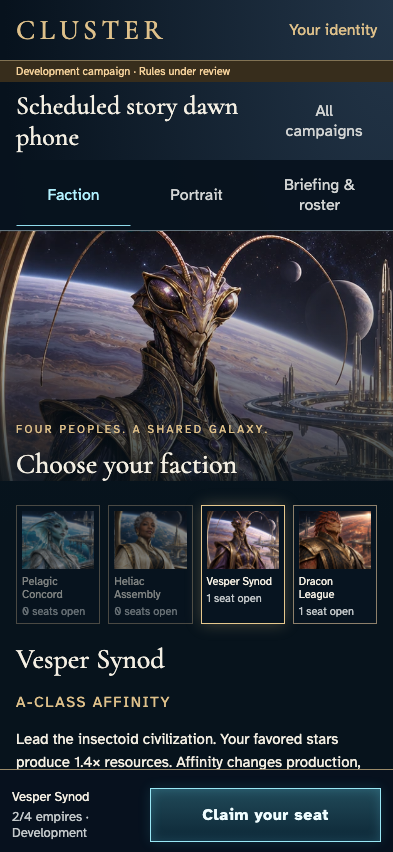](../../../../../../tests/browser/story-baselines/campaign-scheduled-start/phone/darwin-arm64/008-choose-1-3-1-dawn-envoy-3.png)

## 9. Claim the reviewed seat and inspect the authoritative roster acknowledgement.

Actor: **Dawn envoy 3**.

Acknowledged outcome: The joining commander and host observe the acknowledged roster count.

- [x] No commander has an uncaught application error.

### Viewpoint: Dawn envoy 3

### Viewpoint: Dawn envoy 1

## 10. Review the available Dracon League seat in Scheduled story dawn phone.

Actor: **Dawn envoy 4**.

Acknowledged outcome: The named faction is selected and commitment is available.

- [x] No commander has an uncaught application error.

### Viewpoint: Dawn envoy 4

## 11. Claim the reviewed seat and inspect the authoritative roster acknowledgement.

Actor: **Dawn envoy 4**.

Acknowledged outcome: The joining commander and host observe the acknowledged roster count.

- [x] No commander has an uncaught application error.

### Viewpoint: Dawn envoy 4

### Viewpoint: Dawn envoy 1

## 12. Propose Scheduled story dusk phone with four empires.

Actor: **Dawn envoy 1**.

Acknowledged outcome: The four-empire proposal is ready to commit.

- [x] No commander has an uncaught application error.

### Viewpoint: Dawn envoy 1

[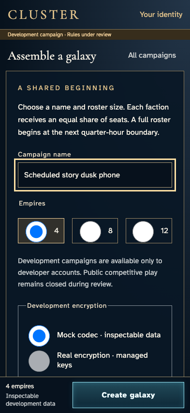](../../../../../../tests/browser/story-baselines/campaign-scheduled-start/phone/darwin-arm64/012-propose-2-1-dawn-envoy-1.png)

## 13. Create the real waiting galaxy before choosing a faction.

Actor: **Dawn envoy 1**.

Acknowledged outcome: Creation is acknowledged with faction selection.

- [x] No commander has an uncaught application error.

### Viewpoint: Dawn envoy 1

[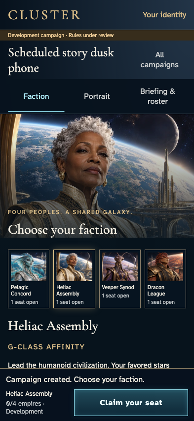](../../../../../../tests/browser/story-baselines/campaign-scheduled-start/phone/darwin-arm64/013-create-2-1-dawn-envoy-1.png)

## 14. Review the available Heliac Assembly seat in Scheduled story dusk phone.

Actor: **Dawn envoy 1**.

Acknowledged outcome: The named faction is selected and commitment is available.

- [x] No commander has an uncaught application error.

### Viewpoint: Dawn envoy 1

## 15. Claim the reviewed seat and inspect the authoritative roster acknowledgement.

Actor: **Dawn envoy 1**.

Acknowledged outcome: The joining commander and host observe the acknowledged roster count.

- [x] No commander has an uncaught application error.

### Viewpoint: Dawn envoy 1

## 16. Review the available Pelagic Concord seat in Scheduled story dusk phone.

Actor: **Dawn envoy 2**.

Acknowledged outcome: The named faction is selected and commitment is available.

- [x] No commander has an uncaught application error.

### Viewpoint: Dawn envoy 2

[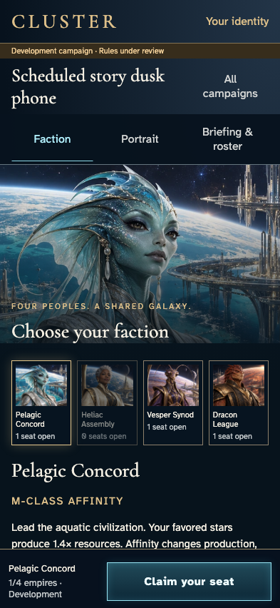](../../../../../../tests/browser/story-baselines/campaign-scheduled-start/phone/darwin-arm64/016-choose-2-2-1-dawn-envoy-2.png)

## 17. Claim the reviewed seat and inspect the authoritative roster acknowledgement.

Actor: **Dawn envoy 2**.

Acknowledged outcome: The joining commander and host observe the acknowledged roster count.

- [x] No commander has an uncaught application error.

### Viewpoint: Dawn envoy 2

### Viewpoint: Dawn envoy 1

[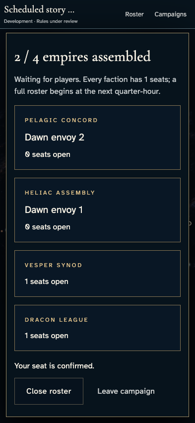](../../../../../../tests/browser/story-baselines/campaign-scheduled-start/phone/darwin-arm64/017-join-2-2-2-dawn-envoy-1.png)

## 18. Review the available Vesper Synod seat in Scheduled story dusk phone.

Actor: **Dawn envoy 3**.

Acknowledged outcome: The named faction is selected and commitment is available.

- [x] No commander has an uncaught application error.

### Viewpoint: Dawn envoy 3

## 19. Claim the reviewed seat and inspect the authoritative roster acknowledgement.

Actor: **Dawn envoy 3**.

Acknowledged outcome: The joining commander and host observe the acknowledged roster count.

- [x] No commander has an uncaught application error.

### Viewpoint: Dawn envoy 3

### Viewpoint: Dawn envoy 1

[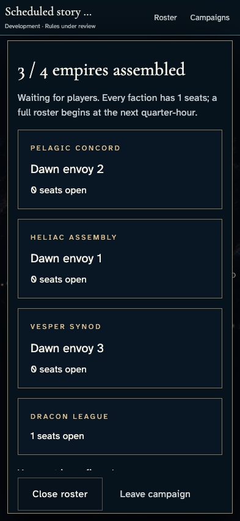](../../../../../../tests/browser/story-baselines/campaign-scheduled-start/phone/darwin-arm64/019-join-2-3-2-dawn-envoy-1.png)

## 20. Review the available Dracon League seat in Scheduled story dusk phone.

Actor: **Dawn envoy 5**.

Acknowledged outcome: The named faction is selected and commitment is available.

- [x] No commander has an uncaught application error.

### Viewpoint: Dawn envoy 5

[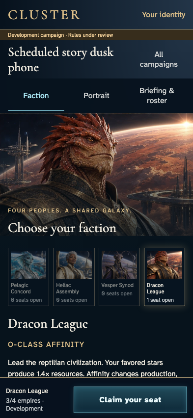](../../../../../../tests/browser/story-baselines/campaign-scheduled-start/phone/darwin-arm64/020-choose-2-4-1-dawn-envoy-5.png)

## 21. Claim the reviewed seat and inspect the authoritative roster acknowledgement.

Actor: **Dawn envoy 5**.

Acknowledged outcome: The joining commander and host observe the acknowledged roster count.

- [x] No commander has an uncaught application error.

### Viewpoint: Dawn envoy 5

### Viewpoint: Dawn envoy 1

## 22. Review the full rosters and the same recorded quarter-hour start from each independent account.

Actor: **All five commanders**.

Acknowledged outcome: All five views show four seats and the recorded start schedule.

- [x] No commander has an uncaught application error.
- [x] Both authoritative heads are scheduled at the derived quarter-hour, without assigned homes.

### Viewpoint: Dawn envoy 1

[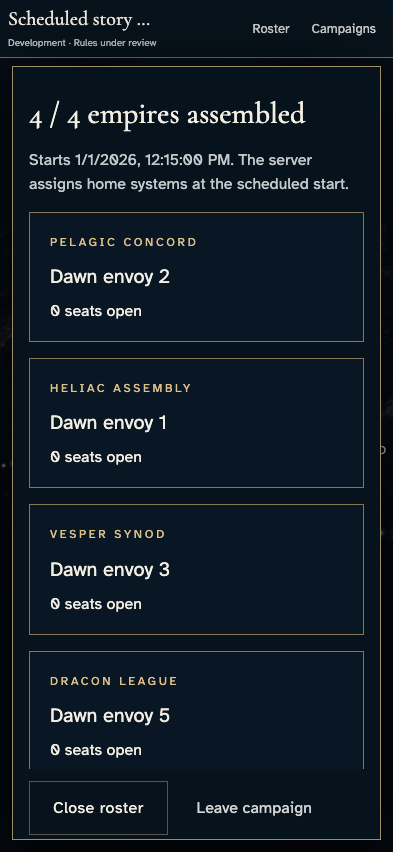](../../../../../../tests/browser/story-baselines/campaign-scheduled-start/phone/darwin-arm64/022-scheduled-rosters-1-dawn-envoy-1.png)

### Viewpoint: Dawn envoy 2

### Viewpoint: Dawn envoy 3

### Viewpoint: Dawn envoy 4

### Viewpoint: Dawn envoy 5

## 23. Advance only browser Date to the recorded start while withholding scheduler delivery. Real service state remains scheduled; no home or clock result is written to persistence.

Actor: **Test harness**. **Harness control; not a player action.**

Acknowledged outcome: Explicit test control; not a player action or hosted-service certification.

## 24. Keep the saved seats visible while the scheduled boundary has passed and home assignment is still outstanding.

Actor: **All five commanders**.

Acknowledged outcome: Every account sees awaiting-home guidance instead of an invented started state.

- [x] No commander has an uncaught application error.

### Viewpoint: Dawn envoy 1

### Viewpoint: Dawn envoy 2

### Viewpoint: Dawn envoy 3

[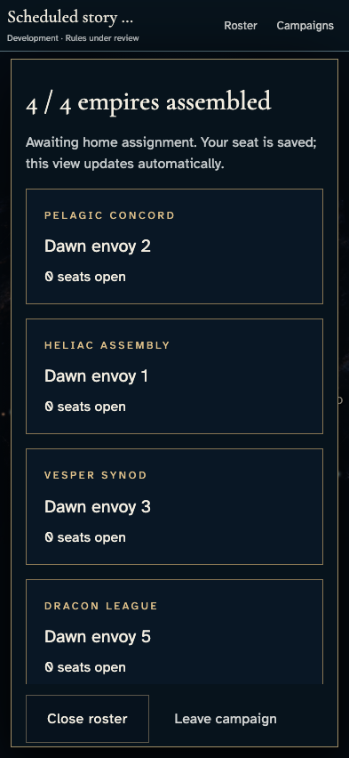](../../../../../../tests/browser/story-baselines/campaign-scheduled-start/phone/darwin-arm64/024-awaiting-assignment-3-dawn-envoy-3.png)

### Viewpoint: Dawn envoy 4

[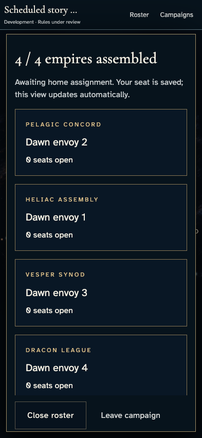](../../../../../../tests/browser/story-baselines/campaign-scheduled-start/phone/darwin-arm64/024-awaiting-assignment-4-dawn-envoy-4.png)

### Viewpoint: Dawn envoy 5

## 25. Deliver the actual startScheduledCampaigns emulator HTTP endpoint. Its real transaction/reducer assigns homes and publishes authorized views; only designated domain time inputs are fixed. This does not certify hosted Scheduler delivery or real elapsed cadence.

Actor: **Test harness**. **Harness control; not a player action.**

Acknowledged outcome: Explicit test control; not a player action or hosted-service certification.

## 26. Read the authoritative begun schedule in each visible roster after scheduler delivery.

Actor: **All five commanders**.

Acknowledged outcome: Every independent roster visibly acknowledges that its campaign began.

- [x] No commander has an uncaught application error.

### Viewpoint: Dawn envoy 1

- [x] The active chart acknowledges that authorized contact records finished loading.

### Viewpoint: Dawn envoy 2

- [x] The active chart acknowledges that authorized contact records finished loading.

[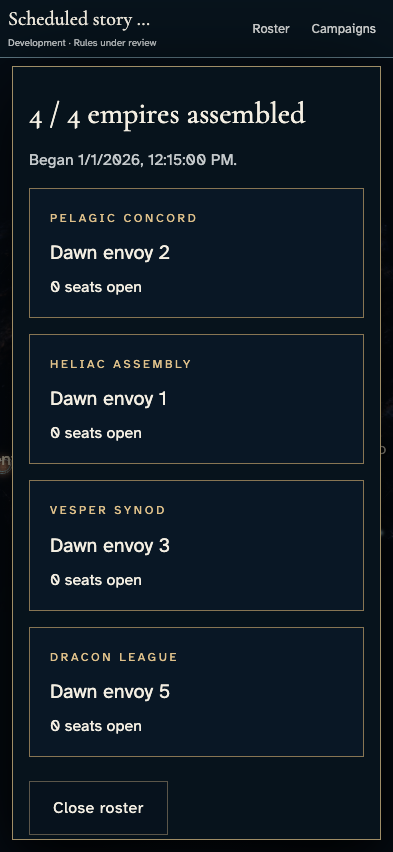](../../../../../../tests/browser/story-baselines/campaign-scheduled-start/phone/darwin-arm64/026-started-rosters-2-dawn-envoy-2.png)

### Viewpoint: Dawn envoy 3

- [x] The active chart acknowledges that authorized contact records finished loading.

[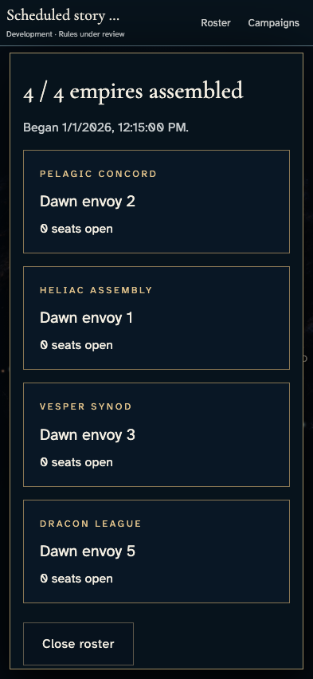](../../../../../../tests/browser/story-baselines/campaign-scheduled-start/phone/darwin-arm64/026-started-rosters-3-dawn-envoy-3.png)

### Viewpoint: Dawn envoy 4

- [x] The active chart acknowledges that authorized contact records finished loading.

[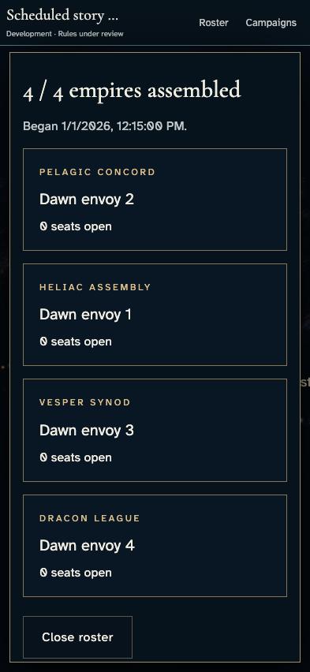](../../../../../../tests/browser/story-baselines/campaign-scheduled-start/phone/darwin-arm64/026-started-rosters-4-dawn-envoy-4.png)

### Viewpoint: Dawn envoy 5

- [x] The active chart acknowledges that authorized contact records finished loading.

## 27. Open the first campaign and inspect each commander's own authoritative home system.

Actor: **Four independent commanders**.

Acknowledged outcome: Four distinct homes show ownership of both layers and the recorded starting forces.

- [x] No commander has an uncaught application error.

### Viewpoint: Dawn envoy 1

- [x] The active chart acknowledges that authorized contact records finished loading.

### Viewpoint: Dawn envoy 2

- [x] The active chart acknowledges that authorized contact records finished loading.

[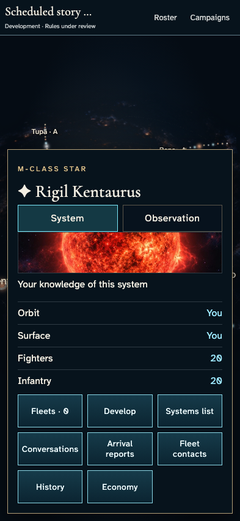](../../../../../../tests/browser/story-baselines/campaign-scheduled-start/phone/darwin-arm64/027-homes-assigned-2-dawn-envoy-2.png)

### Viewpoint: Dawn envoy 3

- [x] The active chart acknowledges that authorized contact records finished loading.

[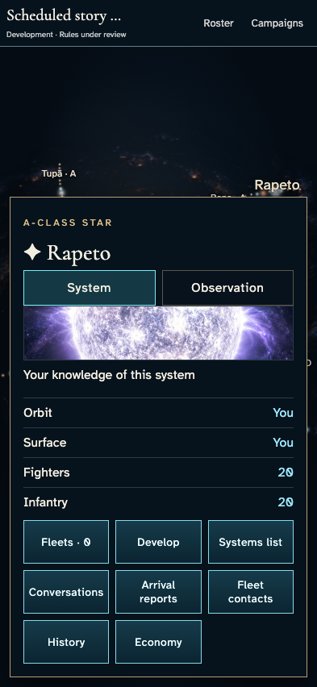](../../../../../../tests/browser/story-baselines/campaign-scheduled-start/phone/darwin-arm64/027-homes-assigned-3-dawn-envoy-3.png)

### Viewpoint: Dawn envoy 4

- [x] The active chart acknowledges that authorized contact records finished loading.

[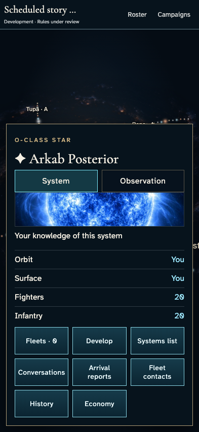](../../../../../../tests/browser/story-baselines/campaign-scheduled-start/phone/darwin-arm64/027-homes-assigned-4-dawn-envoy-4.png)

## 28. Return to entry with one accessible active campaign.

Actor: **Dawn envoy 4**.

Acknowledged outcome: Continue names the one active campaign alongside Play and Learn.

- [x] No commander has an uncaught application error.

### Viewpoint: Dawn envoy 4

## 29. Visit the second active campaign so it becomes the last accessible selection.

Actor: **Dawn envoy 1**.

Acknowledged outcome: The second authoritative galaxy has begun.

- [x] No commander has an uncaught application error.

### Viewpoint: Dawn envoy 1

- [x] The active chart acknowledges that authorized contact records finished loading.

## 30. Return to entry and review the named last campaign and Change campaign option.

Actor: **Dawn envoy 1**.

Acknowledged outcome: Continue names the second campaign while Play, Learn and Change campaign remain distinct.

- [x] No commander has an uncaught application error.

### Viewpoint: Dawn envoy 1

[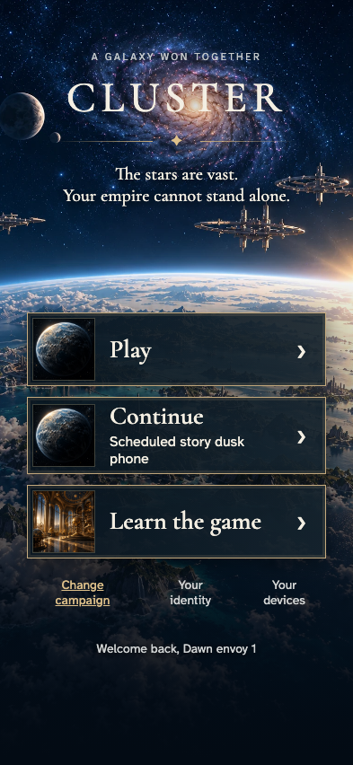](../../../../../../tests/browser/story-baselines/campaign-scheduled-start/phone/darwin-arm64/030-multiple-membership-entry-1-dawn-envoy-1.png)

## 31. Reload entry without losing the account-scoped last campaign selection.

Actor: **Dawn envoy 1**.

Acknowledged outcome: The named second-campaign Continue survives reload.

- [x] No commander has an uncaught application error.

### Viewpoint: Dawn envoy 1

## 32. Commit Continue and return to that exact active campaign.

Actor: **Dawn envoy 1**.

Acknowledged outcome: Continue opens the exact recorded campaign ID and live galaxy.

- [x] No commander has an uncaught application error.

### Viewpoint: Dawn envoy 1

- [x] The active chart acknowledges that authorized contact records finished loading.

[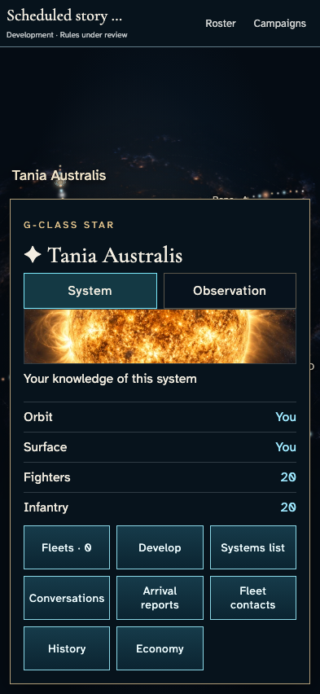](../../../../../../tests/browser/story-baselines/campaign-scheduled-start/phone/darwin-arm64/032-continue-exact-campaign-1-dawn-envoy-1.png)
