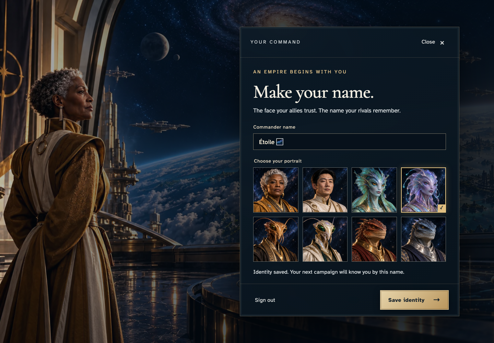
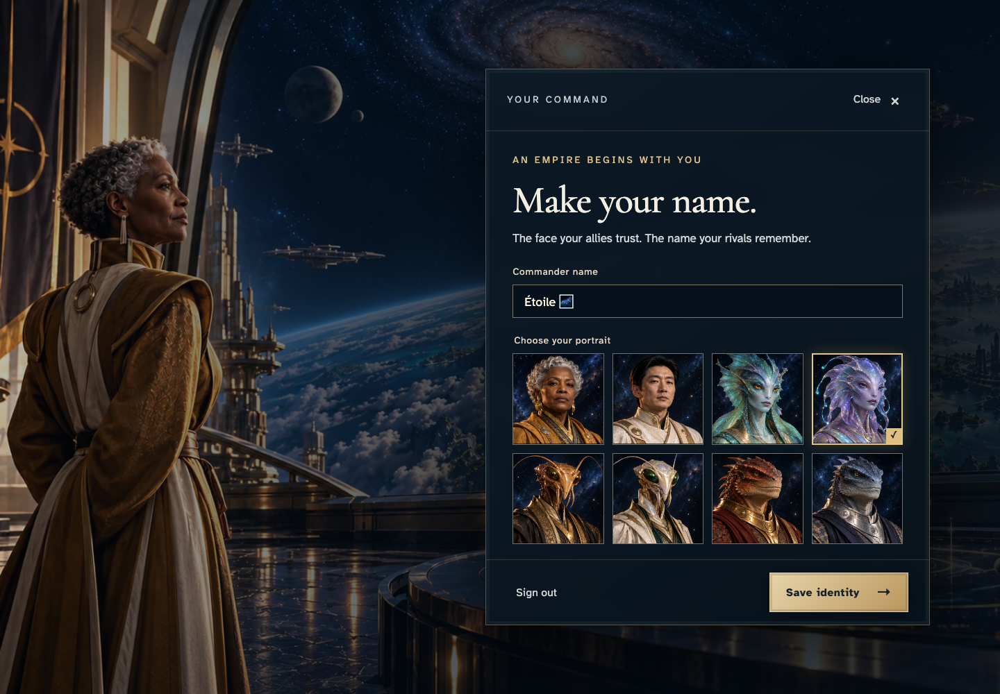
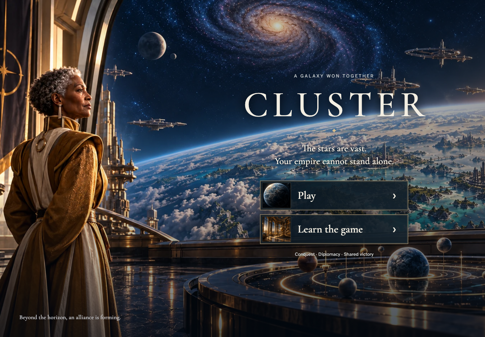

# Save and recover a commander identity

**Exact comparison passed.** desktop · darwin-arm64. Inventory: UX-01, UX-14, UX-16.

Étoile signs in through the real Google emulator UI, chooses an alias and portrait, waits for an encrypted profile command receipt, reloads to recover the saved identity, and signs out. No campaign state is injected.

## 1. Étoile arrives signed out, with no private preview.

Actor: **Étoile**. 

Acknowledged outcome: Play is available on the entry surface.

- [x] No commander identity is displayed before authentication.

### Viewpoint: Étoile

## 2. Étoile signs in with Google and reaches the identity editor.

Actor: **Étoile**. 

Acknowledged outcome: Authentication completes and the commander name field is available.

- [x] The actual portrait picker exposes eight choices and Save is available.

### Viewpoint: Étoile

## 3. Étoile selects the Deepseer and saves the chosen identity.

Actor: **Étoile**. 

Acknowledged outcome: The authoritative encrypted profile command is acknowledged as saved.

- [x] The exact alias and Deepseer remain selected after acknowledgement.

### Viewpoint: Étoile

## 4. Étoile reloads and recovers the same saved commander.

Actor: **Étoile**. 

Acknowledged outcome: The saved alias and portrait return from persisted encrypted profile history.

- [x] The recovered identity editor offers sign out and editing without a duplicate save.

### Viewpoint: Étoile

## 5. Étoile signs out and the entry surface removes private identity details.

Actor: **Étoile**. 

Acknowledged outcome: Play returns after sign-out.

- [x] The alias and identity control are absent from the signed-out DOM.

### Viewpoint: Étoile

