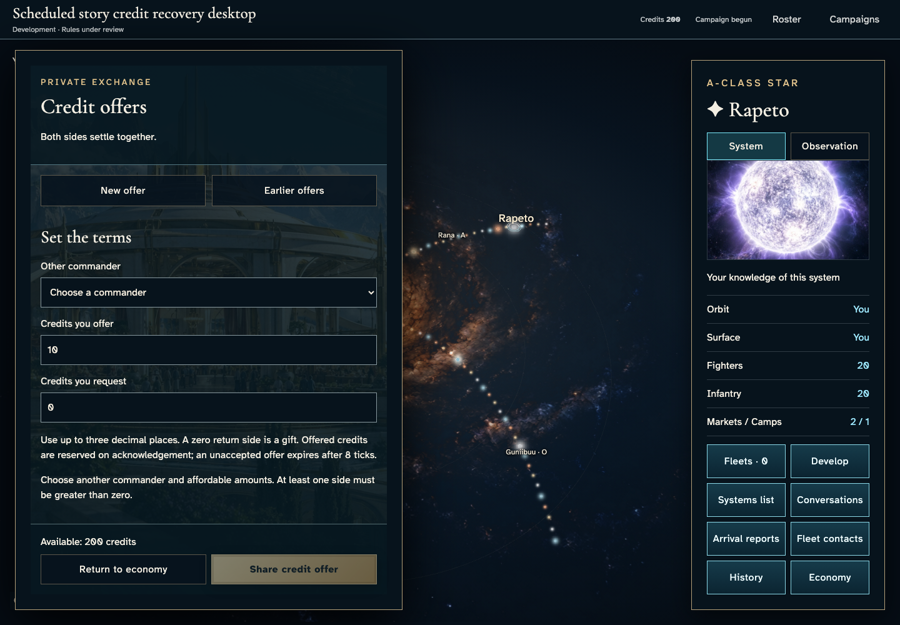
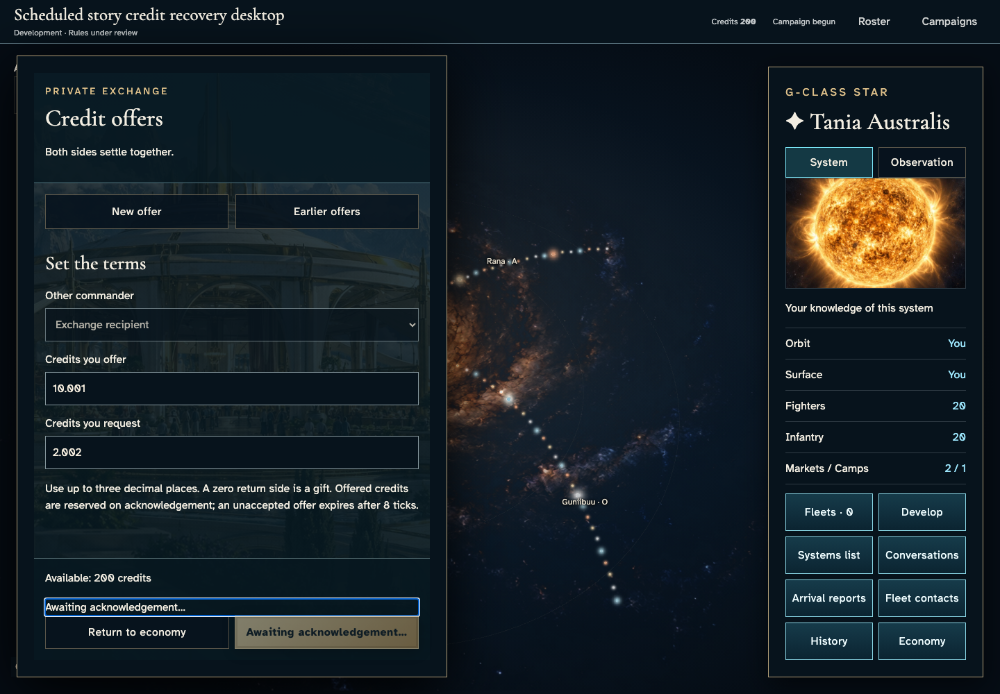
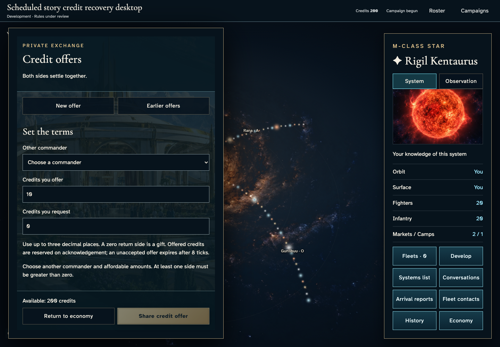
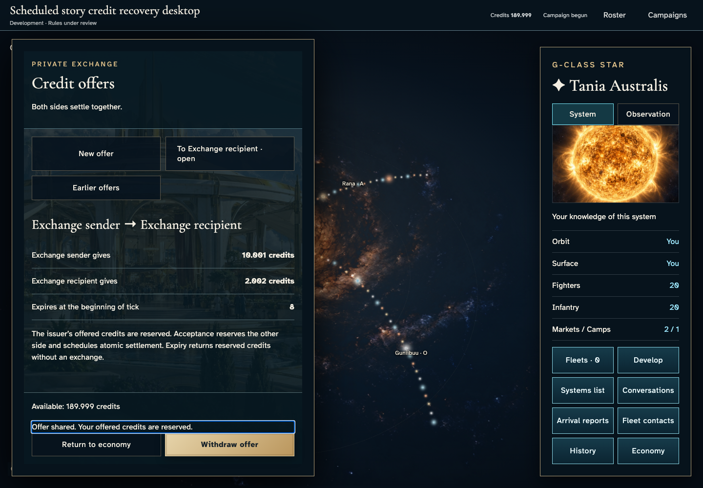
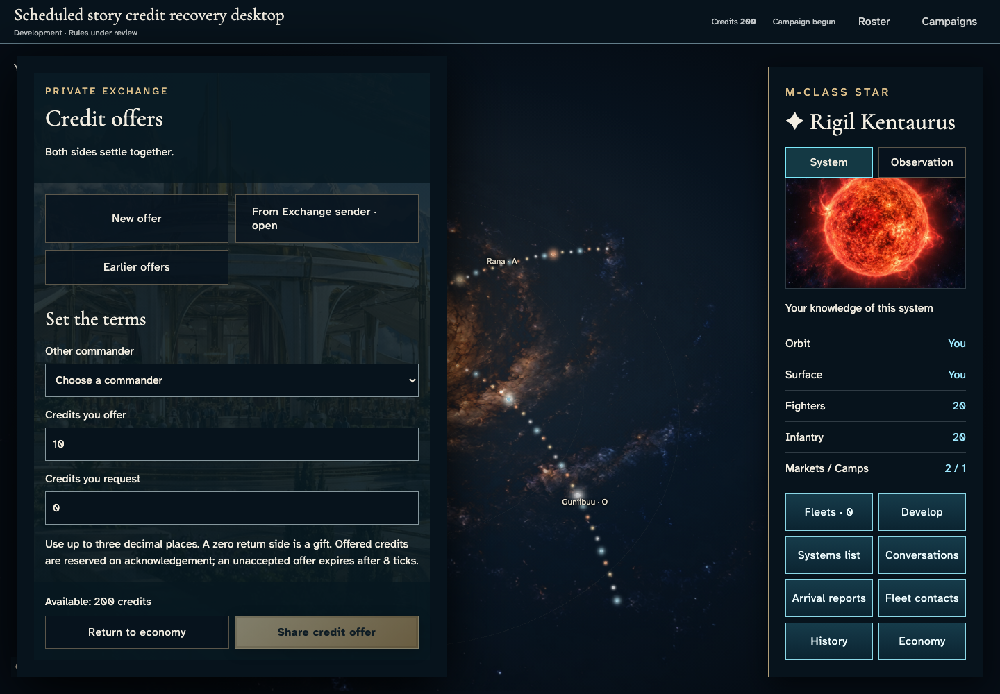
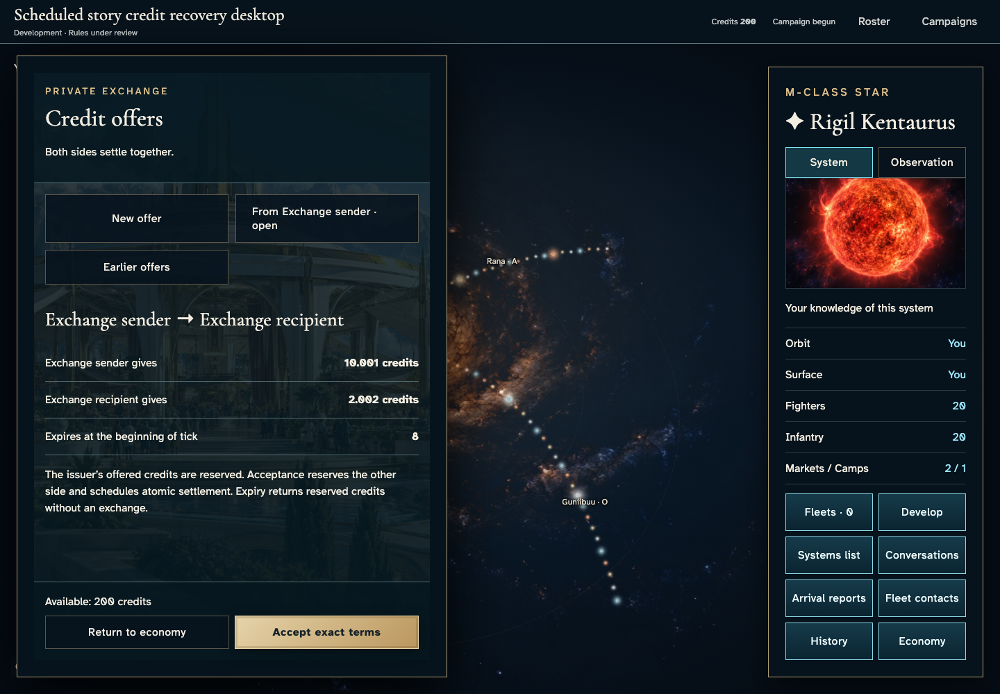
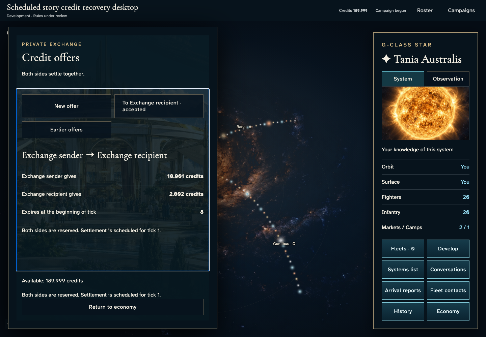
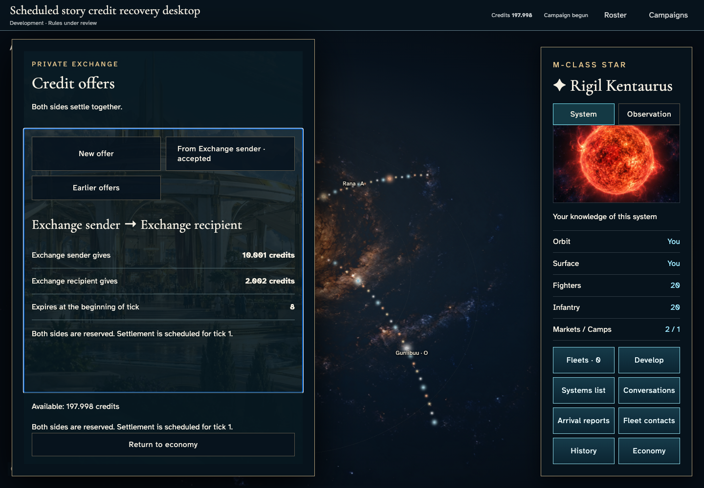
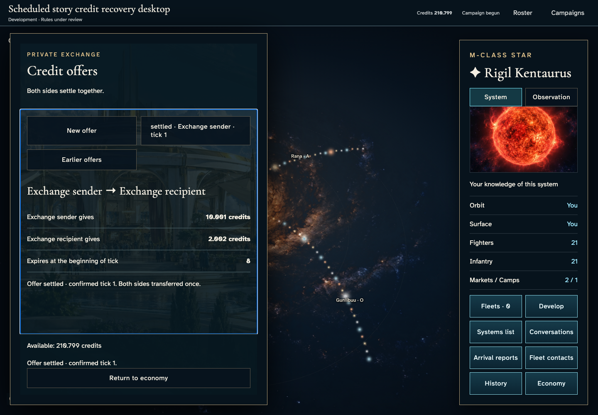
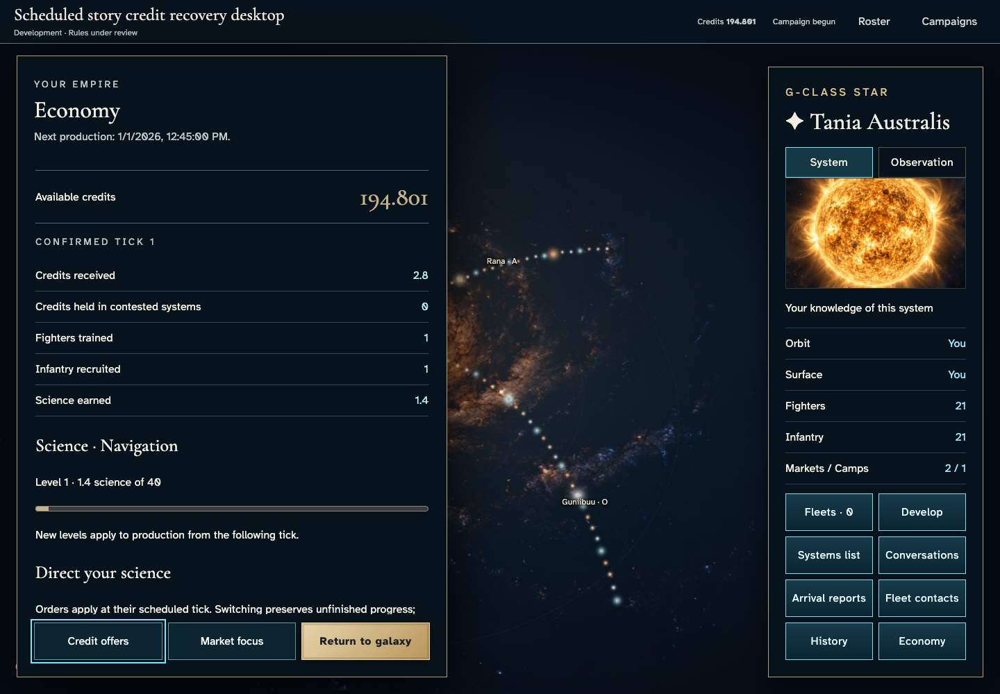

# Recover the same private credit commitment after interruption

**Exact comparison passed.** desktop · darwin-arm64. Inventory: UX-11, UX-14, UX-16.

Four independent authenticated commanders enter a real development campaign. Sender, recipient and outsider inspect private credit commitments, reservations and authoritative outcomes. The development mock provider exercises real encrypted ingress, canonical persistence and recipient grants. Fixed domain clocks and tick-service delivery are explicit harness controls. Eight-tick expiry and settlement ordering remain proposed rules, not owner approval. Managed-key and hosted acceptance remain separate.

## 1. Ordinary emulator sign-in and identity save, with explicit developer entitlement and fixed browser Date; timers continue normally.

Actor: **Test harness**. **Harness control; not a player action.**

Acknowledged outcome: Explicit test control; not a player action or hosted-service certification.

## 2. Ordinary emulator sign-in and identity save, with explicit developer entitlement and fixed browser Date; timers continue normally.

Actor: **Test harness**. **Harness control; not a player action.**

Acknowledged outcome: Explicit test control; not a player action or hosted-service certification.

## 3. Ordinary emulator sign-in and identity save, with explicit developer entitlement and fixed browser Date; timers continue normally.

Actor: **Test harness**. **Harness control; not a player action.**

Acknowledged outcome: Explicit test control; not a player action or hosted-service certification.

## 4. Ordinary emulator sign-in and identity save, with explicit developer entitlement and fixed browser Date; timers continue normally.

Actor: **Test harness**. **Harness control; not a player action.**

Acknowledged outcome: Explicit test control; not a player action or hosted-service certification.

## 5. Create/join through ordinary campaign controls. Fixed catalogue and admission clock are test controls; no seat, message or command outcome is injected.

Actor: **Test harness**. **Harness control; not a player action.**

Acknowledged outcome: Explicit test control; not a player action or hosted-service certification.

## 6. Create/join through ordinary campaign controls. Fixed catalogue and admission clock are test controls; no seat, message or command outcome is injected.

Actor: **Test harness**. **Harness control; not a player action.**

Acknowledged outcome: Explicit test control; not a player action or hosted-service certification.

## 7. Create/join through ordinary campaign controls. Fixed catalogue and admission clock are test controls; no seat, message or command outcome is injected.

Actor: **Test harness**. **Harness control; not a player action.**

Acknowledged outcome: Explicit test control; not a player action or hosted-service certification.

## 8. Create/join through ordinary campaign controls. Fixed catalogue and admission clock are test controls; no seat, message or command outcome is injected.

Actor: **Test harness**. **Harness control; not a player action.**

Acknowledged outcome: Explicit test control; not a player action or hosted-service certification.

## 9. Advance the designated browser/domain clock to 12:15 UTC and deliver the actual emulator Scheduler HTTP request. This does not certify hosted scheduling.

Actor: **Test harness**. **Harness control; not a player action.**

Acknowledged outcome: Explicit test control; not a player action or hosted-service certification.

## 10. Only named credit-story campaigns admit exchange commands one millisecond after the latest confirmed tick boundary. Tick advancement below invokes the real settlement service; no balances, offers, receipts or outcomes are injected.

Actor: **Test harness**. **Harness control; not a player action.**

Acknowledged outcome: Explicit test control; not a player action or hosted-service certification.

## 11. Offer 10.001 credits to Exchange recipient in return for 2.002; each observer opens their own private exchange instrument.

Actor: **Exchange sender**.

Acknowledged outcome: The exact affordable terms are ready to share; no command has reserved funds yet.

- [x] No player viewpoint has an uncaught application error.
- [x] The outsider receives no private offers, outcomes, identifiers or amounts in their actual serialized member projection.
- [x] Every illustrated available balance matches that player's authoritative wallet.

### Viewpoint: Exchange sender

### Viewpoint: Exchange recipient

### Viewpoint: Outer witness

## 12. Withhold only the sender's real trade.offer transport frames. Preserve the encrypted bytes and logical command identity; do not fabricate any acknowledgement.

Actor: **Test harness**. **Harness control; not a player action.**

Acknowledged outcome: Explicit test control; not a player action or hosted-service certification.

## 13. Commit the exact terms and inspect the unacknowledged state while the other players still have no offer.

Actor: **Exchange sender**.

Acknowledged outcome: The UI explicitly awaits acknowledgement, focuses its status and disables repeat submission.

- [x] No player viewpoint has an uncaught application error.
- [x] The outsider receives no private offers, outcomes, identifiers or amounts in their actual serialized member projection.
- [x] Every illustrated available balance matches that player's authoritative wallet.
- [x] Undelivered terms leave canonical revision and all wallets unchanged.

### Viewpoint: Exchange sender

### Viewpoint: Exchange recipient

### Viewpoint: Outer witness

## 14. Reload while delivery is withheld; recover the exact terms and original pending command without creating a replacement.

Actor: **Exchange sender**.

Acknowledged outcome: The exchange instrument reopens with the preserved 10.001 / 2.002 draft and awaiting state.

- [x] No player viewpoint has an uncaught application error.
- [x] The outsider receives no private offers, outcomes, identifiers or amounts in their actual serialized member projection.
- [x] Every illustrated available balance matches that player's authoritative wallet.
- [x] Retransmissions use one path and identical encrypted payload, with no admitted revision or reservation.

### Viewpoint: Exchange sender

### Viewpoint: Exchange recipient

### Viewpoint: Outer witness

## 15. Release the retained frames on the live connection to the actual ingress service; duplicate transport frames retain the same logical command and payload.

Actor: **Test harness**. **Harness control; not a player action.**

Acknowledged outcome: Explicit test control; not a player action or hosted-service certification.

## 16. Read the recovered command's authoritative acknowledgement and one reservation.

Actor: **Exchange sender**.

Acknowledged outcome: Offer shared acknowledges admitted terms and the recipient receives a private open offer.

- [x] No player viewpoint has an uncaught application error.
- [x] The outsider receives no private offers, outcomes, identifiers or amounts in their actual serialized member projection.
- [x] Every illustrated available balance matches that player's authoritative wallet.
- [x] One receipt and one revision reserve exactly 10.001 credits, conserving all available plus reserved funds.

### Viewpoint: Exchange sender

### Viewpoint: Exchange recipient

### Viewpoint: Outer witness

## 17. Read the named counterpart and both exact amounts before accepting; the outsider remains excluded.

Actor: **Exchange recipient**.

Acknowledged outcome: The recipient can accept these exact private terms.

- [x] No player viewpoint has an uncaught application error.
- [x] The outsider receives no private offers, outcomes, identifiers or amounts in their actual serialized member projection.
- [x] Every illustrated available balance matches that player's authoritative wallet.

### Viewpoint: Exchange sender

### Viewpoint: Exchange recipient

### Viewpoint: Outer witness

## 18. Accept the exact terms with Enter. Both reservations await the same confirmed tick; neither side has transferred yet.

Actor: **Exchange recipient**.

Acknowledged outcome: Both players see settlement scheduled for tick 1.

- [x] No player viewpoint has an uncaught application error.
- [x] The outsider receives no private offers, outcomes, identifiers or amounts in their actual serialized member projection.
- [x] Every illustrated available balance matches that player's authoritative wallet.
- [x] Acceptance reserves 2.002 once and conserves 800 credits across four wallets and reservations.

### Viewpoint: Exchange sender

### Viewpoint: Exchange recipient

### Viewpoint: Outer witness

## 19. Advance browser Date to the first tick and invoke the real leased tick service at that boundary. Delivery changes the clock, not the resolver or resulting balances.

Actor: **Test harness**. **Harness control; not a player action.**

Acknowledged outcome: Explicit test control; not a player action or hosted-service certification.

## 20. Read the confirmed atomic exchange. Matching acknowledgement replaces the earlier schedule, and the outsider sees only their own balance.

Actor: **Sender and recipient**.

Acknowledged outcome: Both participants see Offer settled and Both sides transferred once, with no future-scheduled acknowledgement.

- [x] No player viewpoint has an uncaught application error.
- [x] The outsider receives no private offers, outcomes, identifiers or amounts in their actual serialized member projection.
- [x] Every illustrated available balance matches that player's authoritative wallet.
- [x] Settlement transfers each reserved amount once; the only new credits are separately accounted production, with no trade dividend.

### Viewpoint: Exchange sender

### Viewpoint: Exchange recipient

### Viewpoint: Outer witness

## 21. Redeliver the same tick boundary to the real service and require zero additional effects.

Actor: **Test harness**. **Harness control; not a player action.**

Acknowledged outcome: Explicit test control; not a player action or hosted-service certification.

## 22. Reload, reopen private offers and inspect the exact recorded outcome without another transfer or reservation.

Actor: **Exchange sender**.

Acknowledged outcome: The authoritative recorded outcome returns after reload.

- [x] No player viewpoint has an uncaught application error.
- [x] The outsider receives no private offers, outcomes, identifiers or amounts in their actual serialized member projection.
- [x] Every illustrated available balance matches that player's authoritative wallet.
- [x] Reload preserves canonical revision, all wallets and private recipient grants without new effects.

### Viewpoint: Exchange sender

### Viewpoint: Exchange recipient

### Viewpoint: Outer witness

## 23. Escape closes the nested instrument and restores focus to Credit offers in the economy.

Actor: **Exchange sender**.

Acknowledged outcome: Credit offers regains keyboard focus.

- [x] No player viewpoint has an uncaught application error.
- [x] The exchange instrument closes without changing canonical balances.

### Viewpoint: Exchange sender

