# Pause, change encryption and recover both devices

**Exact comparison passed.** desktop · darwin-arm64. Inventory: UX-14, UX-16.

One saved developer uses two authenticated devices to migrate a waiting campaign from inspectable encryption to actual Cloud KMS and back. Ordinary UI creates and joins the fixed-catalogue campaign. No state, migration result or provider is injected. This is two-device recovery for one recipient, not complete multi-recipient, hosted authentication or worker-fault certification.

## 1. Save a developer identity and create and join a waiting mock campaign through the ordinary UI; only developer authorization and catalogue entropy are test-controlled.

Actor: **Test harness**. **Harness control; not a player action.**

Acknowledged outcome: Explicit test control; not a player action or hosted-service certification.

## 2. Sign into the same invitation on a second device and review the current encryption on both.

Actor: **Epoch envoy**.

Acknowledged outcome: Both devices recover the current mock mode and available pause control.

- [x] Read-only canonical metadata confirms mock epoch 1, revision 2, with no extra mutation on recovery.
- [x] Both devices retain campaign access without alerts; prior mock exposure remains explicit.

### Viewpoint: Epoch envoy

[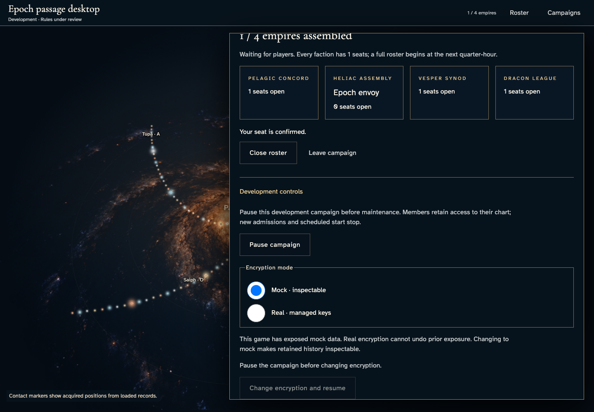](../../../../../../tests/browser/story-baselines/encryption-migration/desktop/darwin-arm64/002-connected-devices-1-epoch-envoy.png)

### Viewpoint: Epoch envoy · second device

[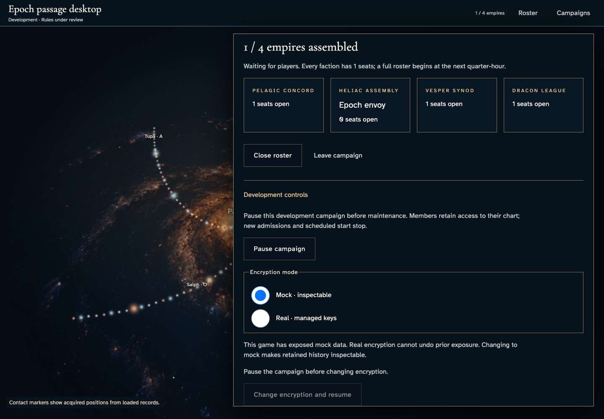](../../../../../../tests/browser/story-baselines/encryption-migration/desktop/darwin-arm64/002-connected-devices-2-epoch-envoy-second-device.png)

## 3. Pause the campaign before migrating to real encryption.

Actor: **Epoch envoy**.

Acknowledged outcome: The pause command is acknowledged and the connected device offers resume.

- [x] Read-only canonical metadata confirms mock epoch 1, revision 3, with no extra mutation on recovery.
- [x] Both devices retain campaign access without alerts; prior mock exposure remains explicit.

### Viewpoint: Epoch envoy

[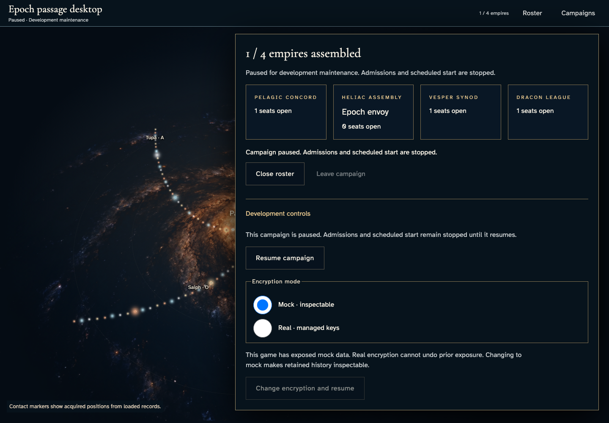](../../../../../../tests/browser/story-baselines/encryption-migration/desktop/darwin-arm64/003-pause-for-real-1-epoch-envoy.png)

### Viewpoint: Epoch envoy · second device

[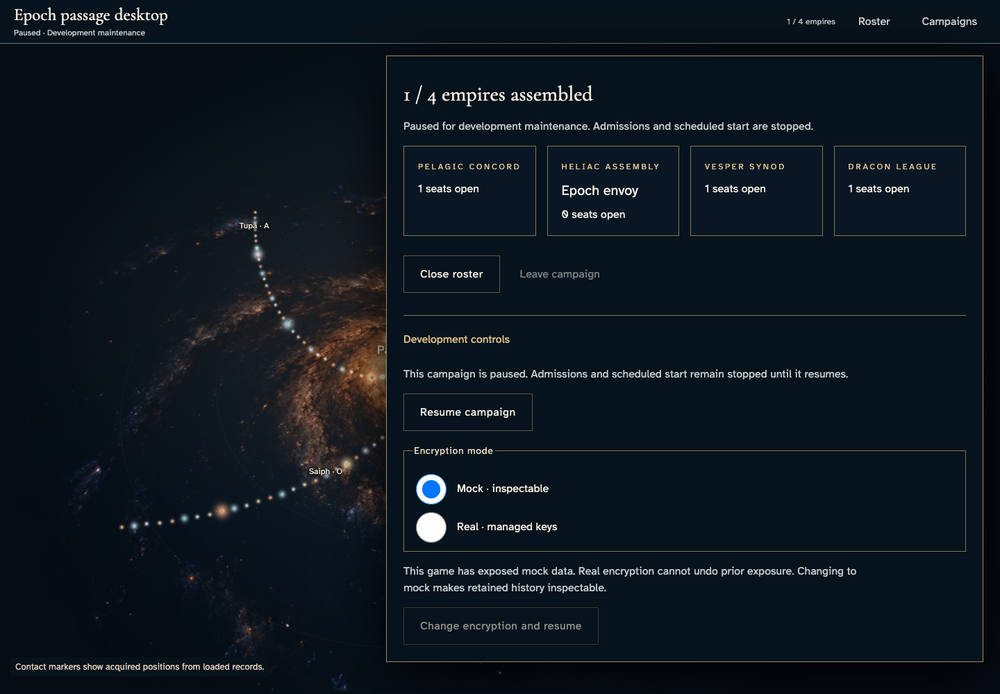](../../../../../../tests/browser/story-baselines/encryption-migration/desktop/darwin-arm64/003-pause-for-real-2-epoch-envoy-second-device.png)

## 4. Select real encryption without committing the change.

Actor: **Epoch envoy**.

Acknowledged outcome: The proposed mode enables the explicit migration commitment.

- [x] Read-only canonical metadata confirms mock epoch 1, revision 3, with no extra mutation on recovery.
- [x] An uncommitted choice does not alter the second device’s authoritative mode.
- [x] Both devices retain campaign access without alerts; prior mock exposure remains explicit.

### Viewpoint: Epoch envoy

[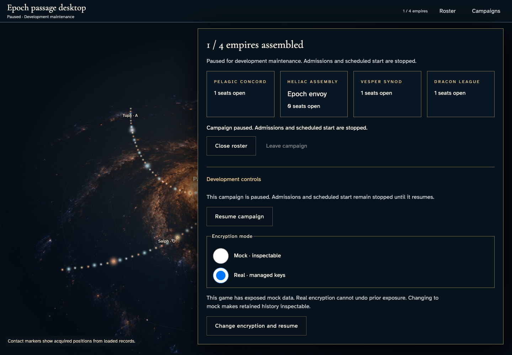](../../../../../../tests/browser/story-baselines/encryption-migration/desktop/darwin-arm64/004-choose-real-1-epoch-envoy.png)

### Viewpoint: Epoch envoy · second device

## 5. Commit real migration, observe focused progress, then wait for verified activation and resumed access.

Actor: **Epoch envoy**.

Acknowledged outcome: The service reports verified completion, restores chart focus and updates the connected device.

- [x] Read-only canonical metadata confirms real epoch 2, revision 4, with no extra mutation on recovery.
- [x] Both devices remain free of alerts after authoritative activation.

### Viewpoint: Epoch envoy

[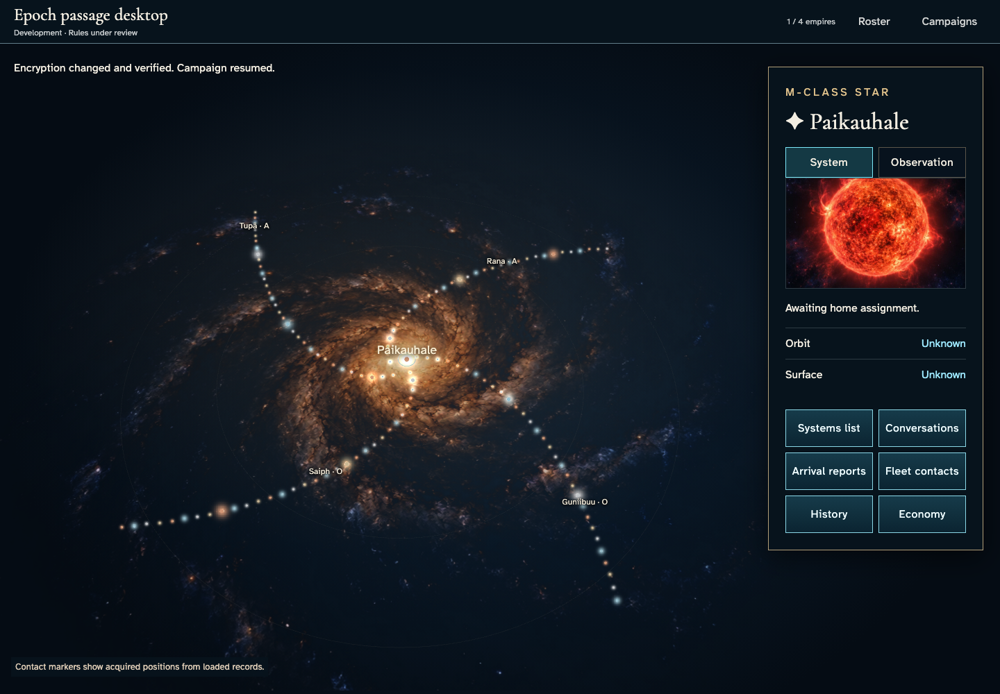](../../../../../../tests/browser/story-baselines/encryption-migration/desktop/darwin-arm64/005-verified-real-1-epoch-envoy.png)

### Viewpoint: Epoch envoy · second device

[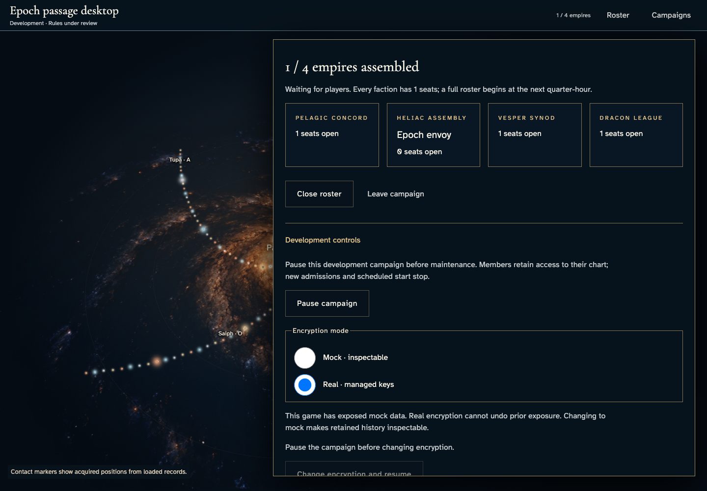](../../../../../../tests/browser/story-baselines/encryption-migration/desktop/darwin-arm64/005-verified-real-2-epoch-envoy-second-device.png)

## 6. Reload the exact campaign and review recovered real encryption with its permanent exposure warning.

Actor: **Epoch envoy**.

Acknowledged outcome: The recovered campaign retains the activated mode and allows normal pause controls.

- [x] Read-only canonical metadata confirms real epoch 2, revision 4, with no extra mutation on recovery.
- [x] Both devices retain campaign access without alerts; prior mock exposure remains explicit.
- [x] Reload keeps the exact campaign invitation.

### Viewpoint: Epoch envoy

[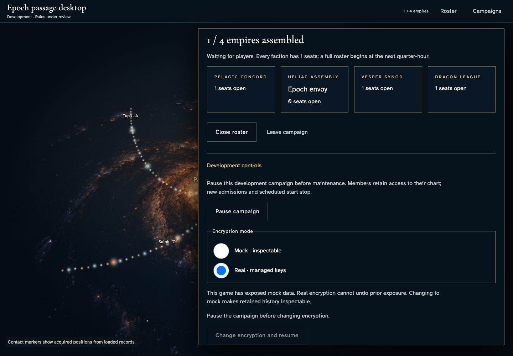](../../../../../../tests/browser/story-baselines/encryption-migration/desktop/darwin-arm64/006-recover-real-1-epoch-envoy.png)

### Viewpoint: Epoch envoy · second device

## 7. Pause the campaign before migrating to mock encryption.

Actor: **Epoch envoy**.

Acknowledged outcome: The pause command is acknowledged and the connected device offers resume.

- [x] Read-only canonical metadata confirms real epoch 2, revision 5, with no extra mutation on recovery.
- [x] Both devices retain campaign access without alerts; prior mock exposure remains explicit.

### Viewpoint: Epoch envoy

[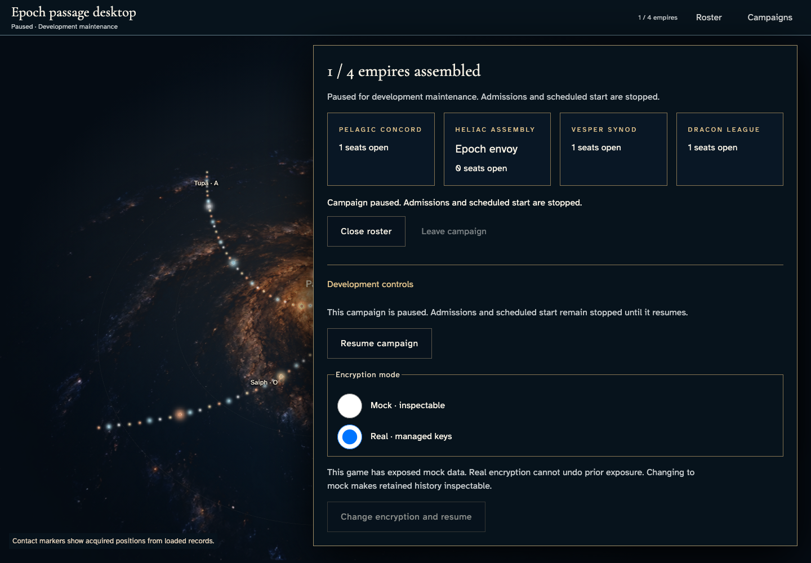](../../../../../../tests/browser/story-baselines/encryption-migration/desktop/darwin-arm64/007-pause-for-mock-1-epoch-envoy.png)

### Viewpoint: Epoch envoy · second device

## 8. Select mock encryption without committing the change.

Actor: **Epoch envoy**.

Acknowledged outcome: The proposed mode enables the explicit migration commitment.

- [x] Read-only canonical metadata confirms real epoch 2, revision 5, with no extra mutation on recovery.
- [x] An uncommitted choice does not alter the second device’s authoritative mode.
- [x] Both devices retain campaign access without alerts; prior mock exposure remains explicit.

### Viewpoint: Epoch envoy

[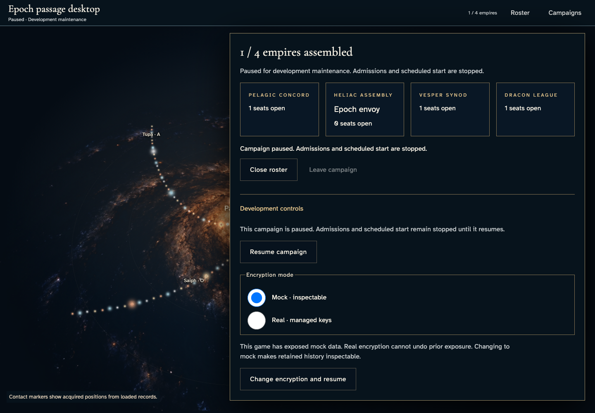](../../../../../../tests/browser/story-baselines/encryption-migration/desktop/darwin-arm64/008-choose-mock-1-epoch-envoy.png)

### Viewpoint: Epoch envoy · second device

## 9. Commit mock migration, observe focused progress, then wait for verified activation and resumed access.

Actor: **Epoch envoy**.

Acknowledged outcome: The service reports verified completion, restores chart focus and updates the connected device.

- [x] Read-only canonical metadata confirms mock epoch 3, revision 6, with no extra mutation on recovery.
- [x] Both devices remain free of alerts after authoritative activation.

### Viewpoint: Epoch envoy

### Viewpoint: Epoch envoy · second device

## 10. Reload the exact campaign and review recovered mock encryption with its permanent exposure warning.

Actor: **Epoch envoy**.

Acknowledged outcome: The recovered campaign retains the activated mode and allows normal pause controls.

- [x] Read-only canonical metadata confirms mock epoch 3, revision 6, with no extra mutation on recovery.
- [x] Both devices retain campaign access without alerts; prior mock exposure remains explicit.
- [x] Reload keeps the exact campaign invitation.

### Viewpoint: Epoch envoy

### Viewpoint: Epoch envoy · second device

[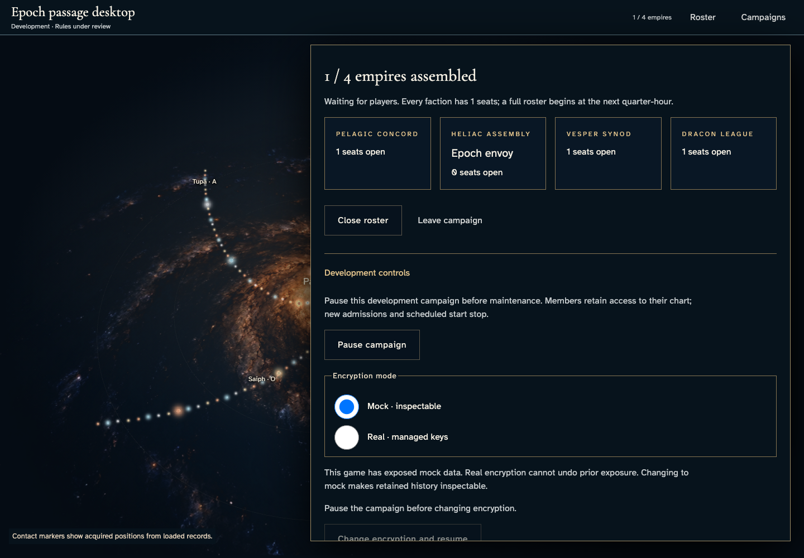](../../../../../../tests/browser/story-baselines/encryption-migration/desktop/darwin-arm64/010-recover-mock-2-epoch-envoy-second-device.png)
