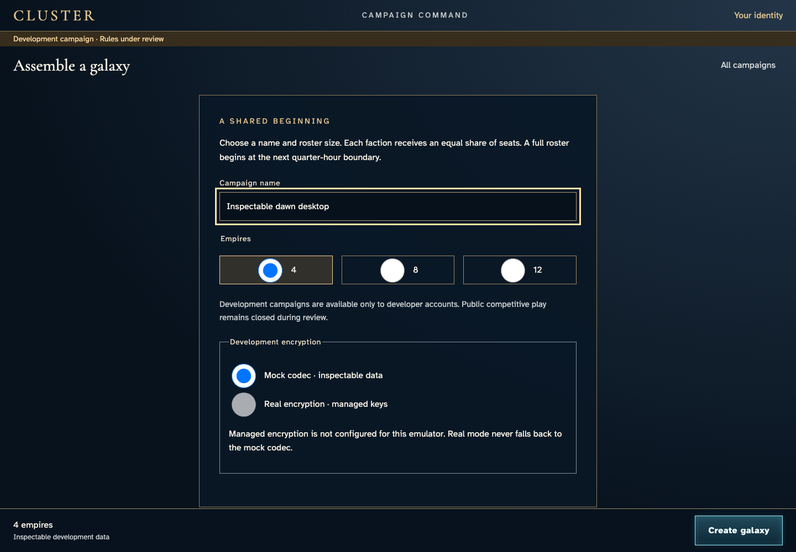
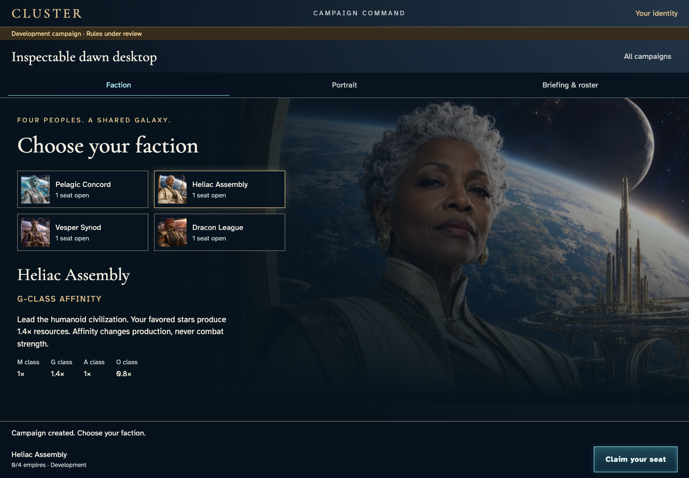
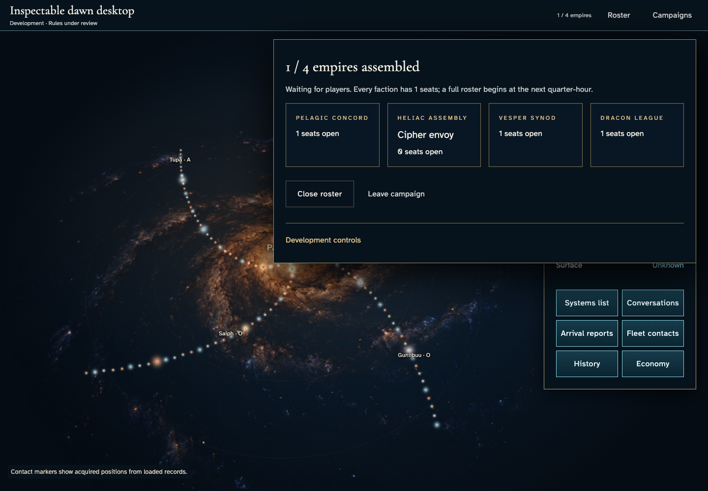

# Understand unavailable encryption before creating a development campaign

**Exact comparison passed.** desktop · darwin-arm64. Inventory: UX-02, UX-14, UX-16.

A saved developer reviews the actual provider availability, chooses the disclosed encryption mode, creates and joins a campaign, reloads its acknowledged seat and leaves. Fixed catalogue entropy is test-only; commands, authorization, encryption, persistence and recipient delivery remain real. Managed runs use actual Cloud KMS and are separate from default CI; emulated login does not certify hosted Google authentication.

## 1. Save an identity through ordinary UI and grant explicit developer access in the emulator. No campaign state or result is injected.

Actor: **Test harness**. **Harness control; not a player action.**

Acknowledged outcome: Explicit test control; not a player action or hosted-service certification.

## 2. Open the proposal and review the available encryption choices before committing.

Actor: **Cipher envoy**.

Acknowledged outcome: The proposal shows the actual configured provider availability.

- [x] Inspectable development data is explicit and selected; unavailable real mode explains that it cannot fall back.

### Viewpoint: Cipher envoy

## 3. Commit the disclosed encryption choice and wait for authoritative campaign creation.

Actor: **Cipher envoy**.

Acknowledged outcome: Campaign creation is acknowledged before faction admission.

- [x] Read-only authoritative metadata retains the chosen mock mode and revision 1.

### Viewpoint: Cipher envoy

## 4. Claim a seat through the selected provider and wait for confirmation.

Actor: **Cipher envoy**.

Acknowledged outcome: The service confirms this seat.

- [x] Read-only authoritative metadata retains the chosen mock mode and revision 2.

### Viewpoint: Cipher envoy

## 5. Reload the exact campaign and open its roster using recovered authenticated member delivery.

Actor: **Cipher envoy**.

Acknowledged outcome: The recovered roster identifies the saved commander and offers seat release.

- [x] Read-only authoritative metadata retains the chosen mock mode and revision 2.
- [x] Reload retains the exact campaign URL.

### Viewpoint: Cipher envoy

## 6. Leave the waiting campaign and wait for the matching authoritative acknowledgement.

Actor: **Cipher envoy**.

Acknowledged outcome: The service acknowledges seat release.

- [x] Read-only authoritative metadata retains the chosen mock mode and revision 3.
- [x] One logical Leave has its matching accepted receipt; membership is absent and the retained protected view denies player access, with no involuntary-access error or retry remedy.

### Viewpoint: Cipher envoy

