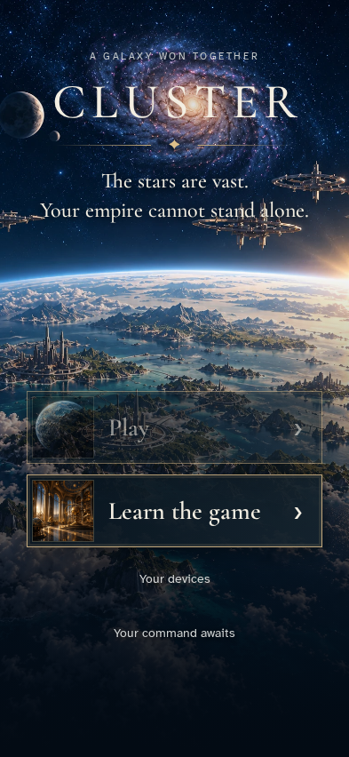
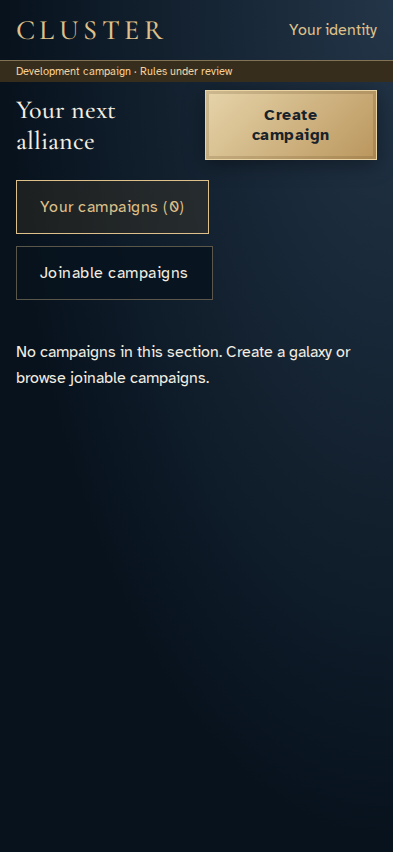
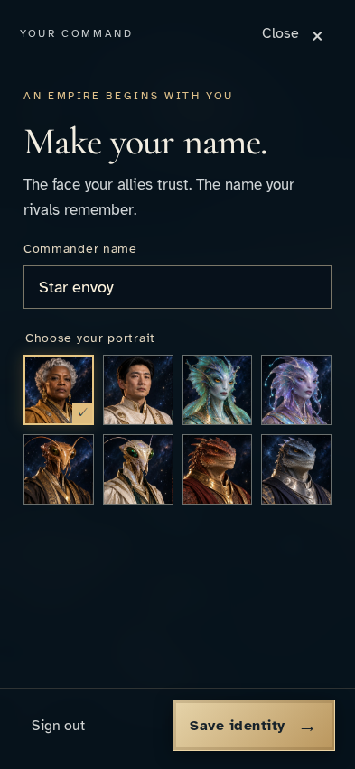

# Wait for the saved identity before opening campaign selection

**Exact comparison passed.** phone · linux-arm64. Inventory: UX-01, UX-14, UX-16.

A returning developer reloads entry while the actual authenticated profile-key request is held by the harness. Play remains disabled until the saved profile is known, then opens the campaign directory without an identity resave. The delay changes no service response or profile state.

## 1. Prepare a real saved identity and developer access through ordinary authentication and save controls.

Actor: **Test harness**. **Harness control; not a player action.**

Acknowledged outcome: Explicit test control; not a player action or hosted-service certification.

## 2. Hold the actual POST profile-key request before its real service response. Authentication, profile state and encrypted command receipts are unchanged.

Actor: **Test harness**. **Harness control; not a player action.**

Acknowledged outcome: Explicit test control; not a player action or hosted-service certification.

## 3. Reload entry while the saved identity is still being recovered. Play cannot route to an editor based on missing profile data.

Actor: **Star envoy**.

Acknowledged outcome: Authentication is known and Play remains disabled until profile readiness.

- [x] The saved profile retains one revision, one version and one receipt.
- [x] The identity editor has not opened or asked for another save.

### Viewpoint: Star envoy

## 4. Release the original profile-key request and remove the delay. The application receives the real saved profile through its normal subscription.

Actor: **Test harness**. **Harness control; not a player action.**

Acknowledged outcome: Explicit test control; not a player action or hosted-service certification.

## 5. Once the saved identity is ready, use Play to enter campaign selection directly.

Actor: **Star envoy**.

Acknowledged outcome: Play opens the joined-campaign directory instead of identity editing.

- [x] The saved profile retains one revision, one version and one receipt.
- [x] No identity editor is shown.

### Viewpoint: Star envoy

## 6. Return to entry and explicitly open identity to confirm the saved name has not required resubmission.

Actor: **Star envoy**.

Acknowledged outcome: The original saved commander name is available.

- [x] The saved profile retains one revision, one version and one receipt.

### Viewpoint: Star envoy

