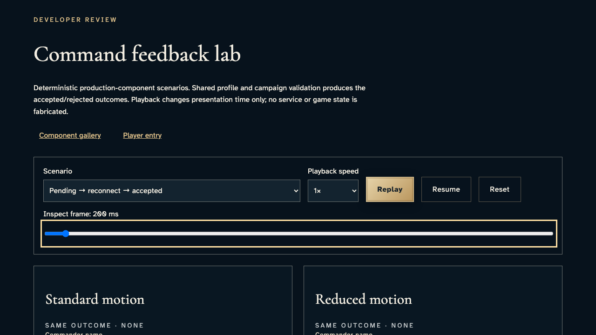
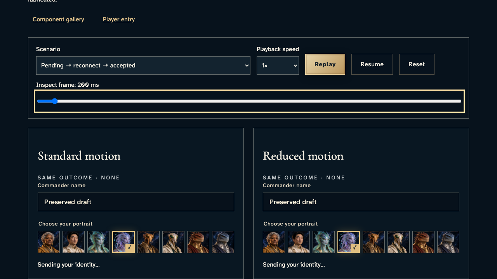
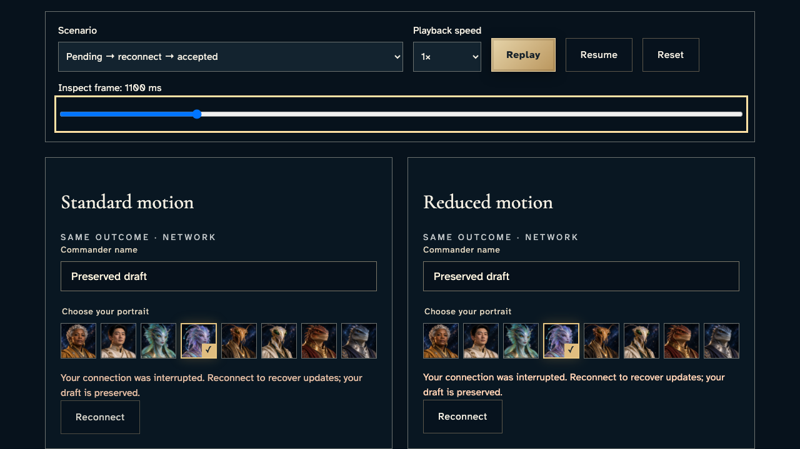
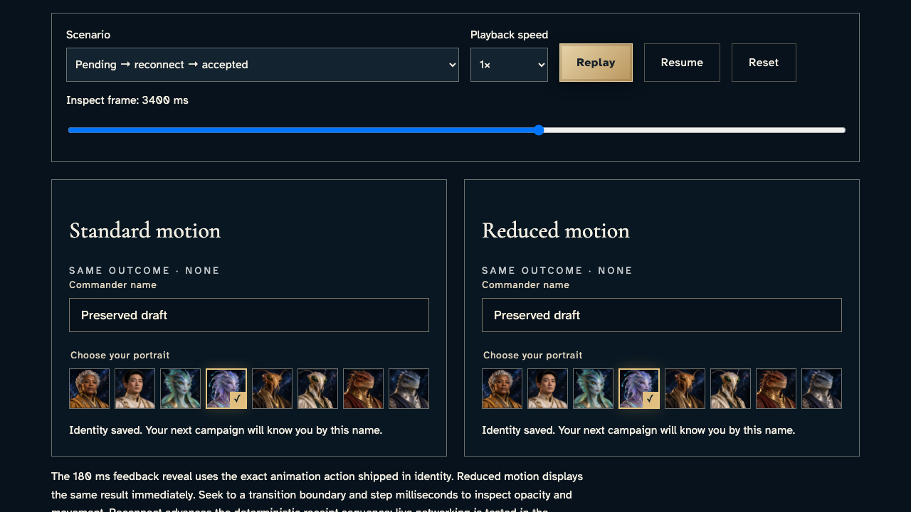
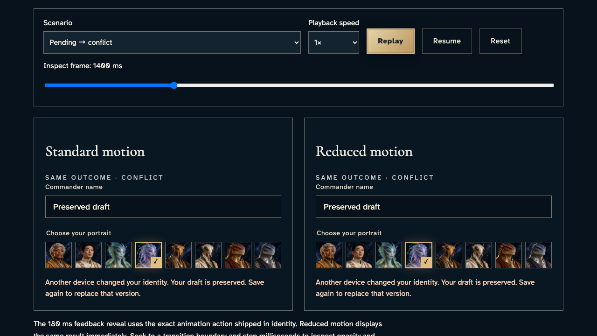
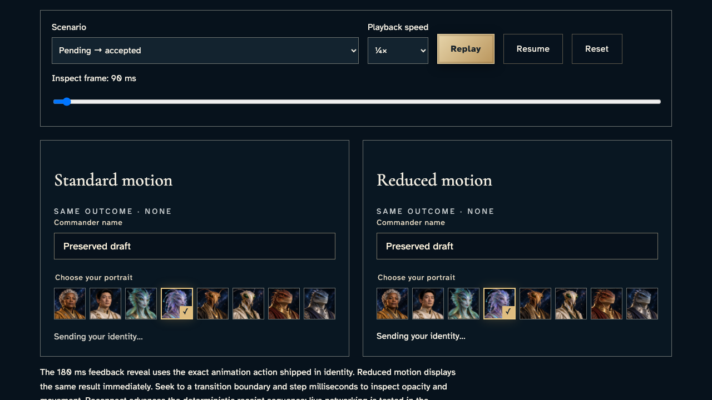
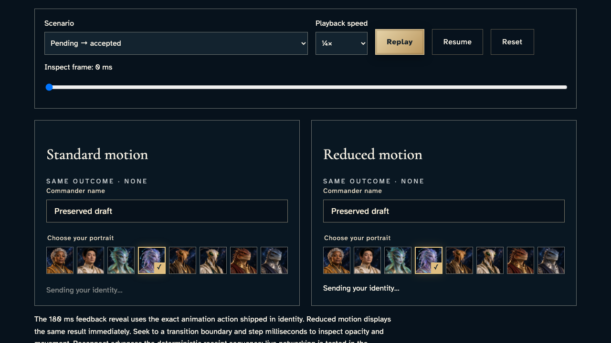

# Inspect shared feedback and compare reduced motion

**Exact comparison passed.** short · darwin-arm64. Inventory: UX-14, UX-16.

A developer inspects deterministic scenarios rendered by the shipped feedback, identity and animation components. These are explicitly component fixtures using production validation and copy, not live commands or service acceptance. The browser clock controls playback only; named paused animation frames are verified before unchanged exact pixel comparison.

## 1. Fix the browser presentation clock for deterministic replay and pause inspection; no service state exists in this component lab.

Actor: **Test harness**. **Harness control; not a player action.**

Acknowledged outcome: Explicit test control; not a player action or hosted-service certification.

## 2. Open the real animation lab and inspect the pending identity frame.

Actor: **Developer**.

Acknowledged outcome: Both motion presentations report “Sending your identity” with identical text.

- [x] Both presentations retain the exact saved draft text.

### Viewpoint: Developer · playback controls

- [x] Playback and scenario controls are visible for the review action.
- [x] Explicit paused motion: [aria-label="Standard motion comparison"], 1 animation(s), 180/180 ms; unchanged exact comparison.
- [x] Explicit paused motion: [aria-label="Reduced motion comparison"], 1 animation(s), 180/180 ms; unchanged exact comparison.

### Viewpoint: Developer · standard motion

- [x] The inspected outcome is fully inside the viewport after deliberate reference-page scrolling.
- [x] Explicit paused motion: [aria-label="Standard motion comparison"], 1 animation(s), 180/180 ms; unchanged exact comparison.
- [x] Explicit paused motion: [aria-label="Reduced motion comparison"], 1 animation(s), 180/180 ms; unchanged exact comparison.

### Viewpoint: Developer · reduced motion

- [x] The inspected outcome is fully inside the viewport after deliberate reference-page scrolling.
- [x] Explicit paused motion: [aria-label="Standard motion comparison"], 1 animation(s), 180/180 ms; unchanged exact comparison.
- [x] Explicit paused motion: [aria-label="Reduced motion comparison"], 1 animation(s), 180/180 ms; unchanged exact comparison.

## 3. Seek into the interrupted connection and compare the real reveal animation with reduced motion.

Actor: **Developer**.

Acknowledged outcome: Both motion presentations report “draft is preserved” with identical text.

- [x] Both presentations retain the exact saved draft text.
- [x] Both presentations offer the reconnect remedy.

### Viewpoint: Developer · standard motion

- [x] The inspected outcome is fully inside the viewport after deliberate reference-page scrolling.
- [x] Explicit paused motion: [aria-label="Standard motion comparison"], 1 animation(s), 100/180 ms; unchanged exact comparison.
- [x] Explicit paused motion: [aria-label="Reduced motion comparison"], 1 animation(s), 180/180 ms; unchanged exact comparison.

### Viewpoint: Developer · reduced motion

- [x] The inspected outcome is fully inside the viewport after deliberate reference-page scrolling.
- [x] Explicit paused motion: [aria-label="Standard motion comparison"], 1 animation(s), 100/180 ms; unchanged exact comparison.
- [x] Explicit paused motion: [aria-label="Reduced motion comparison"], 1 animation(s), 180/180 ms; unchanged exact comparison.

## 4. Use the production reconnect control to replay recovery, then inspect the accepted frame.

Actor: **Developer**.

Acknowledged outcome: Both motion presentations report “Identity saved” with identical text.

- [x] Both presentations retain the exact saved draft text.
- [x] The connection alert clears in both presentations.

### Viewpoint: Developer · standard motion

- [x] The inspected outcome is fully inside the viewport after deliberate reference-page scrolling.
- [x] Explicit paused motion: [aria-label="Standard motion comparison"], 1 animation(s), 180/180 ms; unchanged exact comparison.
- [x] Explicit paused motion: [aria-label="Reduced motion comparison"], 1 animation(s), 180/180 ms; unchanged exact comparison.

### Viewpoint: Developer · reduced motion

- [x] The inspected outcome is fully inside the viewport after deliberate reference-page scrolling.
- [x] Explicit paused motion: [aria-label="Standard motion comparison"], 1 animation(s), 180/180 ms; unchanged exact comparison.
- [x] Explicit paused motion: [aria-label="Reduced motion comparison"], 1 animation(s), 180/180 ms; unchanged exact comparison.

## 5. Select the production revision-conflict scenario and inspect its distinct remedy.

Actor: **Developer**.

Acknowledged outcome: Both motion presentations report “Another device” with identical text.

- [x] Both presentations retain the exact saved draft text.
- [x] A revision conflict does not offer the network reconnect remedy.

### Viewpoint: Developer · standard motion

- [x] The inspected outcome is fully inside the viewport after deliberate reference-page scrolling.
- [x] Explicit paused motion: [aria-label="Standard motion comparison"], 1 animation(s), 180/180 ms; unchanged exact comparison.
- [x] Explicit paused motion: [aria-label="Reduced motion comparison"], 1 animation(s), 180/180 ms; unchanged exact comparison.

### Viewpoint: Developer · reduced motion

- [x] The inspected outcome is fully inside the viewport after deliberate reference-page scrolling.
- [x] Explicit paused motion: [aria-label="Standard motion comparison"], 1 animation(s), 180/180 ms; unchanged exact comparison.
- [x] Explicit paused motion: [aria-label="Reduced motion comparison"], 1 animation(s), 180/180 ms; unchanged exact comparison.

## 6. Replay at quarter speed, pause and prove the frame stays fixed, then inspect the 90 ms reveal.

Actor: **Developer**.

Acknowledged outcome: Both motion presentations report “Sending your identity” with identical text.

- [x] Both presentations retain the exact saved draft text.
- [x] The inspected frame is exactly 90 ms and quarter speed remains selected.

### Viewpoint: Developer · standard motion

- [x] The inspected outcome is fully inside the viewport after deliberate reference-page scrolling.
- [x] Explicit paused motion: [aria-label="Standard motion comparison"], 1 animation(s), 90/180 ms; unchanged exact comparison.
- [x] Explicit paused motion: [aria-label="Reduced motion comparison"], 1 animation(s), 180/180 ms; unchanged exact comparison.

### Viewpoint: Developer · reduced motion

- [x] The inspected outcome is fully inside the viewport after deliberate reference-page scrolling.
- [x] Explicit paused motion: [aria-label="Standard motion comparison"], 1 animation(s), 90/180 ms; unchanged exact comparison.
- [x] Explicit paused motion: [aria-label="Reduced motion comparison"], 1 animation(s), 180/180 ms; unchanged exact comparison.

## 7. Reset playback to its explicit first frame without changing the pending outcome or draft.

Actor: **Developer**.

Acknowledged outcome: Reset returns presentation time to zero and stops playback.

- [x] Both presentations retain the exact saved draft text.
- [x] Both motion presentations report “Sending your identity” with identical text.

### Viewpoint: Developer · standard motion

- [x] The inspected outcome is fully inside the viewport after deliberate reference-page scrolling.
- [x] Explicit paused motion: [aria-label="Standard motion comparison"], 1 animation(s), 0/180 ms; unchanged exact comparison.
- [x] Explicit paused motion: [aria-label="Reduced motion comparison"], 1 animation(s), 180/180 ms; unchanged exact comparison.

### Viewpoint: Developer · reduced motion

- [x] The inspected outcome is fully inside the viewport after deliberate reference-page scrolling.
- [x] Explicit paused motion: [aria-label="Standard motion comparison"], 1 animation(s), 0/180 ms; unchanged exact comparison.
- [x] Explicit paused motion: [aria-label="Reduced motion comparison"], 1 animation(s), 180/180 ms; unchanged exact comparison.

