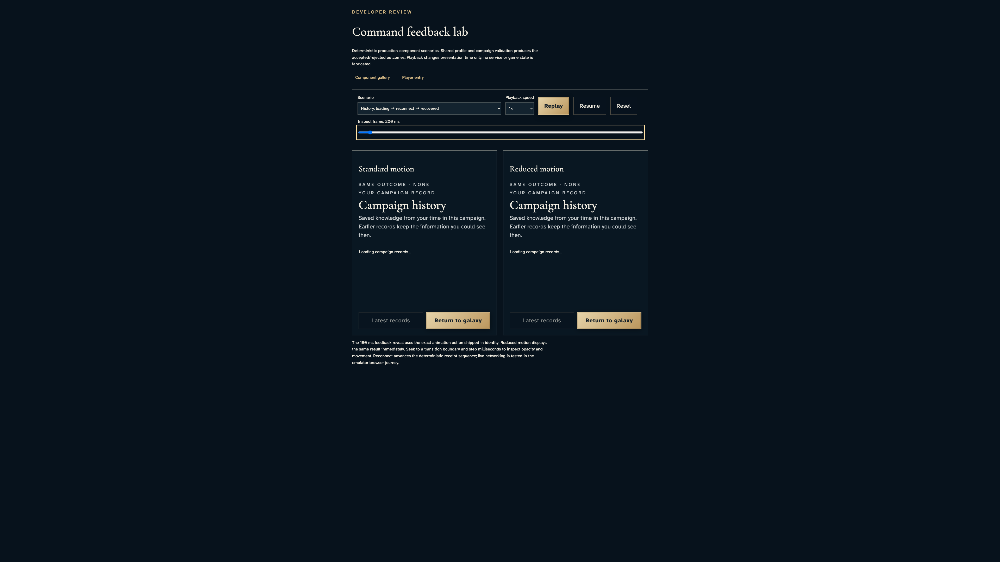
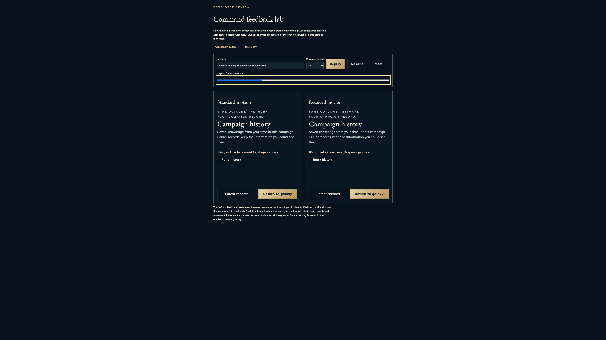
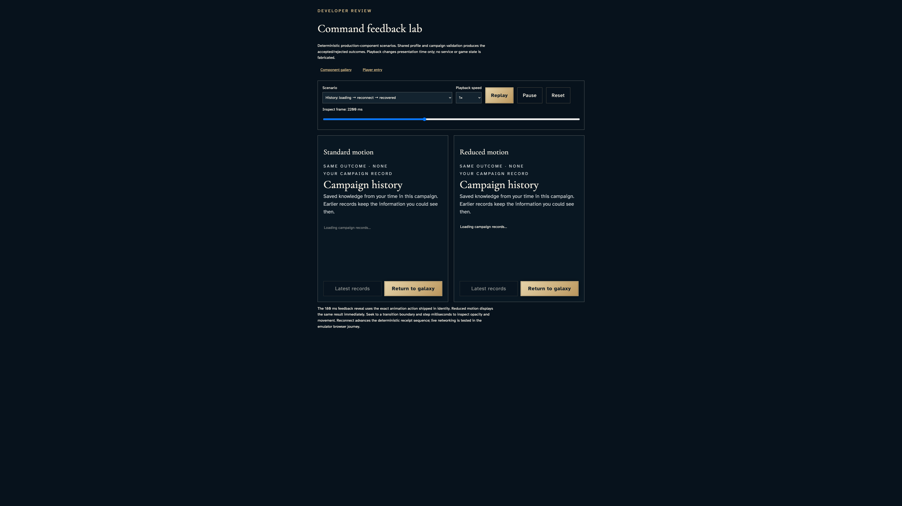
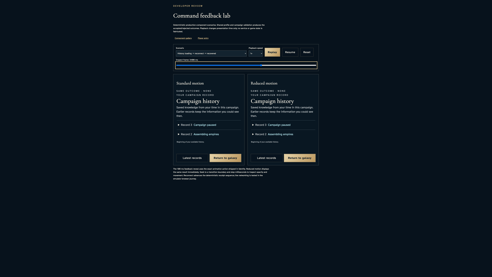
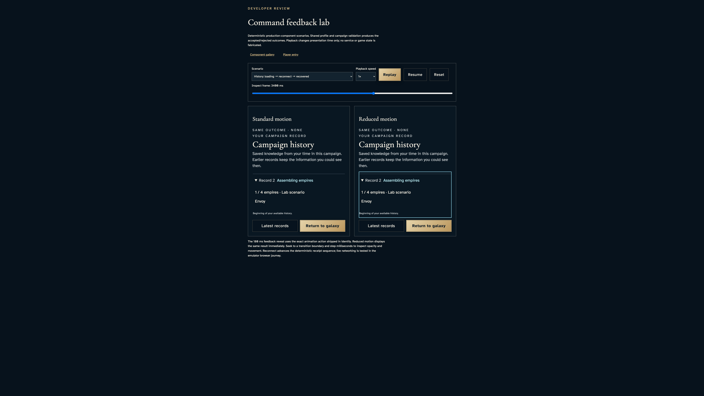
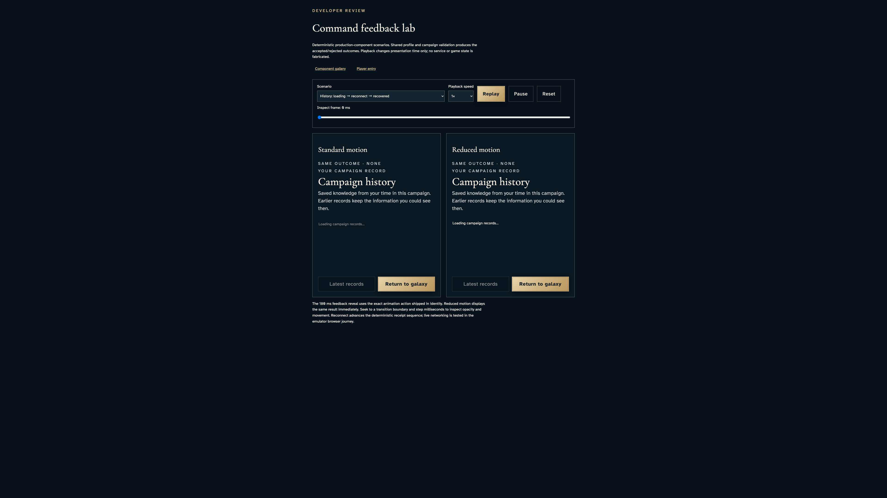

# Inspect history loading, recovery and bounded record reading

**Exact comparison passed.** large · darwin-arm64. Inventory: UX-12, UX-14, UX-16.

A developer uses the actual CampaignHistory component with the existing reducer-derived lab records. Browser time controls presentation only; these deterministic specimens are not network recovery, recipient authorization, pagination or hosted service evidence. The live history story remains separate.

## 1. Freeze browser playback only; no authenticated campaign, remote reads or service clock are replaced.

Actor: **Test harness**. **Harness control; not a player action.**

Acknowledged outcome: Explicit test control; not a player action or hosted-service certification.

## 2. Open the history scenario and inspect pending loading without invented records.

Actor: **Developer**.

Acknowledged outcome: Both motion panes report “Loading campaign records…” identically.

- [x] No records are presented as recovered while loading or interrupted.
- [x] Latest is disabled while the return control remains available.

### Viewpoint: Developer · standard history presentation

- [x] The labeled history specimen and footer remain contained while records scroll in their own bounded region.
- [x] Explicit paused motion: [aria-label="Standard motion comparison"], 1 animation(s), 180/180 ms; unchanged exact comparison.
- [x] Explicit paused motion: [aria-label="Reduced motion comparison"], 1 animation(s), 180/180 ms; unchanged exact comparison.

### Viewpoint: Developer · reduced history presentation

- [x] The labeled history specimen and footer remain contained while records scroll in their own bounded region.
- [x] Explicit paused motion: [aria-label="Standard motion comparison"], 1 animation(s), 180/180 ms; unchanged exact comparison.
- [x] Explicit paused motion: [aria-label="Reduced motion comparison"], 1 animation(s), 180/180 ms; unchanged exact comparison.

## 3. Seek to interrupted recovery and read the retry remedy in both panes.

Actor: **Developer**.

Acknowledged outcome: Both motion panes report “History could not be recovered. Retry keeps your place.” identically.

- [x] No records are presented as recovered while loading or interrupted.
- [x] Retry is a named enabled control and records are not replaced with a false empty-history result.

### Viewpoint: Developer · standard history presentation

- [x] The labeled history specimen and footer remain contained while records scroll in their own bounded region.
- [x] Explicit paused motion: [aria-label="Standard motion comparison"], 1 animation(s), 180/180 ms; unchanged exact comparison.
- [x] Explicit paused motion: [aria-label="Reduced motion comparison"], 1 animation(s), 180/180 ms; unchanged exact comparison.

### Viewpoint: Developer · reduced history presentation

- [x] The labeled history specimen and footer remain contained while records scroll in their own bounded region.
- [x] Explicit paused motion: [aria-label="Standard motion comparison"], 1 animation(s), 180/180 ms; unchanged exact comparison.
- [x] Explicit paused motion: [aria-label="Reduced motion comparison"], 1 animation(s), 180/180 ms; unchanged exact comparison.

## 4. Activate the standard pane's real retry callback by keyboard and inspect its loading frame.

Actor: **Developer**.

Acknowledged outcome: Both motion panes report “Loading campaign records…” identically.

- [x] No records are presented as recovered while loading or interrupted.
- [x] The callback advances the lab to retry time and removes the stale error while latest remains disabled.

### Viewpoint: Developer · standard history presentation

- [x] The labeled history specimen and footer remain contained while records scroll in their own bounded region.
- [x] Explicit paused motion: [aria-label="Standard motion comparison"], 1 animation(s), 0/180 ms; unchanged exact comparison.
- [x] Explicit paused motion: [aria-label="Reduced motion comparison"], 1 animation(s), 180/180 ms; unchanged exact comparison.

### Viewpoint: Developer · reduced history presentation

- [x] The labeled history specimen and footer remain contained while records scroll in their own bounded region.
- [x] Explicit paused motion: [aria-label="Standard motion comparison"], 1 animation(s), 0/180 ms; unchanged exact comparison.
- [x] Explicit paused motion: [aria-label="Reduced motion comparison"], 1 animation(s), 180/180 ms; unchanged exact comparison.

## 5. Seek to the recovered frame and inspect both original record identities and distinct paused/assembling descriptions.

Actor: **Developer**.

Acknowledged outcome: Both panes expose record three and record two, with no loading or error.

- [x] Recovery enables latest and identifies the beginning of available history without inventing earlier records.

### Viewpoint: Developer · standard history presentation

- [x] The labeled history specimen and footer remain contained while records scroll in their own bounded region.
- [x] Explicit paused motion: [aria-label="Standard motion comparison"], 1 animation(s), 180/180 ms; unchanged exact comparison.
- [x] Explicit paused motion: [aria-label="Reduced motion comparison"], 1 animation(s), 180/180 ms; unchanged exact comparison.

### Viewpoint: Developer · reduced history presentation

- [x] The labeled history specimen and footer remain contained while records scroll in their own bounded region.
- [x] Explicit paused motion: [aria-label="Standard motion comparison"], 1 animation(s), 180/180 ms; unchanged exact comparison.
- [x] Explicit paused motion: [aria-label="Reduced motion comparison"], 1 animation(s), 180/180 ms; unchanged exact comparison.

## 6. Open both actual record disclosures with Enter and use the bounded record region's keyboard scrolling.

Actor: **Developer**.

Acknowledged outcome: Both records retain their campaign name, one commander and original revision identities.

- [x] The focused record region is bounded and reading never changes the scenario time or adds records.

### Viewpoint: Developer · standard history presentation

- [x] The labeled history specimen and footer remain contained while records scroll in their own bounded region.
- [x] Explicit paused motion: [aria-label="Standard motion comparison"], 1 animation(s), 180/180 ms; unchanged exact comparison.
- [x] Explicit paused motion: [aria-label="Reduced motion comparison"], 1 animation(s), 180/180 ms; unchanged exact comparison.

### Viewpoint: Developer · reduced history presentation

- [x] The labeled history specimen and footer remain contained while records scroll in their own bounded region.
- [x] Explicit paused motion: [aria-label="Standard motion comparison"], 1 animation(s), 180/180 ms; unchanged exact comparison.
- [x] Explicit paused motion: [aria-label="Reduced motion comparison"], 1 animation(s), 180/180 ms; unchanged exact comparison.

## 7. Request latest through the real component callback and recover the declared lab loading state.

Actor: **Developer**.

Acknowledged outcome: Both motion panes report “Loading campaign records…” identically.

- [x] No records are presented as recovered while loading or interrupted.
- [x] Latest resets playback to zero and disables repeat loading while leaving return available.

### Viewpoint: Developer · standard history presentation

- [x] The labeled history specimen and footer remain contained while records scroll in their own bounded region.
- [x] Explicit paused motion: [aria-label="Standard motion comparison"], 1 animation(s), 0/180 ms; unchanged exact comparison.
- [x] Explicit paused motion: [aria-label="Reduced motion comparison"], 1 animation(s), 180/180 ms; unchanged exact comparison.

### Viewpoint: Developer · reduced history presentation

- [x] The labeled history specimen and footer remain contained while records scroll in their own bounded region.
- [x] Explicit paused motion: [aria-label="Standard motion comparison"], 1 animation(s), 0/180 ms; unchanged exact comparison.
- [x] Explicit paused motion: [aria-label="Reduced motion comparison"], 1 animation(s), 180/180 ms; unchanged exact comparison.

