# Inspect the shipped identity and navigation components

**Exact comparison passed.** short · darwin-arm64. Inventory: UX-01, UX-14, UX-16.

A developer uses the production gallery's actual shared components. Explicit local specimens expose keyboard focus, selected, disabled, pending, invalid and recovery states. Local activation counts are component callbacks, not service receipts or authentication acceptance. The reference page deliberately scrolls; these captures do not certify remaining gameplay specimens.

## 1. Open the developer-only gallery and read its scope before inspecting controls.

Actor: **Developer**.

Acknowledged outcome: Production component gallery is named and the animation lab is reachable.

- [x] The developer page explicitly says samples do not submit game commands.
- [x] The real component callback acknowledges 0 activations.

### Viewpoint: Developer · gallery scope

- [x] The named specimen is wholly visible after deliberate reference-page scrolling.

[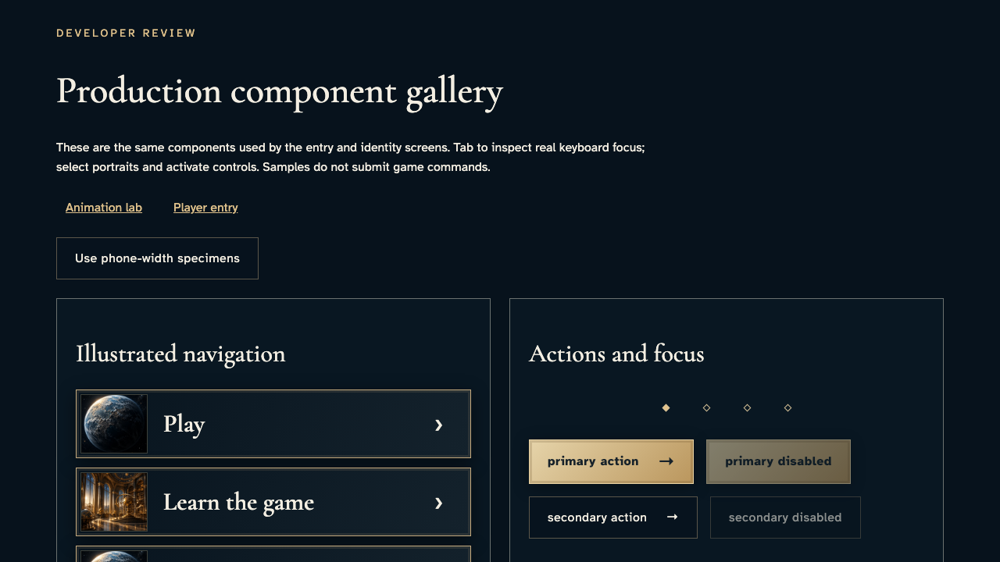](../../../../../../tests/browser/story-baselines/identity-component-gallery/short/darwin-arm64/001-open-gallery-1-developer-gallery-scope.png)

## 2. Focus and activate Play with the keyboard.

Actor: **Developer**.

Acknowledged outcome: The real component callback acknowledges 1 activations.

- [x] The illustrated control retains its real keyboard focus and pending navigation remains disabled.

### Viewpoint: Developer · Play keyboard focus

- [x] The named specimen is wholly visible after deliberate reference-page scrolling.

[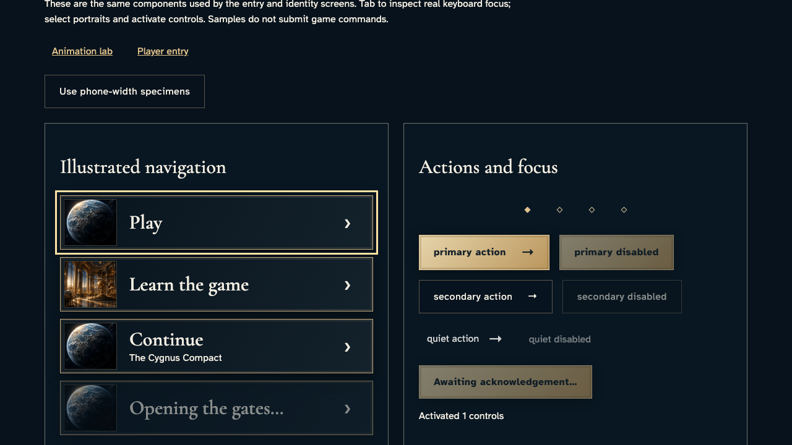](../../../../../../tests/browser/story-baselines/identity-component-gallery/short/darwin-arm64/002-navigation-0-1-developer-play-keyboard-focus.png)

## 3. Focus and activate Learn the game with the keyboard.

Actor: **Developer**.

Acknowledged outcome: The real component callback acknowledges 2 activations.

- [x] The illustrated control retains its real keyboard focus and pending navigation remains disabled.

### Viewpoint: Developer · Learn the game keyboard focus

- [x] The named specimen is wholly visible after deliberate reference-page scrolling.

[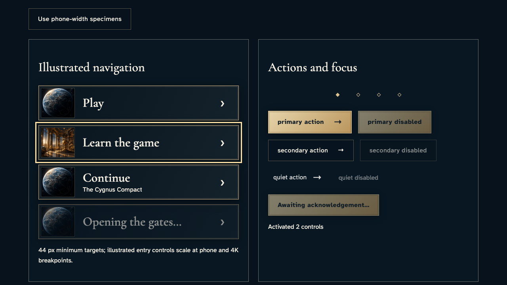](../../../../../../tests/browser/story-baselines/identity-component-gallery/short/darwin-arm64/003-navigation-1-1-developer-learn-the-game-keyboard-focus.png)

## 4. Focus and activate Continue The Cygnus Compact with the keyboard.

Actor: **Developer**.

Acknowledged outcome: The real component callback acknowledges 3 activations.

- [x] The illustrated control retains its real keyboard focus and pending navigation remains disabled.

### Viewpoint: Developer · Continue The Cygnus Compact keyboard focus

- [x] The named specimen is wholly visible after deliberate reference-page scrolling.

[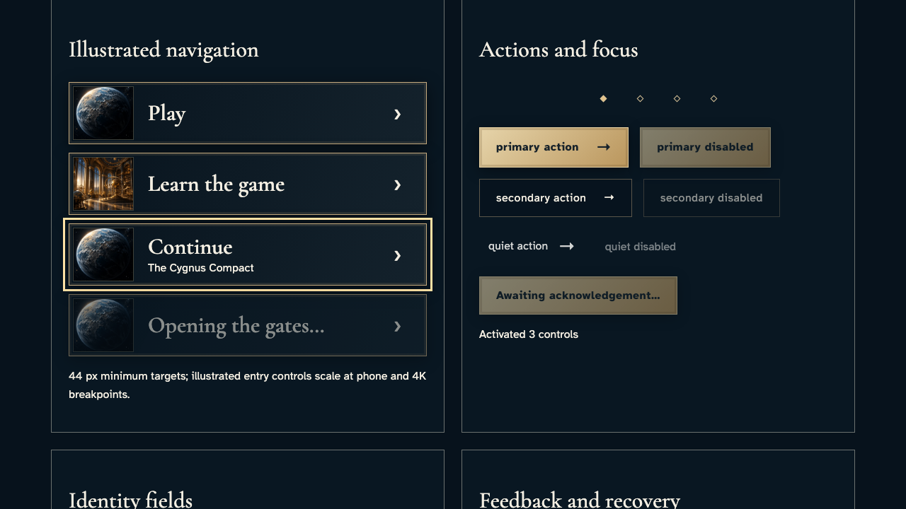](../../../../../../tests/browser/story-baselines/identity-component-gallery/short/darwin-arm64/004-navigation-2-1-developer-continue-the-cygnus-compact-keyboard-focus.png)

## 5. Inspect the disabled opening state without triggering another callback.

Actor: **Developer**.

Acknowledged outcome: The real component callback acknowledges 3 activations.

- [x] Pending navigation exposes its readable label and native disabled state.

### Viewpoint: Developer · pending navigation

- [x] The named specimen is wholly visible after deliberate reference-page scrolling.

[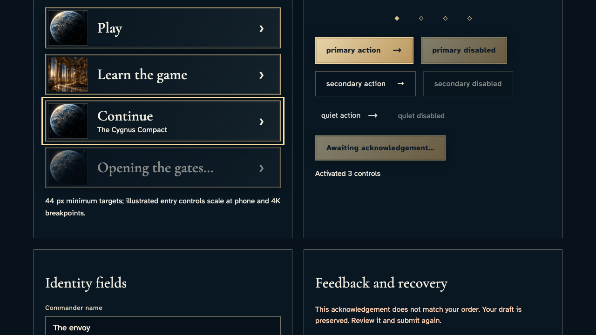](../../../../../../tests/browser/story-baselines/identity-component-gallery/short/darwin-arm64/005-navigation-pending-1-developer-pending-navigation.png)

## 6. Activate the shared primary button with Space and inspect its disabled counterpart.

Actor: **Developer**.

Acknowledged outcome: The real component callback acknowledges 4 activations.

- [x] The active action keeps focus; disabled and awaiting-acknowledgement controls remain unavailable.

### Viewpoint: Developer · primary action states

- [x] The named specimen is wholly visible after deliberate reference-page scrolling.

[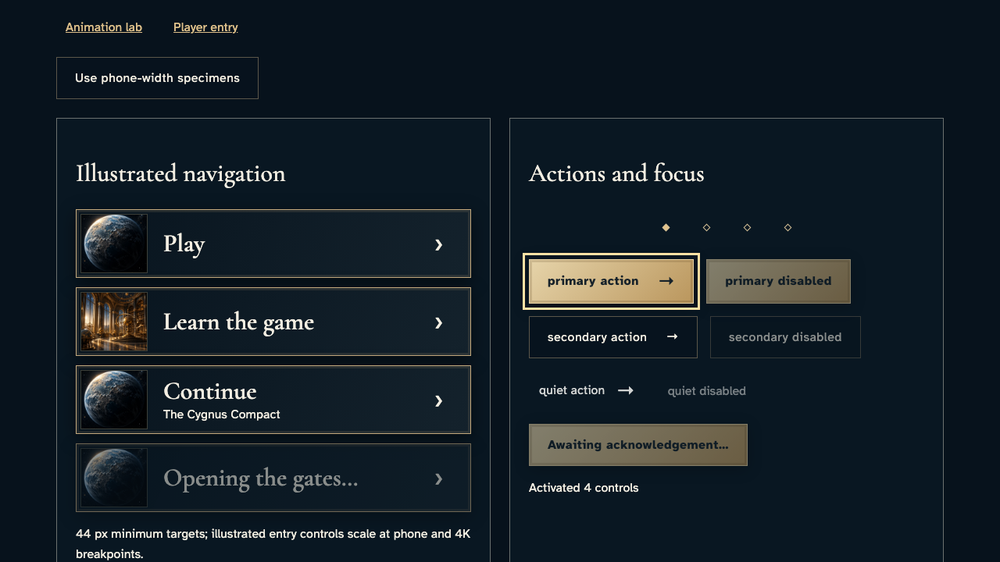](../../../../../../tests/browser/story-baselines/identity-component-gallery/short/darwin-arm64/006-action-primary-1-developer-primary-action-states.png)

## 7. Activate the shared secondary button with Space and inspect its disabled counterpart.

Actor: **Developer**.

Acknowledged outcome: The real component callback acknowledges 5 activations.

- [x] The active action keeps focus; disabled and awaiting-acknowledgement controls remain unavailable.

### Viewpoint: Developer · secondary action states

- [x] The named specimen is wholly visible after deliberate reference-page scrolling.

[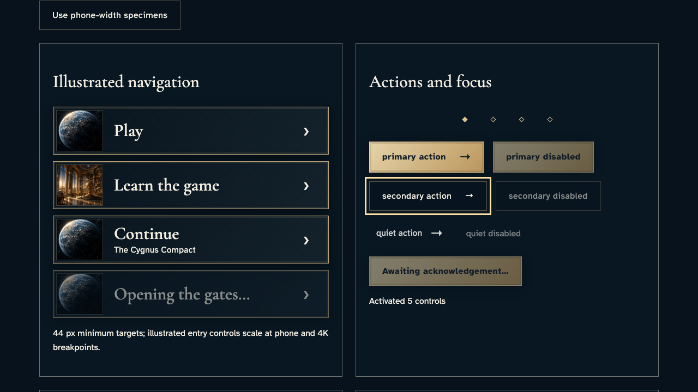](../../../../../../tests/browser/story-baselines/identity-component-gallery/short/darwin-arm64/007-action-secondary-1-developer-secondary-action-states.png)

## 8. Activate the shared quiet button with Space and inspect its disabled counterpart.

Actor: **Developer**.

Acknowledged outcome: The real component callback acknowledges 6 activations.

- [x] The active action keeps focus; disabled and awaiting-acknowledgement controls remain unavailable.

### Viewpoint: Developer · quiet action states

- [x] The named specimen is wholly visible after deliberate reference-page scrolling.

[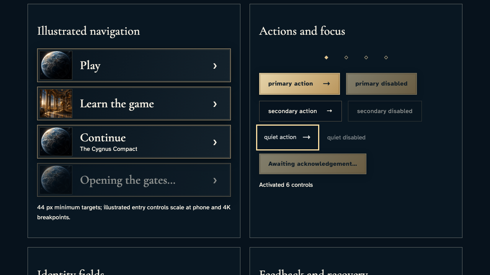](../../../../../../tests/browser/story-baselines/identity-component-gallery/short/darwin-arm64/008-action-quiet-1-developer-quiet-action-states.png)

## 9. Select Diplomacy using the real chapter navigation.

Actor: **Developer**.

Acknowledged outcome: Diplomacy alone is the current chapter.

- [x] The real component callback acknowledges 6 activations.

### Viewpoint: Developer · selected chapter

- [x] The named specimen is wholly visible after deliberate reference-page scrolling.

[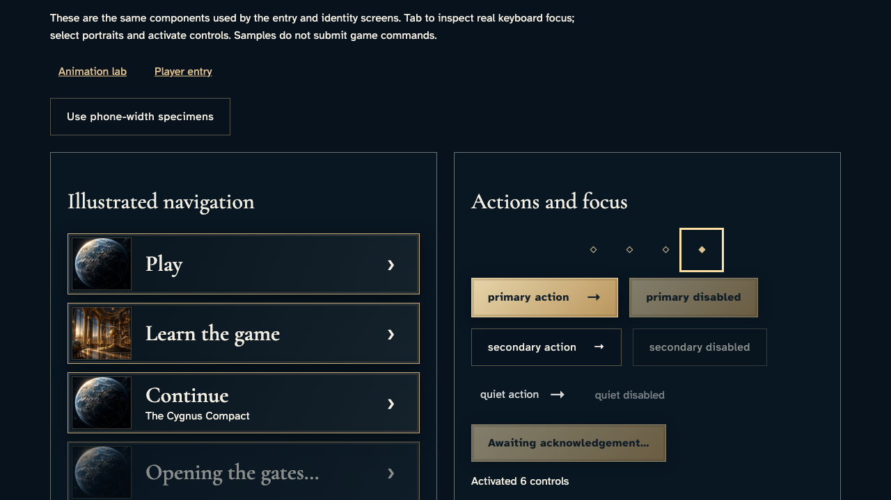](../../../../../../tests/browser/story-baselines/identity-component-gallery/short/darwin-arm64/009-chapter-selected-1-developer-selected-chapter.png)

## 10. Edit the enabled identity specimen while retaining separate invalid and pending fields.

Actor: **Developer**.

Acknowledged outcome: The enabled field retains the exact edited value.

- [x] Field labels clear the focus ring; invalid input names its validation alert and the pending draft stays disabled.

### Viewpoint: Developer · editable identity

- [x] The named specimen is wholly visible after deliberate reference-page scrolling.

[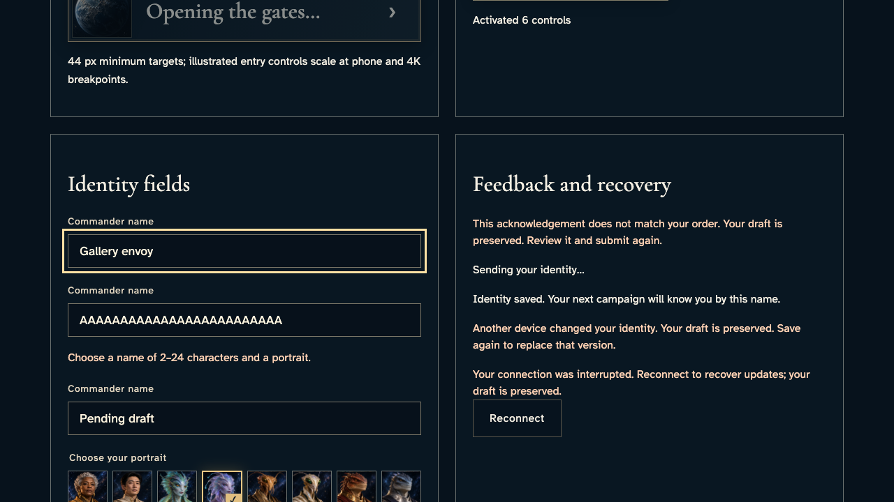](../../../../../../tests/browser/story-baselines/identity-component-gallery/short/darwin-arm64/010-identity-fields-1-developer-editable-identity.png)

### Viewpoint: Developer · validation and pending draft

- [x] The named specimen is wholly visible after deliberate reference-page scrolling.

[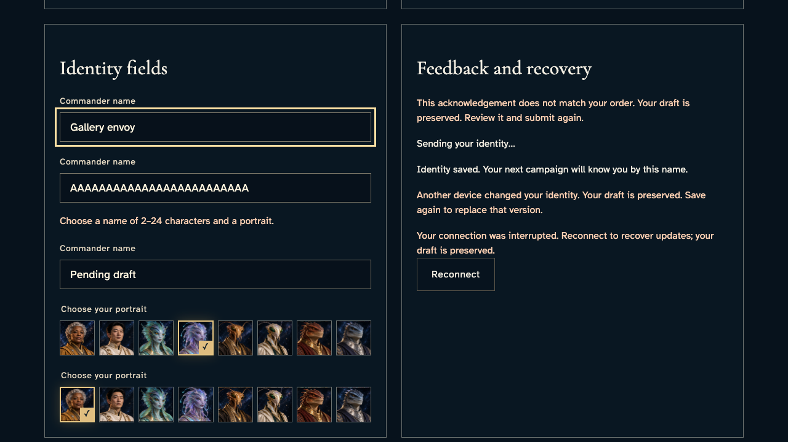](../../../../../../tests/browser/story-baselines/identity-component-gallery/short/darwin-arm64/010-identity-fields-2-developer-validation-and-pending-draft.png)

## 11. Select the navigator through its native radio and inspect the entire named portrait set.

Actor: **Developer**.

Acknowledged outcome: The navigator is the only selected enabled portrait.

- [x] All eight shared portraits expose their production accessible names.

### Viewpoint: Developer · selected and focused portrait

- [x] The named specimen is wholly visible after deliberate reference-page scrolling.

[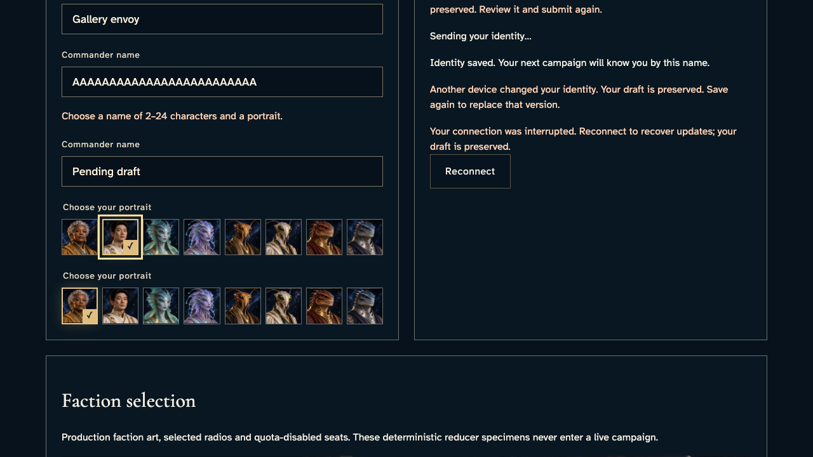](../../../../../../tests/browser/story-baselines/identity-component-gallery/short/darwin-arm64/011-portrait-selected-1-developer-selected-and-focused-portrait.png)

## 12. Inspect the disabled portrait set independently of the editable selection.

Actor: **Developer**.

Acknowledged outcome: The disabled set preserves its envoy selection.

- [x] Every radio in the pending set is disabled.

### Viewpoint: Developer · disabled portraits

- [x] The named specimen is wholly visible after deliberate reference-page scrolling.

[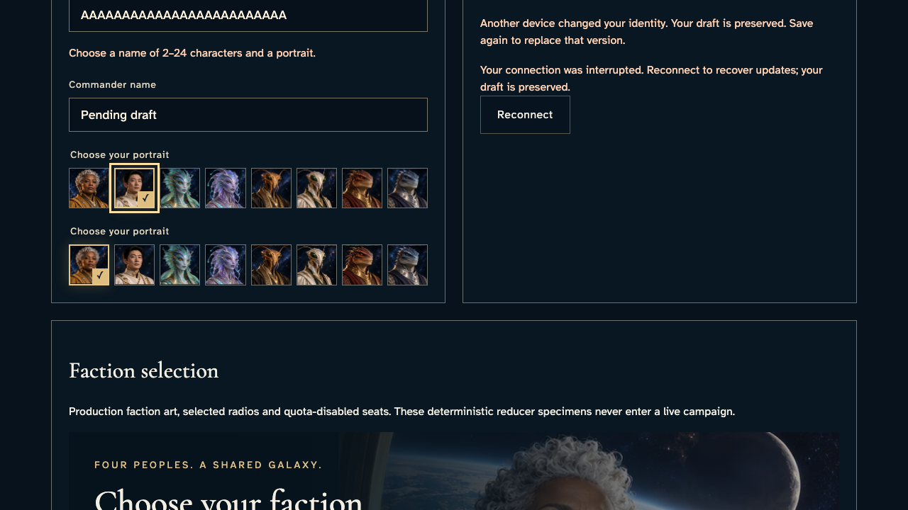](../../../../../../tests/browser/story-baselines/identity-component-gallery/short/darwin-arm64/012-portraits-pending-1-developer-disabled-portraits.png)

## 13. Read the shared pending, accepted and conflict feedback and invoke its reconnect callback.

Actor: **Developer**.

Acknowledged outcome: The real component callback acknowledges 7 activations.

- [x] Pending and accepted copy remain distinct; conflict and network errors explicitly preserve the draft.

### Viewpoint: Developer · identity acknowledgement

- [x] The named specimen is wholly visible after deliberate reference-page scrolling.

[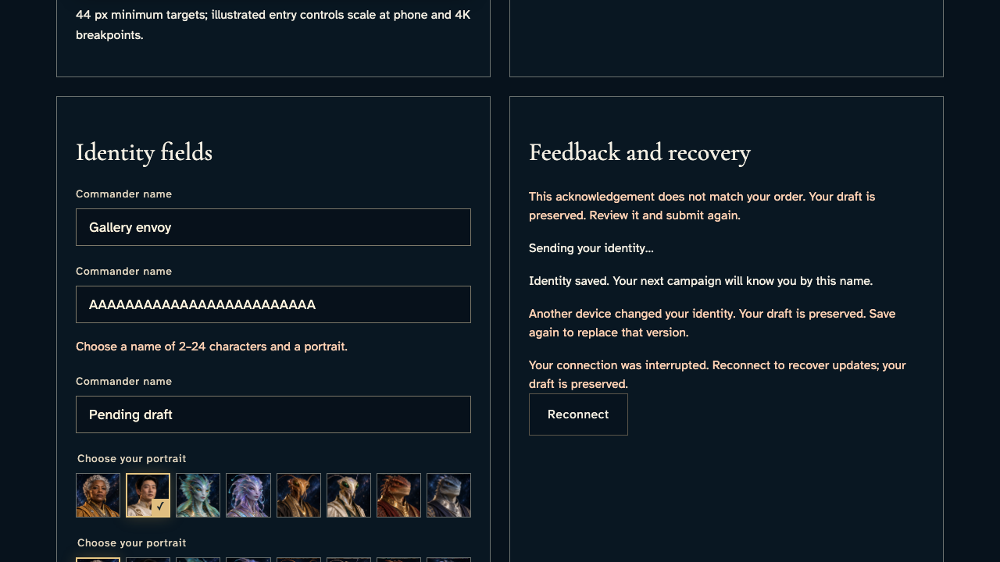](../../../../../../tests/browser/story-baselines/identity-component-gallery/short/darwin-arm64/013-feedback-recovery-1-developer-identity-acknowledgement.png)

### Viewpoint: Developer · conflict recovery

- [x] The named specimen is wholly visible after deliberate reference-page scrolling.

[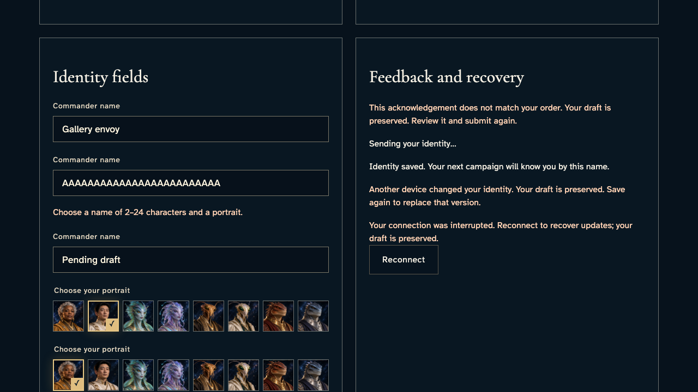](../../../../../../tests/browser/story-baselines/identity-component-gallery/short/darwin-arm64/013-feedback-recovery-2-developer-conflict-recovery.png)

### Viewpoint: Developer · network remedy

- [x] The named specimen is wholly visible after deliberate reference-page scrolling.

[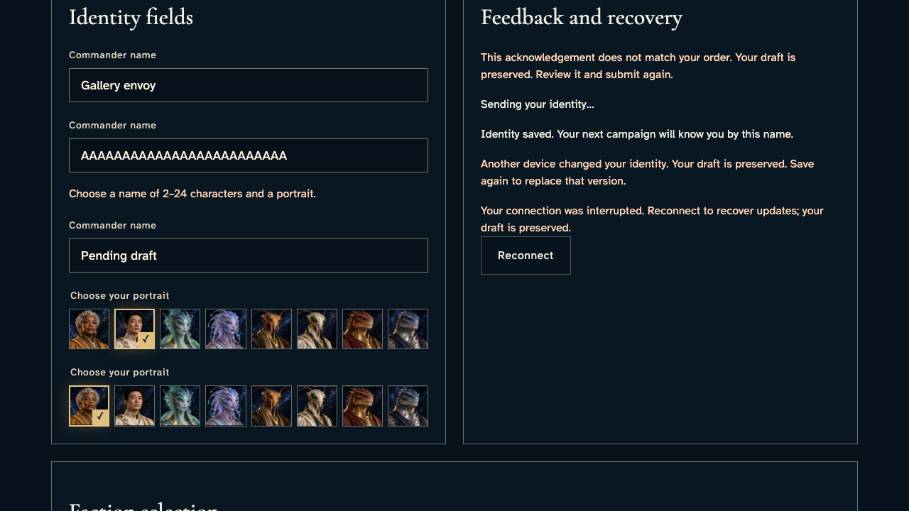](../../../../../../tests/browser/story-baselines/identity-component-gallery/short/darwin-arm64/013-feedback-recovery-3-developer-network-remedy.png)

## 14. Open the shared applied-research disclosure with Enter and read its recorded selection.

Actor: **Developer**.

Acknowledged outcome: The native disclosure opens and shows the applied investing selection.

- [x] The disclosure retains keyboard focus and a minimum 44px hit target.

### Viewpoint: Developer · applied research disclosure

- [x] The named specimen is wholly visible after deliberate reference-page scrolling.

[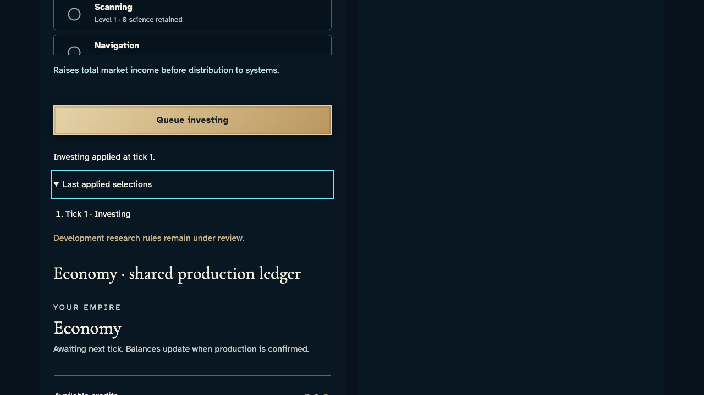](../../../../../../tests/browser/story-baselines/identity-component-gallery/short/darwin-arm64/014-research-disclosure-1-developer-applied-research-disclosure.png)

## 15. Close the research disclosure with Space without changing its recorded outcome.

Actor: **Developer**.

Acknowledged outcome: The native disclosure closes with its label and focus preserved.

- [x] The real component callback acknowledges 7 activations.

### Viewpoint: Developer · closed research disclosure

- [x] The named specimen is wholly visible after deliberate reference-page scrolling.

[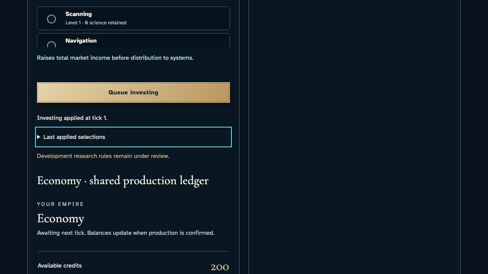](../../../../../../tests/browser/story-baselines/identity-component-gallery/short/darwin-arm64/015-research-disclosure-close-1-developer-closed-research-disclosure.png)

## 16. Switch to phone-width specimens without losing the edited identity or selected portrait.

Actor: **Developer**.

Acknowledged outcome: The gallery acknowledges narrow specimens and offers the wide layout again.

- [x] The identity specimen is at most 393px wide, contains every portrait target and preserves its editable state.

### Viewpoint: Developer · phone-width portrait specimen

- [x] The named specimen is wholly visible after deliberate reference-page scrolling.

[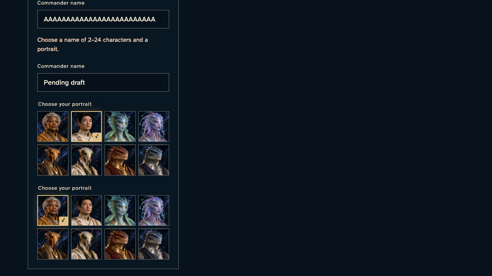](../../../../../../tests/browser/story-baselines/identity-component-gallery/short/darwin-arm64/016-narrow-specimens-1-developer-phone-width-portrait-specimen.png)

## 17. Inspect every entry/identity glyph with its visible identifier and decorative semantics.

Actor: **Developer**.

Acknowledged outcome: The gallery lists the complete shared glyph registry.

- [x] Each decorative glyph is hidden from assistive technology; real controls supply their names.

### Viewpoint: Developer · shared glyph inventory

- [x] The named specimen is wholly visible after deliberate reference-page scrolling.

[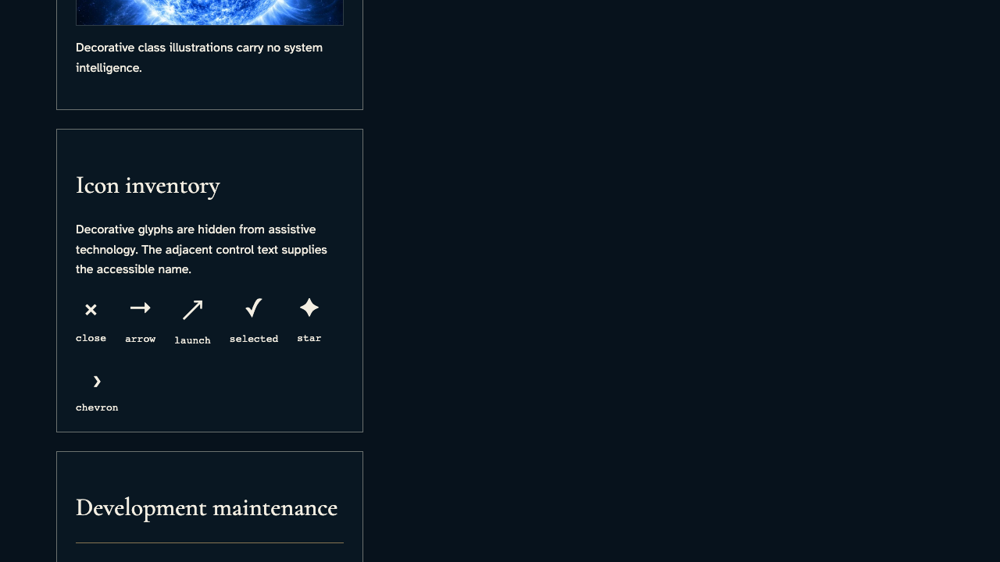](../../../../../../tests/browser/story-baselines/identity-component-gallery/short/darwin-arm64/017-icon-inventory-1-developer-shared-glyph-inventory.png)

## 18. Read the real artwork and font provenance and source link.

Actor: **Developer**.

Acknowledged outcome: The source link identifies the recorded production asset prompts.

- [x] Artwork, bundled font licences and the absence of generated lettering are disclosed.

### Viewpoint: Developer · asset provenance

- [x] The named specimen is wholly visible after deliberate reference-page scrolling.

