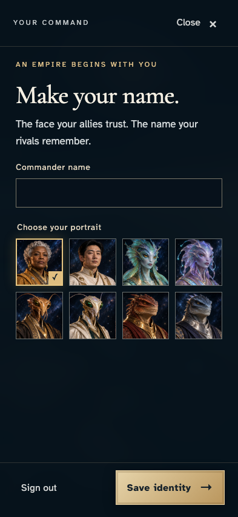
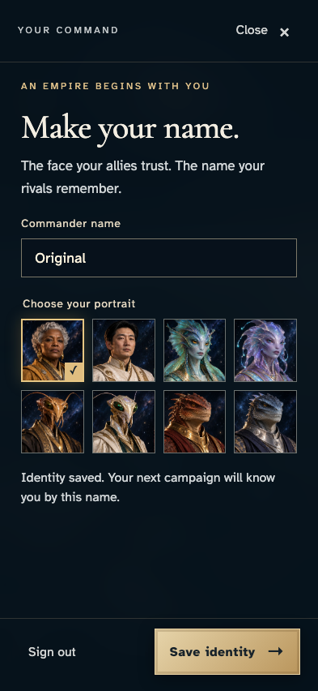
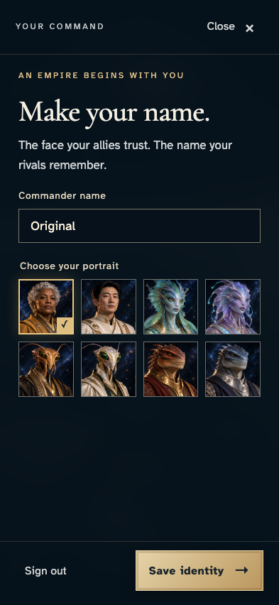
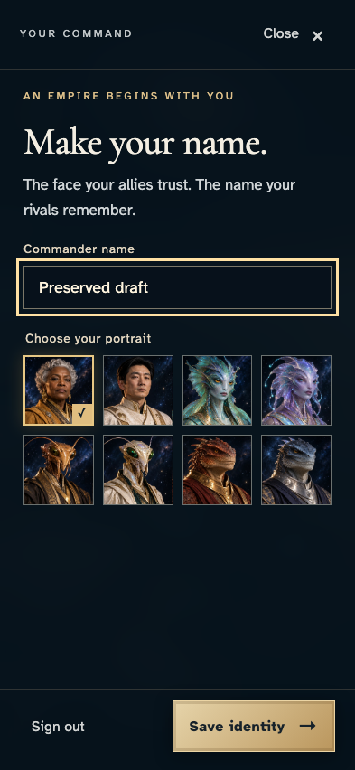
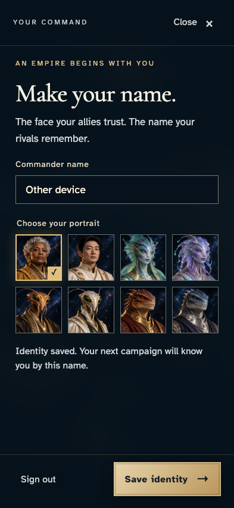
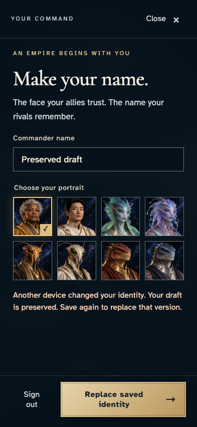
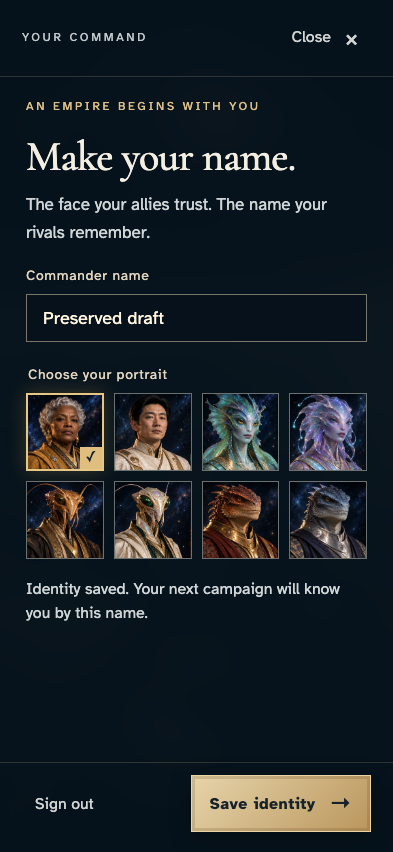

# Resolve two-device identity conflict without losing either draft

**Exact comparison passed.** phone · darwin-arm64. Inventory: UX-14, UX-16.

The same commander edits an identity on two independent authenticated devices. One save wins; the other draft survives conflict and requires an explicit replacement. Read-only emulator records corroborate revisions without choosing or injecting player actions.

## 1. Sign in on the first device and reach the identity editor.

Actor: **Commander — device one**.

Acknowledged outcome: The commander name field is ready after real provider login.

- [x] Eight production portraits and Save are available.

### Viewpoint: Commander — device one

## 2. Save Original as the shared identity.

Actor: **Commander — device one**.

Acknowledged outcome: The encrypted save receives an authoritative accepted receipt.

- [x] The acknowledged name remains Original.

### Viewpoint: Commander — device one

## 3. Sign in independently on a second device and recover Original.

Actor: **Commander — device two**.

Acknowledged outcome: The second device recovers the saved identity.

- [x] Both authenticated devices show the same saved name.

### Viewpoint: Commander — device one

### Viewpoint: Commander — device two

## 4. Edit a local Preserved draft without submitting it.

Actor: **Commander — device two**.

Acknowledged outcome: The editor displays the local draft.

- [x] The first device still shows the saved Original identity.

### Viewpoint: Commander — device one

### Viewpoint: Commander — device two

## 5. Save Other device while the second device keeps its unsent draft.

Actor: **Commander — device one**.

Acknowledged outcome: The first device receives accepted save acknowledgement.

- [x] The remote save does not overwrite the second device draft and produces revision two once.

### Viewpoint: Commander — device one

### Viewpoint: Commander — device two

## 6. Submit the stale draft and receive a conflict remedy.

Actor: **Commander — device two**.

Acknowledged outcome: The conflict identifies another device and offers explicit replacement.

- [x] The draft remains intact, no reconnect remedy is substituted, and the conflicting command has no saved effect.

### Viewpoint: Commander — device one

### Viewpoint: Commander — device two

## 7. Explicitly replace the saved identity with the preserved draft.

Actor: **Commander — device two**.

Acknowledged outcome: Replacement is acknowledged and reaches the other device.

- [x] Both devices retain the chosen draft, with exactly one additional saved revision.

### Viewpoint: Commander — device one

### Viewpoint: Commander — device two

