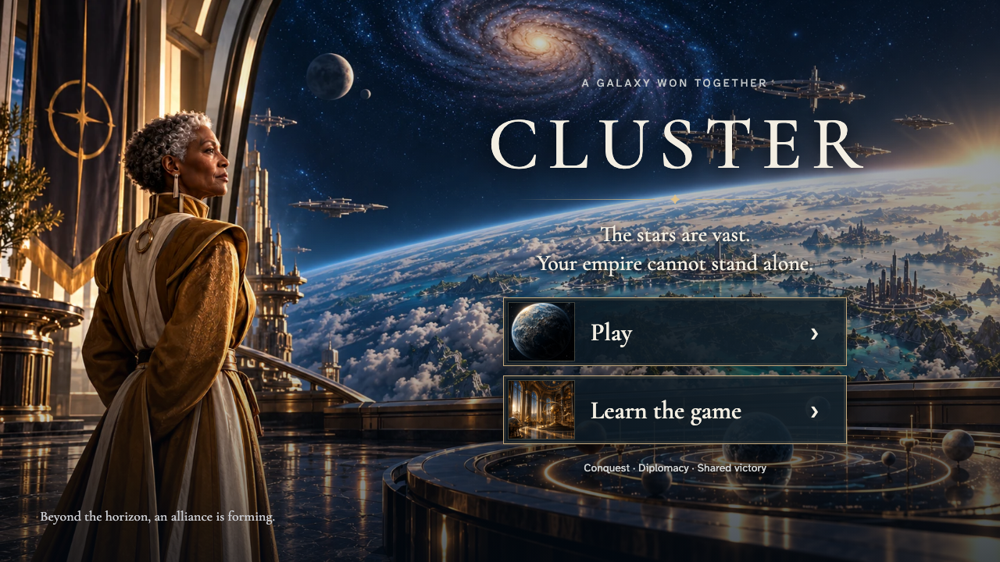
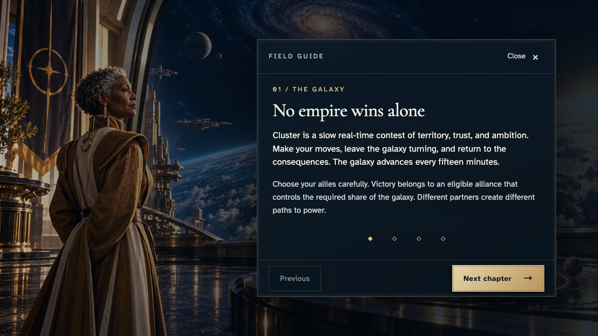
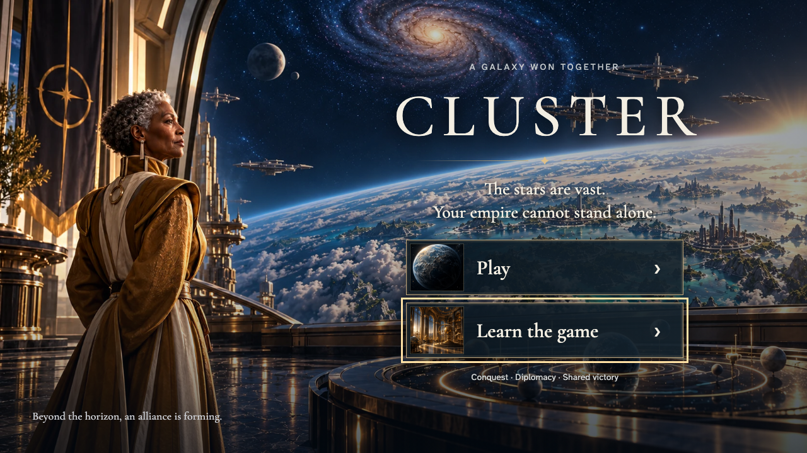
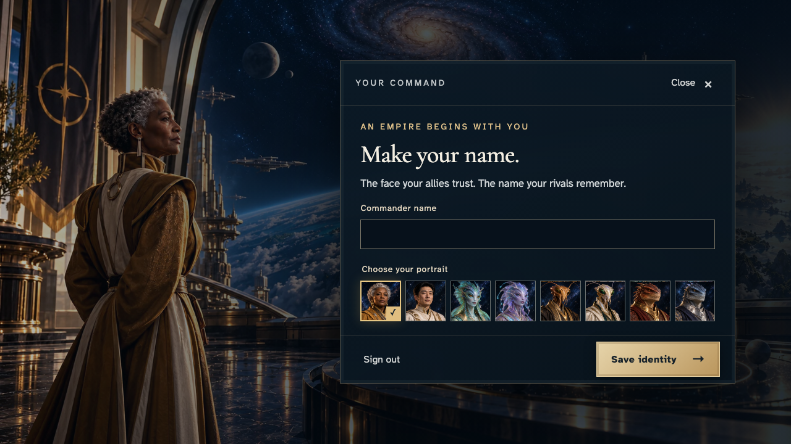
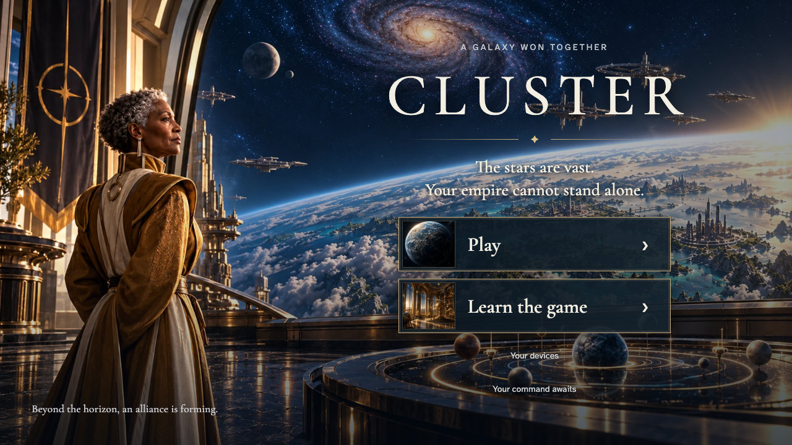

# Restore entry focus after keyboard learning and identity editing

**Exact comparison passed.** short · darwin-arm64. Inventory: UX-01, UX-15, UX-16.

A visitor opens and closes Learn with the keyboard, signs in, closes identity editing, and checks that the entry controls remain focused and reduced-motion transitions are removed.

## 1. Open entry with Play and Learn available.

Actor: **Visitor**.

Acknowledged outcome: Play is ready.

- [x] Learn is available.

### Viewpoint: Visitor

## 2. Open Learn with Enter and focus the first chapter.

Actor: **Visitor**.

Acknowledged outcome: The chapter heading receives focus.

- [x] The return control remains reachable.

### Viewpoint: Visitor

## 3. Use the keyboard to return to the opening Learn control.

Actor: **Visitor**.

Acknowledged outcome: Focus returns to Learn.

- [x] Play remains enabled.

### Viewpoint: Visitor

## 4. Sign in through Play and open identity editing.

Actor: **Commander**.

Acknowledged outcome: The identity editor is ready.

- [x] Close and Save remain available.

### Viewpoint: Commander

## 5. Close identity editing and restore focus to Play with reduced motion.

Actor: **Commander**.

Acknowledged outcome: Focus returns to the Play control that opened identity.

- [x] Reduced motion is active and the entry control has no transition duration.

### Viewpoint: Commander

