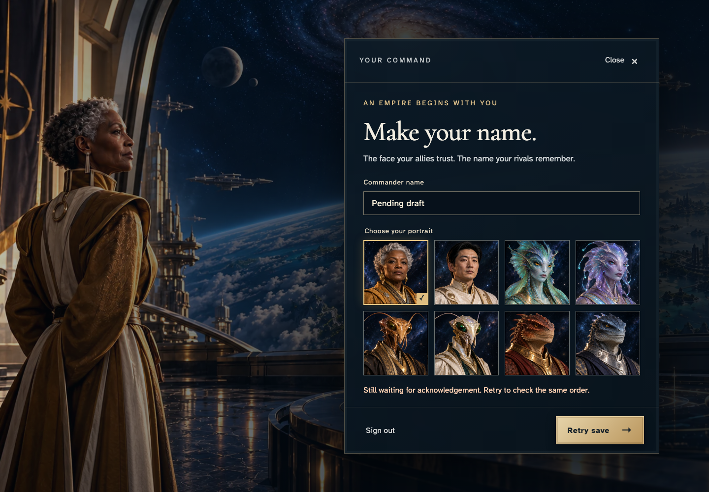
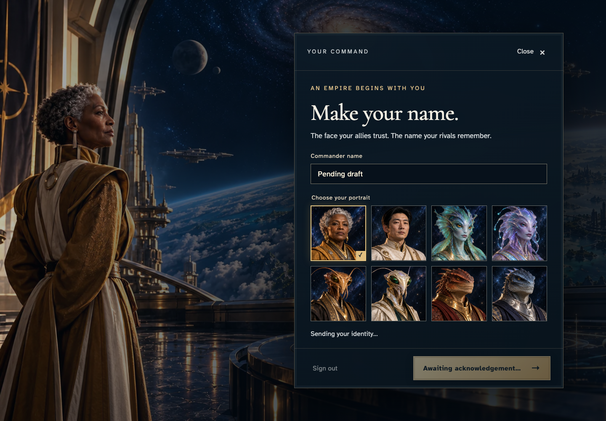
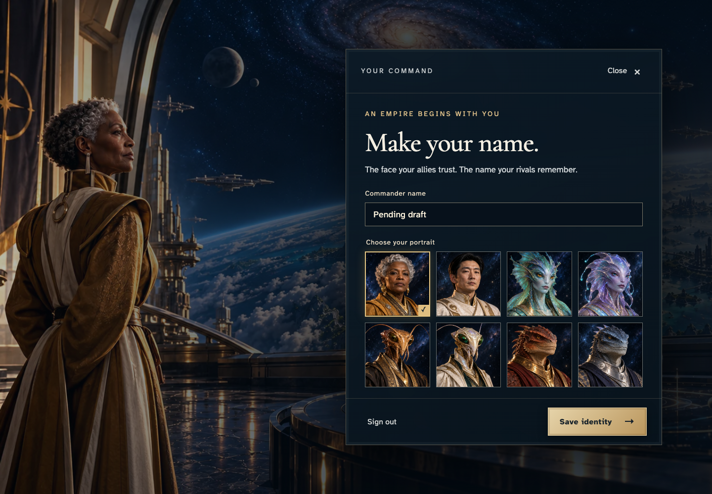

# Retry a pending identity command without duplicate effects or draft loss

**Exact comparison passed.** desktop · darwin-arm64. Inventory: UX-14, UX-16.

A commander saves an identity, loses the network, preserves a pending draft through an explicit retry and reconnect, and recovers it after reload. Actual transport frames and read-only canonical receipts distinguish retransmission from duplicate logical commands.

## 1. Sign in and reach the real identity editor.

Actor: **Commander**.

Acknowledged outcome: Identity editing is ready after authentication.

- [x] Save is available.

### Viewpoint: Commander

## 2. Save Before network loss before disconnecting.

Actor: **Commander**.

Acknowledged outcome: The initial save is acknowledged.

- [x] The accepted name is visible.

### Viewpoint: Commander

## 3. Disconnect this browser context to exercise the actual pending-command recovery protocol.

Actor: **Test harness**. **Harness control; not a player action.**

Acknowledged outcome: Explicit test control; not a player action or hosted-service certification.

## 4. Submit Pending draft offline and receive a retry remedy without losing it.

Actor: **Commander**.

Acknowledged outcome: The acknowledgement deadline exposes Retry save.

- [x] The pending draft remains visible and locked to its original command payload.

### Viewpoint: Commander

## 5. Retry the same pending save while preserving its draft.

Actor: **Commander**.

Acknowledged outcome: The same order is awaiting acknowledgement again.

- [x] Retry does not clear or change the draft.

### Viewpoint: Commander

## 6. Restore the network so the queued command and any transport retransmission can receive the authoritative receipt.

Actor: **Test harness**. **Harness control; not a player action.**

Acknowledged outcome: Explicit test control; not a player action or hosted-service certification.

## 7. Receive the accepted save after reconnecting.

Actor: **Commander**.

Acknowledged outcome: The authoritative receipt confirms the saved draft.

- [x] Every transport transmission uses one unchanged logical command, with exactly one acknowledged revision and saved effect.

### Viewpoint: Commander

## 8. Reload and recover the saved draft without submitting another command.

Actor: **Commander**.

Acknowledged outcome: The saved Pending draft returns after reload.

- [x] Reload preserves the acknowledged revision and version count.

### Viewpoint: Commander

