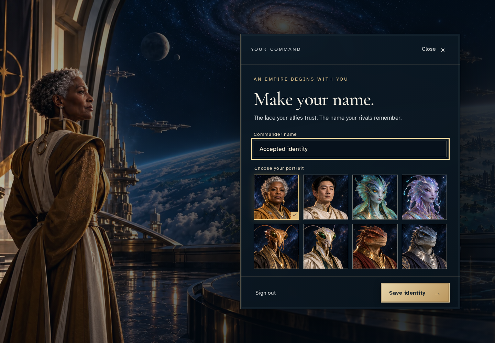
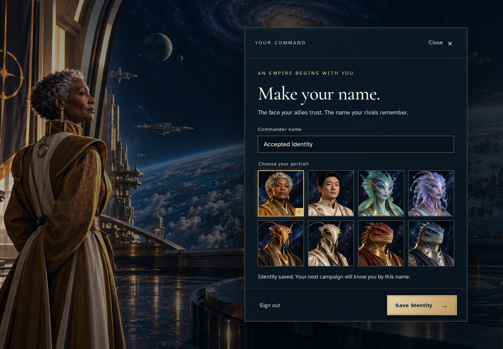
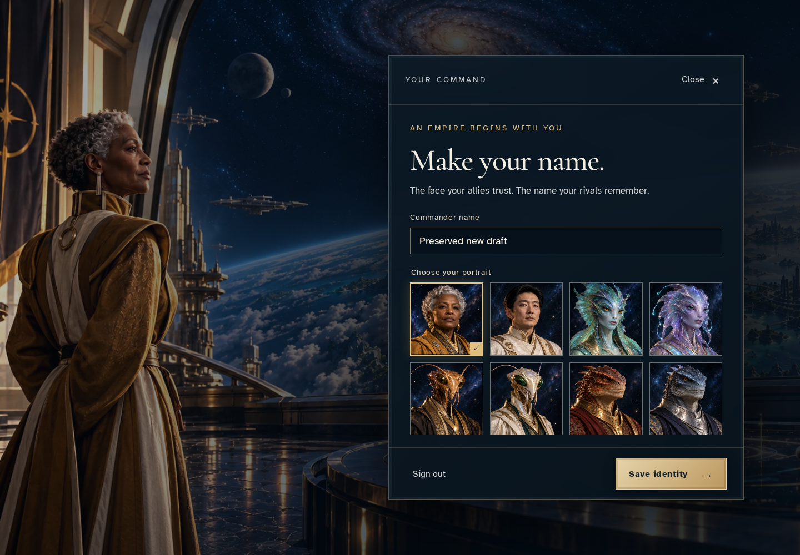

# Recover an identity draft after a mismatched acknowledgement

**Exact comparison passed.** desktop · linux-arm64. Inventory: UX-01, UX-14, UX-16.

A commander submits a second identity with a deliberately reused command UUID. The real encrypted ingress rejects the mismatched acknowledgement without losing the draft; a new command saves it and reload recovers the accepted identity.

## 1. Deliberately reuse the browser command UUID while preserving real encryption entropy, authenticated ingress, persistence and receipt validation. Sign in through the ordinary Google emulator UI.

Actor: **Test harness**. **Harness control; not a player action.**

Acknowledged outcome: Explicit test control; not a player action or hosted-service certification.

## 2. Choose the identity to save first.

Actor: **Receipt commander**.

Acknowledged outcome: The identity draft is ready to save.

- [x] The alias is visible before commitment.

### Viewpoint: Receipt commander

## 3. Save the first identity and wait for its authoritative acknowledgement.

Actor: **Receipt commander**.

Acknowledged outcome: The identity save is acknowledged.

- [x] Canonical identity remains at revision 1 with 1 versions and receipts.

### Viewpoint: Receipt commander

## 4. Prepare a different identity while the original stays saved.

Actor: **Receipt commander**.

Acknowledged outcome: The replacement text remains editable.

- [x] Canonical identity remains at revision 1 with 1 versions and receipts.
- [x] The unsaved replacement does not inherit the prior save acknowledgement.

### Viewpoint: Receipt commander

## 5. Submit the replacement with the reused command ID. The acknowledgement belongs to different content, so the draft is retained for a fresh save.

Actor: **Receipt commander**.

Acknowledged outcome: The mismatched-order alert is focused.

- [x] Canonical identity remains at revision 1 with 1 versions and receipts.
- [x] The draft survives without a misleading validation error or retry of the colliding command.

### Viewpoint: Receipt commander

## 6. Restore ordinary random command UUIDs; do not change the retained draft, receipt or persisted identity.

Actor: **Test harness**. **Harness control; not a player action.**

Acknowledged outcome: Explicit test control; not a player action or hosted-service certification.

## 7. Save the retained draft as a new command and receive its matching acknowledgement.

Actor: **Receipt commander**.

Acknowledged outcome: The fresh identity command is acknowledged.

- [x] Canonical identity remains at revision 2 with 2 versions and receipts.

### Viewpoint: Receipt commander

## 8. Reload and reopen the identity saved by the fresh command.

Actor: **Receipt commander**.

Acknowledged outcome: The accepted replacement survives reload.

- [x] Canonical identity remains at revision 2 with 2 versions and receipts.

### Viewpoint: Receipt commander

