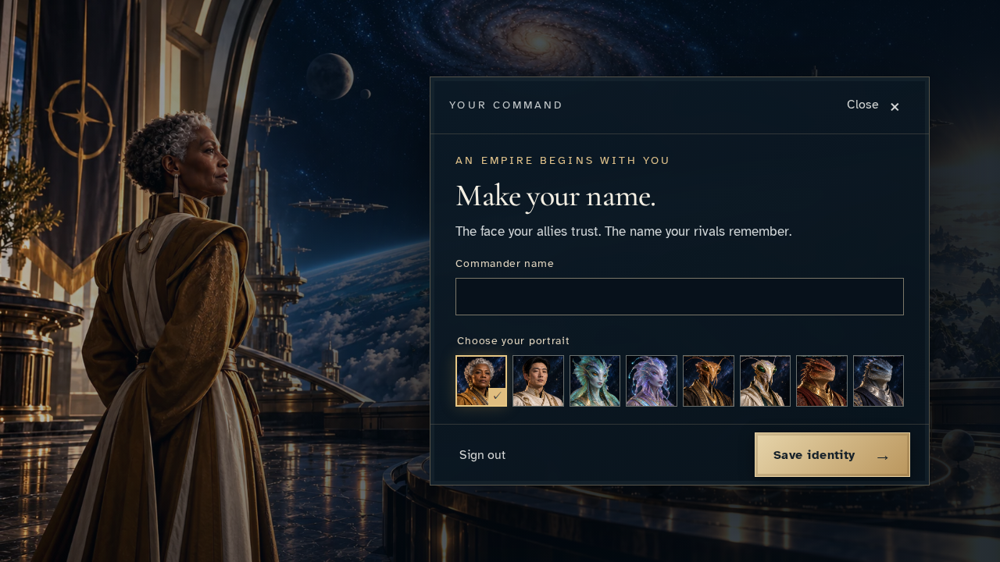
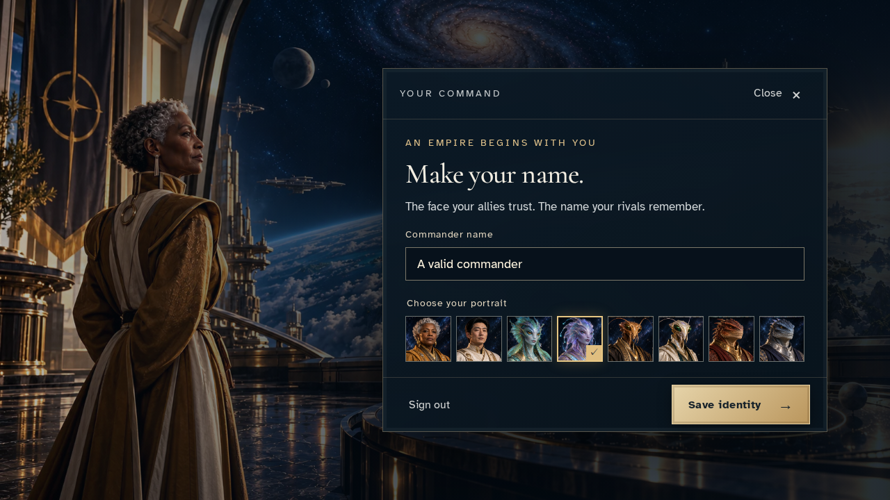
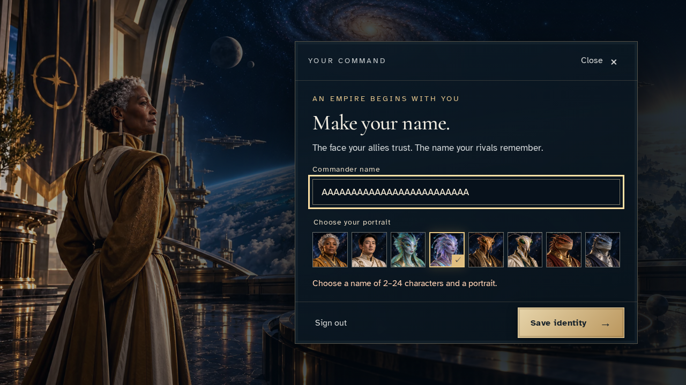
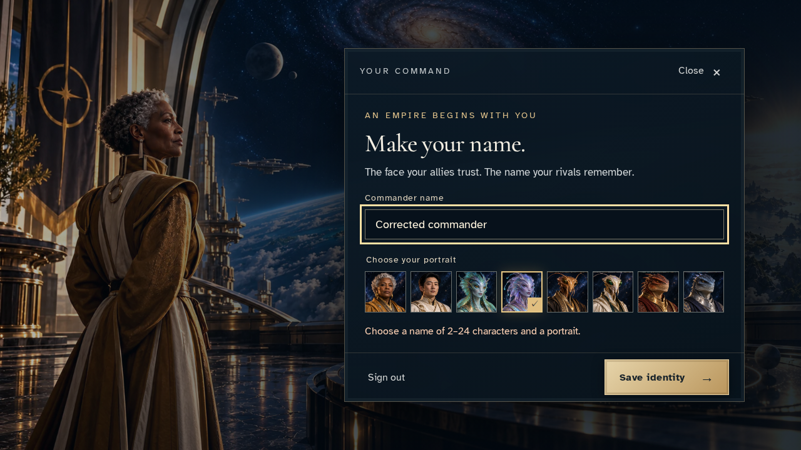
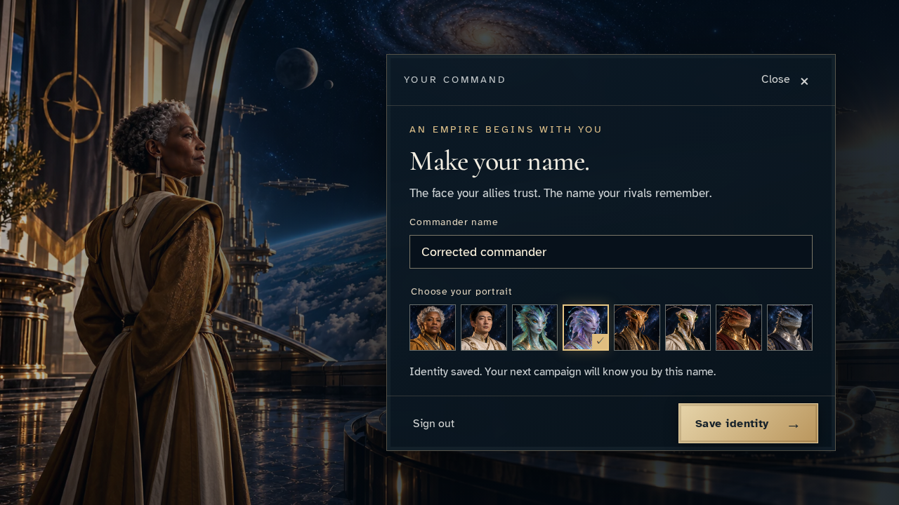
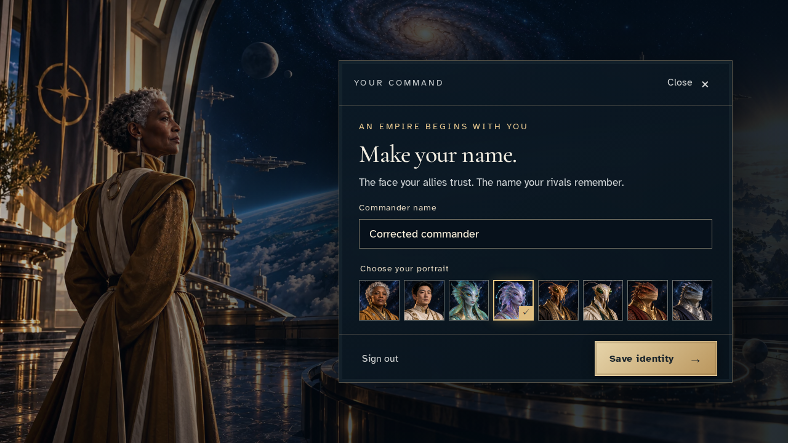

# Correct an invalid commander identity

**Exact comparison passed.** short · linux-arm64. Inventory: UX-14, UX-16.

A commander enters a name, receives a focused validation remedy for an overlong draft, corrects it and receives the real encrypted-save acknowledgement before recovering it after reload.

## 1. Sign in and open the production identity editor.

Actor: **Commander**.

Acknowledged outcome: The authenticated identity editor is ready.

- [x] Save is available and no profile command has been submitted.

### Viewpoint: Commander

## 2. Draft a valid name and select the Deepseer portrait.

Actor: **Commander**.

Acknowledged outcome: The name and portrait remain selected locally.

- [x] Editing has not written a profile.

### Viewpoint: Commander

## 3. Attempt to save a 25-character name and read the specific validation remedy.

Actor: **Commander**.

Acknowledged outcome: The editor explains the 2–24 character requirement.

- [x] The invalid draft and portrait are retained, focus returns to the name, and reconnect is not offered.

### Viewpoint: Commander

## 4. Correct the name in the preserved draft.

Actor: **Commander**.

Acknowledged outcome: The corrected draft is ready to save.

- [x] The portrait remains selected and no command was sent before commitment.

### Viewpoint: Commander

## 5. Save the corrected identity and wait for authoritative acceptance.

Actor: **Commander**.

Acknowledged outcome: Identity saved confirms the accepted command.

- [x] The validation error clears and exactly one canonical revision, version and receipt exist.

### Viewpoint: Commander

## 6. Reload and recover the accepted correction without another write.

Actor: **Commander**.

Acknowledged outcome: The saved name and portrait are recovered.

- [x] Recovery keeps the original saved revision and no validation error.

### Viewpoint: Commander

