# Recover an interrupted route without duplicating its forces

**Exact comparison passed.** large · linux-arm64. Inventory: UX-08, UX-14, UX-16.

Four independent commanders enter through actual authenticated controls. Formation establishes a fleet; a route preview becomes an acknowledged departure and authoritative arrival. Owner and other-player views show private orders and outcomes. Fixed catalogue/domain clocks and scan entropy identities are explicit harness controls; real HMAC draws and acquisition remain unchanged. Development transport capacity and tick rules remain under review; Submitted route recovery is distinct from unsent memory-only drafts; this does not certify managed encryption or hosted scheduling.

## 1. Ordinary emulator sign-in and identity save, with explicit developer entitlement and fixed browser Date; timers continue normally.

Actor: **Test harness**. **Harness control; not a player action.**

Acknowledged outcome: Explicit test control; not a player action or hosted-service certification.

## 2. Ordinary emulator sign-in and identity save, with explicit developer entitlement and fixed browser Date; timers continue normally.

Actor: **Test harness**. **Harness control; not a player action.**

Acknowledged outcome: Explicit test control; not a player action or hosted-service certification.

## 3. Ordinary emulator sign-in and identity save, with explicit developer entitlement and fixed browser Date; timers continue normally.

Actor: **Test harness**. **Harness control; not a player action.**

Acknowledged outcome: Explicit test control; not a player action or hosted-service certification.

## 4. Ordinary emulator sign-in and identity save, with explicit developer entitlement and fixed browser Date; timers continue normally.

Actor: **Test harness**. **Harness control; not a player action.**

Acknowledged outcome: Explicit test control; not a player action or hosted-service certification.

## 5. Create/join through ordinary campaign controls. Fixed catalogue and admission clock are test controls; no seat, message or command outcome is injected.

Actor: **Test harness**. **Harness control; not a player action.**

Acknowledged outcome: Explicit test control; not a player action or hosted-service certification.

## 6. Create/join through ordinary campaign controls. Fixed catalogue and admission clock are test controls; no seat, message or command outcome is injected.

Actor: **Test harness**. **Harness control; not a player action.**

Acknowledged outcome: Explicit test control; not a player action or hosted-service certification.

## 7. Create/join through ordinary campaign controls. Fixed catalogue and admission clock are test controls; no seat, message or command outcome is injected.

Actor: **Test harness**. **Harness control; not a player action.**

Acknowledged outcome: Explicit test control; not a player action or hosted-service certification.

## 8. Create/join through ordinary campaign controls. Fixed catalogue and admission clock are test controls; no seat, message or command outcome is injected.

Actor: **Test harness**. **Harness control; not a player action.**

Acknowledged outcome: Explicit test control; not a player action or hosted-service certification.

## 9. Advance the designated browser/domain clock to 12:15 UTC and deliver the actual emulator Scheduler HTTP request. This does not certify hosted scheduling.

Actor: **Test harness**. **Harness control; not a player action.**

Acknowledged outcome: Explicit test control; not a player action or hosted-service certification.

## 10. Open each commander's own fleet preparation. Enter two fighters and an over-capacity infantry complement before committing anything.

Actor: **Fleet marshal**.

Acknowledged outcome: The actual capacity constraint disables formation without a command.

- [x] Both fixed action rails are visible before scrolling and no application error occurred.
- [x] Other commanders have no owner fleet, private order or ledger in their actual member projections.
- [x] Invalid input does not change canonical state or reserve forces.

### Viewpoint: Fleet marshal

[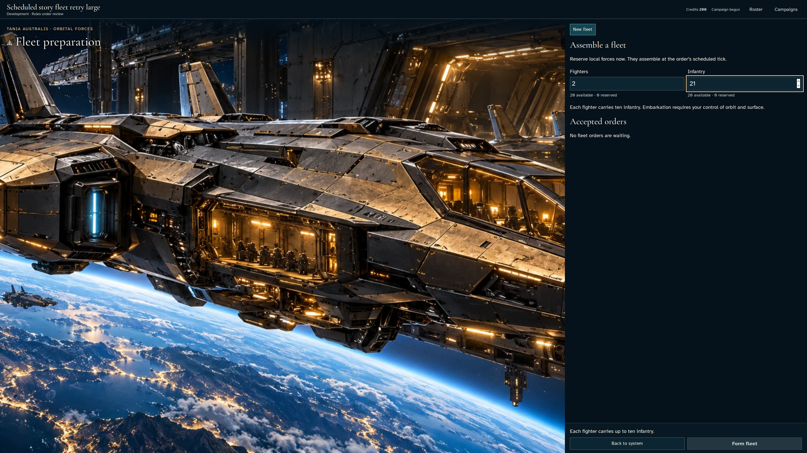](../../../../../../tests/browser/story-baselines/interrupted-fleet-route/large/linux-arm64/010-inspect-formation-1-fleet-marshal.png)

### Viewpoint: Independent marshal

## 11. Reduce infantry to the supported twenty and inspect the ready formation.

Actor: **Fleet marshal**.

Acknowledged outcome: Formation is enabled and focused for keyboard confirmation.

- [x] Both fixed action rails are visible before scrolling and no application error occurred.
- [x] Other commanders have no owner fleet, private order or ledger in their actual member projections.

### Viewpoint: Fleet marshal

### Viewpoint: Independent marshal

## 12. Confirm formation with Enter. The authoritative receipt reserves two fighters and twenty infantry for tick one, without moving them yet.

Actor: **Fleet marshal**.

Acknowledged outcome: The service acknowledges the formation and publishes its exact waiting complement.

- [x] Both fixed action rails are visible before scrolling and no application error occurred.
- [x] Other commanders have no owner fleet, private order or ledger in their actual member projections.
- [x] One accepted receipt and revision reserve the original forces without creating a fleet or moving the garrison.

### Viewpoint: Fleet marshal

[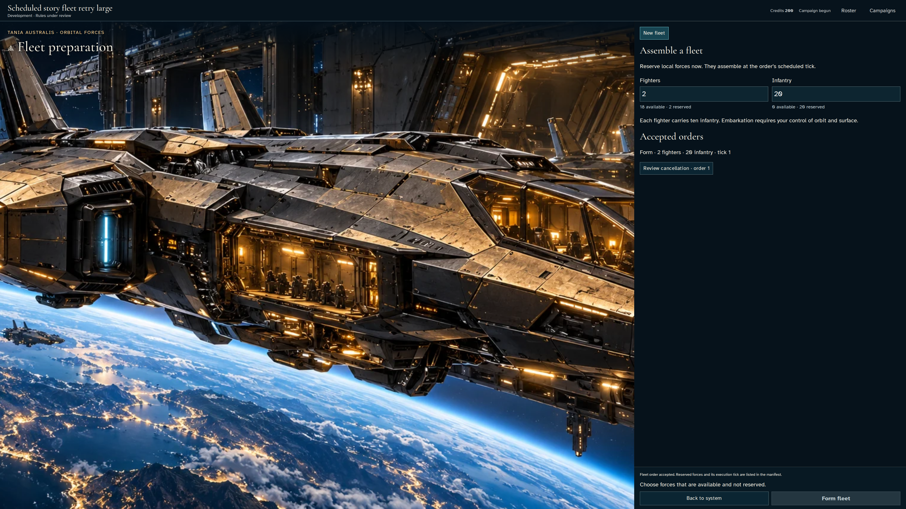](../../../../../../tests/browser/story-baselines/interrupted-fleet-route/large/linux-arm64/012-reserve-formation-1-fleet-marshal.png)

### Viewpoint: Independent marshal

## 13. Reload the owner account and reopen its exact campaign's home-system fleet panel.

Actor: **Fleet marshal**.

Acknowledged outcome: The same accepted order and reserved complement return from persistence.

- [x] Both fixed action rails are visible before scrolling and no application error occurred.
- [x] Other commanders have no owner fleet, private order or ledger in their actual member projections.
- [x] Reload adds no revision, order or effect.

### Viewpoint: Fleet marshal

### Viewpoint: Independent marshal

## 14. Advance the explicit domain clock once and invoke the real leased tick service. Repeat delivery must do no work; no fleet or outcome is injected.

Actor: **Test harness**. **Harness control; not a player action.**

Acknowledged outcome: Explicit test control; not a player action or hosted-service certification.

## 15. Read the authoritative formation result and select the new fleet with the keyboard. The other commander still sees only their own forces.

Actor: **Fleet marshal**.

Acknowledged outcome: The confirmed fleet contains two fighters and twenty infantry and can be disbanded.

- [x] Both fixed action rails are visible before scrolling and no application error occurred.
- [x] Other commanders have no owner fleet, private order or ledger in their actual member projections.
- [x] Units move from garrison to exactly one fleet; only this tick's recorded production changes empire totals.

### Viewpoint: Fleet marshal

### Viewpoint: Independent marshal

## 16. Open the fleet route planner with the keyboard. Range limits each leg; speed determines its travel duration.

Actor: **Fleet marshal**.

Acknowledged outcome: The real route details gain focus and show distinct range and speed.

- [x] Every rendered waypoint ownership label agrees with the actual owner's current acquired report or Unknown; canonical reads only corroborate visible facts.
- [x] The route commitment rail is visible before scrolling, and other commanders receive no private route, fleet complement or arrival report.

### Viewpoint: Fleet marshal

[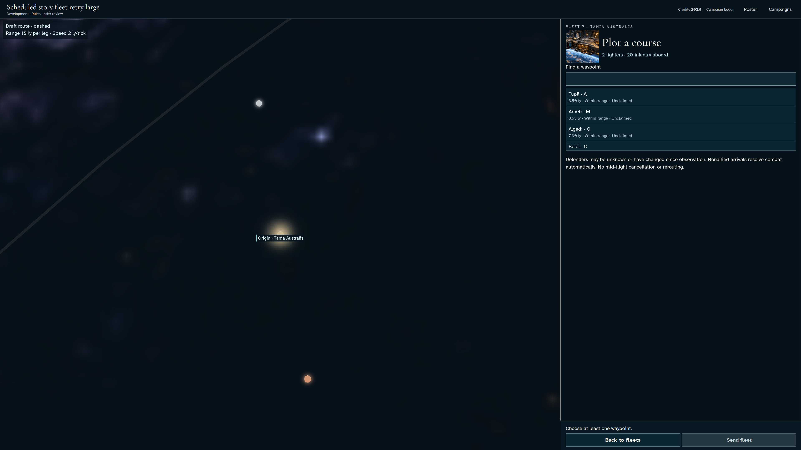](../../../../../../tests/browser/story-baselines/interrupted-fleet-route/large/linux-arm64/016-open-route-1-fleet-marshal.png)

### Viewpoint: Independent marshal

## 17. Select the nearest displayed within-range destination through its ordinary catalogue control and read the route preview.

Actor: **Fleet marshal**.

Acknowledged outcome: A draft leg shows catalogue distance and speed-derived duration, and enables commitment.

- [x] Every rendered waypoint ownership label agrees with the actual owner's current acquired report or Unknown; canonical reads only corroborate visible facts.
- [x] The route commitment rail is visible before scrolling, and other commanders receive no private route, fleet complement or arrival report.
- [x] Preview adds no command or movement; exact public coordinates satisfy range independently of the speed-derived tick count.

### Viewpoint: Fleet marshal

[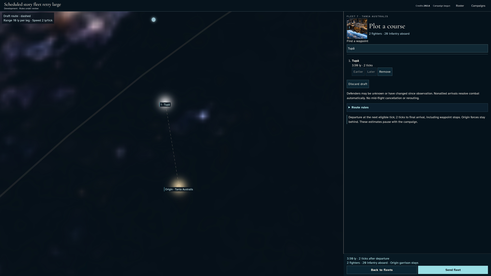](../../../../../../tests/browser/story-baselines/interrupted-fleet-route/large/linux-arm64/017-choose-waypoint-1-fleet-marshal.png)

### Viewpoint: Independent marshal

## 18. Add a displayed beyond-range waypoint. Inspect the range remedy before issuing any route.

Actor: **Fleet marshal**.

Acknowledged outcome: The out-of-range leg disables Send fleet with a specific range remedy.

- [x] Every rendered waypoint ownership label agrees with the actual owner's current acquired report or Unknown; canonical reads only corroborate visible facts.
- [x] The route commitment rail is visible before scrolling, and other commanders receive no private route, fleet complement or arrival report.
- [x] Invalid routing preserves the exact canonical forces and orders.

### Viewpoint: Fleet marshal

[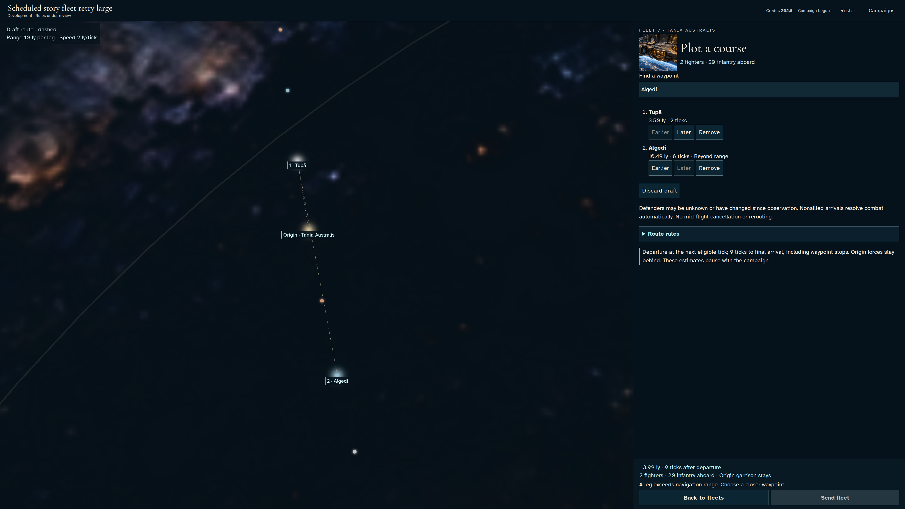](../../../../../../tests/browser/story-baselines/interrupted-fleet-route/large/linux-arm64/018-reject-distant-leg-1-fleet-marshal.png)

### Viewpoint: Independent marshal

## 19. Reorder the distant leg with keyboard controls, restore its position, then remove it. Return to fleets and reopen the planner to retain the valid draft.

Actor: **Fleet marshal**.

Acknowledged outcome: The retained single-leg draft is ready for keyboard commitment.

- [x] Every rendered waypoint ownership label agrees with the actual owner's current acquired report or Unknown; canonical reads only corroborate visible facts.
- [x] The route commitment rail is visible before scrolling, and other commanders receive no private route, fleet complement or arrival report.

### Viewpoint: Fleet marshal

[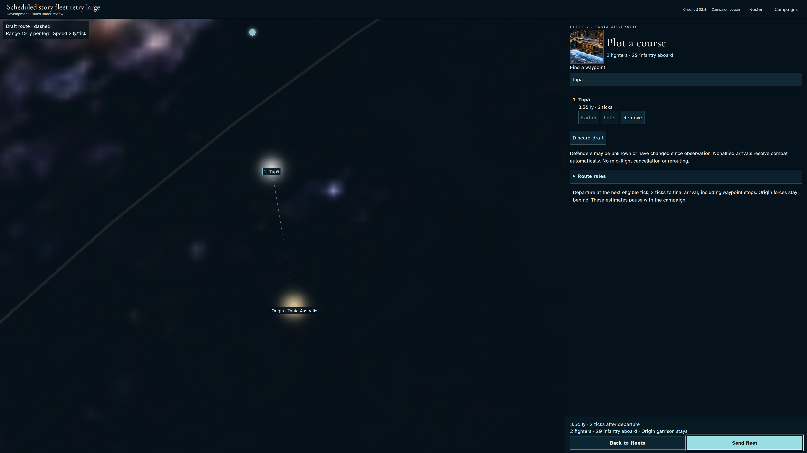](../../../../../../tests/browser/story-baselines/interrupted-fleet-route/large/linux-arm64/019-repair-route-1-fleet-marshal.png)

### Viewpoint: Independent marshal

## 20. Hold only fleet.route RTDB writes before actual ingress. No identity, payload, canonical state or receipt is altered.

Actor: **Test harness**. **Harness control; not a player action.**

Acknowledged outcome: Explicit test control; not a player action or hosted-service certification.

## 21. Confirm Send with Enter. Delivery is withheld, so the original forces remain aboard while the command awaits acknowledgement.

Actor: **Fleet marshal**.

Acknowledged outcome: The unacknowledged route disables repeat commitment.

- [x] Every rendered waypoint ownership label agrees with the actual owner's current acquired report or Unknown; canonical reads only corroborate visible facts.
- [x] The route commitment rail is visible before scrolling, and other commanders receive no private route, fleet complement or arrival report.
- [x] Withheld route has no effect.

### Viewpoint: Fleet marshal

[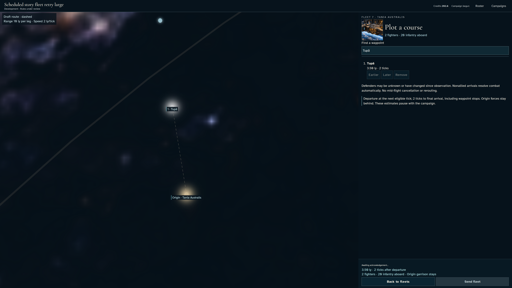](../../../../../../tests/browser/story-baselines/interrupted-fleet-route/large/linux-arm64/021-pending-route-1-fleet-marshal.png)

### Viewpoint: Independent marshal

## 22. Reload the uncertain order and inspect its original selected fleet and destination.

Actor: **Fleet marshal**.

Acknowledged outcome: Recovery opens the original route, retaining its exact proposed destination and disabled commitment.

- [x] Every rendered waypoint ownership label agrees with the actual owner's current acquired report or Unknown; canonical reads only corroborate visible facts.
- [x] The route commitment rail is visible before scrolling, and other commanders receive no private route, fleet complement or arrival report.
- [x] Retransmissions keep one command path and identical encrypted payload; reload neither reserves nor duplicates forces.

### Viewpoint: Fleet marshal

[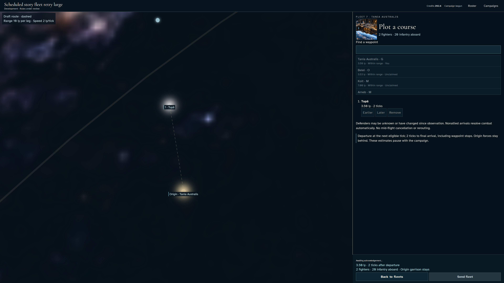](../../../../../../tests/browser/story-baselines/interrupted-fleet-route/large/linux-arm64/022-reload-pending-route-1-fleet-marshal.png)

### Viewpoint: Independent marshal

## 23. When acknowledgement remains uncertain, review the preserved destination and focus Check route order. This remedy discovers or retries the existing submission.

Actor: **Fleet marshal**.

Acknowledged outcome: The focused same-order remedy is enabled while the original route remains visible.

- [x] Every rendered waypoint ownership label agrees with the actual owner's current acquired report or Unknown; canonical reads only corroborate visible facts.
- [x] The route commitment rail is visible before scrolling, and other commanders receive no private route, fleet complement or arrival report.
- [x] Waiting for a remedy changes no forces or campaign revision.

### Viewpoint: Fleet marshal

[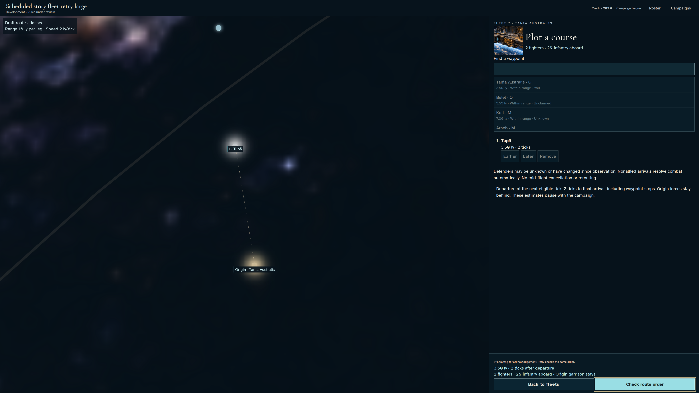](../../../../../../tests/browser/story-baselines/interrupted-fleet-route/large/linux-arm64/023-review-route-retry-1-fleet-marshal.png)

### Viewpoint: Independent marshal

## 24. When acknowledgement remains uncertain, use Check route order with Enter to discover or retry the same submitted order.

Actor: **Fleet marshal**.

Acknowledged outcome: The original route is pending again; another transport attempt does not create another logical command.

- [x] Every rendered waypoint ownership label agrees with the actual owner's current acquired report or Unknown; canonical reads only corroborate visible facts.
- [x] The route commitment rail is visible before scrolling, and other commanders receive no private route, fleet complement or arrival report.
- [x] Every retry retains the same command path and encrypted payload, with no canonical effect before delivery.

### Viewpoint: Fleet marshal

[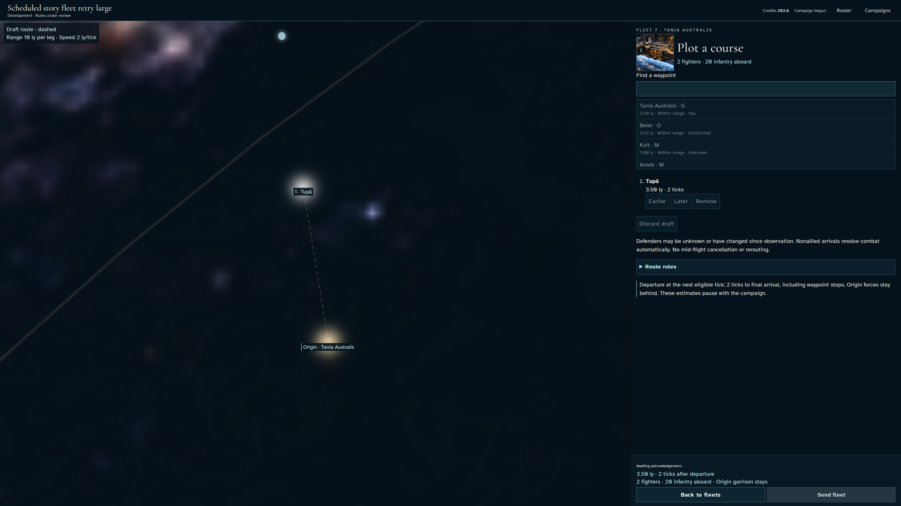](../../../../../../tests/browser/story-baselines/interrupted-fleet-route/large/linux-arm64/024-retry-original-route-1-fleet-marshal.png)

### Viewpoint: Independent marshal

## 25. Disconnect the player before releasing retained transport frames to real ingress. The service can accept the original command while the offline browser cannot receive its receipt; no state or receipt is fabricated.

Actor: **Test harness**. **Harness control; not a player action.**

Acknowledged outcome: Explicit test control; not a player action or hosted-service certification.

## 26. Connection is lost before the service acknowledgement reaches this device. Wait for the real overdue acknowledgement recovery state, keeping the submitted destination visible without claiming confirmed departure.

Actor: **Fleet marshal**.

Acknowledged outcome: This device offers to check the same overdue route order; the independent commander sees no private order.

- [x] Every rendered waypoint ownership label agrees with the actual owner's current acquired report or Unknown; canonical reads only corroborate visible facts.
- [x] The route commitment rail is visible before scrolling, and other commanders receive no private route, fleet complement or arrival report.

### Viewpoint: Fleet marshal

[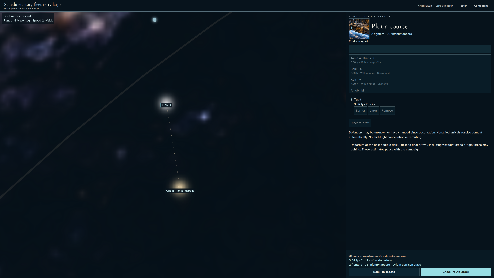](../../../../../../tests/browser/story-baselines/interrupted-fleet-route/large/linux-arm64/026-accepted-while-offline-1-fleet-marshal.png)

### Viewpoint: Independent marshal

## 27. End the offline document before restoring network, retaining actual IndexedDB and authenticated account. The next ordinary navigation must discover the existing receipt, not manufacture a replacement command.

Actor: **Test harness**. **Harness control; not a player action.**

Acknowledged outcome: Explicit test control; not a player action or hosted-service certification.

## 28. Reopen the campaign after interrupted acknowledgement. Discover the original accepted receipt and route without issuing a replacement command.

Actor: **Fleet marshal**.

Acknowledged outcome: The route receipt publishes departure tick two and the selected destination.

- [x] Every rendered waypoint ownership label agrees with the actual owner's current acquired report or Unknown; canonical reads only corroborate visible facts.
- [x] The route commitment rail is visible before scrolling, and other commanders receive no private route, fleet complement or arrival report.
- [x] One accepted receipt and revision retain the full fleet until departure.

### Viewpoint: Fleet marshal

[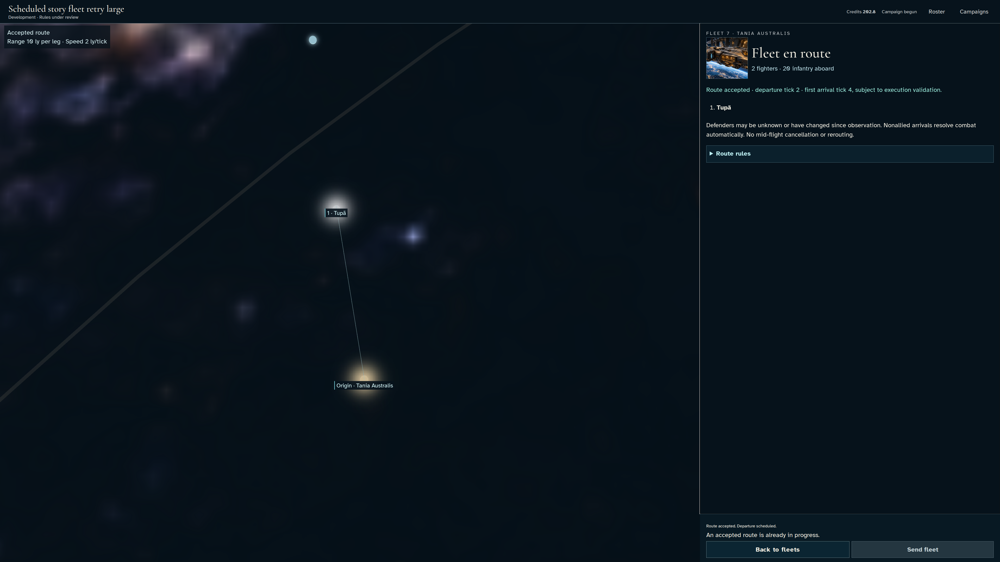](../../../../../../tests/browser/story-baselines/interrupted-fleet-route/large/linux-arm64/028-accept-route-1-fleet-marshal.png)

### Viewpoint: Independent marshal

## 29. Reload the exact campaign and reopen the original fleet's accepted route, without issuing a replacement command.

Actor: **Fleet marshal**.

Acknowledged outcome: The same accepted destination and departure tick return from persistence.

- [x] Every rendered waypoint ownership label agrees with the actual owner's current acquired report or Unknown; canonical reads only corroborate visible facts.
- [x] The route commitment rail is visible before scrolling, and other commanders receive no private route, fleet complement or arrival report.
- [x] Reload neither duplicates the route nor changes forces.

### Viewpoint: Fleet marshal

[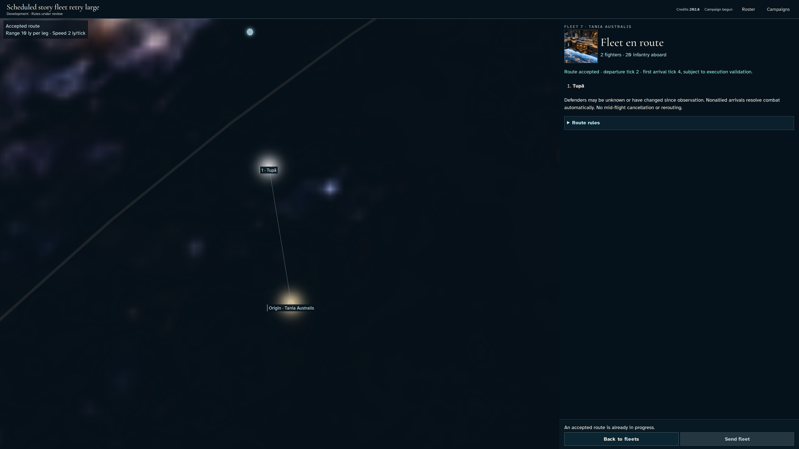](../../../../../../tests/browser/story-baselines/interrupted-fleet-route/large/linux-arm64/029-recover-route-1-fleet-marshal.png)

### Viewpoint: Independent marshal

## 30. Advance the labelled domain clock and invoke actual leased settlement. Repeat delivery must leave the full canonical state unchanged; no travel state is injected.

Actor: **Test harness**. **Harness control; not a player action.**

Acknowledged outcome: Explicit test control; not a player action or hosted-service certification.

## 31. Read the authoritative departure and scheduled arrival. A traveling fleet cannot receive another route.

Actor: **Fleet marshal**.

Acknowledged outcome: The fleet is traveling with a speed-derived arrival tick and disabled commitment.

- [x] Every rendered waypoint ownership label agrees with the actual owner's current acquired report or Unknown; canonical reads only corroborate visible facts.
- [x] The route commitment rail is visible before scrolling, and other commanders receive no private route, fleet complement or arrival report.
- [x] Departure conserves the complete fleet and its original route identity.

### Viewpoint: Fleet marshal

[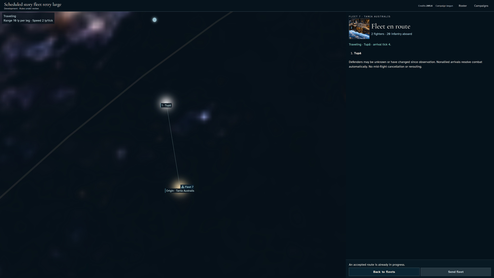](../../../../../../tests/browser/story-baselines/interrupted-fleet-route/large/linux-arm64/031-traveling-1-fleet-marshal.png)

### Viewpoint: Independent marshal

## 32. Deliver each due boundary through the real leased service, checking repeat delivery and recording actual production. This accelerated domain-clock journey does not certify hosted cadence or batch catch-up.

Actor: **Test harness**. **Harness control; not a player action.**

Acknowledged outcome: Explicit test control; not a player action or hosted-service certification.

## 33. Read the resolved arrival and resulting orbit/surface control. Landed infantry remains part of the commander's conserved forces.

Actor: **Fleet marshal**.

Acknowledged outcome: The authoritative arrival names the destination, forces and resulting control.

- [x] Every rendered waypoint ownership label agrees with the actual owner's current acquired report or Unknown; canonical reads only corroborate visible facts.
- [x] The route commitment rail is visible before scrolling, and other commanders receive no private route, fleet complement or arrival report.
- [x] A single arrival retains all forces across fleet and newly controlled surface, with only actual production added.

### Viewpoint: Fleet marshal

[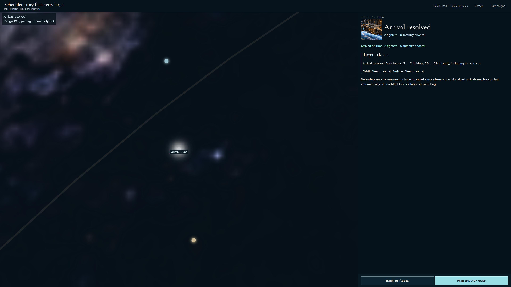](../../../../../../tests/browser/story-baselines/interrupted-fleet-route/large/linux-arm64/033-arrival-report-1-fleet-marshal.png)

### Viewpoint: Independent marshal

[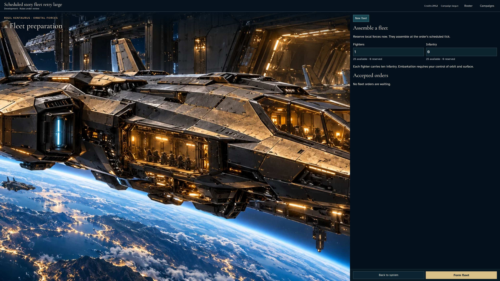](../../../../../../tests/browser/story-baselines/interrupted-fleet-route/large/linux-arm64/033-arrival-report-2-independent-marshal.png)

## 34. Return to fleet preparation, recover the destination after reload and inspect the same stationed fleet with the keyboard.

Actor: **Fleet marshal**.

Acknowledged outcome: The recovered fleet is stationed at the destination with its surviving complement.

- [x] Both fixed action rails are visible before scrolling and no application error occurred.
- [x] Other commanders have no owner fleet, private order or ledger in their actual member projections.
- [x] Final reload preserves the exact settled state and receipt identity.

### Viewpoint: Fleet marshal

[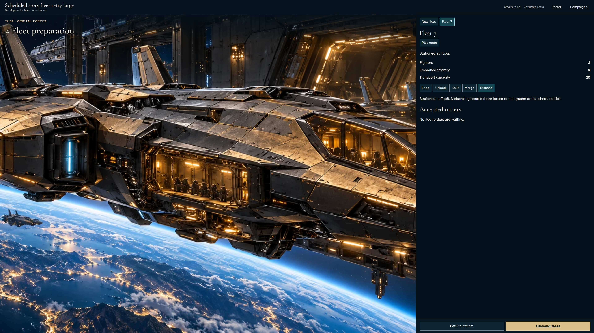](../../../../../../tests/browser/story-baselines/interrupted-fleet-route/large/linux-arm64/034-recover-arrival-1-fleet-marshal.png)

### Viewpoint: Independent marshal

## 35. Sign out through the identity controls, then revisit the campaign URL. The prior recovered route must not expose a private fleet to a signed-out browser.

Actor: **Fleet marshal**.

Acknowledged outcome: The campaign requires sign-in and renders neither fleet preparation nor a route planner.

- [x] Signing out changes no campaign forces, receipt or revision.

### Viewpoint: Fleet marshal

[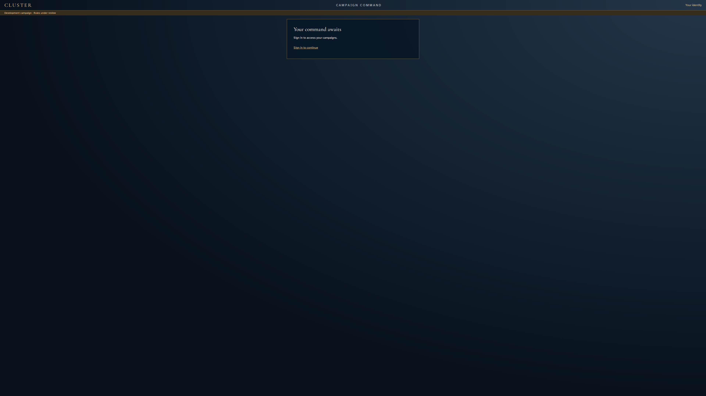](../../../../../../tests/browser/story-baselines/interrupted-fleet-route/large/linux-arm64/035-sign-out-access-1-fleet-marshal.png)

### Viewpoint: Independent marshal

