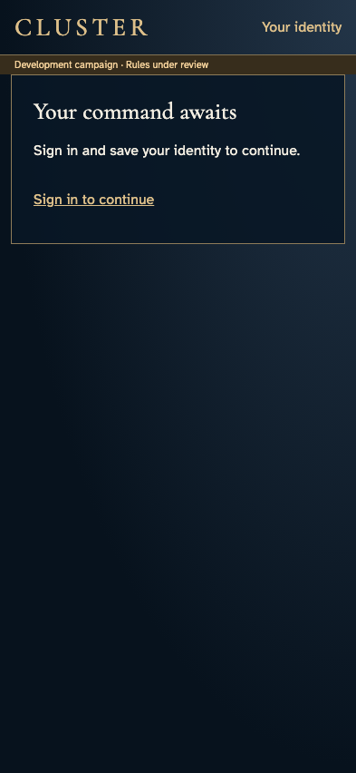
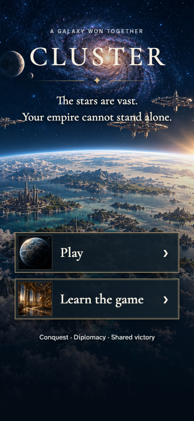
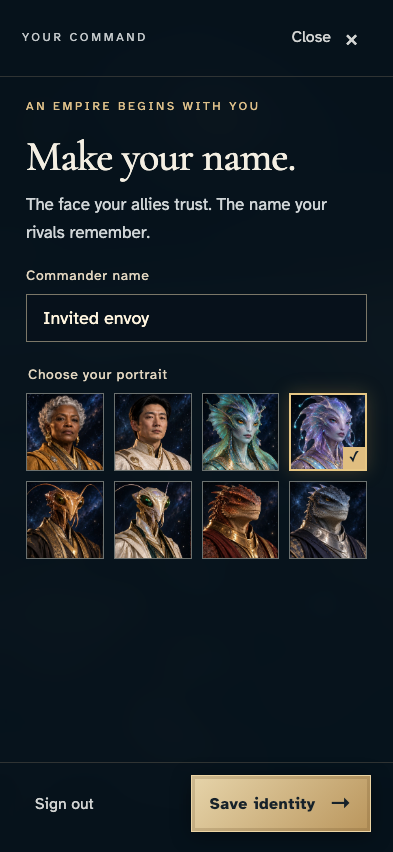
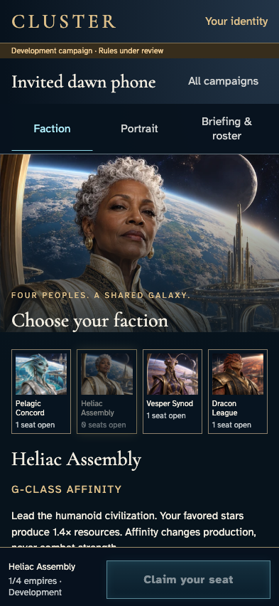
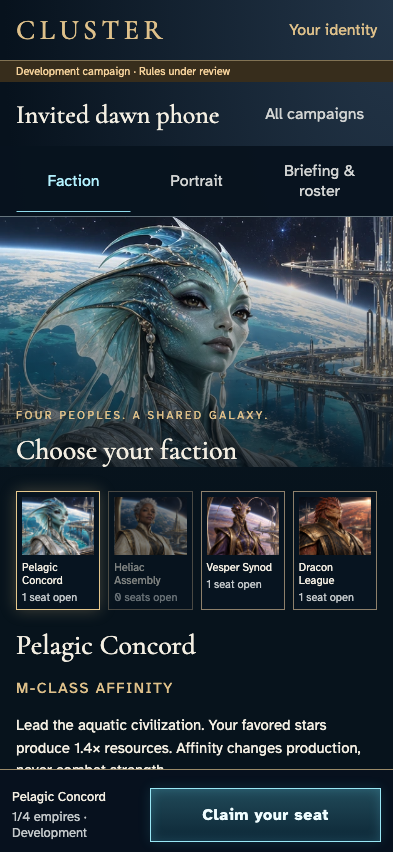
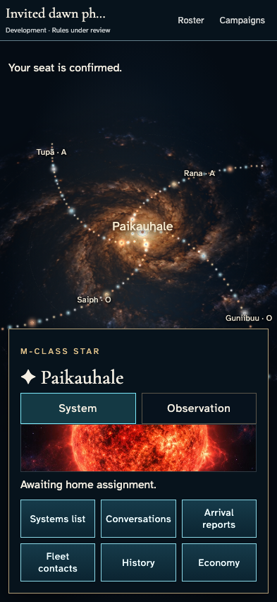
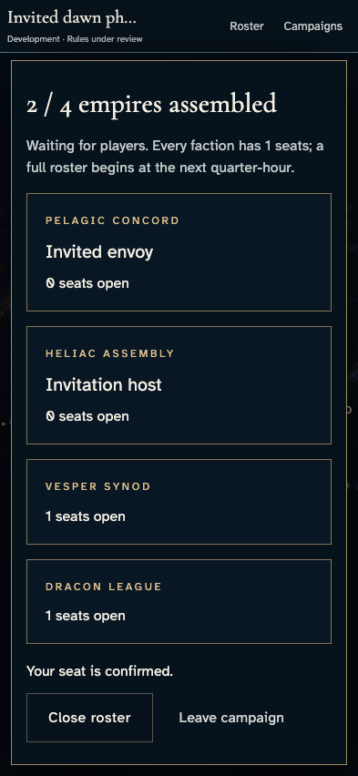
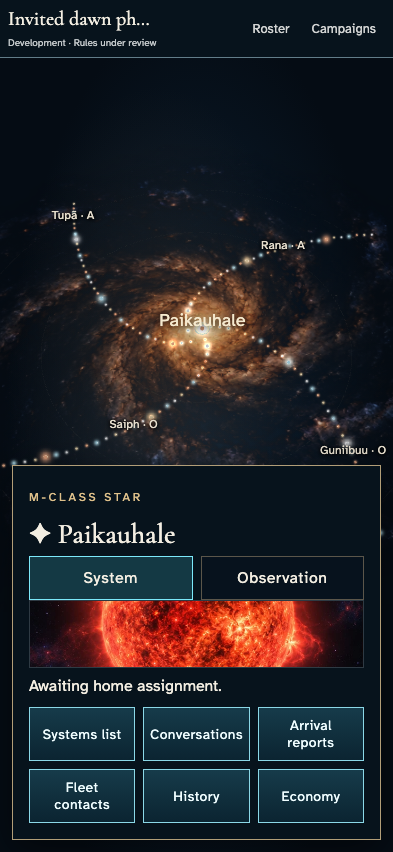

# Follow an invitation into a waiting campaign

**Exact comparison passed.** phone · darwin-arm64. Inventory: UX-01, UX-02, UX-14, UX-16.

An independent new commander follows an invitation through authentication and saved identity, reviews a faction and claims a real seat. The host observes the acknowledged roster change. The starting host campaign is prepared through ordinary UI with fixed catalogue entropy and explicit development access.

## 1. Prepare the host's saved identity and one-seat waiting campaign through real sign-in/create/join UI. Grant emulator development access; the test-only loader fixes catalogue entropy, not keys, commands or persistence.

Actor: **Test harness**. **Harness control; not a player action.**

Acknowledged outcome: Explicit test control; not a player action or hosted-service certification.

## 2. Open the invitation while signed out.

Actor: **Invited envoy**.

Acknowledged outcome: Sign-in is required before campaign access.

- [x] The private galaxy is not exposed before authentication.

### Viewpoint: Invited envoy

## 3. Continue to entry with the invitation preserved.

Actor: **Invited envoy**.

Acknowledged outcome: Play is available for sign-in.

- [x] Entry preserves the exact invited campaign ID.

### Viewpoint: Invited envoy

## 4. Authenticate and reach first-time identity editing.

Actor: **Invited envoy**.

Acknowledged outcome: The commander name field is ready.

- [x] No identity command is submitted by sign-in alone.

### Viewpoint: Invited envoy

## 5. Grant this authenticated emulator account development access so it can enter the explicitly development-only campaign; this is not public admission approval.

Actor: **Test harness**. **Harness control; not a player action.**

Acknowledged outcome: Explicit test control; not a player action or hosted-service certification.

## 6. Choose the identity used for this campaign.

Actor: **Invited envoy**.

Acknowledged outcome: The local identity choice is retained.

- [x] The draft remains unsent until Save.

### Viewpoint: Invited envoy

## 7. Save the identity and resume the exact invitation automatically.

Actor: **Invited envoy**.

Acknowledged outcome: The invited campaign opens faction selection after identity acceptance.

- [x] Exactly one saved identity revision exists and the editor has closed.

### Viewpoint: Invited envoy

## 8. Review the Pelagic faction before claiming the seat.

Actor: **Invited envoy**.

Acknowledged outcome: Pelagic is selected and the commitment stays available.

- [x] Claim your seat remains enabled.

### Viewpoint: Invited envoy

## 9. Commit the selected seat and wait for the host's authoritative roster update.

Actor: **Invited envoy**.

Acknowledged outcome: The server confirms the new seat and the host sees the invited commander.

- [x] The guest sees the actual galaxy without creating another identity revision.

### Viewpoint: Invited envoy

### Viewpoint: Invitation host

## 10. Reload and recover the admitted campaign without re-saving identity.

Actor: **Invited envoy**.

Acknowledged outcome: The invited galaxy is restored.

- [x] The campaign URL and original identity revision are unchanged.

### Viewpoint: Invited envoy

