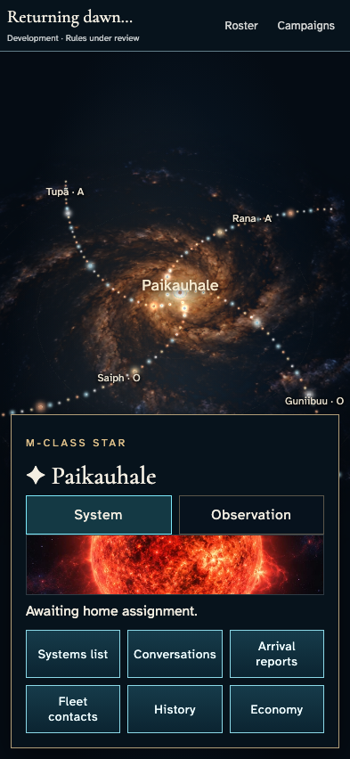
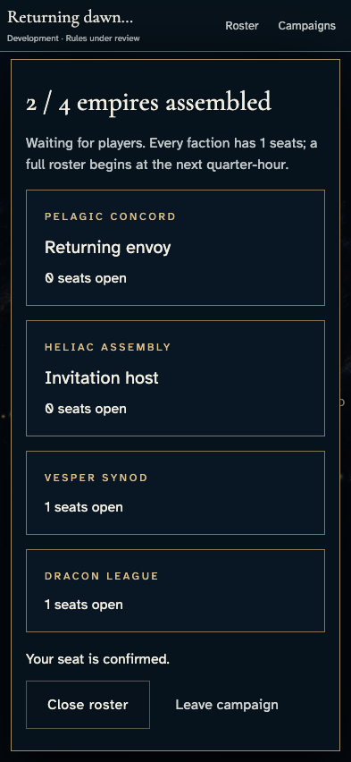
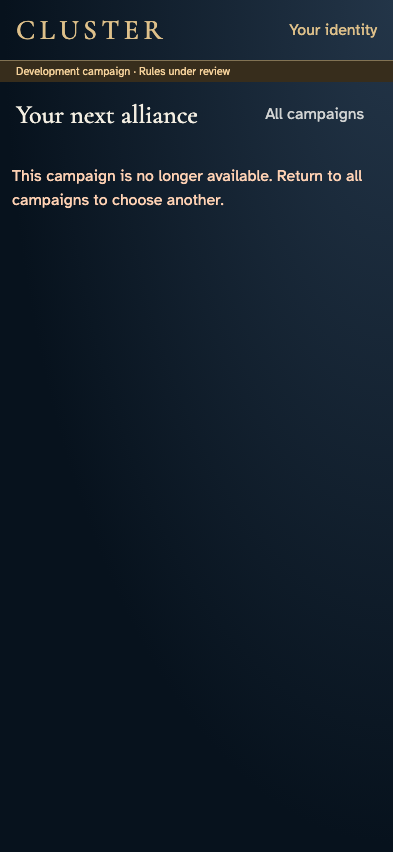
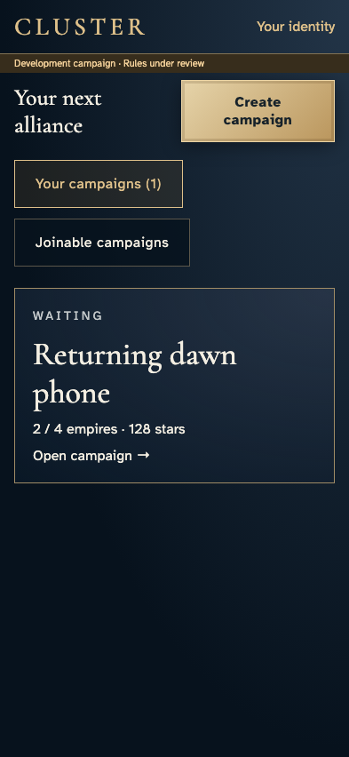
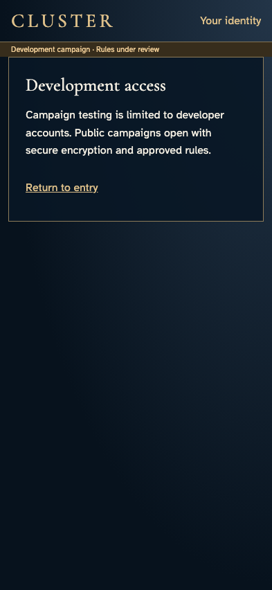
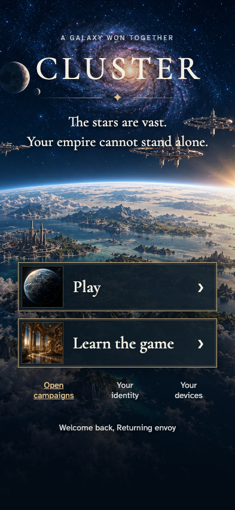

# Return through an invitation without rewriting identity

**Exact comparison passed.** phone · darwin-arm64. Inventory: UX-01, UX-02, UX-14, UX-16.

A signed-out commander with a saved identity and an admitted seat returns through the original invitation. Authentication resumes the campaign directly, with no identity resave. Missing and development-access-denied invitations provide explicit recovery routes without changing the saved identity.

## 1. Prepare two independently authenticated commanders and two admitted seats through real UI, with fixed catalogue input and explicit emulator development access. Save the returning identity once, then sign out through the identity editor. This establishes an existing campaign; it does not claim illustrated admission or hosted Google acceptance.

Actor: **Test harness**. **Harness control; not a player action.**

Acknowledged outcome: Explicit test control; not a player action or hosted-service certification.

## 2. Open the original invitation while signed out.

Actor: **Returning envoy**.

Acknowledged outcome: The campaign asks for sign-in before exposing private information.

- [x] The private galaxy is absent while signed out.

### Viewpoint: Returning envoy

## 3. Continue to entry while retaining the exact campaign destination.

Actor: **Returning envoy**.

Acknowledged outcome: Play is ready for authentication.

- [x] The campaign ID is preserved across the entry redirect.

### Viewpoint: Returning envoy

## 4. Authenticate with the saved account and resume the campaign directly.

Actor: **Returning envoy**.

Acknowledged outcome: The invited galaxy opens without an identity-editor round trip.

- [x] No identity resave or duplicate seat is required.

### Viewpoint: Returning envoy

### Viewpoint: Invitation host

## 5. Reload the resumed campaign with the same saved identity.

Actor: **Returning envoy**.

Acknowledged outcome: The authorized galaxy is recovered again.

- [x] Recovery leaves the original identity revision and receipt intact.

### Viewpoint: Returning envoy

## 6. Follow an invitation whose campaign is no longer available.

Actor: **Returning envoy**.

Acknowledged outcome: The unavailable-campaign error explains the missing destination.

- [x] All campaigns offers a usable remedy and identity is unchanged.

### Viewpoint: Returning envoy

## 7. Return to the campaign directory after the missing invitation.

Actor: **Returning envoy**.

Acknowledged outcome: The campaign directory loads and clears the missing-link error.

- [x] The existing saved identity remains unchanged.

### Viewpoint: Returning envoy

## 8. Remove this test account's emulator development claim to exercise a real authorization denial. The campaign, membership, history and identity records are not edited.

Actor: **Test harness**. **Harness control; not a player action.**

Acknowledged outcome: Explicit test control; not a player action or hosted-service certification.

## 9. Follow the original invitation after development access is removed.

Actor: **Returning envoy**.

Acknowledged outcome: The development-access boundary denies campaign entry.

- [x] The denied view exposes no galaxy and leaves saved identity intact.

### Viewpoint: Returning envoy

## 10. Return to entry and clear the inaccessible invitation.

Actor: **Returning envoy**.

Acknowledged outcome: The entry surface is available again.

- [x] The denied campaign query is cleared without rewriting identity.

### Viewpoint: Returning envoy

