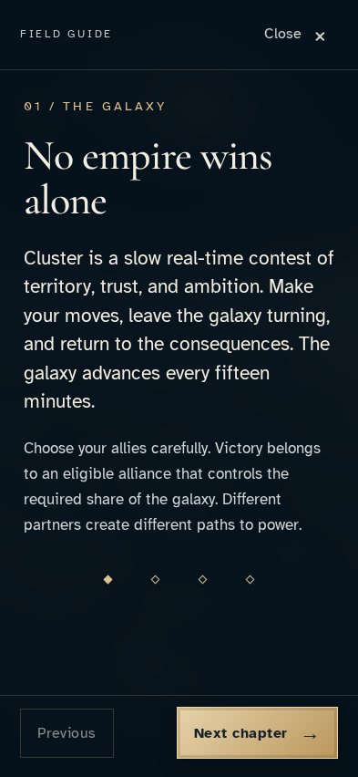
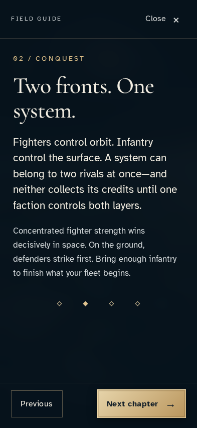
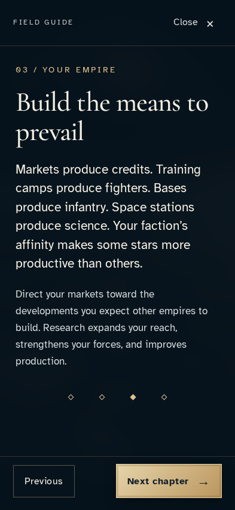
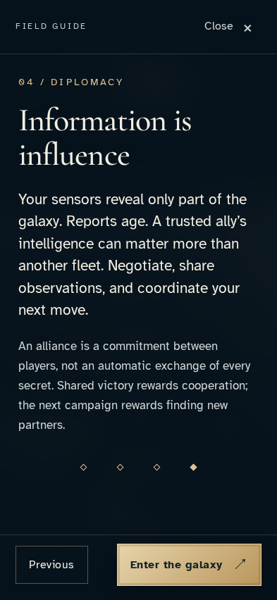
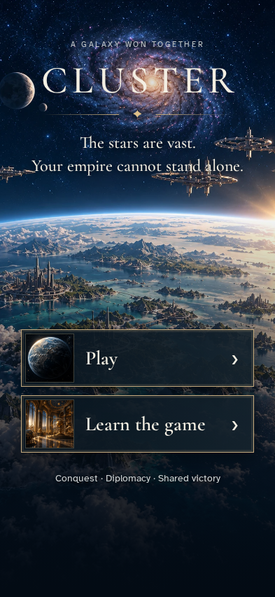

# Learn the campaign and return to entry

**Exact comparison passed.** phone · linux-arm64. Inventory: UX-01, UX-15, UX-16.

A new visitor reads each field-guide chapter, keeps keyboard focus through navigation, and returns without signing in or changing a campaign.

## 1. The visitor arrives at Cluster and can choose Play or Learn.

Actor: **Visitor**.

Acknowledged outcome: The production entry surface is ready for input.

- [x] Learn is available and no private campaign or commander is shown.

### Viewpoint: Visitor

## 2. The visitor opens Learn with the keyboard and reads the purpose of alliances.

Actor: **Visitor**.

Acknowledged outcome: The first chapter heading receives focus.

- [x] The next chapter and return controls are available.

### Viewpoint: Visitor

## 3. The visitor reads “Two fronts. One system.”.

Actor: **Visitor**.

Acknowledged outcome: The chapter “Two fronts. One system.” is visible and focused.

- [x] The guide remains a readable bounded surface with a return control.

### Viewpoint: Visitor

## 4. The visitor reads “Build the means to prevail”.

Actor: **Visitor**.

Acknowledged outcome: The chapter “Build the means to prevail” is visible and focused.

- [x] The guide remains a readable bounded surface with a return control.

### Viewpoint: Visitor

## 5. The visitor reads “Information is influence”.

Actor: **Visitor**.

Acknowledged outcome: The chapter “Information is influence” is visible and focused.

- [x] The guide remains a readable bounded surface with a return control.

### Viewpoint: Visitor

## 6. The visitor closes Learn and returns to its opening control.

Actor: **Visitor**.

Acknowledged outcome: Focus returns to Learn.

- [x] Play is still available; learning did not sign in or create a campaign.

### Viewpoint: Visitor

