# Reserve, complete and cancel developments

**Exact comparison passed.** desktop · darwin-arm64. Inventory: UX-05, UX-06, UX-14, UX-15, UX-16.

Four independent players enter a real development campaign. Owner and other-player views show reservation, queued work, completion and cancellation. Encrypted mock ingress, canonical state, private grants and tick settlement are real. Fixed domain time for construction and market-focus admission, plus withheld delivery, are explicitly labelled test controls. Construction price, four-advance duration, refunds and dividends remain proposed development rules; managed-key, hosted and all-layer acceptance remain separate.

## 1. Ordinary emulator sign-in and identity save, with explicit developer entitlement and fixed browser Date; timers continue normally.

Actor: **Test harness**. **Harness control; not a player action.**

Acknowledged outcome: Explicit test control; not a player action or hosted-service certification.

## 2. Ordinary emulator sign-in and identity save, with explicit developer entitlement and fixed browser Date; timers continue normally.

Actor: **Test harness**. **Harness control; not a player action.**

Acknowledged outcome: Explicit test control; not a player action or hosted-service certification.

## 3. Ordinary emulator sign-in and identity save, with explicit developer entitlement and fixed browser Date; timers continue normally.

Actor: **Test harness**. **Harness control; not a player action.**

Acknowledged outcome: Explicit test control; not a player action or hosted-service certification.

## 4. Ordinary emulator sign-in and identity save, with explicit developer entitlement and fixed browser Date; timers continue normally.

Actor: **Test harness**. **Harness control; not a player action.**

Acknowledged outcome: Explicit test control; not a player action or hosted-service certification.

## 5. Create/join through ordinary campaign controls. Fixed catalogue and admission clock are test controls; no seat, message or command outcome is injected.

Actor: **Test harness**. **Harness control; not a player action.**

Acknowledged outcome: Explicit test control; not a player action or hosted-service certification.

## 6. Create/join through ordinary campaign controls. Fixed catalogue and admission clock are test controls; no seat, message or command outcome is injected.

Actor: **Test harness**. **Harness control; not a player action.**

Acknowledged outcome: Explicit test control; not a player action or hosted-service certification.

## 7. Create/join through ordinary campaign controls. Fixed catalogue and admission clock are test controls; no seat, message or command outcome is injected.

Actor: **Test harness**. **Harness control; not a player action.**

Acknowledged outcome: Explicit test control; not a player action or hosted-service certification.

## 8. Create/join through ordinary campaign controls. Fixed catalogue and admission clock are test controls; no seat, message or command outcome is injected.

Actor: **Test harness**. **Harness control; not a player action.**

Acknowledged outcome: Explicit test control; not a player action or hosted-service certification.

## 9. Advance the designated browser/domain clock to 12:15 UTC and deliver the actual emulator Scheduler HTTP request. This does not certify hosted scheduling.

Actor: **Test harness**. **Harness control; not a player action.**

Acknowledged outcome: Explicit test control; not a player action or hosted-service certification.

## 10. Inspect the actual home system and choose an orbital training camp. The other commander reviews their own construction panel.

Actor: **Builder envoy**.

Acknowledged outcome: The development quote shows69 credits and131 after reservation, with one completed training camp.

- [x] Both commitment rails remain visible before scrolling and no player has an uncaught application error.
- [x] Other players receive no owner construction orders, cancellation IDs, paid costs or ledger in their serialized private projection.
- [x] Visible available balances equal each player's authoritative wallet.

### Viewpoint: Builder envoy

### Viewpoint: Independent builder

## 11. Open contextual construction rules with the keyboard and inspect the selected camp's real price and capacity.

Actor: **Builder envoy**.

Acknowledged outcome: The open chapter explains the real69-credit quote and8-place capacity without an order acknowledgement.

- [x] Both commitment rails remain visible before scrolling and no player has an uncaught application error.
- [x] Other players receive no owner construction orders, cancellation IDs, paid costs or ledger in their serialized private projection.
- [x] Visible available balances equal each player's authoritative wallet.
- [x] Reading help preserves the selected camp, both private views and the entire authoritative campaign without submitting an order.

### Viewpoint: Builder envoy

[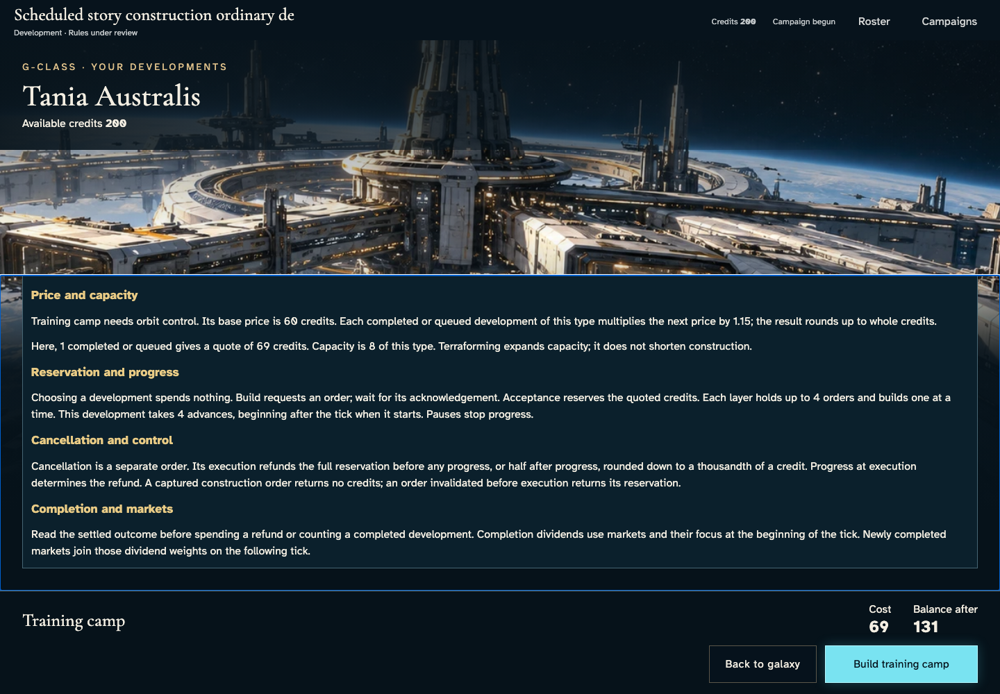](../../../../../../tests/browser/story-baselines/live-construction-ordinary/desktop/darwin-arm64/011-read-construction-price-1-builder-envoy.png)

### Viewpoint: Independent builder

## 12. Read reservation and progress before committing credits.

Actor: **Builder envoy**.

Acknowledged outcome: The reservation and progress explanation is visible inside the bounded reading panel.

- [x] Both commitment rails remain visible before scrolling and no player has an uncaught application error.
- [x] Other players receive no owner construction orders, cancellation IDs, paid costs or ledger in their serialized private projection.
- [x] Visible available balances equal each player's authoritative wallet.
- [x] Reading help preserves the selected camp, both private views and the entire authoritative campaign without submitting an order.

### Viewpoint: Builder envoy

[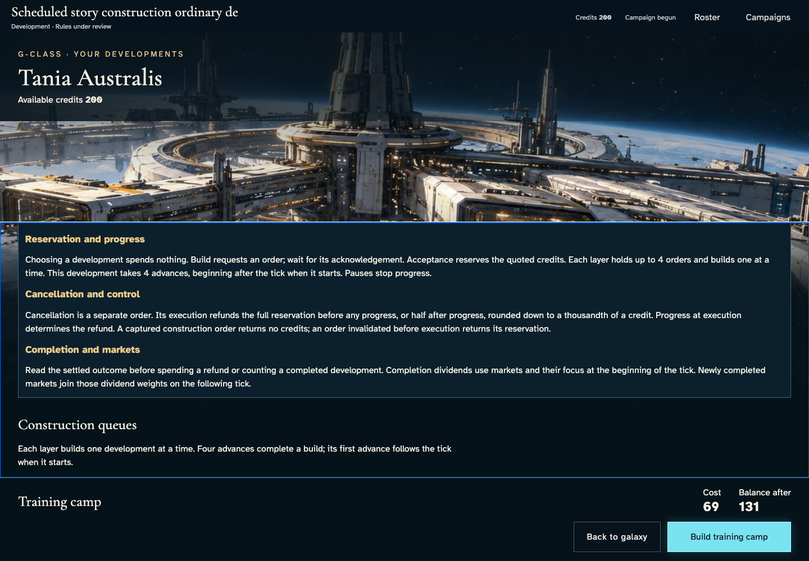](../../../../../../tests/browser/story-baselines/live-construction-ordinary/desktop/darwin-arm64/012-read-construction-reservation-1-builder-envoy.png)

### Viewpoint: Independent builder

## 13. Read cancellation and control before committing credits.

Actor: **Builder envoy**.

Acknowledged outcome: The cancellation and control explanation is visible inside the bounded reading panel.

- [x] Both commitment rails remain visible before scrolling and no player has an uncaught application error.
- [x] Other players receive no owner construction orders, cancellation IDs, paid costs or ledger in their serialized private projection.
- [x] Visible available balances equal each player's authoritative wallet.
- [x] Reading help preserves the selected camp, both private views and the entire authoritative campaign without submitting an order.

### Viewpoint: Builder envoy

### Viewpoint: Independent builder

## 14. Read cancellation, control and completion boundaries while the build commitment remains available.

Actor: **Builder envoy**.

Acknowledged outcome: The chapter explains execution-time refunds and recorded market focus, not equal-focus dividends.

- [x] Both commitment rails remain visible before scrolling and no player has an uncaught application error.
- [x] Other players receive no owner construction orders, cancellation IDs, paid costs or ledger in their serialized private projection.
- [x] Visible available balances equal each player's authoritative wallet.
- [x] Reading help preserves the selected camp, both private views and the entire authoritative campaign without submitting an order.

### Viewpoint: Builder envoy

[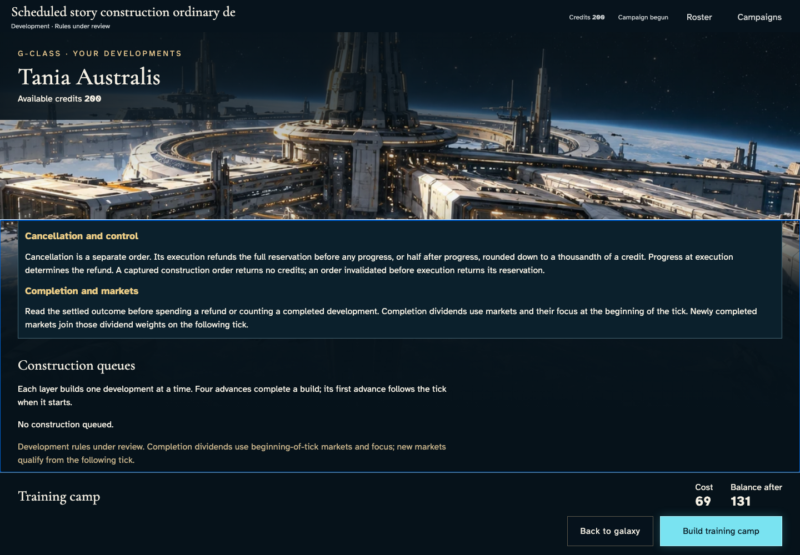](../../../../../../tests/browser/story-baselines/live-construction-ordinary/desktop/darwin-arm64/014-read-construction-outcomes-1-builder-envoy.png)

### Viewpoint: Independent builder

## 15. Close the chapter with the keyboard; normal and reduced motion retain the same construction decision.

Actor: **Builder envoy**.

Acknowledged outcome: The chapter closes and keyboard focus remains on its opening control.

- [x] Both commitment rails remain visible before scrolling and no player has an uncaught application error.
- [x] Other players receive no owner construction orders, cancellation IDs, paid costs or ledger in their serialized private projection.
- [x] Visible available balances equal each player's authoritative wallet.
- [x] Reading help preserves the selected camp, both private views and the entire authoritative campaign without submitting an order.

### Viewpoint: Builder envoy

[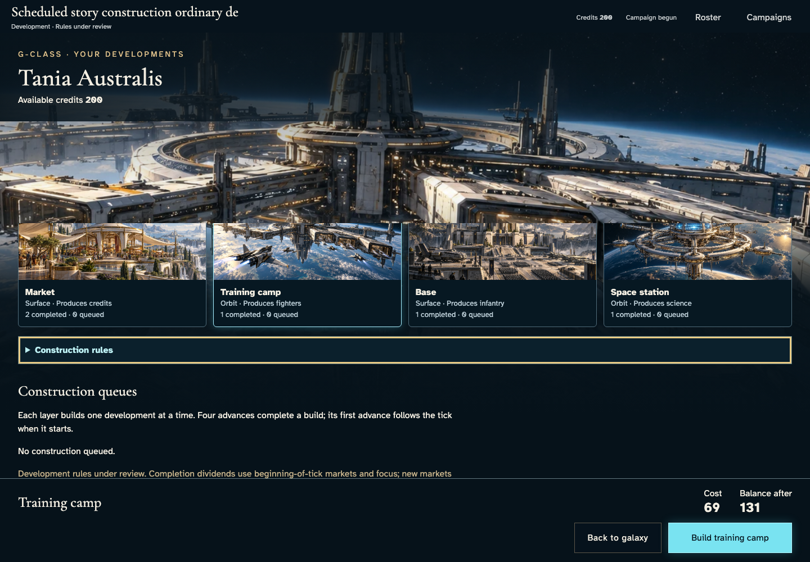](../../../../../../tests/browser/story-baselines/live-construction-ordinary/desktop/darwin-arm64/015-close-construction-rules-1-builder-envoy.png)

### Viewpoint: Independent builder

## 16. Open the real market instrument before choosing a private allocation.

Actor: **Builder envoy**.

Acknowledged outcome: Current equal allocation is visible and unchanged focus cannot be submitted.

- [x] The market commitment remains inside the viewport before scrolling, with the other player's own construction view intact.
- [x] Other players receive no owner construction orders, cancellation IDs, paid costs or ledger in their serialized private projection.
- [x] Help and an unsent allocation preserve canonical state and both private projections.

### Viewpoint: Builder envoy

[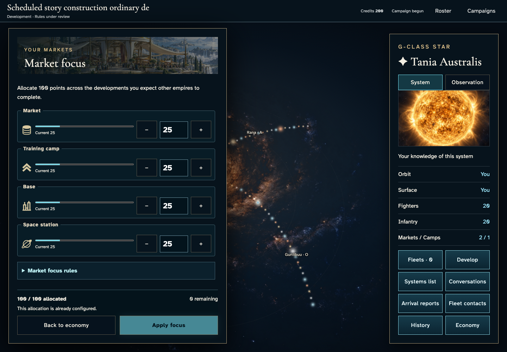](../../../../../../tests/browser/story-baselines/live-construction-ordinary/desktop/darwin-arm64/016-open-market-focus-1-builder-envoy.png)

### Viewpoint: Independent builder

## 17. Read allocate expectations while the campaign continues.

Actor: **Builder envoy**.

Acknowledged outcome: The selected rule is readable without applying an allocation.

- [x] The market commitment remains inside the viewport before scrolling, with the other player's own construction view intact.
- [x] Other players receive no owner construction orders, cancellation IDs, paid costs or ledger in their serialized private projection.
- [x] Help and an unsent allocation preserve canonical state and both private projections.

### Viewpoint: Builder envoy

[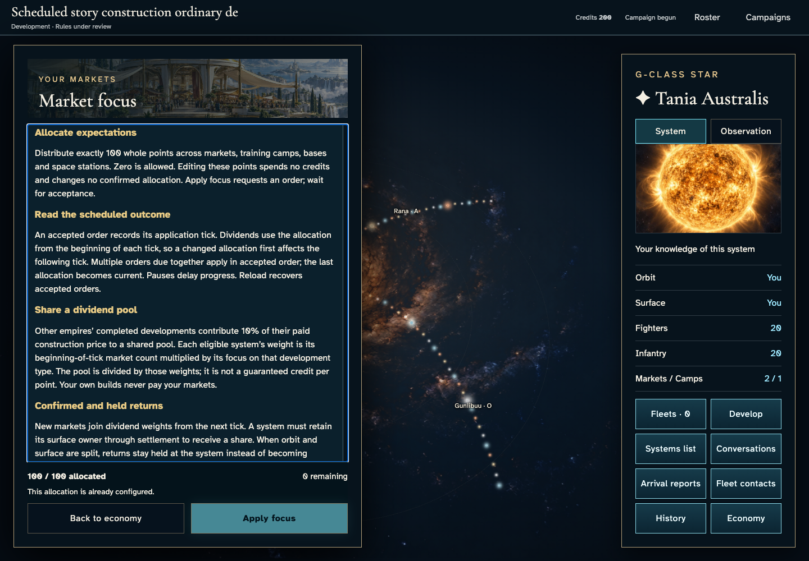](../../../../../../tests/browser/story-baselines/live-construction-ordinary/desktop/darwin-arm64/017-read-market-rule-0-1-builder-envoy.png)

### Viewpoint: Independent builder

## 18. Read read the scheduled outcome while the campaign continues.

Actor: **Builder envoy**.

Acknowledged outcome: The selected rule is readable without applying an allocation.

- [x] The market commitment remains inside the viewport before scrolling, with the other player's own construction view intact.
- [x] Other players receive no owner construction orders, cancellation IDs, paid costs or ledger in their serialized private projection.
- [x] Help and an unsent allocation preserve canonical state and both private projections.

### Viewpoint: Builder envoy

[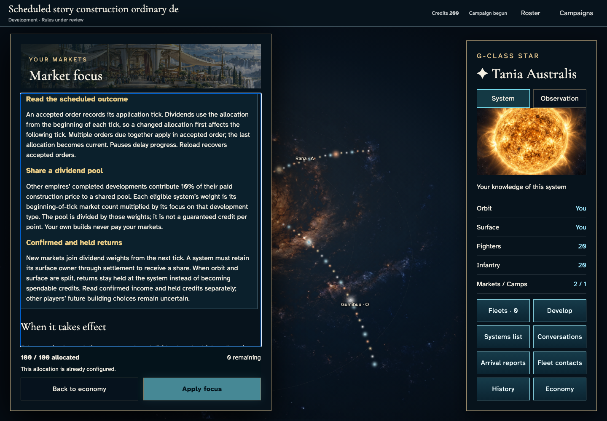](../../../../../../tests/browser/story-baselines/live-construction-ordinary/desktop/darwin-arm64/018-read-market-rule-1-1-builder-envoy.png)

### Viewpoint: Independent builder

## 19. Read share a dividend pool while the campaign continues.

Actor: **Builder envoy**.

Acknowledged outcome: The selected rule is readable without applying an allocation.

- [x] The market commitment remains inside the viewport before scrolling, with the other player's own construction view intact.
- [x] Other players receive no owner construction orders, cancellation IDs, paid costs or ledger in their serialized private projection.
- [x] Help and an unsent allocation preserve canonical state and both private projections.

### Viewpoint: Builder envoy

[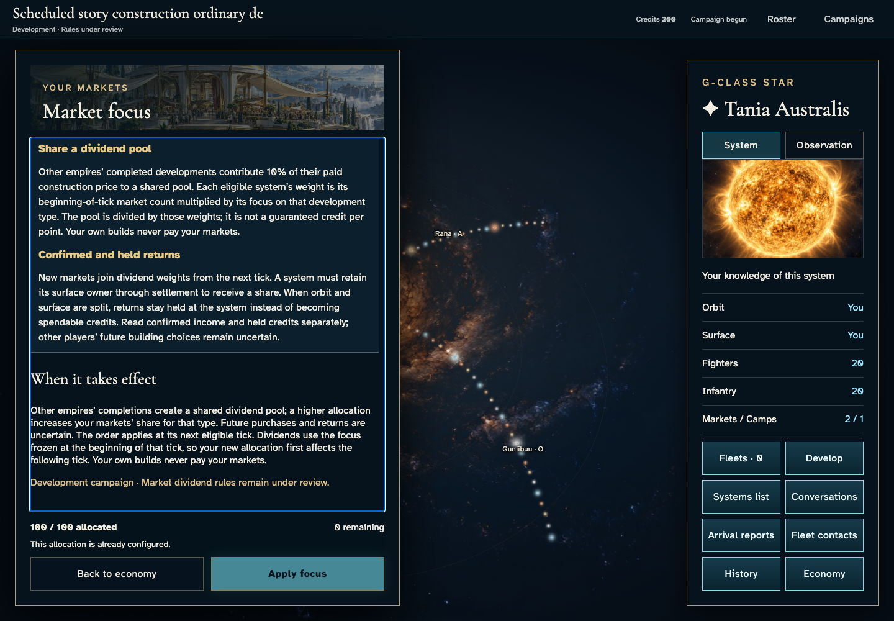](../../../../../../tests/browser/story-baselines/live-construction-ordinary/desktop/darwin-arm64/019-read-market-rule-2-1-builder-envoy.png)

### Viewpoint: Independent builder

## 20. Read confirmed and held returns while the campaign continues.

Actor: **Builder envoy**.

Acknowledged outcome: The selected rule is readable without applying an allocation.

- [x] The market commitment remains inside the viewport before scrolling, with the other player's own construction view intact.
- [x] Other players receive no owner construction orders, cancellation IDs, paid costs or ledger in their serialized private projection.
- [x] Help and an unsent allocation preserve canonical state and both private projections.

### Viewpoint: Builder envoy

### Viewpoint: Independent builder

## 21. Close help with the keyboard in both motion modes and return to allocation controls.

Actor: **Builder envoy**.

Acknowledged outcome: The closed disclosure retains keyboard focus and the allocation remains unsent.

- [x] The market commitment remains inside the viewport before scrolling, with the other player's own construction view intact.
- [x] Other players receive no owner construction orders, cancellation IDs, paid costs or ledger in their serialized private projection.
- [x] Help and an unsent allocation preserve canonical state and both private projections.

### Viewpoint: Builder envoy

### Viewpoint: Independent builder

## 22. Increase camp focus before redistributing the other points; the invalid total prevents sending.

Actor: **Builder envoy**.

Acknowledged outcome: 75 over allocation is explained and Apply focus stays disabled.

- [x] The market commitment remains inside the viewport before scrolling, with the other player's own construction view intact.
- [x] Other players receive no owner construction orders, cancellation IDs, paid costs or ledger in their serialized private projection.
- [x] Help and an unsent allocation preserve canonical state and both private projections.

### Viewpoint: Builder envoy

[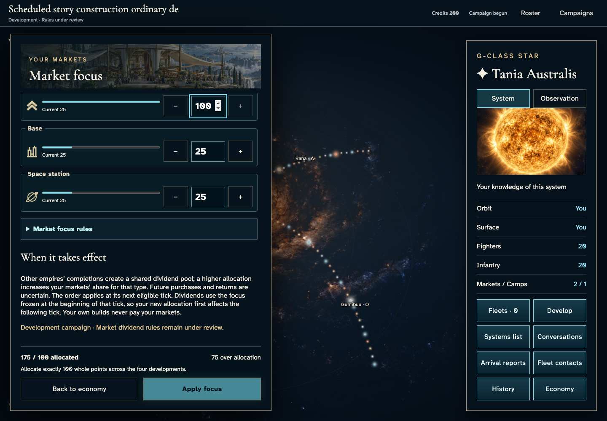](../../../../../../tests/browser/story-baselines/live-construction-ordinary/desktop/darwin-arm64/022-review-invalid-focus-1-builder-envoy.png)

### Viewpoint: Independent builder

## 23. Clear the market field while redistributing points; a blank partial edit remains unsent.

Actor: **Builder envoy**.

Acknowledged outcome: The blank market field is preserved and Apply focus is disabled.

- [x] The market commitment remains inside the viewport before scrolling, with the other player's own construction view intact.
- [x] Other players receive no owner construction orders, cancellation IDs, paid costs or ledger in their serialized private projection.
- [x] Help and an unsent allocation preserve canonical state and both private projections.

### Viewpoint: Builder envoy

[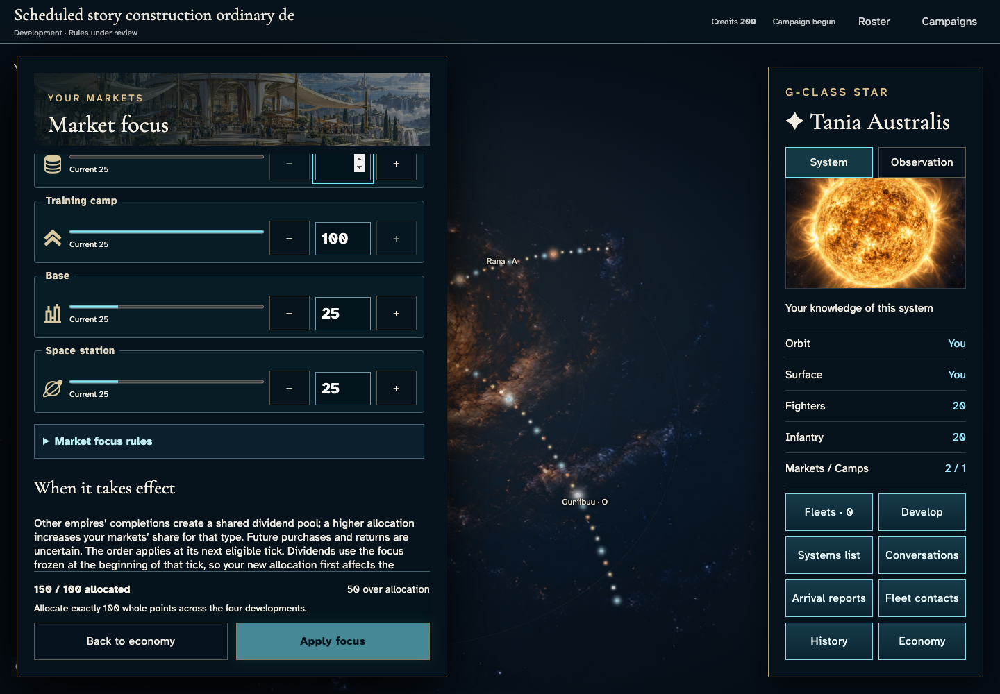](../../../../../../tests/browser/story-baselines/live-construction-ordinary/desktop/darwin-arm64/023-leave-partial-focus-1-builder-envoy.png)

### Viewpoint: Independent builder

## 24. Leave the allocation instrument and galaxy panel, then recover the same unsent invalid allocation using the keyboard.

Actor: **Builder envoy**.

Acknowledged outcome: The blank market and100 camp points return intact and cannot be sent.

- [x] The market commitment remains inside the viewport before scrolling, with the other player's own construction view intact.
- [x] Other players receive no owner construction orders, cancellation IDs, paid costs or ledger in their serialized private projection.
- [x] Help and an unsent allocation preserve canonical state and both private projections.

### Viewpoint: Builder envoy

### Viewpoint: Independent builder

## 25. Allocate all100 points to training camps without sending an order yet.

Actor: **Builder envoy**.

Acknowledged outcome: Exactly100 points enables Apply focus while the current allocation is unchanged.

- [x] The market commitment remains inside the viewport before scrolling, with the other player's own construction view intact.
- [x] Other players receive no owner construction orders, cancellation IDs, paid costs or ledger in their serialized private projection.
- [x] Help and an unsent allocation preserve canonical state and both private projections.

### Viewpoint: Builder envoy

[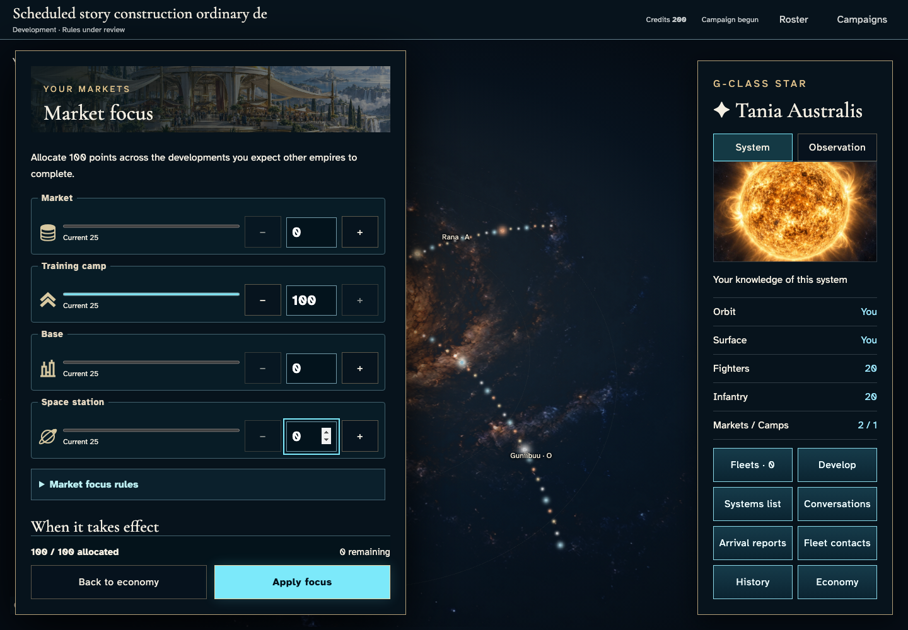](../../../../../../tests/browser/story-baselines/live-construction-ordinary/desktop/darwin-arm64/025-review-market-draft-1-builder-envoy.png)

### Viewpoint: Independent builder

## 26. Commit the allocation through the ordinary keyboard action and inspect its acknowledged application tick.

Actor: **Builder envoy**.

Acknowledged outcome: Focus order accepted names application tick1 and dividends from tick2.

- [x] The market commitment remains inside the viewport before scrolling, with the other player's own construction view intact.
- [x] Other players receive no owner construction orders, cancellation IDs, paid costs or ledger in their serialized private projection.
- [x] One accepted receipt records the private allocation without changing any wallet, system or another player's focus.

### Viewpoint: Builder envoy

[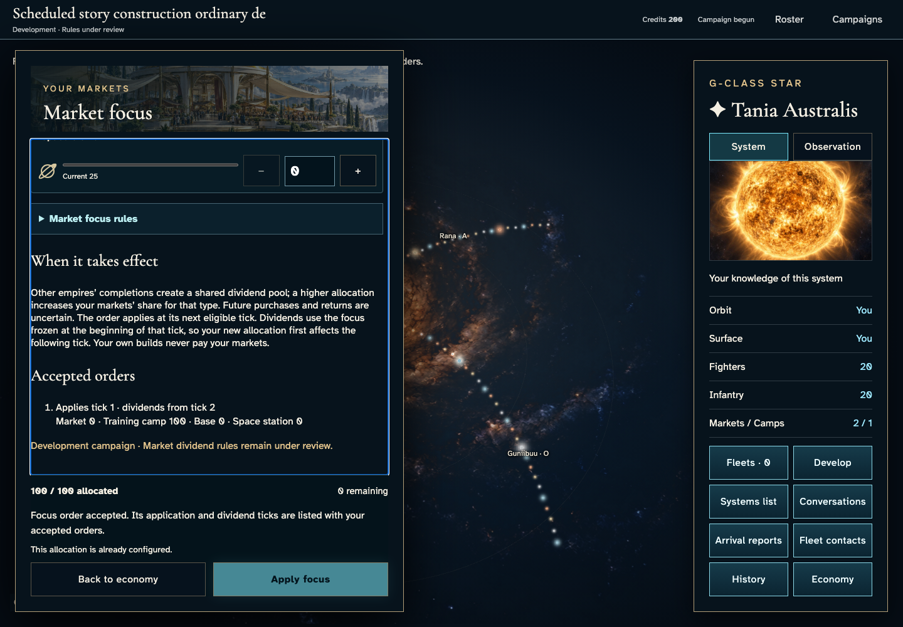](../../../../../../tests/browser/story-baselines/live-construction-ordinary/desktop/darwin-arm64/026-accept-market-focus-1-builder-envoy.png)

### Viewpoint: Independent builder

## 27. Reload and reopen the recorded focus; this recovers the accepted order rather than resubmitting it.

Actor: **Builder envoy**.

Acknowledged outcome: The camp allocation and original application tick survive reload.

- [x] The market commitment remains inside the viewport before scrolling, with the other player's own construction view intact.
- [x] Other players receive no owner construction orders, cancellation IDs, paid costs or ledger in their serialized private projection.
- [x] Reload creates no additional command or effect.

### Viewpoint: Builder envoy

[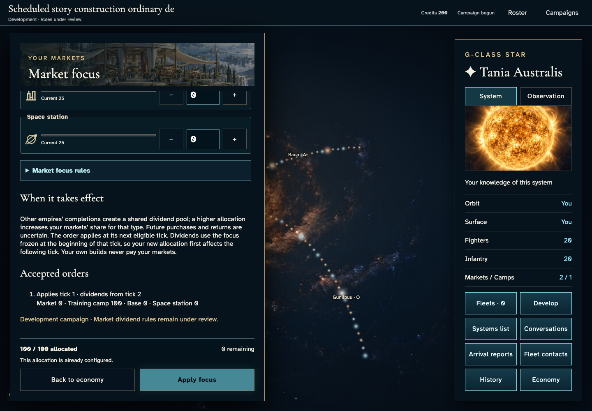](../../../../../../tests/browser/story-baselines/live-construction-ordinary/desktop/darwin-arm64/027-recover-market-focus-1-builder-envoy.png)

### Viewpoint: Independent builder

## 28. Return through economy to the preserved home development decision.

Actor: **Builder envoy**.

Acknowledged outcome: Training camp still costs69 with131 remaining after reservation.

- [x] Both commitment rails remain visible before scrolling and no player has an uncaught application error.
- [x] Other players receive no owner construction orders, cancellation IDs, paid costs or ledger in their serialized private projection.
- [x] Visible available balances equal each player's authoritative wallet.
- [x] Navigation leaves the accepted focus unchanged.

### Viewpoint: Builder envoy

[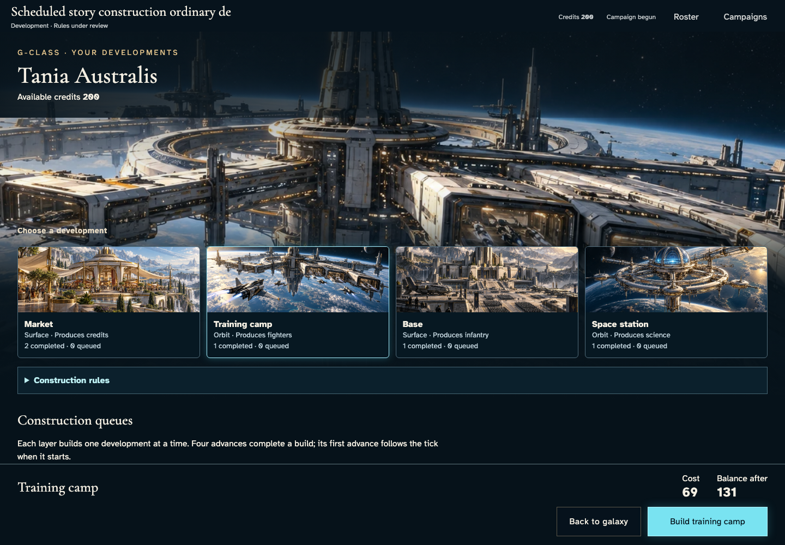](../../../../../../tests/browser/story-baselines/live-construction-ordinary/desktop/darwin-arm64/028-return-to-development-1-builder-envoy.png)

### Viewpoint: Independent builder

## 29. Read the authoritative construction acknowledgement and credit reservation.

Actor: **Builder envoy**.

Acknowledged outcome: Construction order accepted accompanies a queued camp eligible at tick1.

- [x] Both commitment rails remain visible before scrolling and no player has an uncaught application error.
- [x] Other players receive no owner construction orders, cancellation IDs, paid costs or ledger in their serialized private projection.
- [x] Visible available balances equal each player's authoritative wallet.
- [x] Exactly one command revision reserves69 credits; the orbital count and every other wallet are unchanged.

### Viewpoint: Builder envoy

[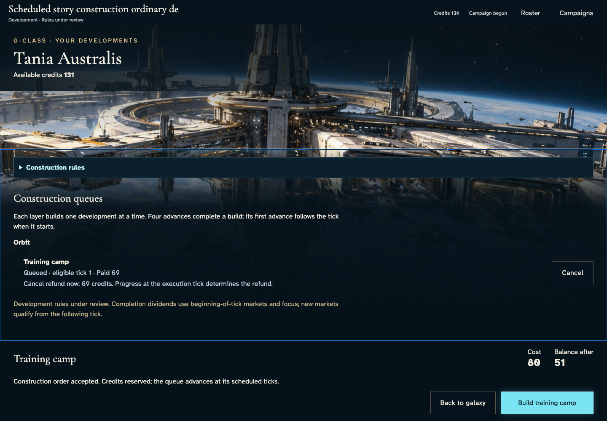](../../../../../../tests/browser/story-baselines/live-construction-ordinary/desktop/darwin-arm64/029-reserve-build-1-builder-envoy.png)

### Viewpoint: Independent builder

## 30. Reload the accepted work and reopen Develop to recover the same queue and balance.

Actor: **Builder envoy**.

Acknowledged outcome: The persisted queue remains eligible at tick1 with131 credits available.

- [x] Both commitment rails remain visible before scrolling and no player has an uncaught application error.
- [x] Other players receive no owner construction orders, cancellation IDs, paid costs or ledger in their serialized private projection.
- [x] Visible available balances equal each player's authoritative wallet.
- [x] Reload creates no command, revision or additional debit.

### Viewpoint: Builder envoy

[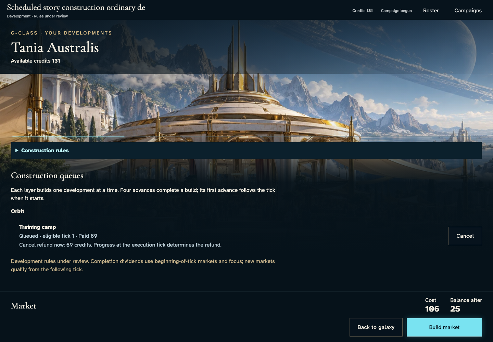](../../../../../../tests/browser/story-baselines/live-construction-ordinary/desktop/darwin-arm64/030-reload-reservation-1-builder-envoy.png)

### Viewpoint: Independent builder

## 31. Deliver five explicit production boundaries through the actual leased tick service. The first starts the build, four subsequent advances finish it; repeat delivery must change nothing.

Actor: **Test harness**. **Harness control; not a player action.**

Acknowledged outcome: Explicit test control; not a player action or hosted-service certification.

## 32. Inspect the settled training camp and the other commander's unchanged private queue.

Actor: **Builder envoy**.

Acknowledged outcome: The authoritative completion appears and the camp count is two.

- [x] Both commitment rails remain visible before scrolling and no player has an uncaught application error.
- [x] Other players receive no owner construction orders, cancellation IDs, paid costs or ledger in their serialized private projection.
- [x] Visible available balances equal each player's authoritative wallet.
- [x] Five ticks produce the exact reserved-owner and dividend-recipient balances, with one completed camp and no queued work.

### Viewpoint: Builder envoy

### Viewpoint: Independent builder

## 33. After real tick settlement, inspect the applied allocation and distinguish it from future market returns.

Actor: **Builder envoy**.

Acknowledged outcome: The authoritative applied outcome names tick1 and dividend eligibility from tick2.

- [x] The original order applied once and own construction still pays no own-market dividend.

### Viewpoint: Builder envoy

[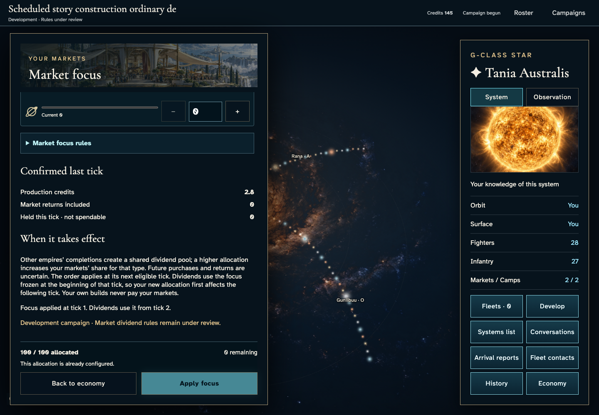](../../../../../../tests/browser/story-baselines/live-construction-ordinary/desktop/darwin-arm64/033-inspect-applied-focus-1-builder-envoy.png)

### Viewpoint: Independent builder

## 34. Return to the completed camp before making the next construction decision.

Actor: **Builder envoy**.

Acknowledged outcome: The completed camp remains available with no queued work.

- [x] Both commitment rails remain visible before scrolling and no player has an uncaught application error.
- [x] Other players receive no owner construction orders, cancellation IDs, paid costs or ledger in their serialized private projection.
- [x] Visible available balances equal each player's authoritative wallet.

### Viewpoint: Builder envoy

### Viewpoint: Independent builder

## 35. Choose a surface base and reserve its quoted cost using the keyboard.

Actor: **Builder envoy**.

Acknowledged outcome: A new accepted base order enters the surface queue for tick6.

- [x] Both commitment rails remain visible before scrolling and no player has an uncaught application error.
- [x] Other players receive no owner construction orders, cancellation IDs, paid costs or ledger in their serialized private projection.
- [x] Visible available balances equal each player's authoritative wallet.
- [x] The displayed base reservation is the sole wallet debit and neither completed development count changes.

### Viewpoint: Builder envoy

### Viewpoint: Independent builder

## 36. Request cancellation of the queued surface base. The refund waits for authoritative settlement.

Actor: **Builder envoy**.

Acknowledged outcome: Cancellation is acknowledged for tick6 and the cancel action is disabled.

- [x] Both commitment rails remain visible before scrolling and no player has an uncaught application error.
- [x] Other players receive no owner construction orders, cancellation IDs, paid costs or ledger in their serialized private projection.
- [x] Visible available balances equal each player's authoritative wallet.
- [x] Cancellation admission adds one revision without an early refund or a second build.

### Viewpoint: Builder envoy

[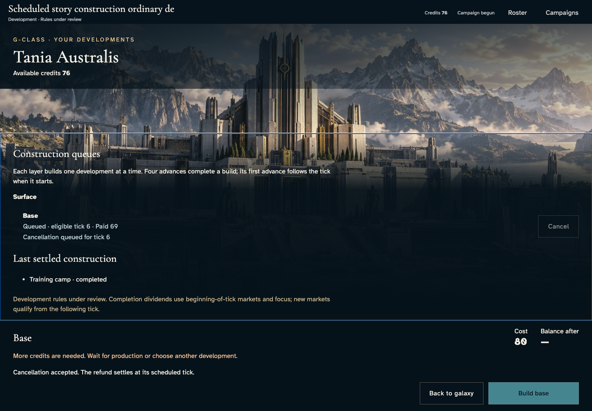](../../../../../../tests/browser/story-baselines/live-construction-ordinary/desktop/darwin-arm64/036-cancel-base-1-builder-envoy.png)

### Viewpoint: Independent builder

[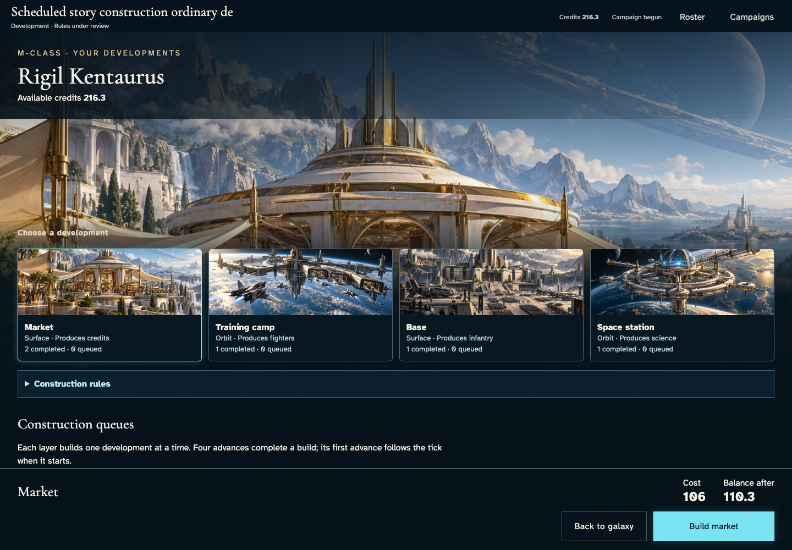](../../../../../../tests/browser/story-baselines/live-construction-ordinary/desktop/darwin-arm64/036-cancel-base-2-independent-builder.png)

## 37. Deliver tick6 through the real production service and repeat it to prove no second refund or production effect.

Actor: **Test harness**. **Harness control; not a player action.**

Acknowledged outcome: Explicit test control; not a player action or hosted-service certification.

## 38. Read the settled cancellation and returned credits; other players inspect only their own balances and empty queues.

Actor: **Builder envoy**.

Acknowledged outcome: The base cancellation states its returned credits and no construction remains queued.

- [x] Both commitment rails remain visible before scrolling and no player has an uncaught application error.
- [x] Other players receive no owner construction orders, cancellation IDs, paid costs or ledger in their serialized private projection.
- [x] Visible available balances equal each player's authoritative wallet.
- [x] The unstarted base refunds its entire reservation exactly once; only tick6 production changes each wallet and the base count is unchanged.

### Viewpoint: Builder envoy

[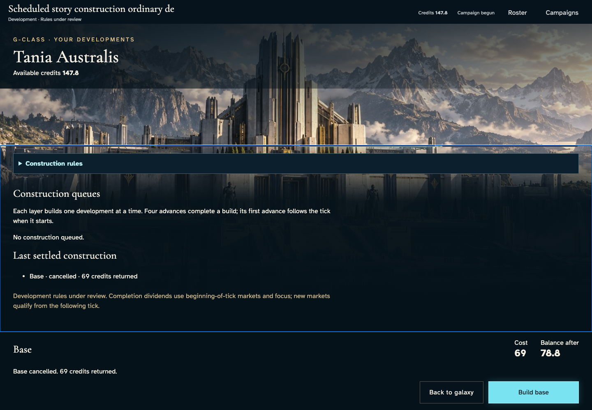](../../../../../../tests/browser/story-baselines/live-construction-ordinary/desktop/darwin-arm64/038-cancelled-base-1-builder-envoy.png)

### Viewpoint: Independent builder

## 39. Reload and reopen the construction panel to inspect the persisted refund without replaying an action.

Actor: **Builder envoy**.

Acknowledged outcome: The same settled cancellation and returned credits are recovered.

- [x] Both commitment rails remain visible before scrolling and no player has an uncaught application error.
- [x] Other players receive no owner construction orders, cancellation IDs, paid costs or ledger in their serialized private projection.
- [x] Visible available balances equal each player's authoritative wallet.
- [x] The complete canonical result survives reload without another revision, build or refund.

### Viewpoint: Builder envoy

[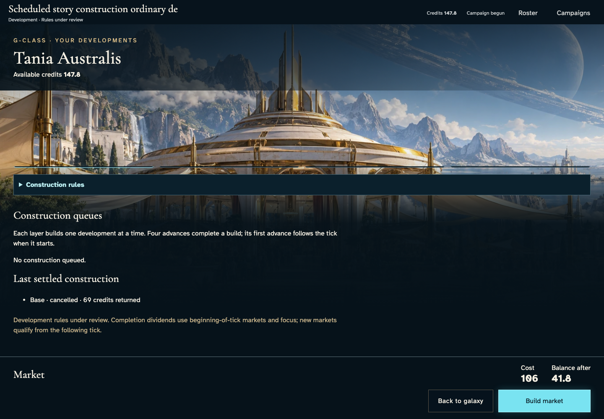](../../../../../../tests/browser/story-baselines/live-construction-ordinary/desktop/darwin-arm64/039-recover-settled-outcome-1-builder-envoy.png)

### Viewpoint: Independent builder

## 40. Return to the galaxy with Escape and recover the Develop control's focus.

Actor: **Builder envoy**.

Acknowledged outcome: The panel closes and Develop receives keyboard focus.

- [x] Leaving the instrument has no authoritative side effect.

### Viewpoint: Builder envoy

### Viewpoint: Independent builder

