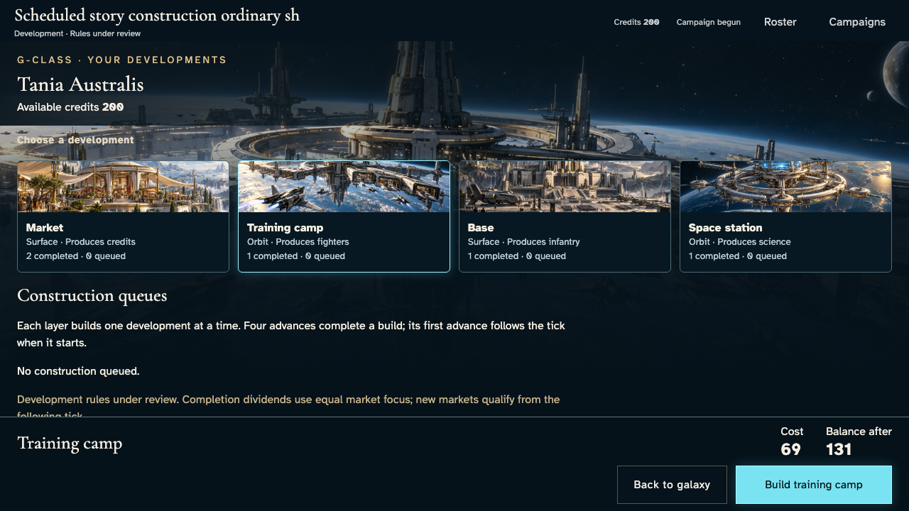
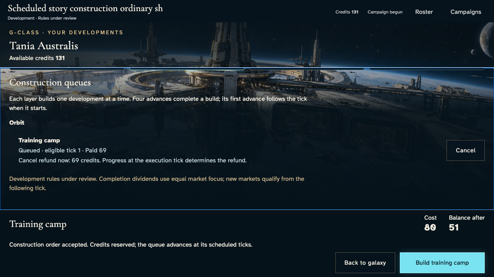
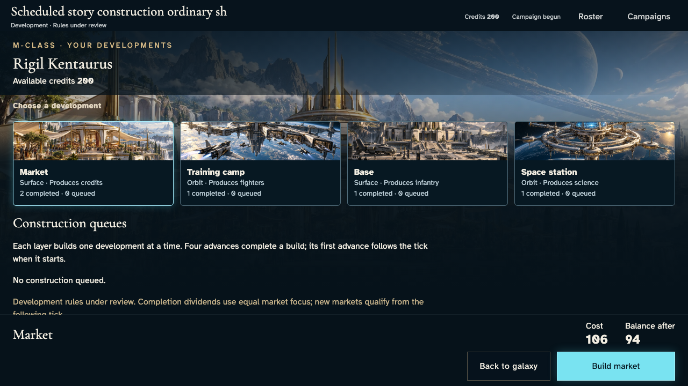
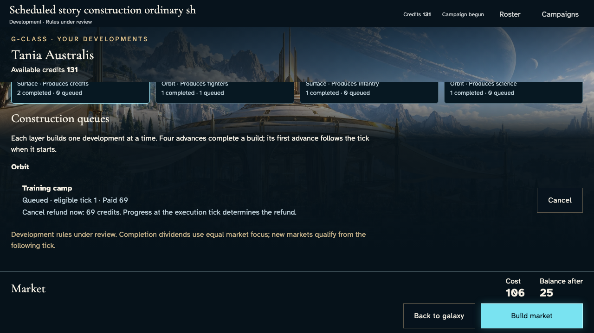
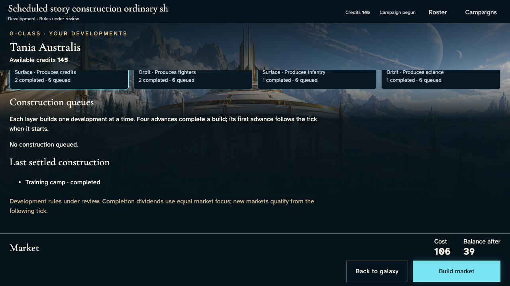
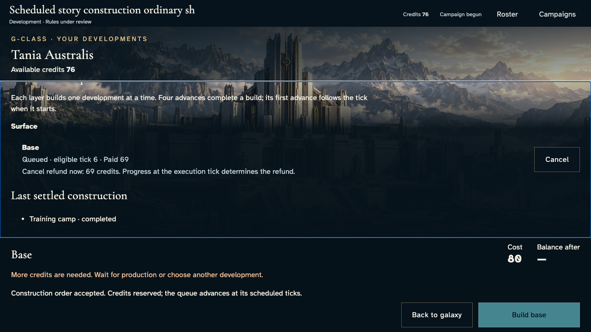
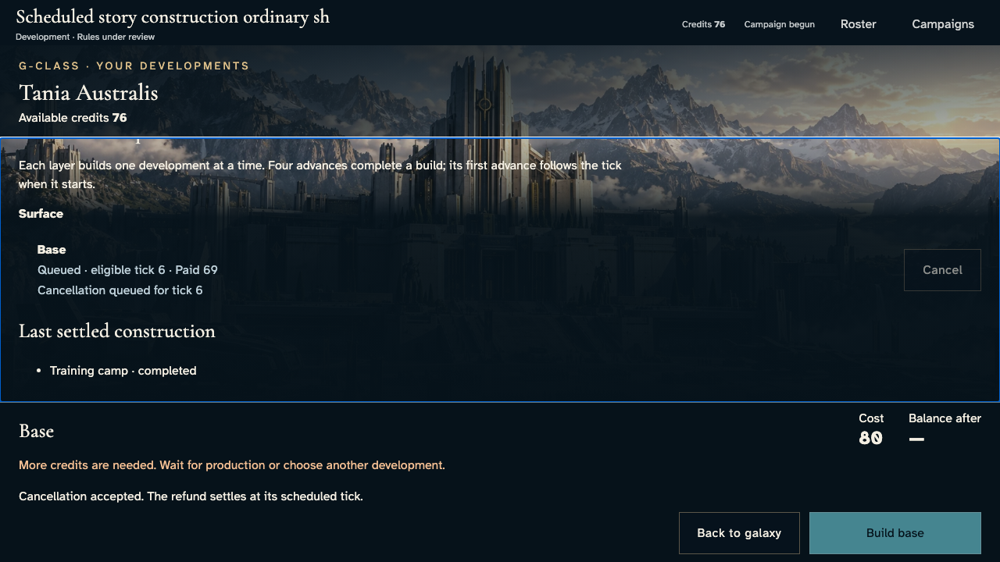
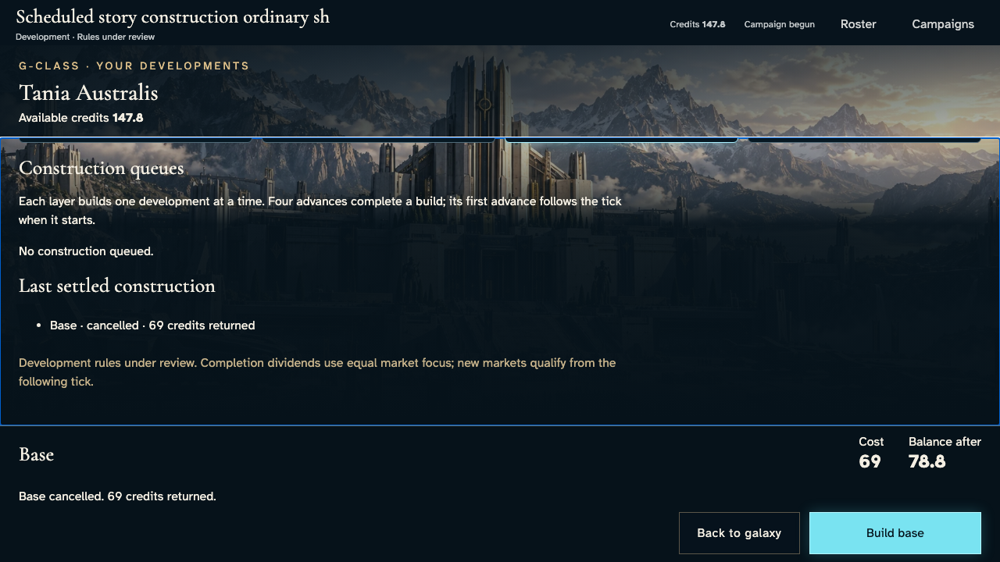
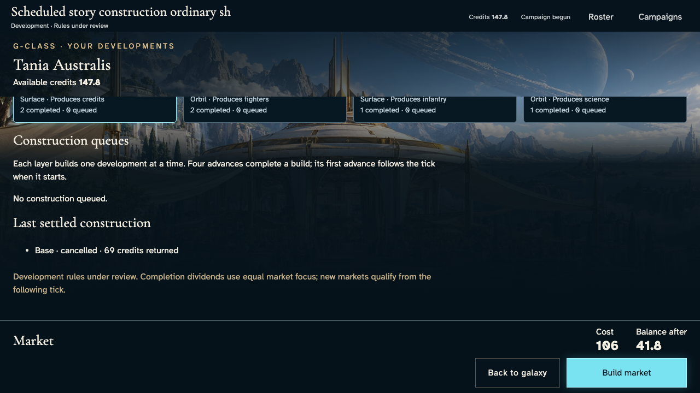
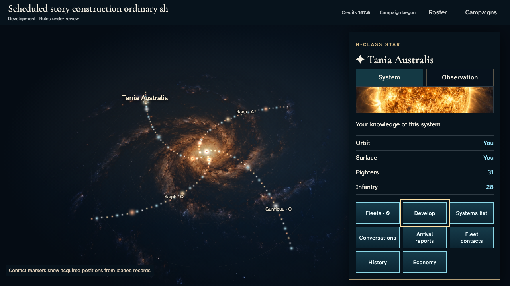

# Reserve, complete and cancel developments

**Exact comparison passed.** short · darwin-arm64. Inventory: UX-05, UX-14, UX-16.

Four independent players enter a real development campaign. Owner and other-player views show reservation, queued work, completion and cancellation. Encrypted mock ingress, canonical state, private grants and tick settlement are real. Fixed domain time and withheld delivery are explicitly labelled test controls. Construction price, four-advance duration, refunds and dividends remain proposed development rules; managed-key, hosted and all-layer acceptance remain separate.

## 1. Ordinary emulator sign-in and identity save, with explicit developer entitlement and fixed browser Date; timers continue normally.

Actor: **Test harness**. **Harness control; not a player action.**

Acknowledged outcome: Explicit test control; not a player action or hosted-service certification.

## 2. Ordinary emulator sign-in and identity save, with explicit developer entitlement and fixed browser Date; timers continue normally.

Actor: **Test harness**. **Harness control; not a player action.**

Acknowledged outcome: Explicit test control; not a player action or hosted-service certification.

## 3. Ordinary emulator sign-in and identity save, with explicit developer entitlement and fixed browser Date; timers continue normally.

Actor: **Test harness**. **Harness control; not a player action.**

Acknowledged outcome: Explicit test control; not a player action or hosted-service certification.

## 4. Ordinary emulator sign-in and identity save, with explicit developer entitlement and fixed browser Date; timers continue normally.

Actor: **Test harness**. **Harness control; not a player action.**

Acknowledged outcome: Explicit test control; not a player action or hosted-service certification.

## 5. Create/join through ordinary campaign controls. Fixed catalogue and admission clock are test controls; no seat, message or command outcome is injected.

Actor: **Test harness**. **Harness control; not a player action.**

Acknowledged outcome: Explicit test control; not a player action or hosted-service certification.

## 6. Create/join through ordinary campaign controls. Fixed catalogue and admission clock are test controls; no seat, message or command outcome is injected.

Actor: **Test harness**. **Harness control; not a player action.**

Acknowledged outcome: Explicit test control; not a player action or hosted-service certification.

## 7. Create/join through ordinary campaign controls. Fixed catalogue and admission clock are test controls; no seat, message or command outcome is injected.

Actor: **Test harness**. **Harness control; not a player action.**

Acknowledged outcome: Explicit test control; not a player action or hosted-service certification.

## 8. Create/join through ordinary campaign controls. Fixed catalogue and admission clock are test controls; no seat, message or command outcome is injected.

Actor: **Test harness**. **Harness control; not a player action.**

Acknowledged outcome: Explicit test control; not a player action or hosted-service certification.

## 9. Advance the designated browser/domain clock to 12:15 UTC and deliver the actual emulator Scheduler HTTP request. This does not certify hosted scheduling.

Actor: **Test harness**. **Harness control; not a player action.**

Acknowledged outcome: Explicit test control; not a player action or hosted-service certification.

## 10. Inspect the actual home system and choose an orbital training camp. The other commander reviews their own construction panel.

Actor: **Builder envoy**.

Acknowledged outcome: The development quote shows69 credits and131 after reservation, with one completed training camp.

- [x] Both commitment rails remain visible before scrolling and no player has an uncaught application error.
- [x] Other players receive no owner construction orders, cancellation IDs, paid costs or ledger in their serialized private projection.
- [x] Visible available balances equal each player's authoritative wallet.

### Viewpoint: Builder envoy

### Viewpoint: Independent builder

## 11. Read the authoritative construction acknowledgement and credit reservation.

Actor: **Builder envoy**.

Acknowledged outcome: Construction order accepted accompanies a queued camp eligible at tick1.

- [x] Both commitment rails remain visible before scrolling and no player has an uncaught application error.
- [x] Other players receive no owner construction orders, cancellation IDs, paid costs or ledger in their serialized private projection.
- [x] Visible available balances equal each player's authoritative wallet.
- [x] Exactly one command revision reserves69 credits; the orbital count and every other wallet are unchanged.

### Viewpoint: Builder envoy

### Viewpoint: Independent builder

## 12. Reload the accepted work and reopen Develop to recover the same queue and balance.

Actor: **Builder envoy**.

Acknowledged outcome: The persisted queue remains eligible at tick1 with131 credits available.

- [x] Both commitment rails remain visible before scrolling and no player has an uncaught application error.
- [x] Other players receive no owner construction orders, cancellation IDs, paid costs or ledger in their serialized private projection.
- [x] Visible available balances equal each player's authoritative wallet.
- [x] Reload creates no command, revision or additional debit.

### Viewpoint: Builder envoy

### Viewpoint: Independent builder

## 13. Deliver five explicit production boundaries through the actual leased tick service. The first starts the build, four subsequent advances finish it; repeat delivery must change nothing.

Actor: **Test harness**. **Harness control; not a player action.**

Acknowledged outcome: Explicit test control; not a player action or hosted-service certification.

## 14. Inspect the settled training camp and the other commander's unchanged private queue.

Actor: **Builder envoy**.

Acknowledged outcome: The authoritative completion appears and the camp count is two.

- [x] Both commitment rails remain visible before scrolling and no player has an uncaught application error.
- [x] Other players receive no owner construction orders, cancellation IDs, paid costs or ledger in their serialized private projection.
- [x] Visible available balances equal each player's authoritative wallet.
- [x] Five ticks produce the exact reserved-owner and dividend-recipient balances, with one completed camp and no queued work.

### Viewpoint: Builder envoy

### Viewpoint: Independent builder

## 15. Choose a surface base and reserve its quoted cost using the keyboard.

Actor: **Builder envoy**.

Acknowledged outcome: A new accepted base order enters the surface queue for tick6.

- [x] Both commitment rails remain visible before scrolling and no player has an uncaught application error.
- [x] Other players receive no owner construction orders, cancellation IDs, paid costs or ledger in their serialized private projection.
- [x] Visible available balances equal each player's authoritative wallet.
- [x] The displayed base reservation is the sole wallet debit and neither completed development count changes.

### Viewpoint: Builder envoy

### Viewpoint: Independent builder

## 16. Request cancellation of the queued surface base. The refund waits for authoritative settlement.

Actor: **Builder envoy**.

Acknowledged outcome: Cancellation is acknowledged for tick6 and the cancel action is disabled.

- [x] Both commitment rails remain visible before scrolling and no player has an uncaught application error.
- [x] Other players receive no owner construction orders, cancellation IDs, paid costs or ledger in their serialized private projection.
- [x] Visible available balances equal each player's authoritative wallet.
- [x] Cancellation admission adds one revision without an early refund or a second build.

### Viewpoint: Builder envoy

### Viewpoint: Independent builder

## 17. Deliver tick6 through the real production service and repeat it to prove no second refund or production effect.

Actor: **Test harness**. **Harness control; not a player action.**

Acknowledged outcome: Explicit test control; not a player action or hosted-service certification.

## 18. Read the settled cancellation and returned credits; other players inspect only their own balances and empty queues.

Actor: **Builder envoy**.

Acknowledged outcome: The base cancellation states its returned credits and no construction remains queued.

- [x] Both commitment rails remain visible before scrolling and no player has an uncaught application error.
- [x] Other players receive no owner construction orders, cancellation IDs, paid costs or ledger in their serialized private projection.
- [x] Visible available balances equal each player's authoritative wallet.
- [x] The unstarted base refunds its entire reservation exactly once; only tick6 production changes each wallet and the base count is unchanged.

### Viewpoint: Builder envoy

### Viewpoint: Independent builder

## 19. Reload and reopen the construction panel to inspect the persisted refund without replaying an action.

Actor: **Builder envoy**.

Acknowledged outcome: The same settled cancellation and returned credits are recovered.

- [x] Both commitment rails remain visible before scrolling and no player has an uncaught application error.
- [x] Other players receive no owner construction orders, cancellation IDs, paid costs or ledger in their serialized private projection.
- [x] Visible available balances equal each player's authoritative wallet.
- [x] The complete canonical result survives reload without another revision, build or refund.

### Viewpoint: Builder envoy

### Viewpoint: Independent builder

## 20. Return to the galaxy with Escape and recover the Develop control's focus.

Actor: **Builder envoy**.

Acknowledged outcome: The panel closes and Develop receives keyboard focus.

- [x] Leaving the instrument has no authoritative side effect.

### Viewpoint: Builder envoy

### Viewpoint: Independent builder

