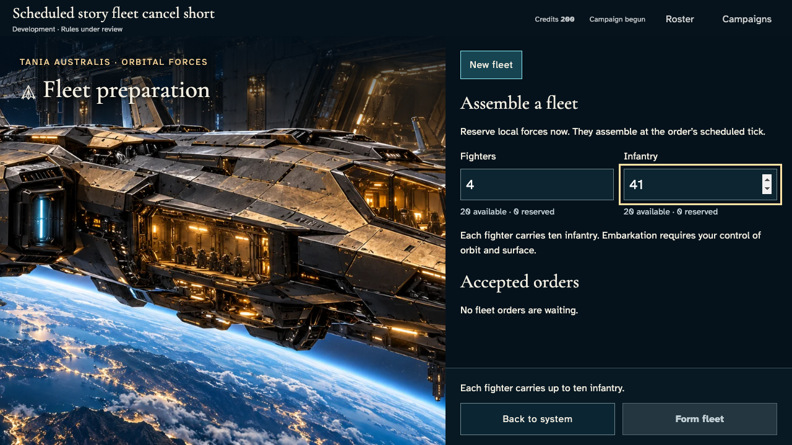
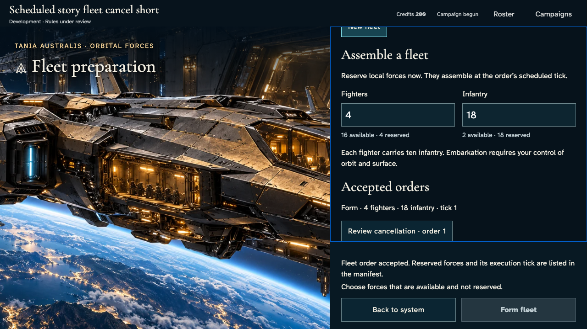
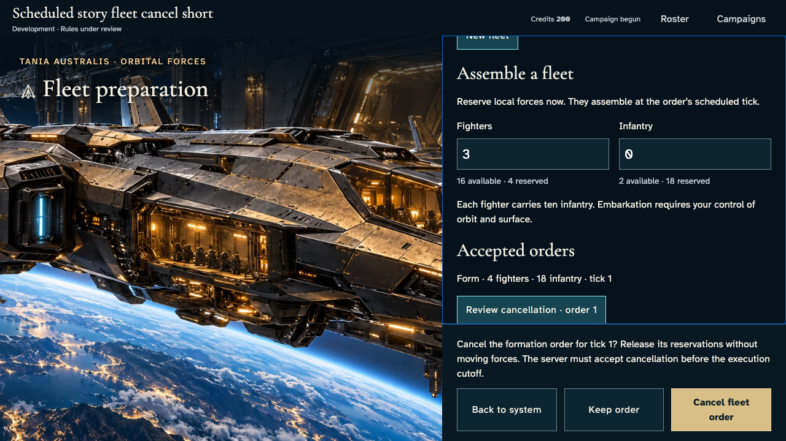
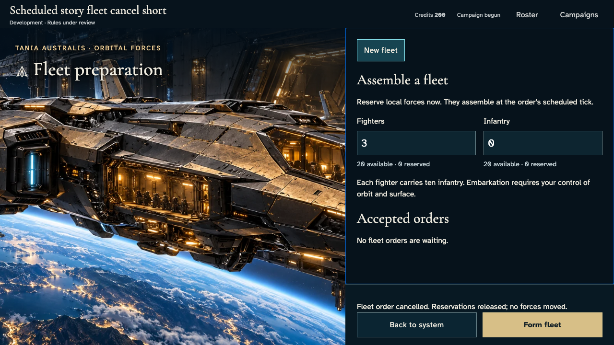
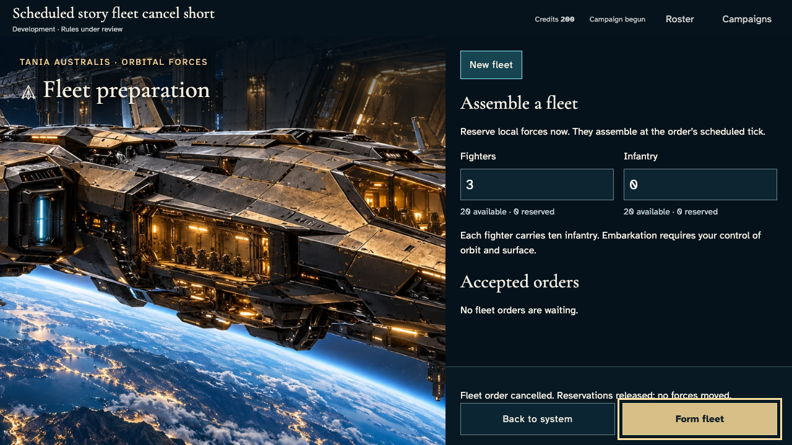
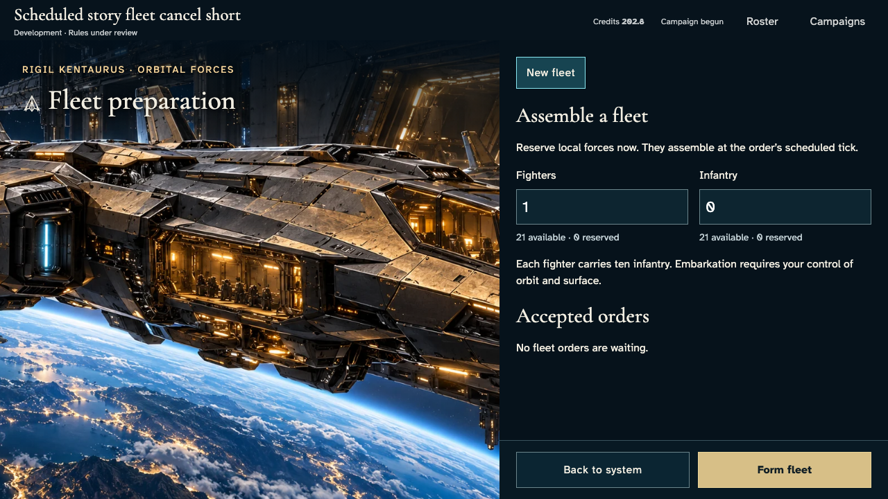
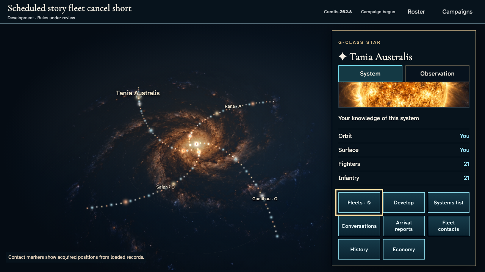

# Review, keep and cancel a fleet order

**Exact comparison passed.** short · darwin-arm64. Inventory: UX-08, UX-14, UX-16.

Four independent commanders enter through actual authenticated controls. The owner reviews and keeps an accepted formation, preserves a separate unsubmitted draft, then cancels with one authoritative receipt. Released forces never execute at the cancelled boundary. Owner and independent-player views show private reservations and recovery. Explicit domain clocks are harness controls; this does not certify cutoff-edge timing, managed keys or hosted cadence.

## 1. Ordinary emulator sign-in and identity save, with explicit developer entitlement and fixed browser Date; timers continue normally.

Actor: **Test harness**. **Harness control; not a player action.**

Acknowledged outcome: Explicit test control; not a player action or hosted-service certification.

## 2. Ordinary emulator sign-in and identity save, with explicit developer entitlement and fixed browser Date; timers continue normally.

Actor: **Test harness**. **Harness control; not a player action.**

Acknowledged outcome: Explicit test control; not a player action or hosted-service certification.

## 3. Ordinary emulator sign-in and identity save, with explicit developer entitlement and fixed browser Date; timers continue normally.

Actor: **Test harness**. **Harness control; not a player action.**

Acknowledged outcome: Explicit test control; not a player action or hosted-service certification.

## 4. Ordinary emulator sign-in and identity save, with explicit developer entitlement and fixed browser Date; timers continue normally.

Actor: **Test harness**. **Harness control; not a player action.**

Acknowledged outcome: Explicit test control; not a player action or hosted-service certification.

## 5. Create/join through ordinary campaign controls. Fixed catalogue and admission clock are test controls; no seat, message or command outcome is injected.

Actor: **Test harness**. **Harness control; not a player action.**

Acknowledged outcome: Explicit test control; not a player action or hosted-service certification.

## 6. Create/join through ordinary campaign controls. Fixed catalogue and admission clock are test controls; no seat, message or command outcome is injected.

Actor: **Test harness**. **Harness control; not a player action.**

Acknowledged outcome: Explicit test control; not a player action or hosted-service certification.

## 7. Create/join through ordinary campaign controls. Fixed catalogue and admission clock are test controls; no seat, message or command outcome is injected.

Actor: **Test harness**. **Harness control; not a player action.**

Acknowledged outcome: Explicit test control; not a player action or hosted-service certification.

## 8. Create/join through ordinary campaign controls. Fixed catalogue and admission clock are test controls; no seat, message or command outcome is injected.

Actor: **Test harness**. **Harness control; not a player action.**

Acknowledged outcome: Explicit test control; not a player action or hosted-service certification.

## 9. Advance the designated browser/domain clock to 12:15 UTC and deliver the actual emulator Scheduler HTTP request. This does not certify hosted scheduling.

Actor: **Test harness**. **Harness control; not a player action.**

Acknowledged outcome: Explicit test control; not a player action or hosted-service certification.

## 10. Open each commander's own fleet preparation. Enter four fighters and an over-capacity infantry complement before committing anything.

Actor: **Fleet marshal**.

Acknowledged outcome: The actual capacity constraint disables formation without a command.

- [x] Both fixed action rails are visible before scrolling and no application error occurred.
- [x] Other commanders have no owner fleet, private order or ledger in their actual member projections.
- [x] Invalid input does not change canonical state or reserve forces.

### Viewpoint: Fleet marshal

### Viewpoint: Independent marshal

## 11. Reduce infantry to the supported eighteen and inspect the ready formation.

Actor: **Fleet marshal**.

Acknowledged outcome: Formation is enabled and focused for keyboard confirmation.

- [x] Both fixed action rails are visible before scrolling and no application error occurred.
- [x] Other commanders have no owner fleet, private order or ledger in their actual member projections.

### Viewpoint: Fleet marshal

### Viewpoint: Independent marshal

## 12. Confirm formation with Enter. The authoritative receipt reserves four fighters and eighteen infantry for tick one, without moving them yet.

Actor: **Fleet marshal**.

Acknowledged outcome: The service acknowledges the formation and publishes its exact waiting complement.

- [x] Both fixed action rails are visible before scrolling and no application error occurred.
- [x] Other commanders have no owner fleet, private order or ledger in their actual member projections.
- [x] One accepted receipt and revision reserve the original forces without creating a fleet or moving the garrison.

### Viewpoint: Fleet marshal

### Viewpoint: Independent marshal

## 13. Reload the owner account and reopen its exact campaign's home-system fleet panel.

Actor: **Fleet marshal**.

Acknowledged outcome: The same accepted order and reserved complement return from persistence.

- [x] Both fixed action rails are visible before scrolling and no application error occurred.
- [x] Other commanders have no owner fleet, private order or ledger in their actual member projections.
- [x] Reload adds no revision, order or effect.

### Viewpoint: Fleet marshal

### Viewpoint: Independent marshal

## 14. Start a separate three-fighter draft, then inspect cancellation of the accepted four-fighter/eighteen-infantry order. The reservation stays intact until confirmed.

Actor: **Fleet marshal**.

Acknowledged outcome: The fixed rail names the original formation and tick; both Keep order and Cancel fleet order are available.

- [x] Both fixed action rails are visible before scrolling and no application error occurred.
- [x] Other commanders have no owner fleet, private order or ledger in their actual member projections.
- [x] Review creates no command and preserves the unrelated three-fighter draft and original reservation.

### Viewpoint: Fleet marshal

### Viewpoint: Independent marshal

## 15. Choose Keep order with Enter. Return to the original draft without cancelling anything.

Actor: **Fleet marshal**.

Acknowledged outcome: The accepted formation remains scheduled and the normal formation commitment returns.

- [x] Both fixed action rails are visible before scrolling and no application error occurred.
- [x] Other commanders have no owner fleet, private order or ledger in their actual member projections.
- [x] Keep order adds no revision or cancellation; draft stays three fighters.

### Viewpoint: Fleet marshal

### Viewpoint: Independent marshal

## 16. Review the same accepted order again and confirm cancellation with Enter. Read the actual service acknowledgement and released reservation.

Actor: **Fleet marshal**.

Acknowledged outcome: The authoritative cancellation returns focus to Accepted orders and reports that no forces moved.

- [x] Both fixed action rails are visible before scrolling and no application error occurred.
- [x] Other commanders have no owner fleet, private order or ledger in their actual member projections.
- [x] Exactly one accepted cancellation revision clears the original order and preserves every garrison/fleet; its receipt is bound to the actual encrypted request.

### Viewpoint: Fleet marshal

### Viewpoint: Independent marshal

## 17. Inspect the preserved three-fighter draft and the returned availability after cancellation, without submitting a replacement formation.

Actor: **Fleet marshal**.

Acknowledged outcome: Formation is enabled with three fighters, zero infantry and no reserved units.

- [x] Both fixed action rails are visible before scrolling and no application error occurred.
- [x] Other commanders have no owner fleet, private order or ledger in their actual member projections.
- [x] Draft inspection cannot create a replacement order or change balances/forces.

### Viewpoint: Fleet marshal

### Viewpoint: Independent marshal

## 18. Reload the exact campaign and inspect its confirmed absence of accepted fleet orders. The unsubmitted draft is not claimed as a persisted command.

Actor: **Fleet marshal**.

Acknowledged outcome: Confirmed released reservations recover from persistence.

- [x] Both fixed action rails are visible before scrolling and no application error occurred.
- [x] Other commanders have no owner fleet, private order or ledger in their actual member projections.
- [x] Reload does not re-create the cancelled order or append a new revision.

### Viewpoint: Fleet marshal

### Viewpoint: Independent marshal

## 19. Advance to the cancelled formation's real boundary and invoke the production leased tick service, then repeat delivery. Only ordinary production may occur; no formation is injected.

Actor: **Test harness**. **Harness control; not a player action.**

Acknowledged outcome: Explicit test control; not a player action or hosted-service certification.

## 20. Inspect the next confirmed tick: no fleet appears, and both commanders retain their own produced forces.

Actor: **Fleet marshal**.

Acknowledged outcome: The accepted cancellation remains effective past the original execution boundary.

- [x] Both fixed action rails are visible before scrolling and no application error occurred.
- [x] Other commanders have no owner fleet, private order or ledger in their actual member projections.
- [x] No formation outcome or force movement exists; only the real production ledger increases totals and repeated delivery is a complete no-op.

### Viewpoint: Fleet marshal

### Viewpoint: Independent marshal

## 21. Return to the galaxy with Enter and confirm the system has no fleet marker.

Actor: **Fleet marshal**.

Acknowledged outcome: Focus returns to Fleets · 0 and no owned fleet marker exists.

- [x] Navigation preserves settled forces and no application error occurred.

### Viewpoint: Fleet marshal

### Viewpoint: Independent marshal

