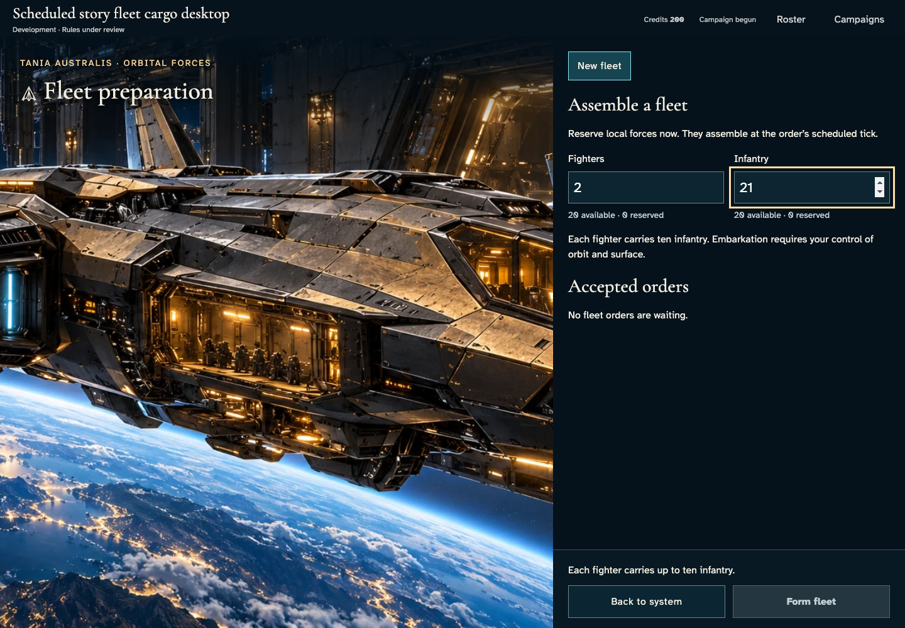
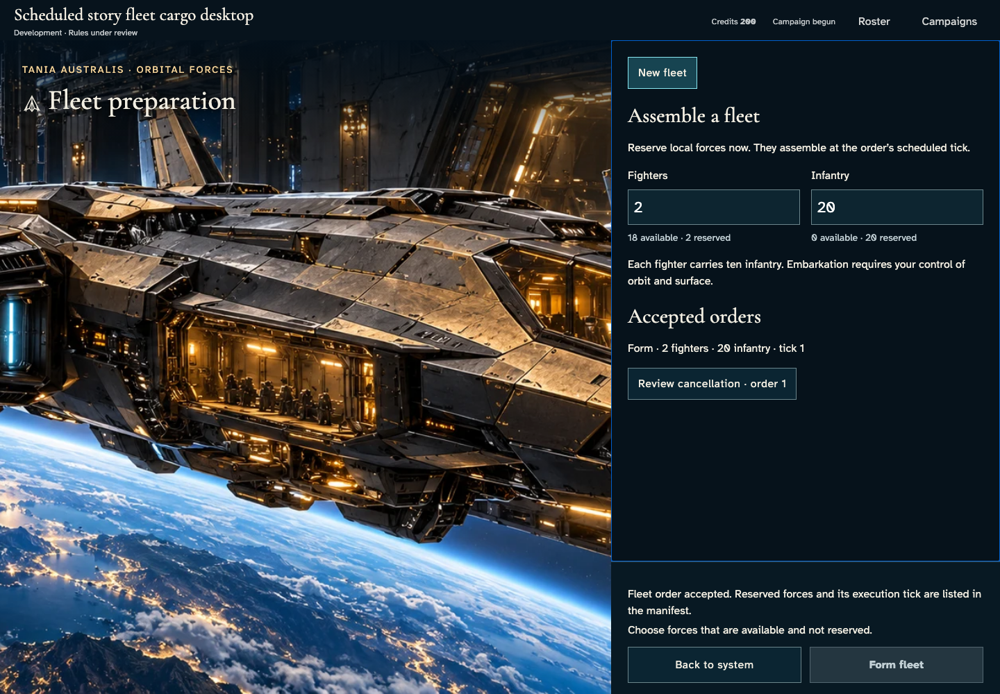
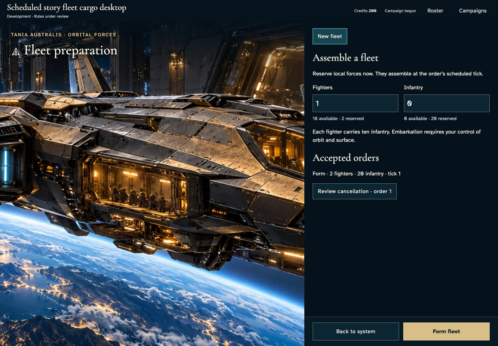
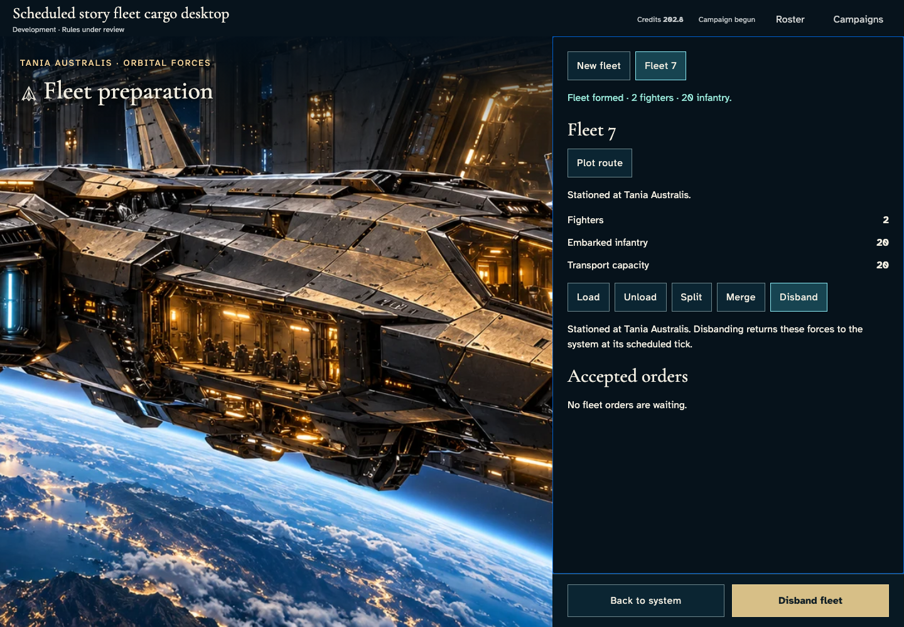
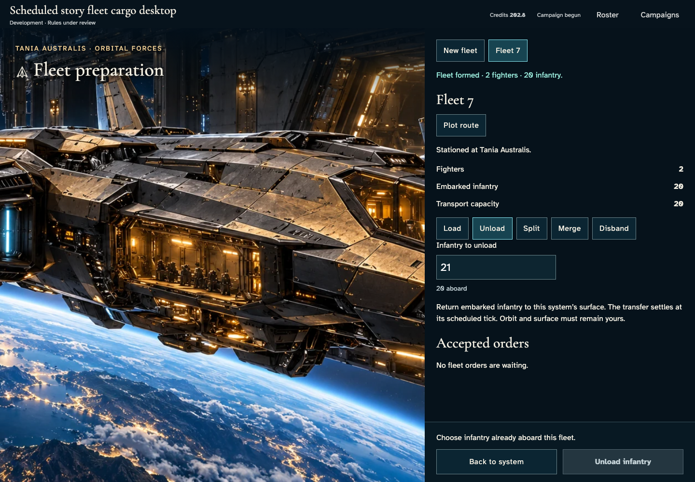
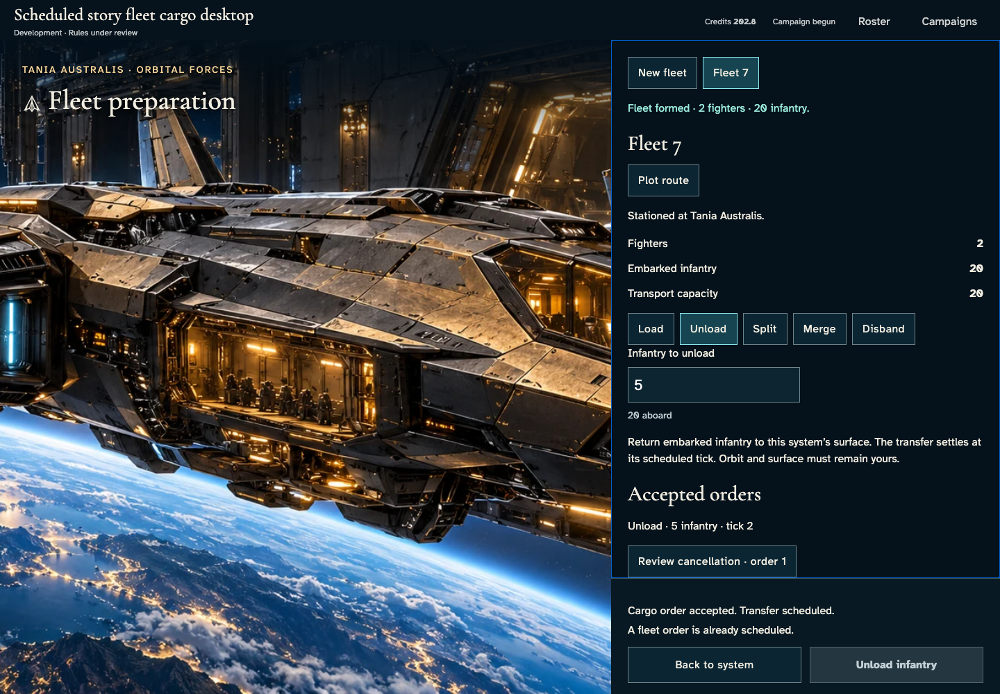
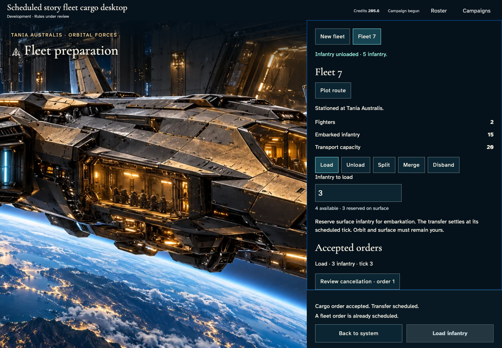
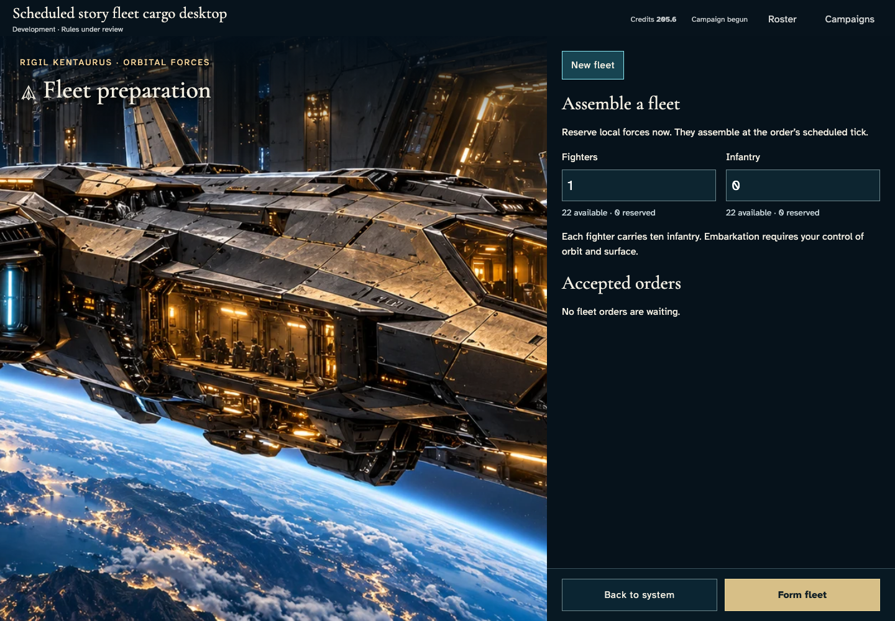
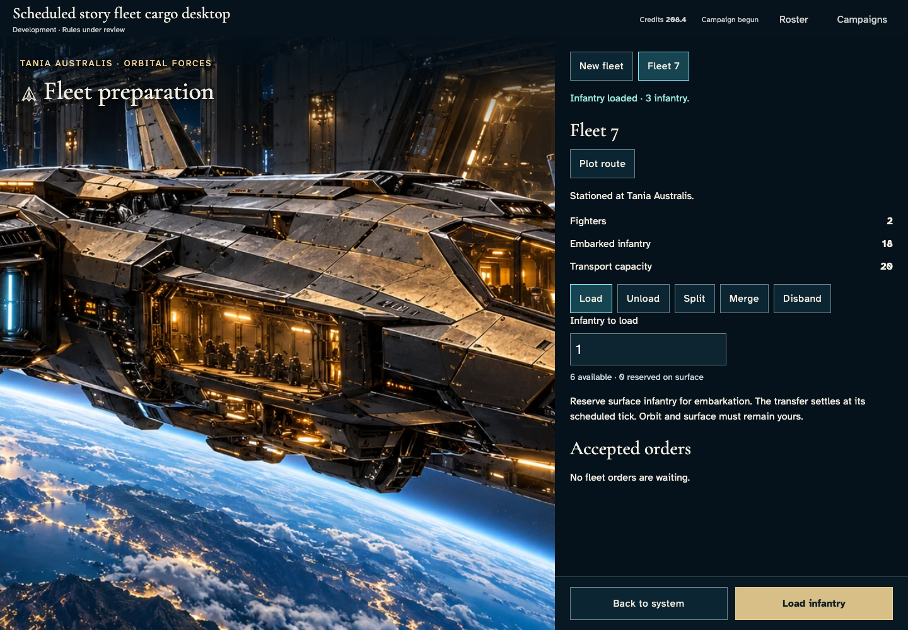
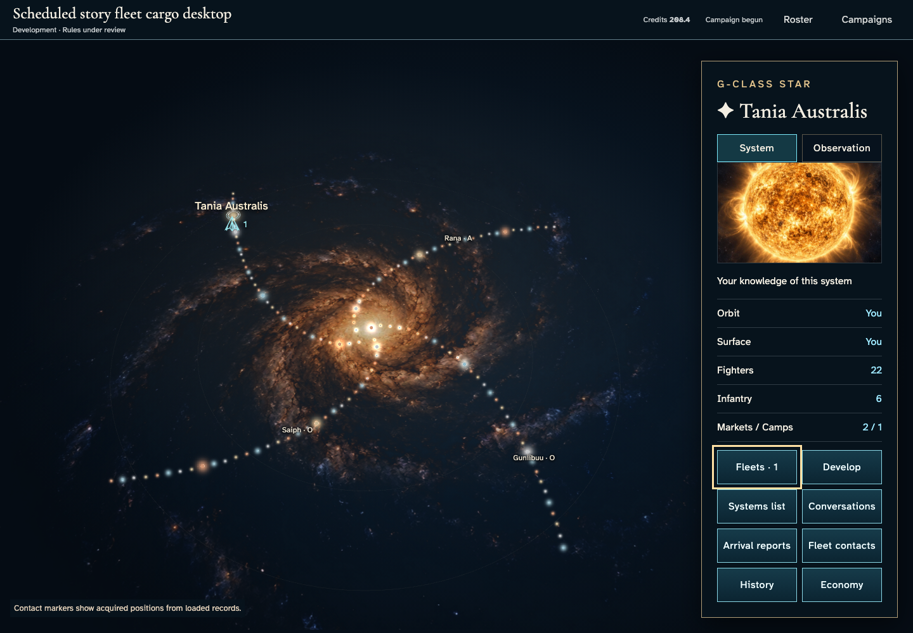

# Unload, recover and reload fleet cargo

**Exact comparison passed.** desktop · darwin-arm64. Inventory: UX-08, UX-14, UX-16.

Four independent commanders enter through actual authenticated controls. Formation establishes a fleet; unload and load reserve infantry and move it once at leased settlement. Owner and other-player views show private orders and outcomes. Fixed catalogue/domain clocks are explicit harness controls. Development transport capacity and tick rules remain under review; this does not certify travel, managed encryption or hosted scheduling.

## 1. Ordinary emulator sign-in and identity save, with explicit developer entitlement and fixed browser Date; timers continue normally.

Actor: **Test harness**. **Harness control; not a player action.**

Acknowledged outcome: Explicit test control; not a player action or hosted-service certification.

## 2. Ordinary emulator sign-in and identity save, with explicit developer entitlement and fixed browser Date; timers continue normally.

Actor: **Test harness**. **Harness control; not a player action.**

Acknowledged outcome: Explicit test control; not a player action or hosted-service certification.

## 3. Ordinary emulator sign-in and identity save, with explicit developer entitlement and fixed browser Date; timers continue normally.

Actor: **Test harness**. **Harness control; not a player action.**

Acknowledged outcome: Explicit test control; not a player action or hosted-service certification.

## 4. Ordinary emulator sign-in and identity save, with explicit developer entitlement and fixed browser Date; timers continue normally.

Actor: **Test harness**. **Harness control; not a player action.**

Acknowledged outcome: Explicit test control; not a player action or hosted-service certification.

## 5. Create/join through ordinary campaign controls. Fixed catalogue and admission clock are test controls; no seat, message or command outcome is injected.

Actor: **Test harness**. **Harness control; not a player action.**

Acknowledged outcome: Explicit test control; not a player action or hosted-service certification.

## 6. Create/join through ordinary campaign controls. Fixed catalogue and admission clock are test controls; no seat, message or command outcome is injected.

Actor: **Test harness**. **Harness control; not a player action.**

Acknowledged outcome: Explicit test control; not a player action or hosted-service certification.

## 7. Create/join through ordinary campaign controls. Fixed catalogue and admission clock are test controls; no seat, message or command outcome is injected.

Actor: **Test harness**. **Harness control; not a player action.**

Acknowledged outcome: Explicit test control; not a player action or hosted-service certification.

## 8. Create/join through ordinary campaign controls. Fixed catalogue and admission clock are test controls; no seat, message or command outcome is injected.

Actor: **Test harness**. **Harness control; not a player action.**

Acknowledged outcome: Explicit test control; not a player action or hosted-service certification.

## 9. Advance the designated browser/domain clock to 12:15 UTC and deliver the actual emulator Scheduler HTTP request. This does not certify hosted scheduling.

Actor: **Test harness**. **Harness control; not a player action.**

Acknowledged outcome: Explicit test control; not a player action or hosted-service certification.

## 10. Open each commander's own fleet preparation. Enter two fighters and an over-capacity infantry complement before committing anything.

Actor: **Fleet marshal**.

Acknowledged outcome: The actual capacity constraint disables formation without a command.

- [x] Both fixed action rails are visible before scrolling and no application error occurred.
- [x] Other commanders have no owner fleet, private order or ledger in their actual member projections.
- [x] Invalid input does not change canonical state or reserve forces.

### Viewpoint: Fleet marshal

### Viewpoint: Independent marshal

## 11. Reduce infantry to the supported twenty and inspect the ready formation.

Actor: **Fleet marshal**.

Acknowledged outcome: Formation is enabled and focused for keyboard confirmation.

- [x] Both fixed action rails are visible before scrolling and no application error occurred.
- [x] Other commanders have no owner fleet, private order or ledger in their actual member projections.

### Viewpoint: Fleet marshal

### Viewpoint: Independent marshal

## 12. Confirm formation with Enter. The authoritative receipt reserves two fighters and twenty infantry for tick one, without moving them yet.

Actor: **Fleet marshal**.

Acknowledged outcome: The service acknowledges the formation and publishes its exact waiting complement.

- [x] Both fixed action rails are visible before scrolling and no application error occurred.
- [x] Other commanders have no owner fleet, private order or ledger in their actual member projections.
- [x] One accepted receipt and revision reserve the original forces without creating a fleet or moving the garrison.

### Viewpoint: Fleet marshal

### Viewpoint: Independent marshal

## 13. Reload the owner account and reopen its exact campaign's home-system fleet panel.

Actor: **Fleet marshal**.

Acknowledged outcome: The same accepted order and reserved complement return from persistence.

- [x] Both fixed action rails are visible before scrolling and no application error occurred.
- [x] Other commanders have no owner fleet, private order or ledger in their actual member projections.
- [x] Reload adds no revision, order or effect.

### Viewpoint: Fleet marshal

### Viewpoint: Independent marshal

## 14. Advance the explicit domain clock once and invoke the real leased tick service. Repeat delivery must do no work; no fleet or outcome is injected.

Actor: **Test harness**. **Harness control; not a player action.**

Acknowledged outcome: Explicit test control; not a player action or hosted-service certification.

## 15. Read the authoritative formation result and select the new fleet with the keyboard. The other commander still sees only their own forces.

Actor: **Fleet marshal**.

Acknowledged outcome: The confirmed fleet contains two fighters and twenty infantry and can be disbanded.

- [x] Both fixed action rails are visible before scrolling and no application error occurred.
- [x] Other commanders have no owner fleet, private order or ledger in their actual member projections.
- [x] Units move from garrison to exactly one fleet; only this tick's recorded production changes empire totals.

### Viewpoint: Fleet marshal

### Viewpoint: Independent marshal

## 16. Choose unload and inspect a quantity beyond the available cargo or capacity. No order is issued.

Actor: **Fleet marshal**.

Acknowledged outcome: The production control rejects the excess quantity before submission.

- [x] Both fixed action rails are visible before scrolling and no application error occurred.
- [x] Other commanders have no owner fleet, private order or ledger in their actual member projections.
- [x] Invalid cargo input creates no revision, reservation or unit movement.

### Viewpoint: Fleet marshal

### Viewpoint: Independent marshal

## 17. Review 5 infantry for unload and focus the fixed commitment control.

Actor: **Fleet marshal**.

Acknowledged outcome: The valid cargo order is enabled and keyboard focused.

- [x] Both fixed action rails are visible before scrolling and no application error occurred.
- [x] Other commanders have no owner fleet, private order or ledger in their actual member projections.

### Viewpoint: Fleet marshal

### Viewpoint: Independent marshal

## 18. Confirm unload with Enter. The acknowledged reservation waits for tick 2; infantry has not moved.

Actor: **Fleet marshal**.

Acknowledged outcome: The service acknowledges the exact transfer and scheduled tick.

- [x] Both fixed action rails are visible before scrolling and no application error occurred.
- [x] Other commanders have no owner fleet, private order or ledger in their actual member projections.
- [x] One accepted receipt and revision reserve the transfer; all garrisons and fleets are unchanged.

### Viewpoint: Fleet marshal

### Viewpoint: Independent marshal

## 19. Reload the exact campaign and recover the same private accepted cargo order.

Actor: **Fleet marshal**.

Acknowledged outcome: The original quantity and settlement tick return from authoritative persistence.

- [x] Both fixed action rails are visible before scrolling and no application error occurred.
- [x] Other commanders have no owner fleet, private order or ledger in their actual member projections.
- [x] Reload creates no new command, revision or transfer.

### Viewpoint: Fleet marshal

### Viewpoint: Independent marshal

## 20. Advance the explicitly labelled domain clock and deliver the real leased tick, then repeat delivery. No cargo, production or outcome is injected; hosted cadence remains unverified.

Actor: **Test harness**. **Harness control; not a player action.**

Acknowledged outcome: Explicit test control; not a player action or hosted-service certification.

## 21. Read the confirmed 5-infantry transfer. The fleet now carries 15 infantry; other commanders receive no private order or ledger.

Actor: **Fleet marshal**.

Acknowledged outcome: The matching authoritative result replaces the scheduled transfer and clears the reservation.

- [x] Both fixed action rails are visible before scrolling and no application error occurred.
- [x] Other commanders have no owner fleet, private order or ledger in their actual member projections.
- [x] Exactly one matching ledger transfers infantry between fleet and surface; only recorded production changes combined forces.

### Viewpoint: Fleet marshal

### Viewpoint: Independent marshal

## 22. Choose load and inspect a quantity beyond the available cargo or capacity. No order is issued.

Actor: **Fleet marshal**.

Acknowledged outcome: The production control rejects the excess quantity before submission.

- [x] Both fixed action rails are visible before scrolling and no application error occurred.
- [x] Other commanders have no owner fleet, private order or ledger in their actual member projections.
- [x] Invalid cargo input creates no revision, reservation or unit movement.

### Viewpoint: Fleet marshal

### Viewpoint: Independent marshal

## 23. Review 3 infantry for load and focus the fixed commitment control.

Actor: **Fleet marshal**.

Acknowledged outcome: The valid cargo order is enabled and keyboard focused.

- [x] Both fixed action rails are visible before scrolling and no application error occurred.
- [x] Other commanders have no owner fleet, private order or ledger in their actual member projections.

### Viewpoint: Fleet marshal

### Viewpoint: Independent marshal

## 24. Confirm load with Enter. The acknowledged reservation waits for tick 3; infantry has not moved.

Actor: **Fleet marshal**.

Acknowledged outcome: The service acknowledges the exact transfer and scheduled tick.

- [x] Both fixed action rails are visible before scrolling and no application error occurred.
- [x] Other commanders have no owner fleet, private order or ledger in their actual member projections.
- [x] One accepted receipt and revision reserve the transfer; all garrisons and fleets are unchanged.

### Viewpoint: Fleet marshal

### Viewpoint: Independent marshal

## 25. Reload the exact campaign and recover the same private accepted cargo order.

Actor: **Fleet marshal**.

Acknowledged outcome: The original quantity and settlement tick return from authoritative persistence.

- [x] Both fixed action rails are visible before scrolling and no application error occurred.
- [x] Other commanders have no owner fleet, private order or ledger in their actual member projections.
- [x] Reload creates no new command, revision or transfer.

### Viewpoint: Fleet marshal

### Viewpoint: Independent marshal

## 26. Advance the explicitly labelled domain clock and deliver the real leased tick, then repeat delivery. No cargo, production or outcome is injected; hosted cadence remains unverified.

Actor: **Test harness**. **Harness control; not a player action.**

Acknowledged outcome: Explicit test control; not a player action or hosted-service certification.

## 27. Read the confirmed 3-infantry transfer. The fleet now carries 18 infantry; other commanders receive no private order or ledger.

Actor: **Fleet marshal**.

Acknowledged outcome: The matching authoritative result replaces the scheduled transfer and clears the reservation.

- [x] Both fixed action rails are visible before scrolling and no application error occurred.
- [x] Other commanders have no owner fleet, private order or ledger in their actual member projections.
- [x] Exactly one matching ledger transfers infantry between fleet and surface; only recorded production changes combined forces.

### Viewpoint: Fleet marshal

### Viewpoint: Independent marshal

## 28. Reload the final loaded fleet and return to the galaxy using the keyboard.

Actor: **Fleet marshal**.

Acknowledged outcome: The stationed fleet marker remains and the opener regains focus.

- [x] Reload preserves the final conserved forces without another effect or application error.

### Viewpoint: Fleet marshal

### Viewpoint: Independent marshal

