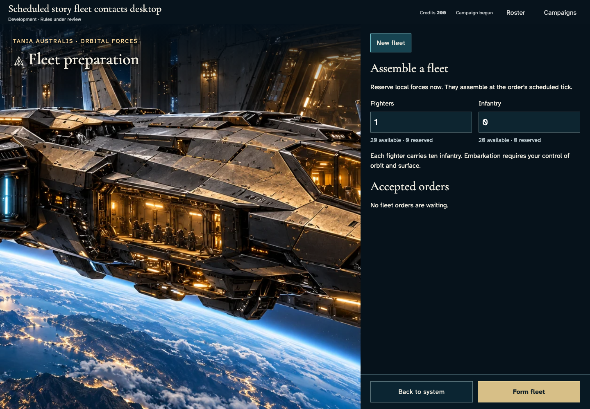
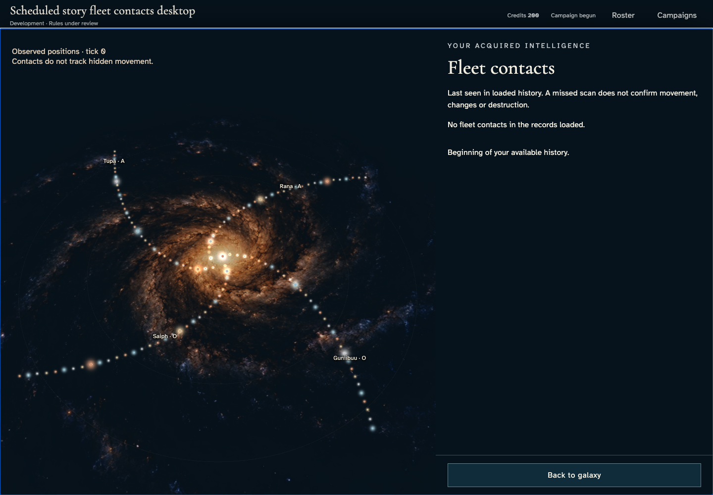
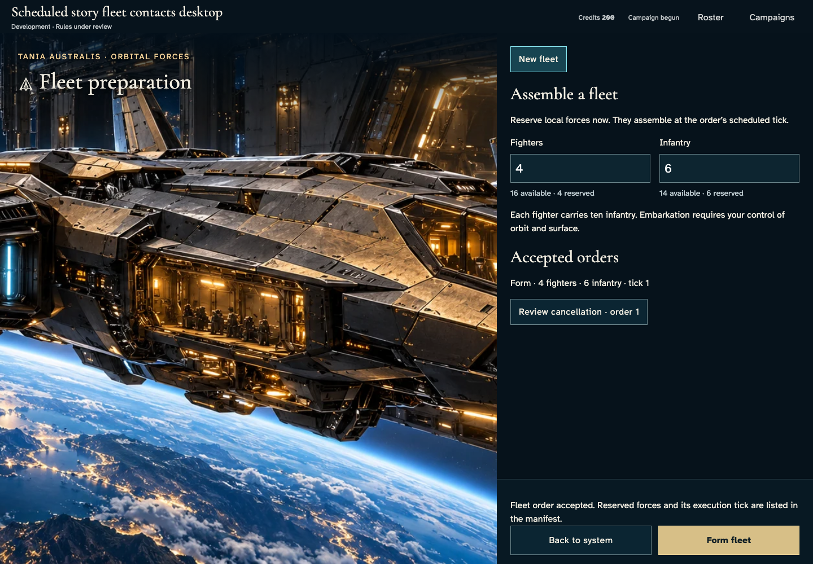
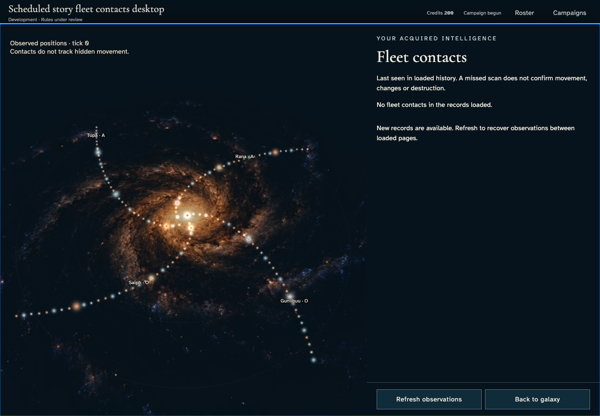
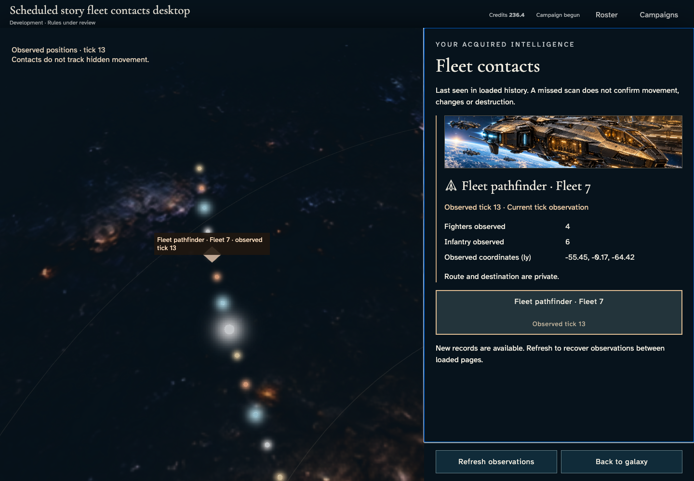
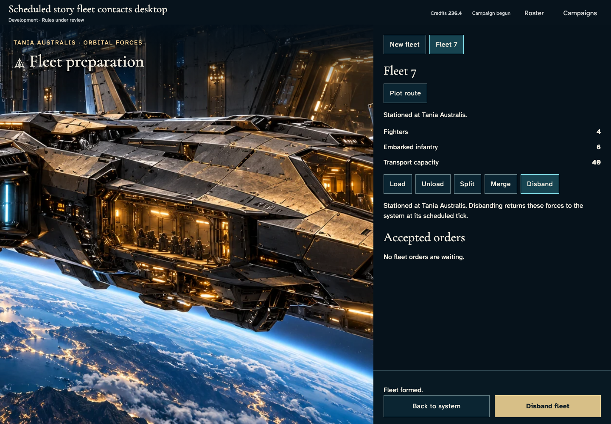
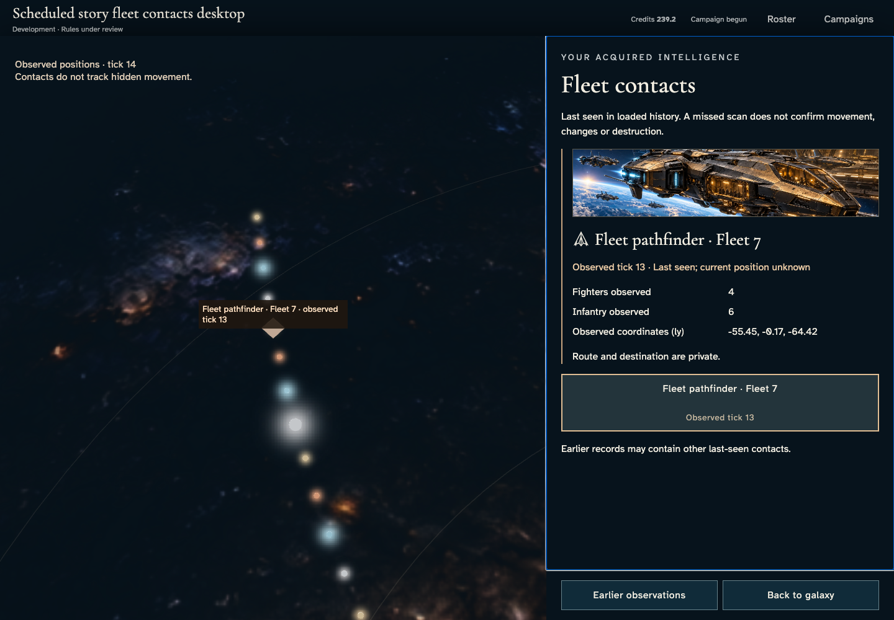
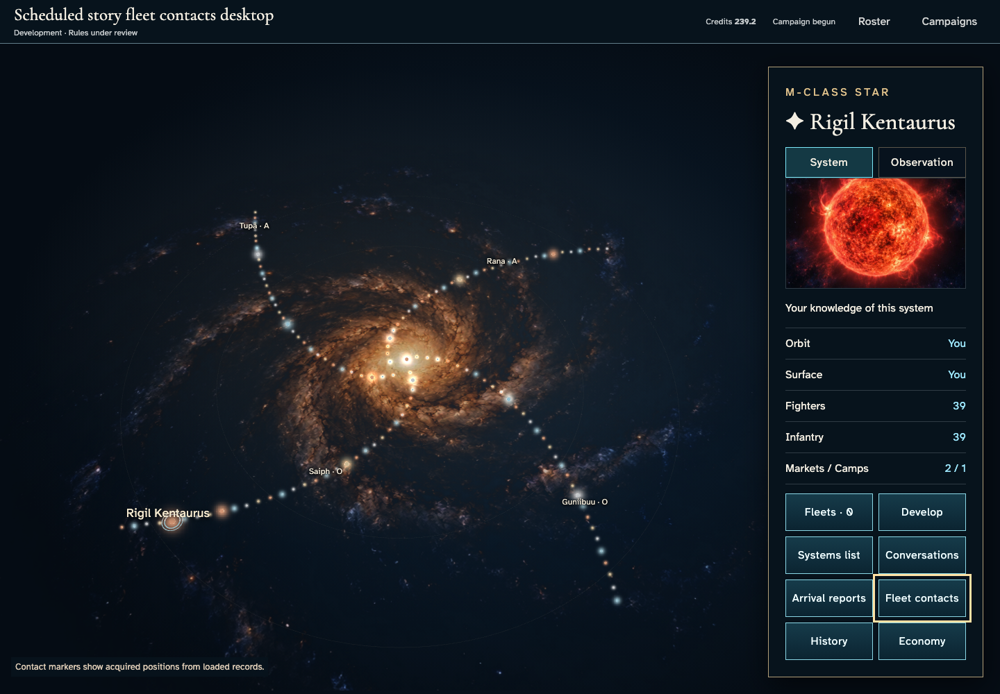

# Acquire and recover a fleet's last observed facts

**Exact comparison passed.** desktop · darwin-arm64. Inventory: UX-03, UX-07, UX-08, UX-14, UX-16.

Four ordinary authenticated commanders admit through the UI. One forms a real fleet; another acquires and recovers last-seen intelligence while owner forces remain private. Catalogue/domain clocks and scan entropy identities are explicit harness controls, never injected reports. Development scanning and force rules remain under review; hosted scheduling, secure-provider and production entropy certification are separate gates.

## 1. Ordinary emulator authentication and saved identity; explicit developer access and fixed domain Date. Timers remain real.

Actor: **Test harness**. **Harness control; not a player action.**

Acknowledged outcome: Explicit test control; not a player action or hosted-service certification.

## 2. Ordinary emulator authentication and saved identity; explicit developer access and fixed domain Date. Timers remain real.

Actor: **Test harness**. **Harness control; not a player action.**

Acknowledged outcome: Explicit test control; not a player action or hosted-service certification.

## 3. Ordinary emulator authentication and saved identity; explicit developer access and fixed domain Date. Timers remain real.

Actor: **Test harness**. **Harness control; not a player action.**

Acknowledged outcome: Explicit test control; not a player action or hosted-service certification.

## 4. Ordinary emulator authentication and saved identity; explicit developer access and fixed domain Date. Timers remain real.

Actor: **Test harness**. **Harness control; not a player action.**

Acknowledged outcome: Explicit test control; not a player action or hosted-service certification.

## 5. Create/join through production controls. The catalogue seed and admission clock are test boundaries, not injected seats or campaign state.

Actor: **Test harness**. **Harness control; not a player action.**

Acknowledged outcome: Explicit test control; not a player action or hosted-service certification.

## 6. Create/join through production controls. The catalogue seed and admission clock are test boundaries, not injected seats or campaign state.

Actor: **Test harness**. **Harness control; not a player action.**

Acknowledged outcome: Explicit test control; not a player action or hosted-service certification.

## 7. Create/join through production controls. The catalogue seed and admission clock are test boundaries, not injected seats or campaign state.

Actor: **Test harness**. **Harness control; not a player action.**

Acknowledged outcome: Explicit test control; not a player action or hosted-service certification.

## 8. Create/join through production controls. The catalogue seed and admission clock are test boundaries, not injected seats or campaign state.

Actor: **Test harness**. **Harness control; not a player action.**

Acknowledged outcome: Explicit test control; not a player action or hosted-service certification.

## 9. Set the explicit admission domain clock and deliver the real emulator Scheduler HTTP request; this does not certify hosted scheduling.

Actor: **Test harness**. **Harness control; not a player action.**

Acknowledged outcome: Explicit test control; not a player action or hosted-service certification.

## 10. The owner opens fleet preparation while the observer checks their own contact records before any fleet exists.

Actor: **Contact watcher**.

Acknowledged outcome: Authorized contact history is loaded and contains no fleet contact.

- [x] Each commander has only their own military view and no invented contact.

### Viewpoint: Fleet pathfinder

- [x] Each return control stays visible before scrolling, contact annotations do not intercept the pointer, and neither player view has an application error.

### Viewpoint: Contact watcher

- [x] Each return control stays visible before scrolling, contact annotations do not intercept the pointer, and neither player view has an application error.

## 11. Reserve four fighters and six infantry through the real encrypted formation command; the observer receives no private order.

Actor: **Fleet pathfinder**.

Acknowledged outcome: The authoritative accepted fleet order records exactly four fighters and six infantry.

- [x] Reservation changes no total forces and no observer receives the private order or a fabricated fleet.

### Viewpoint: Fleet pathfinder

- [x] Each return control stays visible before scrolling, contact annotations do not intercept the pointer, and neither player view has an application error.

### Viewpoint: Contact watcher

- [x] Each return control stays visible before scrolling, contact annotations do not intercept the pointer, and neither player view has an application error.

## 12. Deliver the first real leased tick using the explicit domain clock; verify formation/production conservation and a repeat delivery with no effect. Scan HMAC identity inputs are fixed only in the guarded test service module.

Actor: **Test harness**. **Harness control; not a player action.**

Acknowledged outcome: Explicit test control; not a player action or hosted-service certification.

## 13. Advance real ticks to the deterministic fixture's next acquired contact. This explicit scan/clock harness is not a player action or production entropy certification; every tick checks conservation and repeat delivery.

Actor: **Test harness**. **Harness control; not a player action.**

Acknowledged outcome: Explicit test control; not a player action or hosted-service certification.

## 14. Read acquired fleet facts and the private owner manifest as separate player viewpoints.

Actor: **Contact watcher**.

Acknowledged outcome: The observer's report is current at the actual acquired tick; the owner has exactly one formed fleet.

- [x] The contact contains only authorized observed fields, with no route, destination, owner command or private fleet identity; owner forces remain conserved.

### Viewpoint: Fleet pathfinder

- [x] Each return control stays visible before scrolling, contact annotations do not intercept the pointer, and neither player view has an application error.

### Viewpoint: Contact watcher

- [x] Each return control stays visible before scrolling, contact annotations do not intercept the pointer, and neither player view has an application error.

## 15. Read the acquired report's tick and current-observation status.

Actor: **Contact watcher**.

Acknowledged outcome: The report age is fully visible inside the bounded details panel.

- [x] Reading and keyboard focus do not write a command, reveal private routes or change authoritative forces/history.

### Viewpoint: Fleet pathfinder

- [x] Each return control stays visible before scrolling, contact annotations do not intercept the pointer, and neither player view has an application error.

### Viewpoint: Contact watcher

- [x] Each return control stays visible before scrolling, contact annotations do not intercept the pointer, and neither player view has an application error.

## 16. Scroll the bounded contact details to read the complete complement, coordinates and private-route explanation.

Actor: **Contact watcher**.

Acknowledged outcome: The report facts is fully visible inside the bounded details panel.

- [x] Reading and keyboard focus do not write a command, reveal private routes or change authoritative forces/history.

### Viewpoint: Fleet pathfinder

- [x] Each return control stays visible before scrolling, contact annotations do not intercept the pointer, and neither player view has an application error.

### Viewpoint: Contact watcher

- [x] Each return control stays visible before scrolling, contact annotations do not intercept the pointer, and neither player view has an application error.

## 17. Deliver actual ticks to the next deterministic missed scan, retaining the last acquired authorized report for comparison. A missed roll is produced by the real HMAC/probability check, never an injected outcome.

Actor: **Test harness**. **Harness control; not a player action.**

Acknowledged outcome: Explicit test control; not a player action or hosted-service certification.

## 18. Refresh authorized contact history and distinguish last-seen facts from current position, without inferring destruction or a private route.

Actor: **Contact watcher**.

Acknowledged outcome: The loaded last-seen record retains its actual observed tick, coordinates and complement while current position is unknown.

- [x] The current private projection has no acquired contact at the missed tick, while the owner still has the same real fleet and forces.

### Viewpoint: Fleet pathfinder

- [x] Each return control stays visible before scrolling, contact annotations do not intercept the pointer, and neither player view has an application error.

### Viewpoint: Contact watcher

- [x] Each return control stays visible before scrolling, contact annotations do not intercept the pointer, and neither player view has an application error.

## 19. Read the retained report's tick and explicit warning that its current position is unknown.

Actor: **Contact watcher**.

Acknowledged outcome: The report age is fully visible inside the bounded details panel.

- [x] Reading and keyboard focus do not write a command, reveal private routes or change authoritative forces/history.

### Viewpoint: Fleet pathfinder

- [x] Each return control stays visible before scrolling, contact annotations do not intercept the pointer, and neither player view has an application error.

### Viewpoint: Contact watcher

- [x] Each return control stays visible before scrolling, contact annotations do not intercept the pointer, and neither player view has an application error.

## 20. Scroll the bounded contact details to read the complete complement, coordinates and private-route explanation.

Actor: **Contact watcher**.

Acknowledged outcome: The report facts is fully visible inside the bounded details panel.

- [x] Reading and keyboard focus do not write a command, reveal private routes or change authoritative forces/history.

### Viewpoint: Fleet pathfinder

- [x] Each return control stays visible before scrolling, contact annotations do not intercept the pointer, and neither player view has an application error.

### Viewpoint: Contact watcher

- [x] Each return control stays visible before scrolling, contact annotations do not intercept the pointer, and neither player view has an application error.

## 21. Reload both accounts and use ordinary controls to recover the owner's fleet and the observer's last-seen history.

Actor: **Contact watcher**.

Acknowledged outcome: The original last-seen report survives loss of in-memory contact state and the owner recovers the same fleet.

- [x] Reload and normal/reduced-motion preferences preserve report facts, every recipient projection and authoritative forces/history without writing commands.

### Viewpoint: Fleet pathfinder

- [x] Each return control stays visible before scrolling, contact annotations do not intercept the pointer, and neither player view has an application error.

### Viewpoint: Contact watcher

- [x] Each return control stays visible before scrolling, contact annotations do not intercept the pointer, and neither player view has an application error.

## 22. Close the contact instrument with Escape and retain keyboard focus on Fleet contacts in the real galaxy.

Actor: **Contact watcher**.

Acknowledged outcome: Focus returns to Fleet contacts and the instrument closes.

- [x] Closing the instrument preserves authoritative history and forces.

### Viewpoint: Contact watcher

