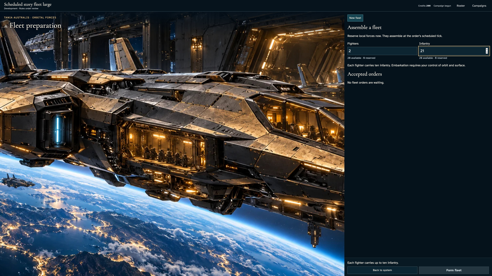
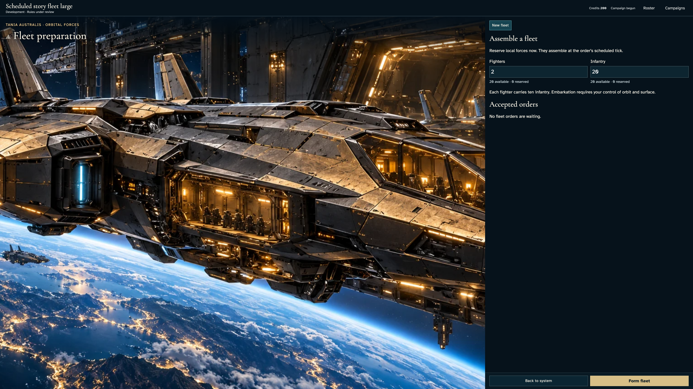
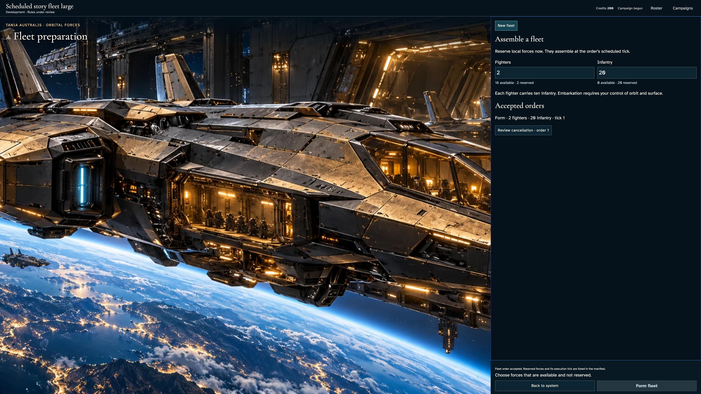
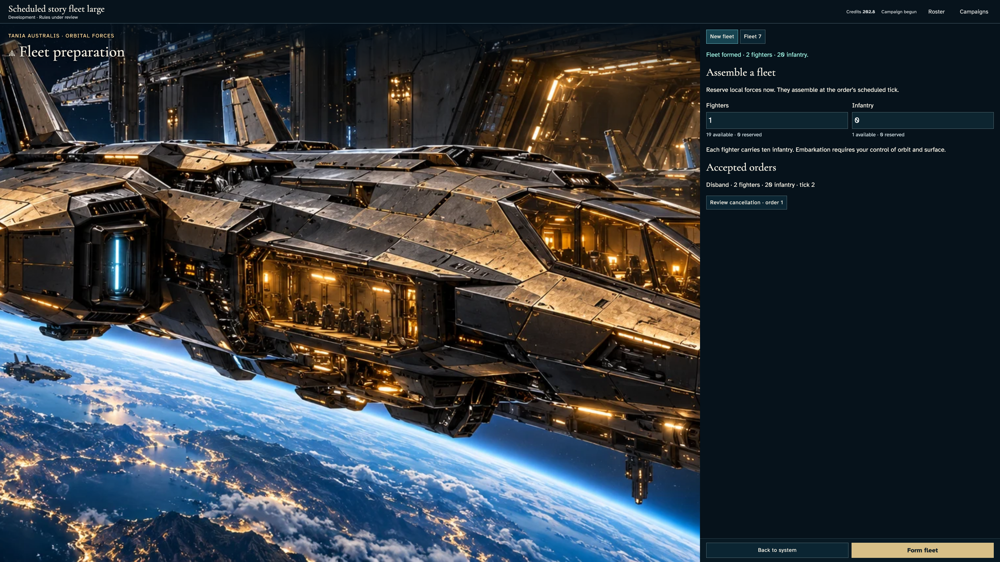
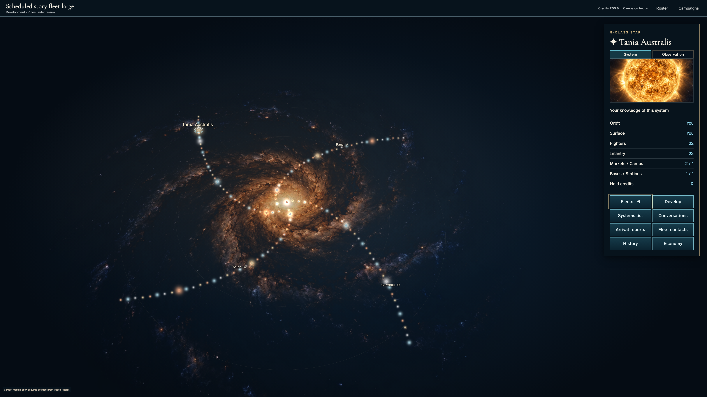

# Form, recover and disband a fleet

**Exact comparison passed.** large · darwin-arm64. Inventory: UX-08, UX-14, UX-16.

Four independent commanders enter through actual authenticated controls. Formation reserves forces, leased settlement moves them once, and disband returns them once. Owner and other-player views show private orders and outcomes. Fixed catalogue/domain clocks are explicit harness controls. Development transport capacity and tick rules remain under review; this does not certify travel, managed encryption or hosted scheduling.

## 1. Ordinary emulator sign-in and identity save, with explicit developer entitlement and fixed browser Date; timers continue normally.

Actor: **Test harness**. **Harness control; not a player action.**

Acknowledged outcome: Explicit test control; not a player action or hosted-service certification.

## 2. Ordinary emulator sign-in and identity save, with explicit developer entitlement and fixed browser Date; timers continue normally.

Actor: **Test harness**. **Harness control; not a player action.**

Acknowledged outcome: Explicit test control; not a player action or hosted-service certification.

## 3. Ordinary emulator sign-in and identity save, with explicit developer entitlement and fixed browser Date; timers continue normally.

Actor: **Test harness**. **Harness control; not a player action.**

Acknowledged outcome: Explicit test control; not a player action or hosted-service certification.

## 4. Ordinary emulator sign-in and identity save, with explicit developer entitlement and fixed browser Date; timers continue normally.

Actor: **Test harness**. **Harness control; not a player action.**

Acknowledged outcome: Explicit test control; not a player action or hosted-service certification.

## 5. Create/join through ordinary campaign controls. Fixed catalogue and admission clock are test controls; no seat, message or command outcome is injected.

Actor: **Test harness**. **Harness control; not a player action.**

Acknowledged outcome: Explicit test control; not a player action or hosted-service certification.

## 6. Create/join through ordinary campaign controls. Fixed catalogue and admission clock are test controls; no seat, message or command outcome is injected.

Actor: **Test harness**. **Harness control; not a player action.**

Acknowledged outcome: Explicit test control; not a player action or hosted-service certification.

## 7. Create/join through ordinary campaign controls. Fixed catalogue and admission clock are test controls; no seat, message or command outcome is injected.

Actor: **Test harness**. **Harness control; not a player action.**

Acknowledged outcome: Explicit test control; not a player action or hosted-service certification.

## 8. Create/join through ordinary campaign controls. Fixed catalogue and admission clock are test controls; no seat, message or command outcome is injected.

Actor: **Test harness**. **Harness control; not a player action.**

Acknowledged outcome: Explicit test control; not a player action or hosted-service certification.

## 9. Advance the designated browser/domain clock to 12:15 UTC and deliver the actual emulator Scheduler HTTP request. This does not certify hosted scheduling.

Actor: **Test harness**. **Harness control; not a player action.**

Acknowledged outcome: Explicit test control; not a player action or hosted-service certification.

## 10. Open each commander's own fleet preparation. Enter two fighters and an over-capacity infantry complement before committing anything.

Actor: **Fleet marshal**.

Acknowledged outcome: The actual capacity constraint disables formation without a command.

- [x] Both fixed action rails are visible before scrolling and no application error occurred.
- [x] Other commanders have no owner fleet, private order or ledger in their actual member projections.
- [x] Invalid input does not change canonical state or reserve forces.

### Viewpoint: Fleet marshal

### Viewpoint: Independent marshal

## 11. Reduce infantry to the supported twenty and inspect the ready formation.

Actor: **Fleet marshal**.

Acknowledged outcome: Formation is enabled and focused for keyboard confirmation.

- [x] Both fixed action rails are visible before scrolling and no application error occurred.
- [x] Other commanders have no owner fleet, private order or ledger in their actual member projections.

### Viewpoint: Fleet marshal

### Viewpoint: Independent marshal

## 12. Confirm formation with Enter. The authoritative receipt reserves two fighters and twenty infantry for tick one, without moving them yet.

Actor: **Fleet marshal**.

Acknowledged outcome: The service acknowledges the formation and publishes its exact waiting complement.

- [x] Both fixed action rails are visible before scrolling and no application error occurred.
- [x] Other commanders have no owner fleet, private order or ledger in their actual member projections.
- [x] One accepted receipt and revision reserve the original forces without creating a fleet or moving the garrison.

### Viewpoint: Fleet marshal

### Viewpoint: Independent marshal

## 13. Reload the owner account and reopen its exact campaign's home-system fleet panel.

Actor: **Fleet marshal**.

Acknowledged outcome: The same accepted order and reserved complement return from persistence.

- [x] Both fixed action rails are visible before scrolling and no application error occurred.
- [x] Other commanders have no owner fleet, private order or ledger in their actual member projections.
- [x] Reload adds no revision, order or effect.

### Viewpoint: Fleet marshal

### Viewpoint: Independent marshal

## 14. Advance the explicit domain clock once and invoke the real leased tick service. Repeat delivery must do no work; no fleet or outcome is injected.

Actor: **Test harness**. **Harness control; not a player action.**

Acknowledged outcome: Explicit test control; not a player action or hosted-service certification.

## 15. Read the authoritative formation result and select the new fleet with the keyboard. The other commander still sees only their own forces.

Actor: **Fleet marshal**.

Acknowledged outcome: The confirmed fleet contains two fighters and twenty infantry and can be disbanded.

- [x] Both fixed action rails are visible before scrolling and no application error occurred.
- [x] Other commanders have no owner fleet, private order or ledger in their actual member projections.
- [x] Units move from garrison to exactly one fleet; only this tick's recorded production changes empire totals.

### Viewpoint: Fleet marshal

### Viewpoint: Independent marshal

## 16. Return to the actual galaxy and inspect the stationed fleet marker.

Actor: **Fleet marshal**.

Acknowledged outcome: The galaxy reports one owned stationed fleet and restores the opener's focus.

- [x] Navigation preserves canonical forces and the independent player's empty roster.

### Viewpoint: Fleet marshal

### Viewpoint: Independent marshal

## 17. Reopen the stationed fleet and confirm disbanding with Enter. Forces stay aboard until tick two is acknowledged.

Actor: **Fleet marshal**.

Acknowledged outcome: The actual disband receipt queues the unchanged complement for tick two.

- [x] Both fixed action rails are visible before scrolling and no application error occurred.
- [x] Other commanders have no owner fleet, private order or ledger in their actual member projections.
- [x] Exactly one revision and order are added; no forces return before settlement.

### Viewpoint: Fleet marshal

### Viewpoint: Independent marshal

## 18. Reload the accepted disband order before settlement.

Actor: **Fleet marshal**.

Acknowledged outcome: The same private disband order remains scheduled.

- [x] Both fixed action rails are visible before scrolling and no application error occurred.
- [x] Other commanders have no owner fleet, private order or ledger in their actual member projections.
- [x] Reload neither duplicates the command nor returns forces early.

### Viewpoint: Fleet marshal

### Viewpoint: Independent marshal

## 19. Deliver the second boundary through the real leased service, then repeat it. Production and disband are real reducer outcomes; this is not hosted cadence evidence.

Actor: **Test harness**. **Harness control; not a player action.**

Acknowledged outcome: Explicit test control; not a player action or hosted-service certification.

## 20. Read the confirmed disband result and returned home-system forces.

Actor: **Fleet marshal**.

Acknowledged outcome: The fleet has disbanded, its order has cleared, and formation is available again.

- [x] Both fixed action rails are visible before scrolling and no application error occurred.
- [x] Other commanders have no owner fleet, private order or ledger in their actual member projections.
- [x] One matching disband ledger returns the complete complement once, conserving total forces plus only recorded production.

### Viewpoint: Fleet marshal

### Viewpoint: Independent marshal

## 21. Reload the settled result and return to the galaxy with the keyboard.

Actor: **Fleet marshal**.

Acknowledged outcome: The map has no owned fleet marker and focus returns to Fleets · 0.

- [x] Final reload and navigation preserve the exact settled state and no application errors occurred.

### Viewpoint: Fleet marshal

### Viewpoint: Independent marshal

