# Recover a split and recombine private forces

**Exact comparison passed.** short · darwin-arm64. Inventory: UX-08, UX-14, UX-16.

Four independent commanders enter through actual authenticated controls. Formation supplies real forces; a withheld split survives reload with one command identity, then leased settlement splits and recombines the complement once. Owner and other-player views show private orders and outcomes. Fixed catalogue/domain clocks are explicit harness controls. Development transport capacity and tick rules remain under review; this does not certify travel, managed encryption or hosted scheduling.

## 1. Ordinary emulator sign-in and identity save, with explicit developer entitlement and fixed browser Date; timers continue normally.

Actor: **Test harness**. **Harness control; not a player action.**

Acknowledged outcome: Explicit test control; not a player action or hosted-service certification.

## 2. Ordinary emulator sign-in and identity save, with explicit developer entitlement and fixed browser Date; timers continue normally.

Actor: **Test harness**. **Harness control; not a player action.**

Acknowledged outcome: Explicit test control; not a player action or hosted-service certification.

## 3. Ordinary emulator sign-in and identity save, with explicit developer entitlement and fixed browser Date; timers continue normally.

Actor: **Test harness**. **Harness control; not a player action.**

Acknowledged outcome: Explicit test control; not a player action or hosted-service certification.

## 4. Ordinary emulator sign-in and identity save, with explicit developer entitlement and fixed browser Date; timers continue normally.

Actor: **Test harness**. **Harness control; not a player action.**

Acknowledged outcome: Explicit test control; not a player action or hosted-service certification.

## 5. Create/join through ordinary campaign controls. Fixed catalogue and admission clock are test controls; no seat, message or command outcome is injected.

Actor: **Test harness**. **Harness control; not a player action.**

Acknowledged outcome: Explicit test control; not a player action or hosted-service certification.

## 6. Create/join through ordinary campaign controls. Fixed catalogue and admission clock are test controls; no seat, message or command outcome is injected.

Actor: **Test harness**. **Harness control; not a player action.**

Acknowledged outcome: Explicit test control; not a player action or hosted-service certification.

## 7. Create/join through ordinary campaign controls. Fixed catalogue and admission clock are test controls; no seat, message or command outcome is injected.

Actor: **Test harness**. **Harness control; not a player action.**

Acknowledged outcome: Explicit test control; not a player action or hosted-service certification.

## 8. Create/join through ordinary campaign controls. Fixed catalogue and admission clock are test controls; no seat, message or command outcome is injected.

Actor: **Test harness**. **Harness control; not a player action.**

Acknowledged outcome: Explicit test control; not a player action or hosted-service certification.

## 9. Advance the designated browser/domain clock to 12:15 UTC and deliver the actual emulator Scheduler HTTP request. This does not certify hosted scheduling.

Actor: **Test harness**. **Harness control; not a player action.**

Acknowledged outcome: Explicit test control; not a player action or hosted-service certification.

## 10. Open each commander's own fleet preparation. Enter four fighters and an over-capacity infantry complement before committing anything.

Actor: **Fleet marshal**.

Acknowledged outcome: The actual capacity constraint disables formation without a command.

- [x] Both fixed action rails are visible before scrolling and no application error occurred.
- [x] Other commanders have no owner fleet, private order or ledger in their actual member projections.
- [x] Invalid input does not change canonical state or reserve forces.

### Viewpoint: Fleet marshal

[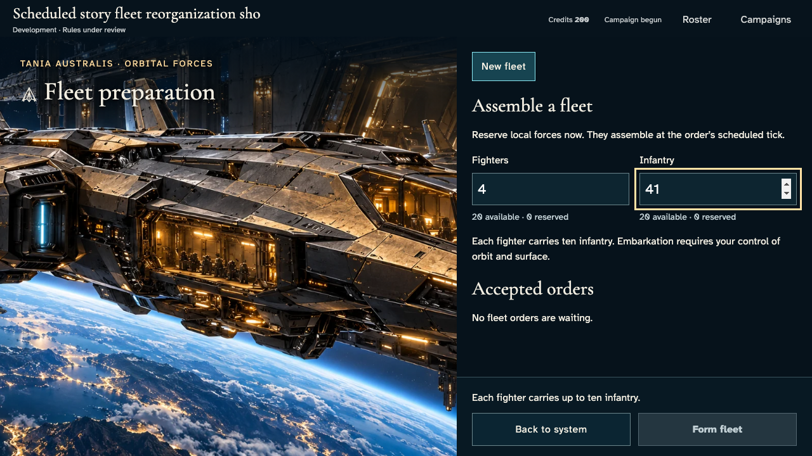](../../../../../../tests/browser/story-baselines/live-fleet-reorganization/short/darwin-arm64/010-inspect-formation-1-fleet-marshal.png)

### Viewpoint: Independent marshal

## 11. Reduce infantry to the supported eighteen and inspect the ready formation.

Actor: **Fleet marshal**.

Acknowledged outcome: Formation is enabled and focused for keyboard confirmation.

- [x] Both fixed action rails are visible before scrolling and no application error occurred.
- [x] Other commanders have no owner fleet, private order or ledger in their actual member projections.

### Viewpoint: Fleet marshal

### Viewpoint: Independent marshal

## 12. Confirm formation with Enter. The authoritative receipt reserves four fighters and eighteen infantry for tick one, without moving them yet.

Actor: **Fleet marshal**.

Acknowledged outcome: The service acknowledges the formation and publishes its exact waiting complement.

- [x] Both fixed action rails are visible before scrolling and no application error occurred.
- [x] Other commanders have no owner fleet, private order or ledger in their actual member projections.
- [x] One accepted receipt and revision reserve the original forces without creating a fleet or moving the garrison.

### Viewpoint: Fleet marshal

[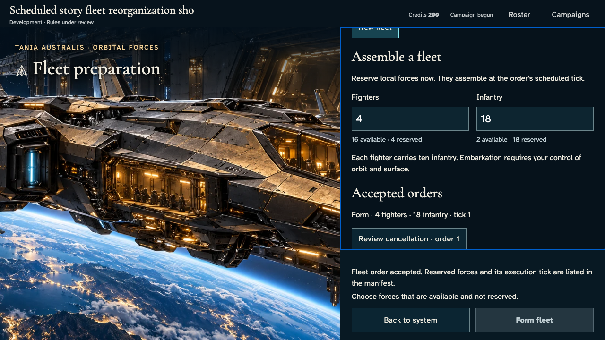](../../../../../../tests/browser/story-baselines/live-fleet-reorganization/short/darwin-arm64/012-reserve-formation-1-fleet-marshal.png)

### Viewpoint: Independent marshal

[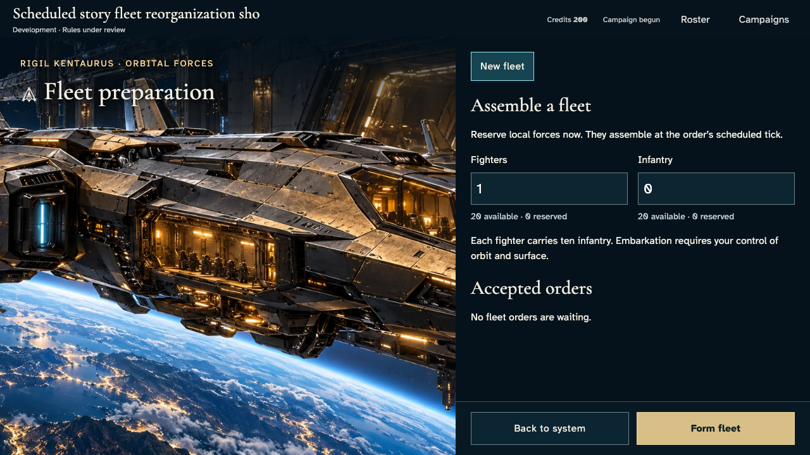](../../../../../../tests/browser/story-baselines/live-fleet-reorganization/short/darwin-arm64/012-reserve-formation-2-independent-marshal.png)

## 13. Reload the owner account and reopen its exact campaign's home-system fleet panel.

Actor: **Fleet marshal**.

Acknowledged outcome: The same accepted order and reserved complement return from persistence.

- [x] Both fixed action rails are visible before scrolling and no application error occurred.
- [x] Other commanders have no owner fleet, private order or ledger in their actual member projections.
- [x] Reload adds no revision, order or effect.

### Viewpoint: Fleet marshal

### Viewpoint: Independent marshal

## 14. Advance the explicit domain clock once and invoke the real leased tick service. Repeat delivery must do no work; no fleet or outcome is injected.

Actor: **Test harness**. **Harness control; not a player action.**

Acknowledged outcome: Explicit test control; not a player action or hosted-service certification.

## 15. Read the authoritative formation result and select the new fleet with the keyboard. The other commander still sees only their own forces.

Actor: **Fleet marshal**.

Acknowledged outcome: The confirmed fleet contains four fighters and eighteen infantry and can be disbanded.

- [x] Both fixed action rails are visible before scrolling and no application error occurred.
- [x] Other commanders have no owner fleet, private order or ledger in their actual member projections.
- [x] Units move from garrison to exactly one fleet; only this tick's recorded production changes empire totals.

### Viewpoint: Fleet marshal

[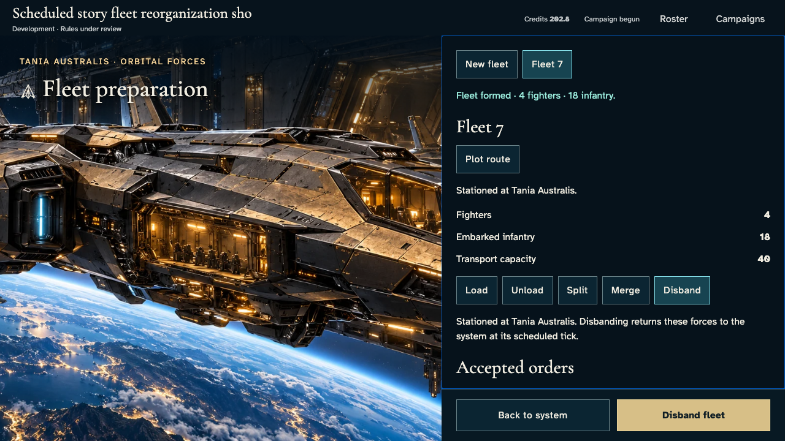](../../../../../../tests/browser/story-baselines/live-fleet-reorganization/short/darwin-arm64/015-formed-fleet-1-fleet-marshal.png)

### Viewpoint: Independent marshal

## 16. Select Split and try to leave eighteen infantry with only one fighter. The draft explains the capacity constraint before submission.

Actor: **Fleet marshal**.

Acknowledged outcome: Split is disabled because both complements must retain transport capacity.

- [x] Both fixed action rails are visible before scrolling and no application error occurred.
- [x] Other commanders have no owner fleet, private order or ledger in their actual member projections.
- [x] Invalid draft creates no order or canonical mutation.

### Viewpoint: Fleet marshal

[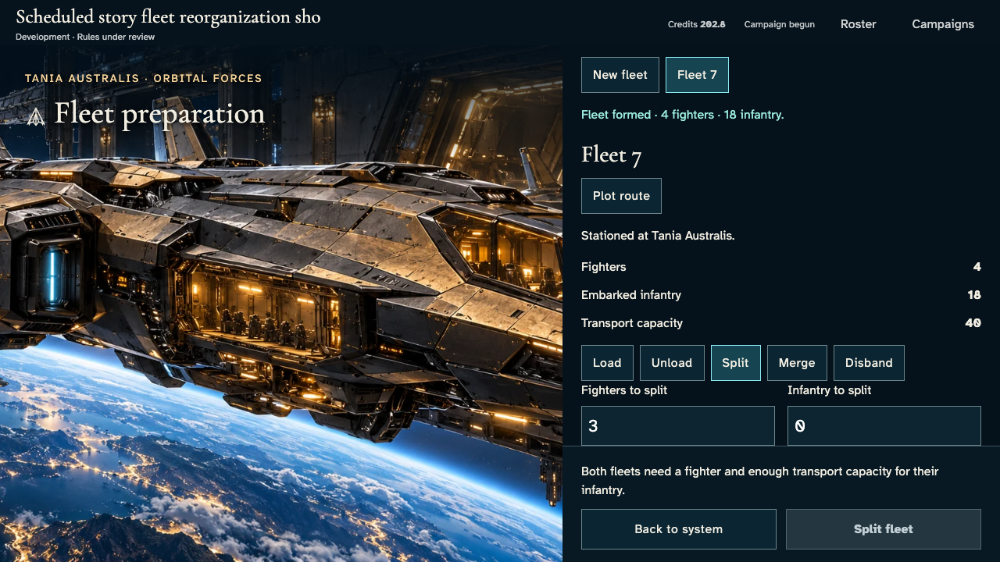](../../../../../../tests/browser/story-baselines/live-fleet-reorganization/short/darwin-arm64/016-invalid-split-1-fleet-marshal.png)

### Viewpoint: Independent marshal

## 17. Choose one fighter and eight infantry for the new fleet; review the three fighters and ten infantry retained by the original fleet.

Actor: **Fleet marshal**.

Acknowledged outcome: The focused keyboard commitment matches both final complements.

- [x] Both fixed action rails are visible before scrolling and no application error occurred.
- [x] Other commanders have no owner fleet, private order or ledger in their actual member projections.

### Viewpoint: Fleet marshal

[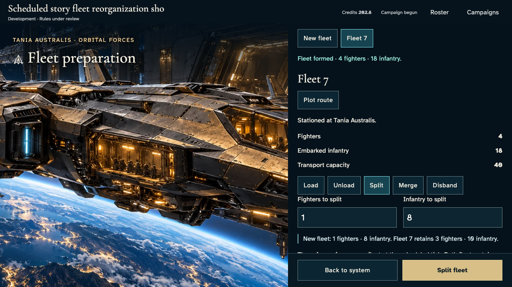](../../../../../../tests/browser/story-baselines/live-fleet-reorganization/short/darwin-arm64/017-review-split-1-fleet-marshal.png)

### Viewpoint: Independent marshal

## 18. Hold only fleet.split RTDB writes before actual ingress. No identity, payload, canonical state or receipt is altered.

Actor: **Test harness**. **Harness control; not a player action.**

Acknowledged outcome: Explicit test control; not a player action or hosted-service certification.

## 19. Confirm Split with Enter. Delivery is withheld, so the original complement remains aboard while the command awaits acknowledgement.

Actor: **Fleet marshal**.

Acknowledged outcome: The unacknowledged split disables repeat commitment.

- [x] Both fixed action rails are visible before scrolling and no application error occurred.
- [x] Other commanders have no owner fleet, private order or ledger in their actual member projections.
- [x] Withheld split has no effect.

### Viewpoint: Fleet marshal

[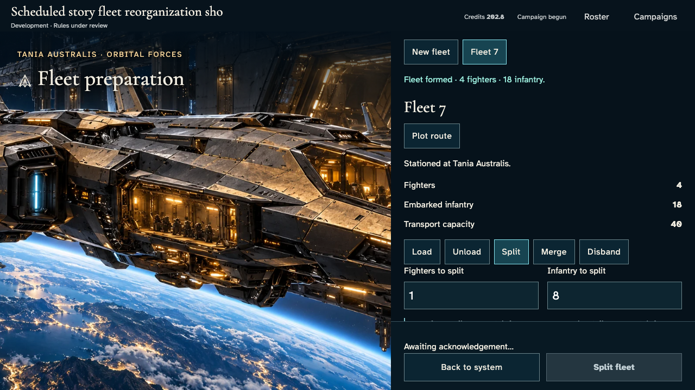](../../../../../../tests/browser/story-baselines/live-fleet-reorganization/short/darwin-arm64/019-pending-split-1-fleet-marshal.png)

### Viewpoint: Independent marshal

## 20. Reload the uncertain order and inspect its original selected fleet and one-fighter/eight-infantry split.

Actor: **Fleet marshal**.

Acknowledged outcome: Recovery opens the original split, retaining its exact proposed complement and disabled commitment.

- [x] Both fixed action rails are visible before scrolling and no application error occurred.
- [x] Other commanders have no owner fleet, private order or ledger in their actual member projections.
- [x] Retransmissions keep one command path and identical encrypted payload; reload neither reserves nor duplicates forces.

### Viewpoint: Fleet marshal

[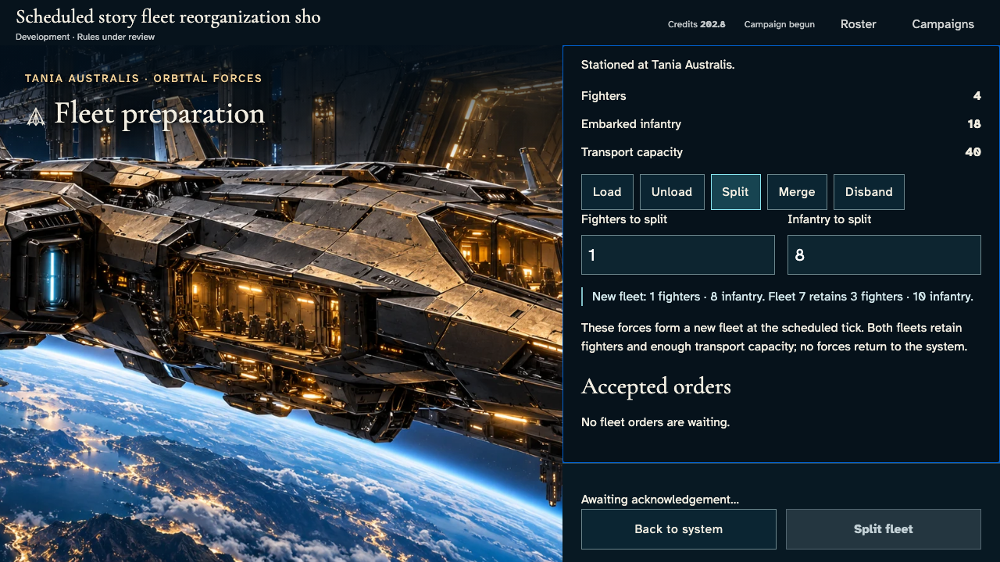](../../../../../../tests/browser/story-baselines/live-fleet-reorganization/short/darwin-arm64/020-reload-pending-split-1-fleet-marshal.png)

### Viewpoint: Independent marshal

## 21. Release retained writes on the live connection to the real service; repeated transport frames retain their original identity and payload.

Actor: **Test harness**. **Harness control; not a player action.**

Acknowledged outcome: Explicit test control; not a player action or hosted-service certification.

## 22. Read the actual split receipt and scheduled complement after transport returns.

Actor: **Fleet marshal**.

Acknowledged outcome: One split is accepted for tick two.

- [x] Both fixed action rails are visible before scrolling and no application error occurred.
- [x] Other commanders have no owner fleet, private order or ledger in their actual member projections.
- [x] One logical accepted command adds exactly one revision and reservation, without changing garrisons or fleets.

### Viewpoint: Fleet marshal

### Viewpoint: Independent marshal

## 23. Deliver tick two through the real leased service; repeat delivery must leave the complete canonical state unchanged.

Actor: **Test harness**. **Harness control; not a player action.**

Acknowledged outcome: Explicit test control; not a player action or hosted-service certification.

## 24. Read the completed split and select the new fleet with Enter; private forces remain absent from the other commander's projection.

Actor: **Fleet marshal**.

Acknowledged outcome: The original fleet retains three fighters/ten infantry and the new fleet holds one/eight.

- [x] Both fixed action rails are visible before scrolling and no application error occurred.
- [x] Other commanders have no owner fleet, private order or ledger in their actual member projections.
- [x] Exactly one matching split ledger and new fleet conserve forces plus recorded production, with no pending order.

### Viewpoint: Fleet marshal

### Viewpoint: Independent marshal

## 25. Open Merge, inspect its required recipient, and use the actual receiving-fleet control to choose the original fleet.

Actor: **Fleet marshal**.

Acknowledged outcome: The selected receiving fleet makes keyboard merge available.

- [x] Both fixed action rails are visible before scrolling and no application error occurred.
- [x] Other commanders have no owner fleet, private order or ledger in their actual member projections.
- [x] Choosing a recipient cannot move forces.

### Viewpoint: Fleet marshal

[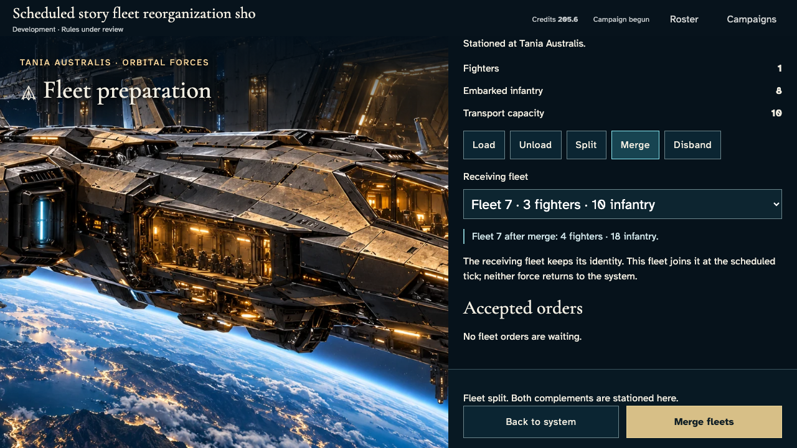](../../../../../../tests/browser/story-baselines/live-fleet-reorganization/short/darwin-arm64/025-choose-recipient-1-fleet-marshal.png)

### Viewpoint: Independent marshal

## 26. Confirm merge with Enter and inspect the tick-three acknowledgement.

Actor: **Fleet marshal**.

Acknowledged outcome: Merge is accepted for the child's complete complement.

- [x] Both fixed action rails are visible before scrolling and no application error occurred.
- [x] Other commanders have no owner fleet, private order or ledger in their actual member projections.
- [x] One accepted merge reserves both fleets without moving any units.

### Viewpoint: Fleet marshal

### Viewpoint: Independent marshal

[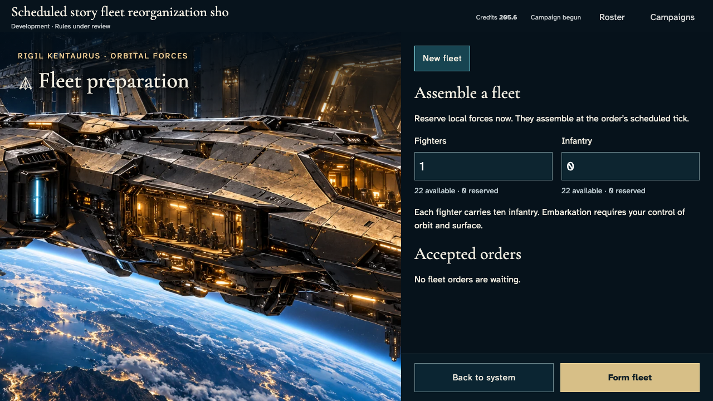](../../../../../../tests/browser/story-baselines/live-fleet-reorganization/short/darwin-arm64/026-accepted-merge-2-independent-marshal.png)

## 27. Inspect the receiving fleet: its existing merge reservation prevents a competing disband.

Actor: **Fleet marshal**.

Acknowledged outcome: The receiving fleet cannot be disbanded while reserved.

- [x] Both fixed action rails are visible before scrolling and no application error occurred.
- [x] Other commanders have no owner fleet, private order or ledger in their actual member projections.
- [x] Inspecting the reserved recipient changes no canonical facts.

### Viewpoint: Fleet marshal

[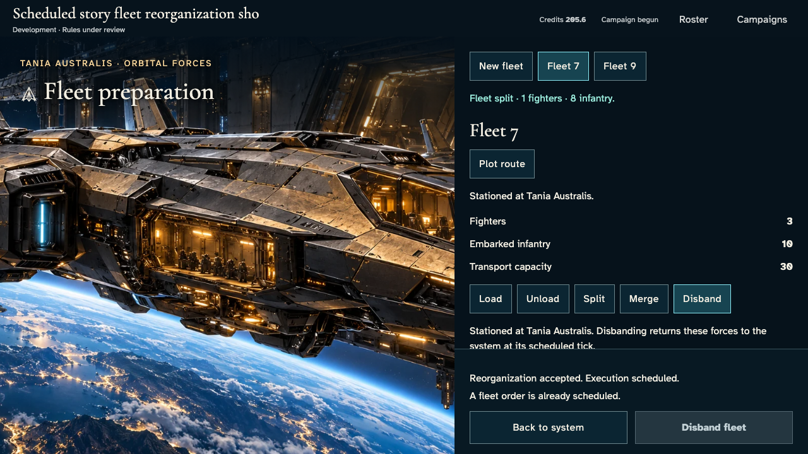](../../../../../../tests/browser/story-baselines/live-fleet-reorganization/short/darwin-arm64/027-reserved-recipient-1-fleet-marshal.png)

### Viewpoint: Independent marshal

## 28. Reload the accepted merge and reselect its source fleet, retaining the exact reservation.

Actor: **Fleet marshal**.

Acknowledged outcome: The same merge order returns from persistence.

- [x] Both fixed action rails are visible before scrolling and no application error occurred.
- [x] Other commanders have no owner fleet, private order or ledger in their actual member projections.
- [x] Reload adds no command, revision or force movement.

### Viewpoint: Fleet marshal

[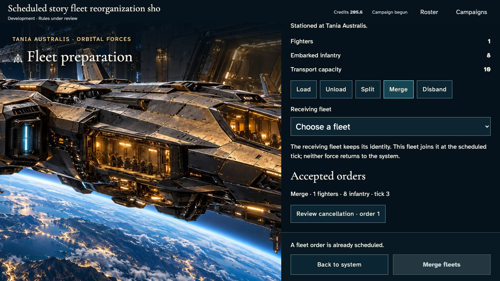](../../../../../../tests/browser/story-baselines/live-fleet-reorganization/short/darwin-arm64/028-reload-merge-1-fleet-marshal.png)

### Viewpoint: Independent marshal

## 29. Deliver the third boundary through the real leased tick service, then repeat it. No result is injected.

Actor: **Test harness**. **Harness control; not a player action.**

Acknowledged outcome: Explicit test control; not a player action or hosted-service certification.

## 30. Read the final merge result. Focus follows the surviving recipient and the complete complement is reunited.

Actor: **Fleet marshal**.

Acknowledged outcome: One fleet remains and its final result no longer claims a future execution.

- [x] Both fixed action rails are visible before scrolling and no application error occurred.
- [x] Other commanders have no owner fleet, private order or ledger in their actual member projections.
- [x] One matching merge ledger retires the child, conserves the full complement and adds only actual production to total forces.

### Viewpoint: Fleet marshal

[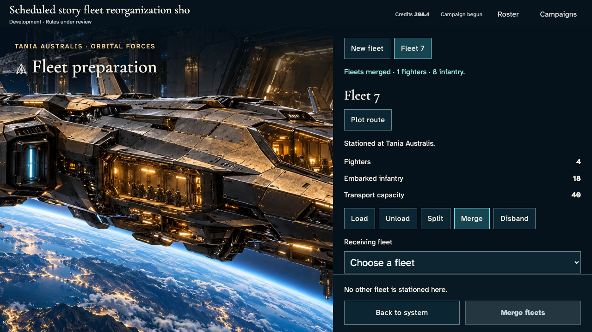](../../../../../../tests/browser/story-baselines/live-fleet-reorganization/short/darwin-arm64/030-merged-fleet-1-fleet-marshal.png)

### Viewpoint: Independent marshal

## 31. Return to the actual galaxy with Enter and inspect the single stationed fleet marker.

Actor: **Fleet marshal**.

Acknowledged outcome: Focus returns to Fleets · 1 and the owned map marker confirms one stationed fleet.

- [x] Final navigation preserves exact settled state and has no application errors.

### Viewpoint: Fleet marshal

[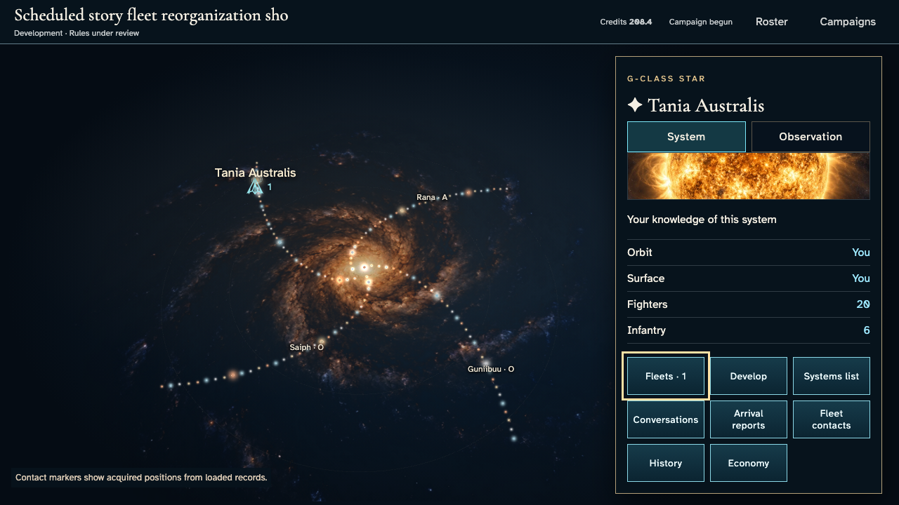](../../../../../../tests/browser/story-baselines/live-fleet-reorganization/short/darwin-arm64/031-return-to-galaxy-1-fleet-marshal.png)

### Viewpoint: Independent marshal

