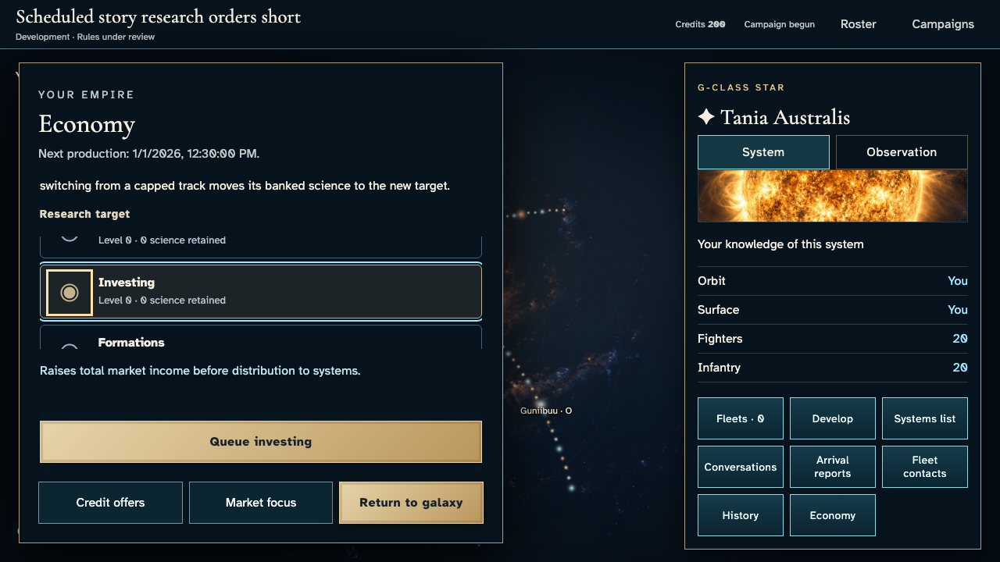
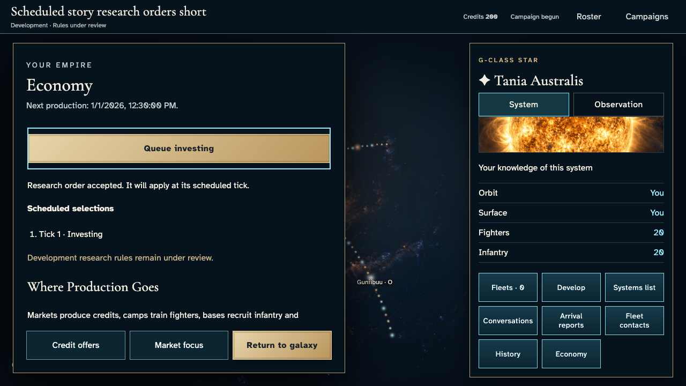
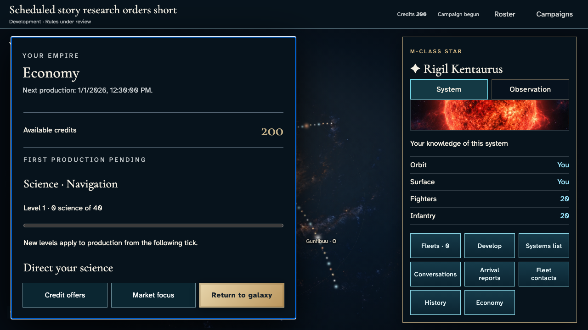
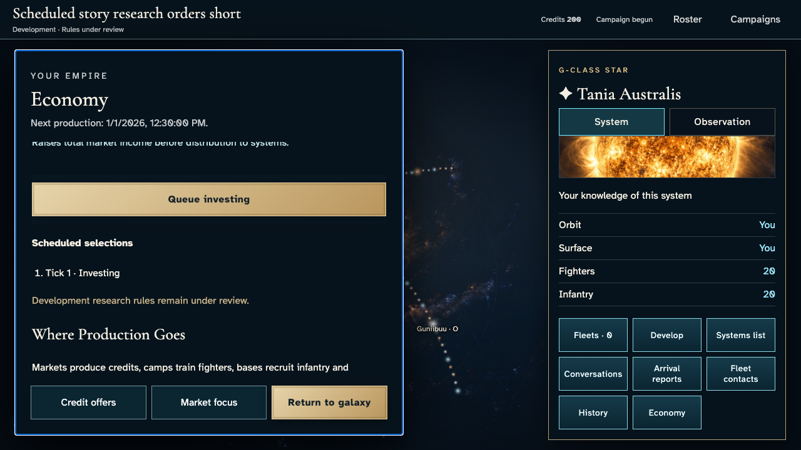
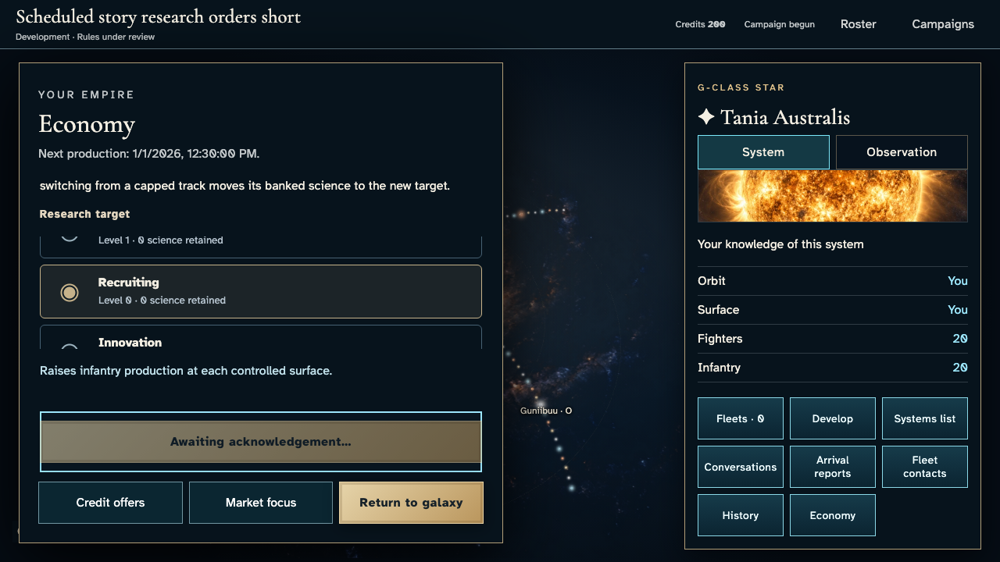
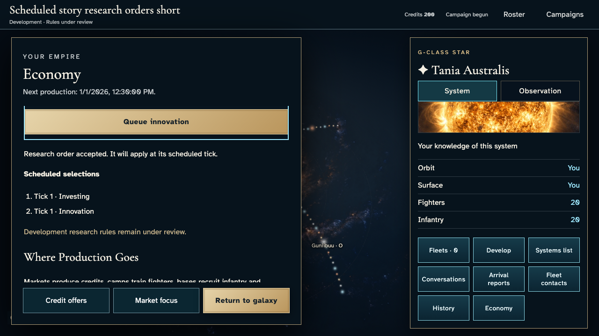
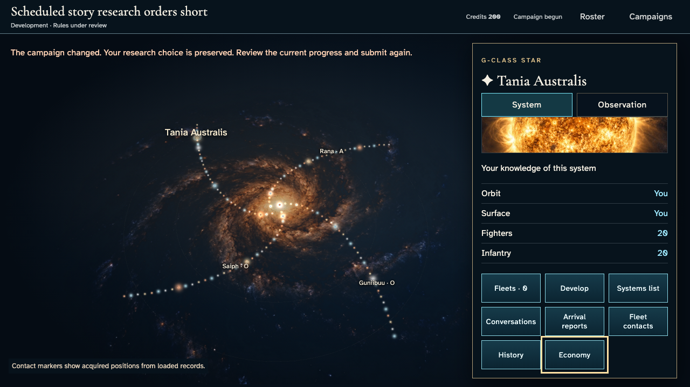
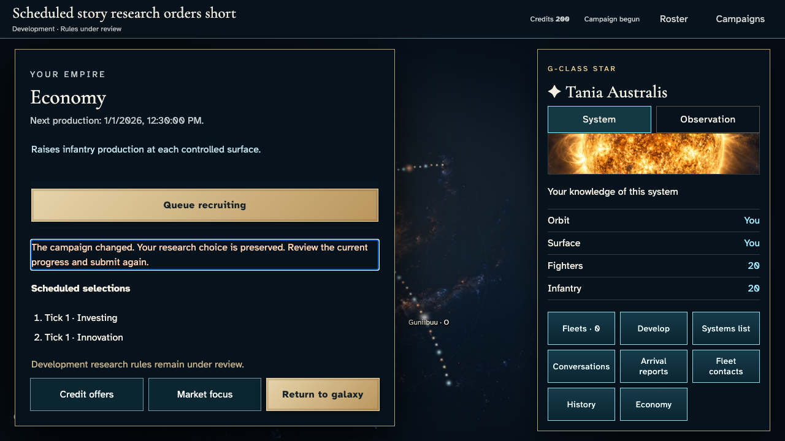

# Choose, switch and recover acknowledged research

**Exact comparison passed.** short · darwin-arm64. Inventory: UX-06, UX-14, UX-16.

Four saved commanders submit real research orders through keyboard controls. Receipts bind original payloads and effective ticks. Reload recovers accepted authority; a second device holds its original command while another order makes its revision stale for rejection. The guarded demo clock changes only designated domain time. No completion, overflow or hosted acceptance is claimed.

## 1. Ordinary Google emulator sign-in and identity save; developer entitlement is an explicit admission fixture, not a fabricated seat.

Actor: **Test harness**. **Harness control; not a player action.**

Acknowledged outcome: Explicit test control; not a player action or hosted-service certification.

## 2. Ordinary Google emulator sign-in and identity save; developer entitlement is an explicit admission fixture, not a fabricated seat.

Actor: **Test harness**. **Harness control; not a player action.**

Acknowledged outcome: Explicit test control; not a player action or hosted-service certification.

## 3. Ordinary Google emulator sign-in and identity save; developer entitlement is an explicit admission fixture, not a fabricated seat.

Actor: **Test harness**. **Harness control; not a player action.**

Acknowledged outcome: Explicit test control; not a player action or hosted-service certification.

## 4. Ordinary Google emulator sign-in and identity save; developer entitlement is an explicit admission fixture, not a fabricated seat.

Actor: **Test harness**. **Harness control; not a player action.**

Acknowledged outcome: Explicit test control; not a player action or hosted-service certification.

## 5. Create/join with ordinary player controls. The existing fixed catalogue and admission-time fixture changes no identity, payload, resource or result.

Actor: **Test harness**. **Harness control; not a player action.**

Acknowledged outcome: Explicit test control; not a player action or hosted-service certification.

## 6. Create/join with ordinary player controls. The existing fixed catalogue and admission-time fixture changes no identity, payload, resource or result.

Actor: **Test harness**. **Harness control; not a player action.**

Acknowledged outcome: Explicit test control; not a player action or hosted-service certification.

## 7. Create/join with ordinary player controls. The existing fixed catalogue and admission-time fixture changes no identity, payload, resource or result.

Actor: **Test harness**. **Harness control; not a player action.**

Acknowledged outcome: Explicit test control; not a player action or hosted-service certification.

## 8. Create/join with ordinary player controls. The existing fixed catalogue and admission-time fixture changes no identity, payload, resource or result.

Actor: **Test harness**. **Harness control; not a player action.**

Acknowledged outcome: Explicit test control; not a player action or hosted-service certification.

## 9. Set the designated browser/domain clock to12:15 UTC and deliver the real Scheduler HTTP request. Authentication remains real. This is not hosted scheduling certification.

Actor: **Test harness**. **Harness control; not a player action.**

Acknowledged outcome: Explicit test control; not a player action or hosted-service certification.

## 10. Open both private science instruments and choose investing by keyboard without sending.

Actor: **Market envoy**.

Acknowledged outcome: Investing is a local choice; no command or receipt exists.

- [x] Research admissions leave resources, levels, progress and the peer's private science unchanged; owner order IDs are absent from serialized peer views.

### Viewpoint: Market envoy

### Viewpoint: Independent investor

## 11. Close with Escape and reopen; unsent investing survives within the campaign.

Actor: **Market envoy**.

Acknowledged outcome: The investing radio is restored without a command.

- [x] Research admissions leave resources, levels, progress and the peer's private science unchanged; owner order IDs are absent from serialized peer views.

### Viewpoint: Market envoy

## 12. Commit investing and wait for its genuine authoritative receipt.

Actor: **Market envoy**.

Acknowledged outcome: The accepted receipt binds the original payload; investing is scheduled for tick1 while navigation remains active.

- [x] Research admissions leave resources, levels, progress and the peer's private science unchanged; owner order IDs are absent from serialized peer views.

### Viewpoint: Market envoy

### Viewpoint: Independent investor

## 13. Reload and recover the accepted investing order from authority.

Actor: **Market envoy**.

Acknowledged outcome: The same UUID and tick recover; reload creates no extra receipt.

- [x] Research admissions leave resources, levels, progress and the peer's private science unchanged; owner order IDs are absent from serialized peer views.

### Viewpoint: Market envoy

## 14. Ordinary sign-in on a second device uses the same saved identity without resaving it; no campaign command is injected.

Actor: **Test harness**. **Harness control; not a player action.**

Acknowledged outcome: Explicit test control; not a player action or hosted-service certification.

## 15. Harness fault: hold only original research ingress frames. Authentication/key requests and private-view updates remain real; no payload is rewritten.

Actor: **Test harness**. **Harness control; not a player action.**

Acknowledged outcome: Explicit test control; not a player action or hosted-service certification.

## 16. Submit recruiting from the second device's current revision. Waiting is not acceptance.

Actor: **Market envoy · second device**.

Acknowledged outcome: The second device waits; authority still has only the first accepted order.

- [x] Research admissions leave resources, levels, progress and the peer's private science unchanged; owner order IDs are absent from serialized peer views.

### Viewpoint: Market envoy · second device

## 17. Use normal motion on the current device; outcome assertions remain identical and captures wait for finite motion.

Actor: **Test harness**. **Harness control; not a player action.**

Acknowledged outcome: Explicit test control; not a player action or hosted-service certification.

## 18. Commit innovation while the second device has an unacknowledged original command.

Actor: **Market envoy**.

Acknowledged outcome: Two distinct accepted orders preserve sequence, first order and progress before settlement.

- [x] Research admissions leave resources, levels, progress and the peer's private science unchanged; owner order IDs are absent from serialized peer views.

### Viewpoint: Market envoy

### Viewpoint: Independent investor

## 19. Release the exact held frames after the competing order is accepted. No synthesized request, extra write or rewritten payload.

Actor: **Test harness**. **Harness control; not a player action.**

Acknowledged outcome: Explicit test control; not a player action or hosted-service certification.

## 20. Read the authoritative conflict and retain recruiting for review.

Actor: **Market envoy · second device**.

Acknowledged outcome: One rejected conflict receipt leaves the two accepted orders intact and preserves the local choice.

- [x] Research admissions leave resources, levels, progress and the peer's private science unchanged; owner order IDs are absent from serialized peer views.

### Viewpoint: Market envoy · second device

### Viewpoint: Independent investor

## 21. Close Economy with Escape; the same research conflict remains discoverable on the galaxy.

Actor: **Market envoy · second device**.

Acknowledged outcome: Exactly one accessible route error replaces the panel error; Economy regains keyboard focus.

- [x] Research admissions leave resources, levels, progress and the peer's private science unchanged; owner order IDs are absent from serialized peer views.

### Viewpoint: Market envoy · second device

## 22. Reopen Economy and review the preserved recruiting choice with a single in-panel remedy.

Actor: **Market envoy · second device**.

Acknowledged outcome: Panel ownership returns without duplicating the error or sending another command.

- [x] Research admissions leave resources, levels, progress and the peer's private science unchanged; owner order IDs are absent from serialized peer views.

### Viewpoint: Market envoy · second device

