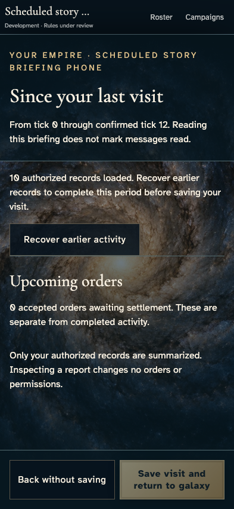
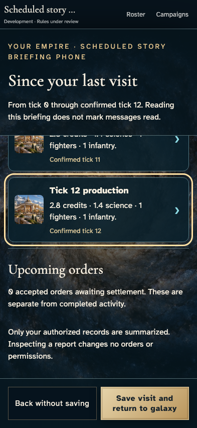
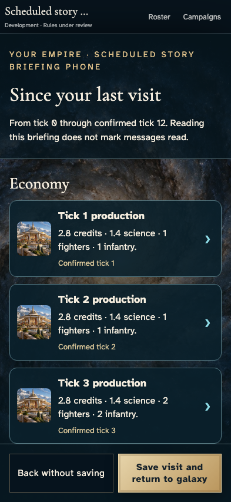
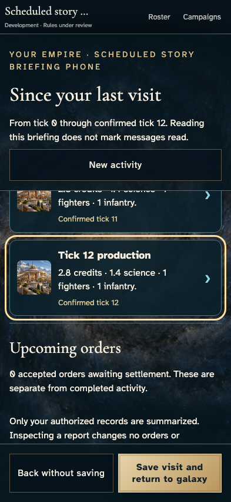
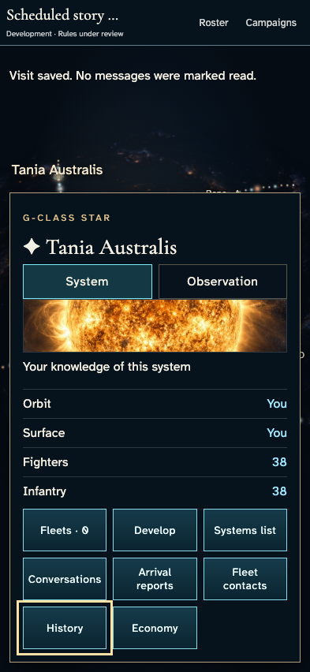
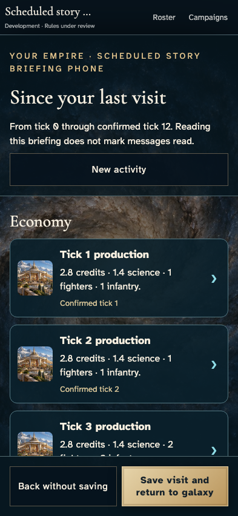
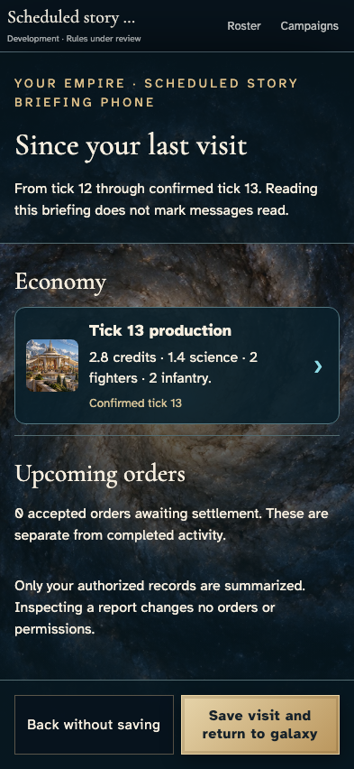
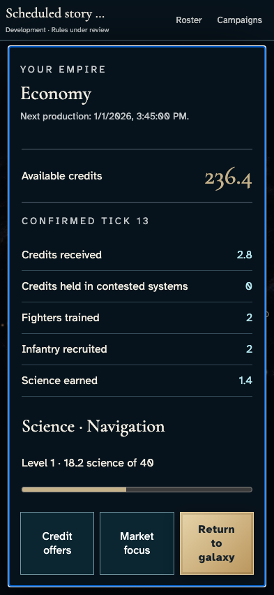
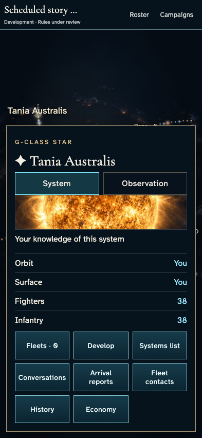

# Return to a complete private briefing without losing new activity

**Exact comparison passed.** phone · darwin-arm64. Inventory: UX-12, UX-14, UX-16.

Independent commanders inspect their authorized production history. A returning commander recovers a paged period, keeps their reading position when new activity arrives, saves only the reviewed period and inspects the remaining report. Visits belong to authoritative player identities. The development mock provider uses real encrypted commands and grants. Domain clocks and actual service delivery are explicitly labelled controls, not hosted certification. Interrupted visit and managed-key stories remain separate coverage.

## 1. Ordinary emulator sign-in and identity save, with explicit developer entitlement and fixed browser Date; timers continue normally.

Actor: **Test harness**. **Harness control; not a player action.**

Acknowledged outcome: Explicit test control; not a player action or hosted-service certification.

## 2. Ordinary emulator sign-in and identity save, with explicit developer entitlement and fixed browser Date; timers continue normally.

Actor: **Test harness**. **Harness control; not a player action.**

Acknowledged outcome: Explicit test control; not a player action or hosted-service certification.

## 3. Ordinary emulator sign-in and identity save, with explicit developer entitlement and fixed browser Date; timers continue normally.

Actor: **Test harness**. **Harness control; not a player action.**

Acknowledged outcome: Explicit test control; not a player action or hosted-service certification.

## 4. Ordinary emulator sign-in and identity save, with explicit developer entitlement and fixed browser Date; timers continue normally.

Actor: **Test harness**. **Harness control; not a player action.**

Acknowledged outcome: Explicit test control; not a player action or hosted-service certification.

## 5. Create/join through ordinary campaign controls. Fixed catalogue and admission clock are test controls; no seat, message or command outcome is injected.

Actor: **Test harness**. **Harness control; not a player action.**

Acknowledged outcome: Explicit test control; not a player action or hosted-service certification.

## 6. Create/join through ordinary campaign controls. Fixed catalogue and admission clock are test controls; no seat, message or command outcome is injected.

Actor: **Test harness**. **Harness control; not a player action.**

Acknowledged outcome: Explicit test control; not a player action or hosted-service certification.

## 7. Create/join through ordinary campaign controls. Fixed catalogue and admission clock are test controls; no seat, message or command outcome is injected.

Actor: **Test harness**. **Harness control; not a player action.**

Acknowledged outcome: Explicit test control; not a player action or hosted-service certification.

## 8. Create/join through ordinary campaign controls. Fixed catalogue and admission clock are test controls; no seat, message or command outcome is injected.

Actor: **Test harness**. **Harness control; not a player action.**

Acknowledged outcome: Explicit test control; not a player action or hosted-service certification.

## 9. Advance the designated browser/domain clock to 12:15 UTC and deliver the actual emulator Scheduler HTTP request. This does not certify hosted scheduling.

Actor: **Test harness**. **Harness control; not a player action.**

Acknowledged outcome: Explicit test control; not a player action or hosted-service certification.

## 10. Advance the declared browser/domain clock and deliver twelve production boundaries through the real leased service; no history, balances or checkpoint is injected.

Actor: **Test harness**. **Harness control; not a player action.**

Acknowledged outcome: Explicit test control; not a player action or hosted-service certification.

## 11. Return through the campaign directory. The briefing identifies the confirmed period but refuses to save while earlier authorized records are missing. Other commanders open their own briefings.

Actor: **Returning envoy**.

Acknowledged outcome: All three briefings name tick 12 and require earlier records before saving.

- [x] No viewpoint has an uncaught application error.
- [x] Each actual member projection carries only its own checkpoint; no other player's visit map is serialized.
- [x] Reading opens no command and changes no canonical state or visit.

### Viewpoint: Returning envoy

### Viewpoint: Independent envoy

### Viewpoint: Outer witness

## 12. Recover earlier authorized activity before making claims about change. Twelve distinct production reports become available to each player.

Actor: **Each commander**.

Acknowledged outcome: All twelve reports are recovered and Save visit becomes available.

- [x] No viewpoint has an uncaught application error.
- [x] Each actual member projection carries only its own checkpoint; no other player's visit map is serialized.
- [x] History recovery preserves every checkpoint, balance and revision.

### Viewpoint: Returning envoy

### Viewpoint: Independent envoy

### Viewpoint: Outer witness

## 13. Use the bounded reading panel to reach Tick 12 production while the commitment rail stays visible.

Actor: **Returning envoy**.

Acknowledged outcome: The last report's inspection control has keyboard focus.

- [x] No viewpoint has an uncaught application error.
- [x] Each actual member projection carries only its own checkpoint; no other player's visit map is serialized.
- [x] The reading pane scrolls without moving the document or hiding the primary action.

### Viewpoint: Returning envoy

### Viewpoint: Independent envoy

### Viewpoint: Outer witness

## 14. Deliver the thirteenth real tick while the player reads the prior period. The service publishes new state; the test does not replace the open snapshot.

Actor: **Test harness**. **Harness control; not a player action.**

Acknowledged outcome: Explicit test control; not a player action or hosted-service certification.

## 15. Notice New activity without silently advancing the reviewed period or moving the reading position.

Actor: **Returning envoy**.

Acknowledged outcome: New activity is available while the open briefing still ends at tick 12.

- [x] No viewpoint has an uncaught application error.
- [x] Each actual member projection carries only its own checkpoint; no other player's visit map is serialized.
- [x] The original scroll offset and all private visits remain unchanged.

### Viewpoint: Returning envoy

### Viewpoint: Independent envoy

### Viewpoint: Outer witness

## 16. Save the reviewed period with Enter. Confirmation returns to the galaxy; other commanders retain their independent periods.

Actor: **Returning envoy**.

Acknowledged outcome: The service accepts the visit and restores focus to History.

- [x] No viewpoint has an uncaught application error.
- [x] Each actual member projection carries only its own checkpoint; no other player's visit map is serialized.
- [x] Exactly one revision records only this commander's tick-12 source; wallets, military state and every other visit remain unchanged.

### Viewpoint: Returning envoy

### Viewpoint: Independent envoy

### Viewpoint: Outer witness

## 17. Reload and open the remaining activity. Tick 13 remains unreviewed because saving the older snapshot did not consume it.

Actor: **Returning envoy**.

Acknowledged outcome: The recovered private period contains only Tick 13 production.

- [x] No viewpoint has an uncaught application error.
- [x] Each actual member projection carries only its own checkpoint; no other player's visit map is serialized.
- [x] Reload does not repeat the visit command or alter any state.

### Viewpoint: Returning envoy

### Viewpoint: Independent envoy

### Viewpoint: Outer witness

## 18. Inspect Tick 13 production through its real report control and read the current economy without marking a further visit.

Actor: **Returning envoy**.

Acknowledged outcome: The Empire economy opens on confirmed tick 13.

- [x] No viewpoint has an uncaught application error.
- [x] Each actual member projection carries only its own checkpoint; no other player's visit map is serialized.
- [x] Inspection preserves the last visit and all canonical state.

### Viewpoint: Returning envoy

### Viewpoint: Independent envoy

### Viewpoint: Outer witness

## 19. Return from the inspected subject and explicitly save the remaining confirmed period.

Actor: **Returning envoy**.

Acknowledged outcome: The latest visit is acknowledged and the galaxy regains History focus.

- [x] No viewpoint has an uncaught application error.
- [x] Each actual member projection carries only its own checkpoint; no other player's visit map is serialized.
- [x] Only the returning commander advances to tick 13, in one additional revision.

### Viewpoint: Returning envoy

### Viewpoint: Independent envoy

### Viewpoint: Outer witness

## 20. Return through the named Continue action. No new briefing is forced after all confirmed activity was explicitly acknowledged.

Actor: **Returning envoy**.

Acknowledged outcome: The galaxy heading receives focus without a repeat briefing.

- [x] No viewpoint has an uncaught application error.
- [x] Each actual member projection carries only its own checkpoint; no other player's visit map is serialized.
- [x] Re-entry has no canonical effect and other commanders keep their earlier checkpoints.

### Viewpoint: Returning envoy

### Viewpoint: Independent envoy

### Viewpoint: Outer witness

