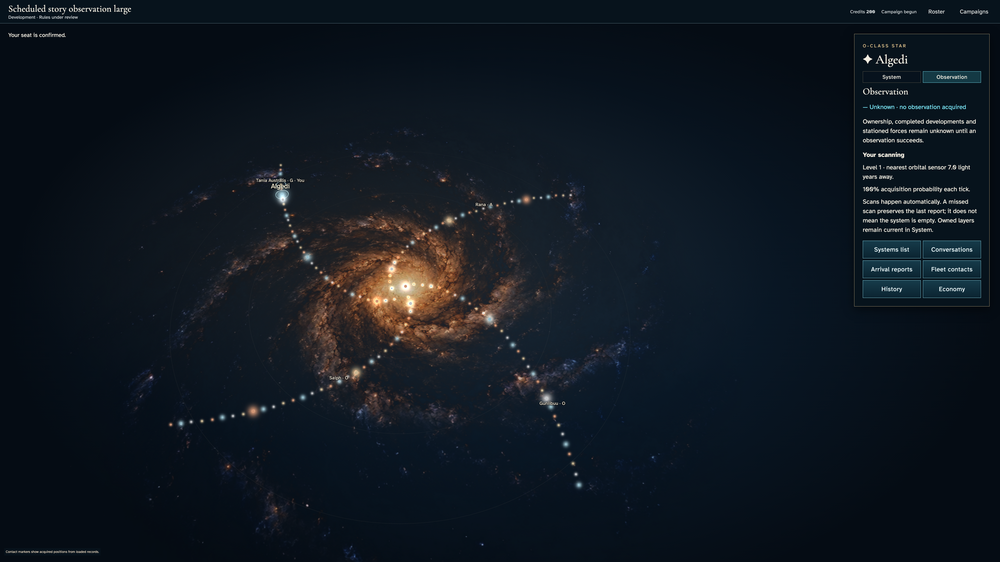
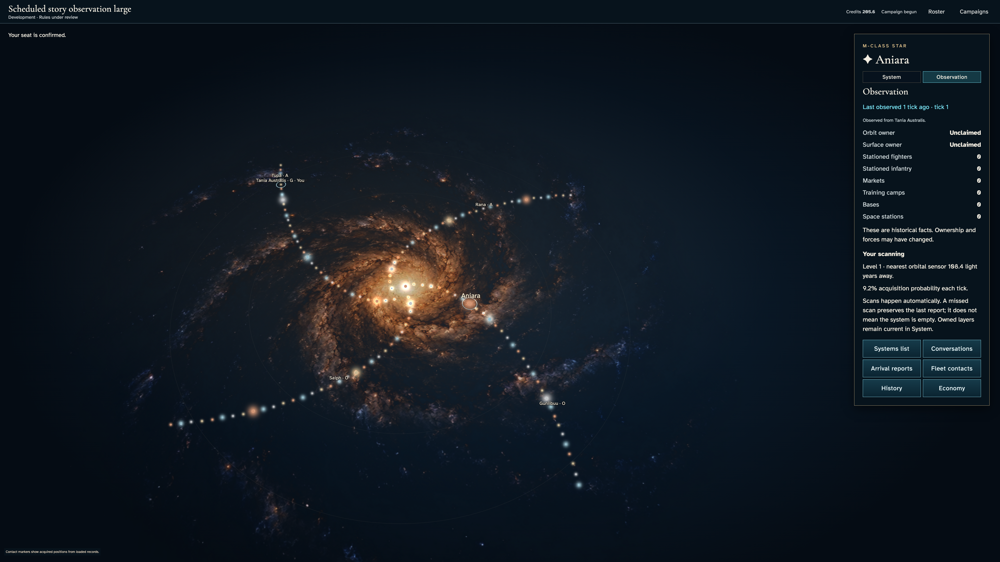
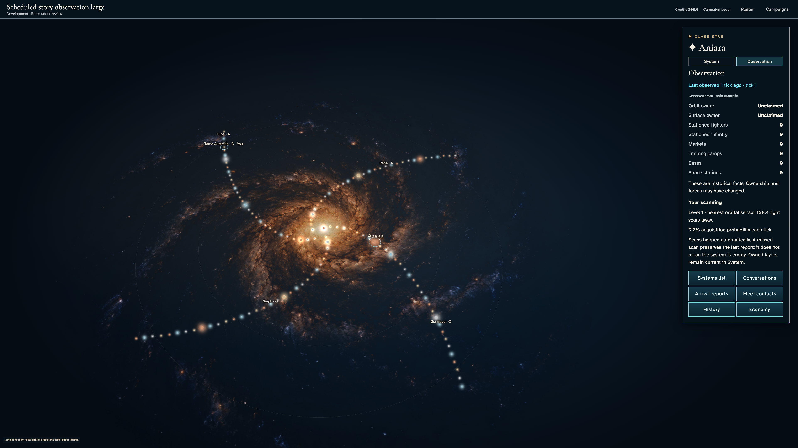
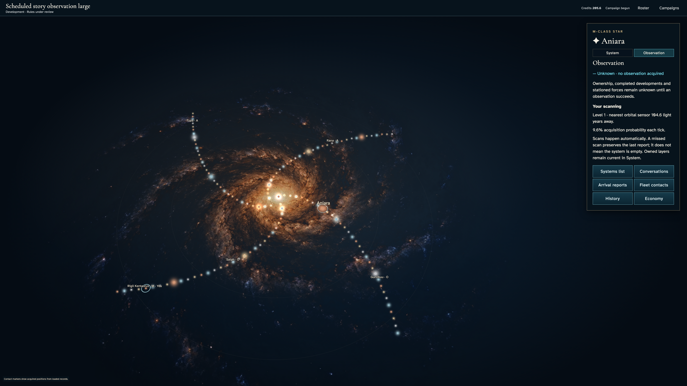
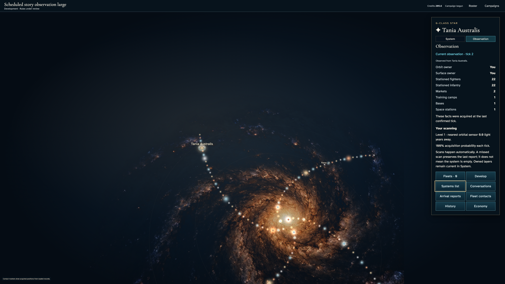

# Read unknown, current and historical stellar intelligence

**Exact comparison passed.** large · darwin-arm64. Inventory: UX-03, UX-07, UX-14, UX-16.

Four independent commanders enter through authenticated controls. Actual leased ticks acquire private observations; a missed scan retains historical facts. Fixed catalogue, domain clocks and scan entropy identities are explicit harness controls, not injected reports. Development scanning rules remain under review. Managed encryption, random-map fairness and hosted scheduling are not certified.

## 1. Ordinary emulator sign-in and identity save, with explicit developer entitlement and fixed browser Date; timers continue normally.

Actor: **Test harness**. **Harness control; not a player action.**

Acknowledged outcome: Explicit test control; not a player action or hosted-service certification.

## 2. Ordinary emulator sign-in and identity save, with explicit developer entitlement and fixed browser Date; timers continue normally.

Actor: **Test harness**. **Harness control; not a player action.**

Acknowledged outcome: Explicit test control; not a player action or hosted-service certification.

## 3. Ordinary emulator sign-in and identity save, with explicit developer entitlement and fixed browser Date; timers continue normally.

Actor: **Test harness**. **Harness control; not a player action.**

Acknowledged outcome: Explicit test control; not a player action or hosted-service certification.

## 4. Ordinary emulator sign-in and identity save, with explicit developer entitlement and fixed browser Date; timers continue normally.

Actor: **Test harness**. **Harness control; not a player action.**

Acknowledged outcome: Explicit test control; not a player action or hosted-service certification.

## 5. Create/join through ordinary campaign controls. Fixed catalogue and admission clock are test controls; no seat, message or command outcome is injected.

Actor: **Test harness**. **Harness control; not a player action.**

Acknowledged outcome: Explicit test control; not a player action or hosted-service certification.

## 6. Create/join through ordinary campaign controls. Fixed catalogue and admission clock are test controls; no seat, message or command outcome is injected.

Actor: **Test harness**. **Harness control; not a player action.**

Acknowledged outcome: Explicit test control; not a player action or hosted-service certification.

## 7. Create/join through ordinary campaign controls. Fixed catalogue and admission clock are test controls; no seat, message or command outcome is injected.

Actor: **Test harness**. **Harness control; not a player action.**

Acknowledged outcome: Explicit test control; not a player action or hosted-service certification.

## 8. Create/join through ordinary campaign controls. Fixed catalogue and admission clock are test controls; no seat, message or command outcome is injected.

Actor: **Test harness**. **Harness control; not a player action.**

Acknowledged outcome: Explicit test control; not a player action or hosted-service certification.

## 9. Advance the designated browser/domain clock to 12:15 UTC and deliver the actual emulator Scheduler HTTP request. This does not certify hosted scheduling.

Actor: **Test harness**. **Harness control; not a player action.**

Acknowledged outcome: Explicit test control; not a player action or hosted-service certification.

## 10. Select the same nearby catalogue star on two independent accounts before the first scan.

Actor: **Survey envoy**.

Acknowledged outcome: Both accounts explicitly report that no observation has been acquired.

- [x] Unknown reports have no serialized observation fields or rendered force/development facts; the primary tab and age remain visible.

### Viewpoint: Survey envoy

- [x] Projected system labels remain separated and contained within the chart.

### Viewpoint: Independent surveyor

- [x] Projected system labels remain separated and contained within the chart.

## 11. Deliver the first real leased tick at the explicit domain boundary. Fixed scan entropy identities feed the real HMAC; acquisition, authorization and publication are unchanged.

Actor: **Test harness**. **Harness control; not a player action.**

Acknowledged outcome: Explicit test control; not a player action or hosted-service certification.

## 12. Read the acknowledged current scan and compare the other commander's independently authorized view of the same star.

Actor: **Survey envoy**.

Acknowledged outcome: The nearby star has a current tick-one report for the survey envoy.

- [x] Every displayed field equals that player's actual projection; private entropy and other accounts' report tables are absent.
- [x] Public range and the envoy's level-one scanning guarantee acquisition within ten light years.

### Viewpoint: Survey envoy

- [x] Projected system labels remain separated and contained within the chart.

### Viewpoint: Independent surveyor

- [x] Projected system labels remain separated and contained within the chart.

## 13. Use the bounded details panel to read scanning probability while the age stays pinned.

Actor: **Survey envoy**.

Acknowledged outcome: Scanning capability is visible and the report age remains inside its scroll panel.

- [x] Reading and keyboard focus do not write a command or modify canonical state.

### Viewpoint: Survey envoy

- [x] Projected system labels remain separated and contained within the chart.

### Viewpoint: Independent surveyor

- [x] Projected system labels remain separated and contained within the chart.

## 14. Deliver the second real leased tick, then repeat delivery to prove the acquired/current or retained/historical outcomes are not redrawn.

Actor: **Test harness**. **Harness control; not a player action.**

Acknowledged outcome: Explicit test control; not a player action or hosted-service certification.

## 15. Select a report the envoy is authorized to read that was not refreshed by the second scan; distinguish its historical facts from another account's report.

Actor: **Survey envoy**.

Acknowledged outcome: The envoy's retained report is explicitly historical at its original observation tick.

- [x] A missed acquisition retains every prior authorized fact without substituting current canonical data; both players see only their own acquired fields.

### Viewpoint: Survey envoy

- [x] Projected system labels remain separated and contained within the chart.

### Viewpoint: Independent surveyor

- [x] Projected system labels remain separated and contained within the chart.

## 16. Read the full historical warning and the other commander's scan caveat without losing the pinned age or leaving the bounded panel.

Actor: **Survey envoy**.

Acknowledged outcome: Each full warning is readable inside its panel below the pinned observation age.

- [x] The original observation timestamp and facts remain unchanged after scrolling.

### Viewpoint: Survey envoy

- [x] Projected system labels remain separated and contained within the chart.

### Viewpoint: Independent surveyor

- [x] Projected system labels remain separated and contained within the chart.

## 17. Inspect another public catalogue star for which the envoy has still acquired no report.

Actor: **Survey envoy**.

Acknowledged outcome: The envoy sees unknown information, never a fabricated zero-force report.

- [x] The unacquired star has no observation object or force/development fields in that account's serialized reports; the other account retains its own access.

### Viewpoint: Survey envoy

- [x] Projected system labels remain separated and contained within the chart.

### Viewpoint: Independent surveyor

- [x] Projected system labels remain separated and contained within the chart.

## 18. Reload both authenticated accounts, reopen the actual campaign and restore the selected historical report through keyboard-accessible system navigation.

Actor: **Survey envoy**.

Acknowledged outcome: Reload recovers the envoy's original tick-one report at current tick two.

- [x] Recovery changes neither acquired history nor privacy and all rendered facts still match each authoritative private view.

### Viewpoint: Survey envoy

- [x] Projected system labels remain separated and contained within the chart.

### Viewpoint: Independent surveyor

- [x] Projected system labels remain separated and contained within the chart.

## 19. Resize the recovered chart and return to the original viewport; compare normal and reduced motion without changing the selected report.

Actor: **Survey envoy**.

Acknowledged outcome: The same historical report remains selected with readable labels after resize and either motion preference.

- [x] Presentation changes neither canonical state nor authorized observations.

### Viewpoint: Survey envoy

- [x] Projected system labels remain separated and contained within the chart.

### Viewpoint: Independent surveyor

- [x] Projected system labels remain separated and contained within the chart.

## 20. Use the systems list and Center home control with the keyboard to discover the home system independently of secondary map labels.

Actor: **Survey envoy**.

Acknowledged outcome: The authoritative home system is selected and its priority label is readable.

- [x] Keyboard chart navigation preserves authoritative forces, history and private recipient projections.

### Viewpoint: Survey envoy

- [x] Projected system labels remain separated and contained within the chart.

### Viewpoint: Independent surveyor

- [x] Projected system labels remain separated and contained within the chart.

