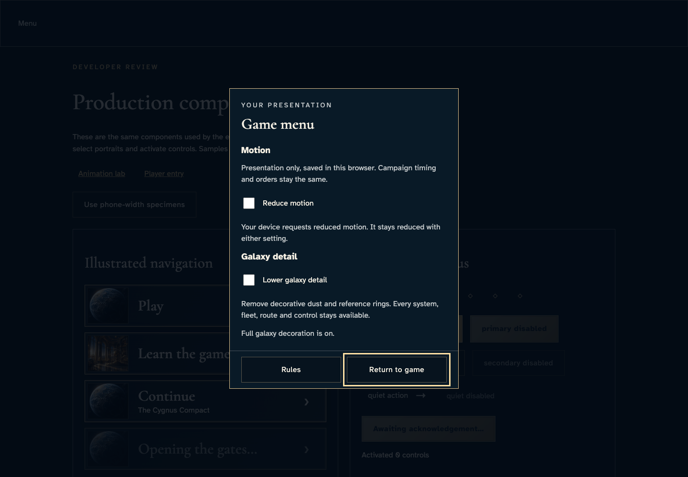
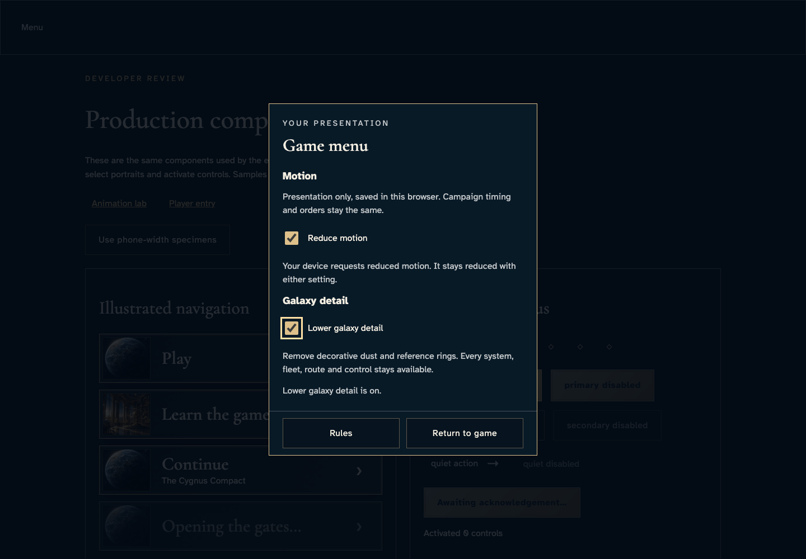
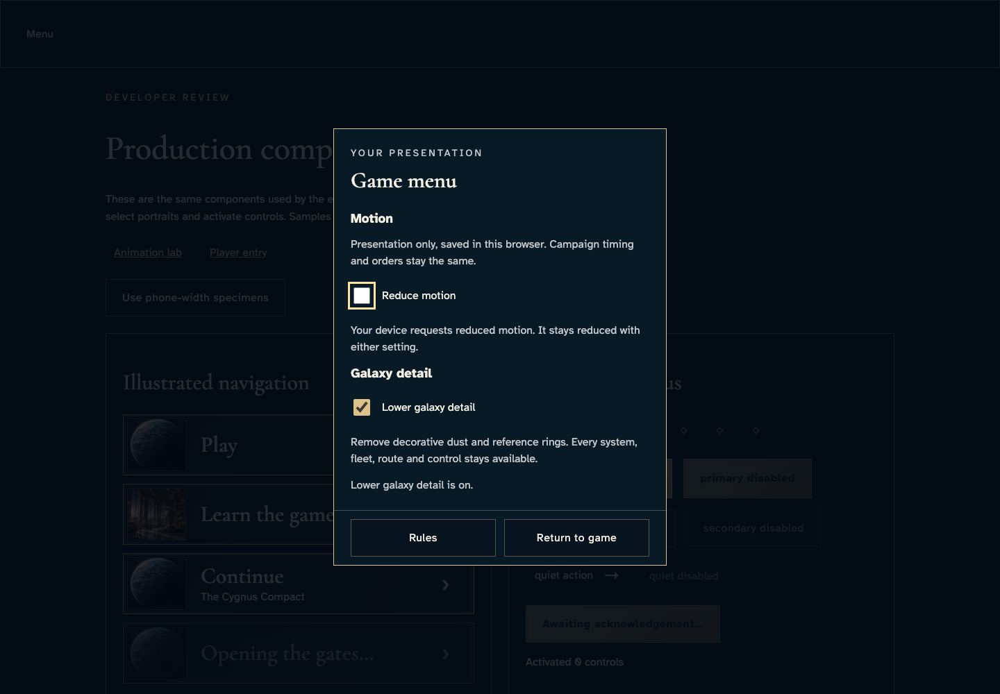
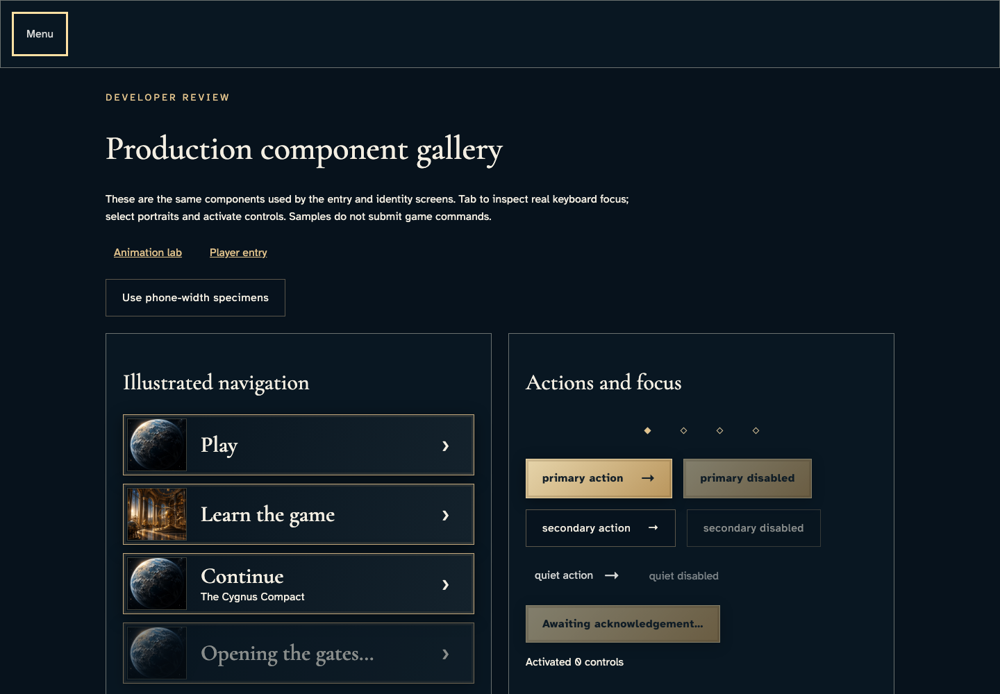
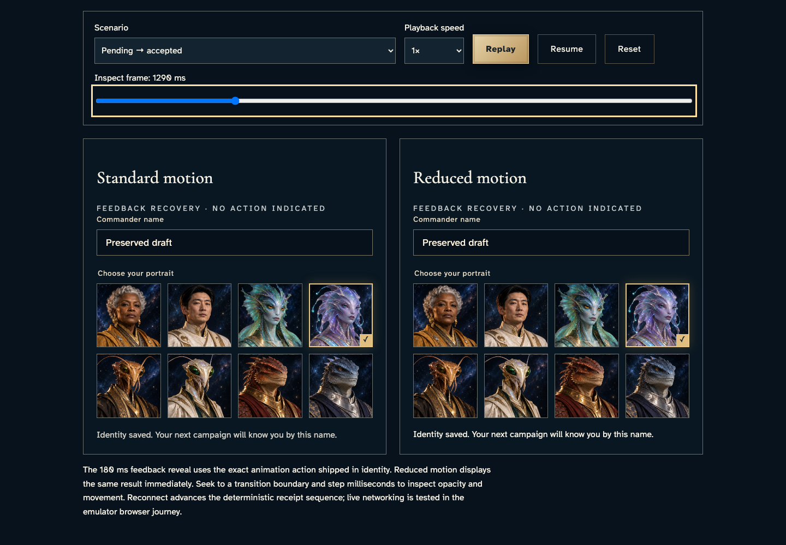

# Choose local presentation and return with keyboard focus

**Exact comparison passed.** desktop · darwin-arm64. Inventory: UX-15, UX-16.

A developer operates the actual shared game menu/settings in the gallery, reloads local choices, and inspects the existing shared feedback lab. These are acknowledged browser-local outcomes, not campaign receipts, galaxy rail/scene equivalence or performance evidence. No identity or emulator setup is used.

## 1. Open the shared menu with Enter and cycle every modal control with Tab and Shift+Tab.

Actor: **Developer**.

Acknowledged outcome: The native modal owns focus and explains browser-local scope.

- [x] Both complete labelled controls and the close action are contained and readable before any auto-scroll.
- [x] OS reduction applies even with the local checkbox off.

### Viewpoint: Developer · local settings

## 2. With the device allowing motion, enable both local reductions through Space; then return to the capture environment.

Actor: **Developer**.

Acknowledged outcome: Both local choices are checked and persisted by the production settings code.

- [x] Both complete labelled controls and the close action are contained and readable before any auto-scroll.
- [x] Lower detail has a named local acknowledgement.

### Viewpoint: Developer · local settings

## 3. Close with Escape, verify opener focus, reload and reopen the saved settings. Turn off the local motion override while the device still requests reduction.

Actor: **Developer**.

Acknowledged outcome: The saved detail choice survives reload and OS reduction cannot be disabled locally.

- [x] Both complete labelled controls and the close action are contained and readable before any auto-scroll.

### Viewpoint: Developer · local settings

## 4. Restore full decoration and explicitly return from the menu with Enter; keyboard focus returns to Menu.

Actor: **Developer**.

Acknowledged outcome: The menu closes and restores its original opening control.

- [x] Both explicit local overrides are now off; device reduction remains effective.

### Viewpoint: Developer · restored opener

## 5. Open the existing feedback lab and seek the same accepted identity result in both paused motion presentations.

Actor: **Developer**.

Acknowledged outcome: Both actual Feedback components show the same accepted outcome.

- [x] Both accepted comparisons distinguish no recovery action from their successful Identity saved outcome.
- [x] The production menu is present in the shared lab; playback is paused and no live campaign is involved.

### Viewpoint: Developer · standard feedback

- [x] The named comparison and accepted outcome are wholly visible in their explicit reading view.
- [x] Explicit paused motion: [aria-label="Standard motion comparison"], 1 animation(s), 90/180 ms; unchanged exact comparison.
- [x] Explicit paused motion: [aria-label="Reduced motion comparison"], 1 animation(s), 180/180 ms; unchanged exact comparison.

### Viewpoint: Developer · reduced feedback

- [x] The named comparison and accepted outcome are wholly visible in their explicit reading view.
- [x] Explicit paused motion: [aria-label="Standard motion comparison"], 1 animation(s), 90/180 ms; unchanged exact comparison.
- [x] Explicit paused motion: [aria-label="Reduced motion comparison"], 1 animation(s), 180/180 ms; unchanged exact comparison.

