# Pause, recover and resume campaign admission

**Exact comparison passed.** phone · linux-arm64. Inventory: UX-02, UX-14, UX-16.

A host pauses a real waiting development campaign while an independent commander is reviewing a faction. The pause fences admission and survives reload; acknowledged resume permits the waiting commander to join. Keyboard traversal wraps within the roster and Escape restores its opening control. Starting state uses real UI with explicit development access and fixed catalogue input.

## 1. Prepare a host's admitted Heliac seat and an independently authenticated Pelagic applicant through ordinary UI. Emulator development claims and fixed catalogue entropy are explicit controls; no production state, pause interval or tick is injected.

Actor: **Test harness**. **Harness control; not a player action.**

Acknowledged outcome: Explicit test control; not a player action or hosted-service certification.

## 2. Open the roster while the other commander can still claim a seat.

Actor: **Maintenance host**.

Acknowledged outcome: The roster panel receives focus.

- [x] The waiting commander can still commit admission before a pause.

### Viewpoint: Maintenance host

[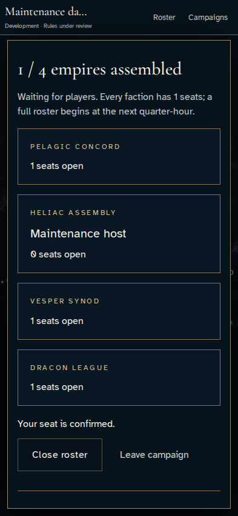](../../../../../../tests/browser/story-baselines/maintenance-admission-recovery/phone/linux-arm64/002-open-roster-1-maintenance-host.png)

### Viewpoint: Waiting envoy

[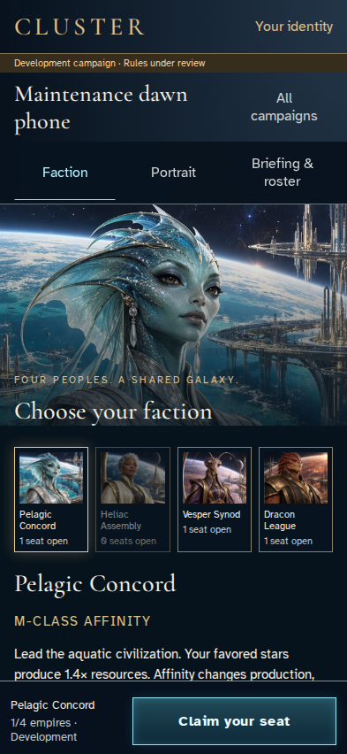](../../../../../../tests/browser/story-baselines/maintenance-admission-recovery/phone/linux-arm64/002-open-roster-2-waiting-envoy.png)

## 3. Traverse the closed roster controls in both wrap directions, then open development controls with the keyboard.

Actor: **Maintenance host**.

Acknowledged outcome: Pause campaign is focused after opening the disclosure.

- [x] The same authoritative campaign remains ready for admission.

### Viewpoint: Maintenance host

[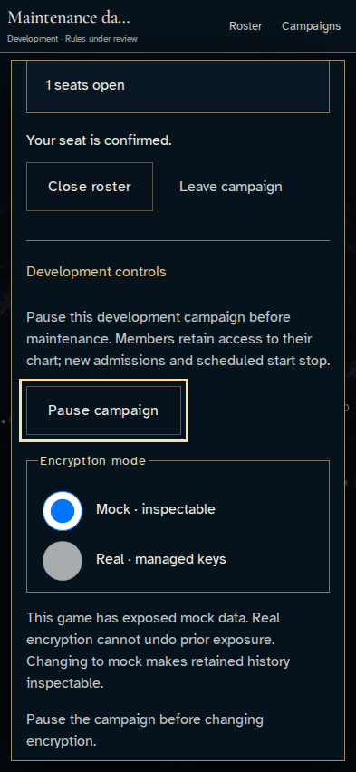](../../../../../../tests/browser/story-baselines/maintenance-admission-recovery/phone/linux-arm64/003-keyboard-controls-1-maintenance-host.png)

## 4. Commit the pause and observe the waiting player's admission control become disabled.

Actor: **Maintenance host**.

Acknowledged outcome: The server acknowledges the pause and explicitly stops admissions and scheduled start.

- [x] Resume is available, leaving is disabled, the background command rail is inert and the applicant cannot claim a seat.

### Viewpoint: Maintenance host

[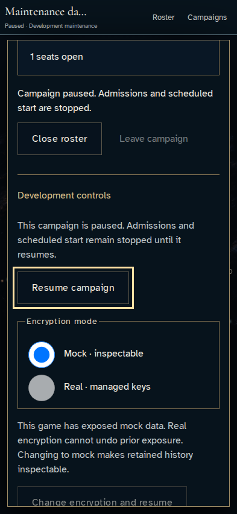](../../../../../../tests/browser/story-baselines/maintenance-admission-recovery/phone/linux-arm64/004-pause-admission-1-maintenance-host.png)

### Viewpoint: Waiting envoy

## 5. Reload and recover the persisted maintenance pause.

Actor: **Maintenance host**.

Acknowledged outcome: The recovered galaxy discloses the development maintenance pause.

- [x] The independent applicant remains unable to join after the host reloads.

### Viewpoint: Maintenance host

[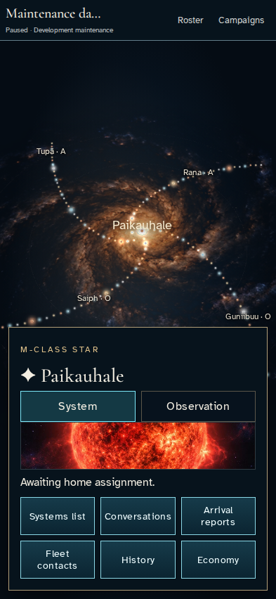](../../../../../../tests/browser/story-baselines/maintenance-admission-recovery/phone/linux-arm64/005-recover-pause-1-maintenance-host.png)

### Viewpoint: Waiting envoy

[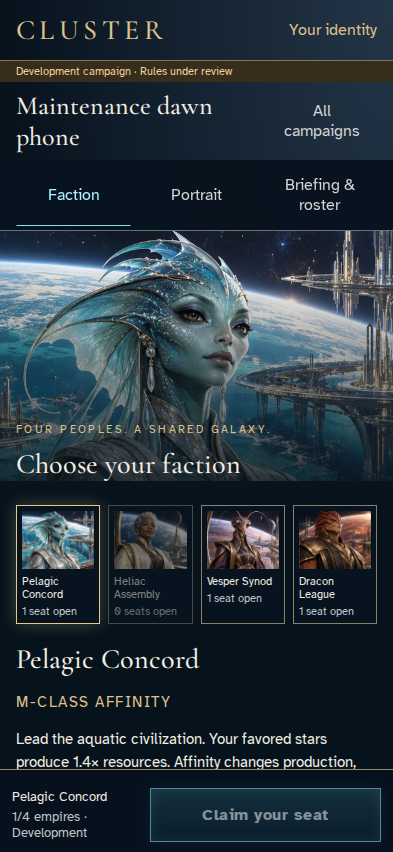](../../../../../../tests/browser/story-baselines/maintenance-admission-recovery/phone/linux-arm64/005-recover-pause-2-waiting-envoy.png)

## 6. Reopen the roster and reach Resume with the keyboard, skipping disabled Leave.

Actor: **Maintenance host**.

Acknowledged outcome: Resume campaign is focused and ready.

- [x] Leaving remains disabled until the server accepts resume.

### Viewpoint: Maintenance host

[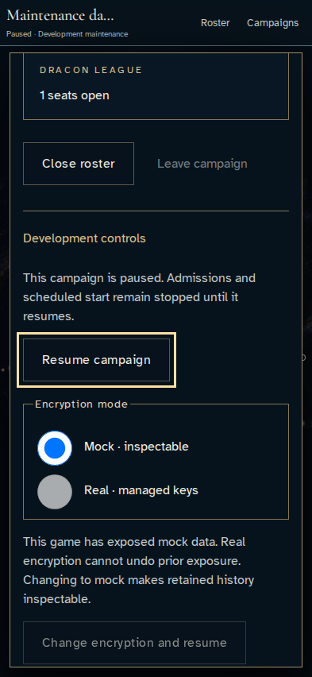](../../../../../../tests/browser/story-baselines/maintenance-admission-recovery/phone/linux-arm64/006-reopen-controls-1-maintenance-host.png)

## 7. Resume the campaign and wait for the applicant's admission control to reopen.

Actor: **Maintenance host**.

Acknowledged outcome: The authoritative receipt confirms Campaign resumed.

- [x] Leaving and claiming a seat become available after acceptance.

### Viewpoint: Maintenance host

[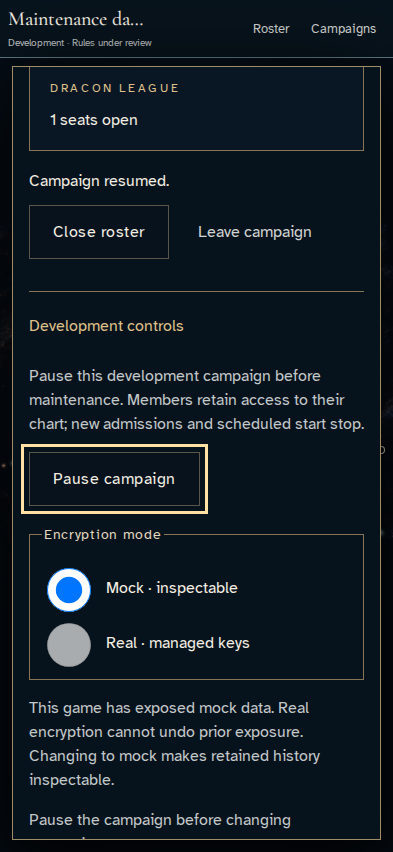](../../../../../../tests/browser/story-baselines/maintenance-admission-recovery/phone/linux-arm64/007-resume-admission-1-maintenance-host.png)

### Viewpoint: Waiting envoy

## 8. Close the roster with Escape and return focus to its opening control.

Actor: **Maintenance host**.

Acknowledged outcome: Roster is focused on the galaxy surface.

- [x] The modal is closed and normal galaxy controls are no longer inert.

### Viewpoint: Maintenance host

[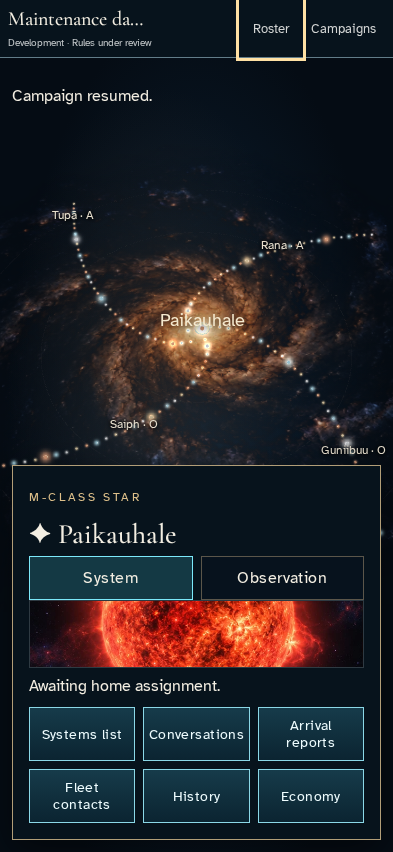](../../../../../../tests/browser/story-baselines/maintenance-admission-recovery/phone/linux-arm64/008-return-focus-1-maintenance-host.png)

## 9. Claim the reopened seat and inspect its acknowledged roster entry.

Actor: **Waiting envoy and Maintenance host**.

Acknowledged outcome: The applicant receives seat confirmation and the host sees Waiting envoy.

- [x] Both commanders see the real persisted campaign; it remains waiting for a full roster.

### Viewpoint: Maintenance host

[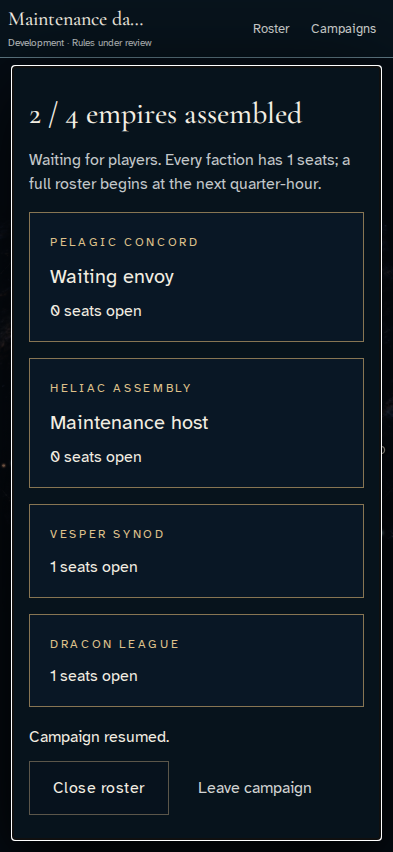](../../../../../../tests/browser/story-baselines/maintenance-admission-recovery/phone/linux-arm64/009-admit-waiting-envoy-1-maintenance-host.png)

### Viewpoint: Waiting envoy

[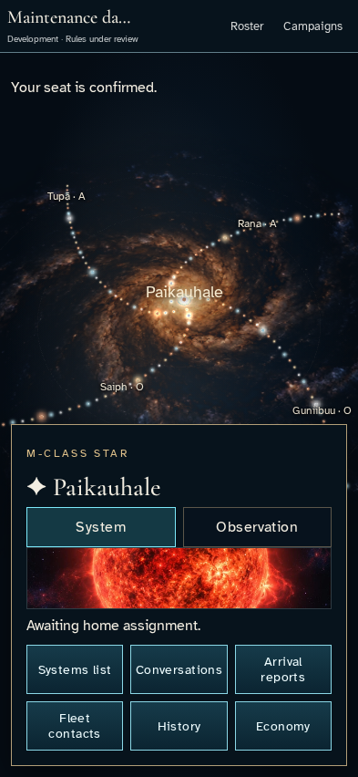](../../../../../../tests/browser/story-baselines/maintenance-admission-recovery/phone/linux-arm64/009-admit-waiting-envoy-2-waiting-envoy.png)
