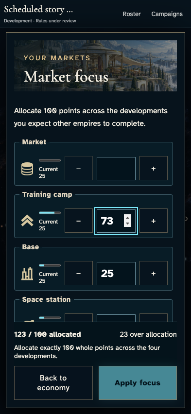
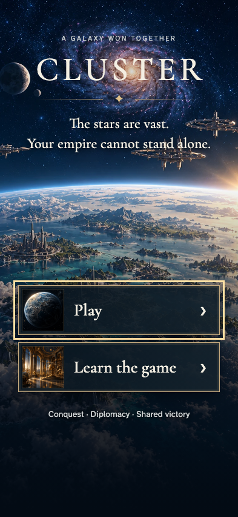
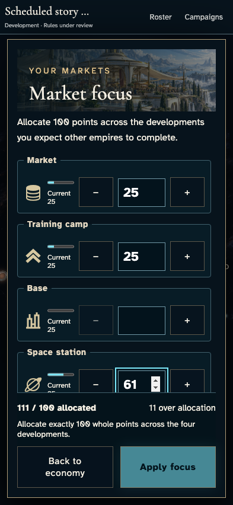
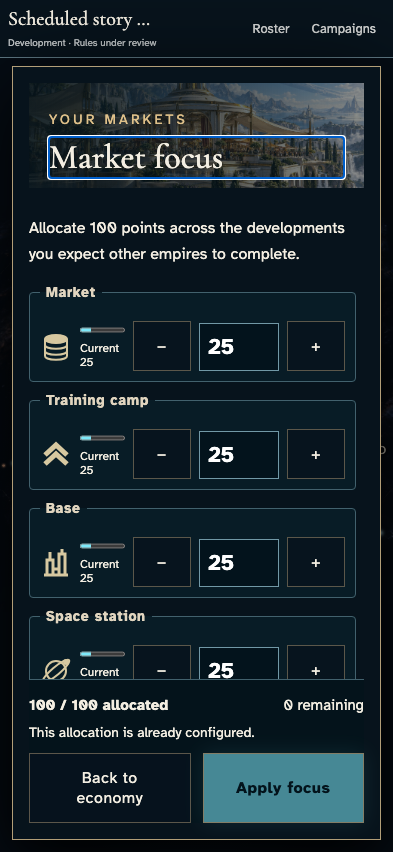

# Switch saved commanders without carrying unsent market intent

**Exact comparison passed.** phone · darwin-arm64. Inventory: UX-06, UX-14, UX-16.

Four saved commanders enter a real development campaign. Ordinary sign-out/sign-in reuses one browser across two accounts without resaving either identity. Partial unsent market intent must clear, while canonical state, both private projections and receipt sets remain unchanged. Fixed admission/catalogue clocks and developer entitlement are explicit harness controls. This does not claim durable accepted-order recovery or hosted authentication acceptance.

## 1. Ordinary Google emulator sign-in and identity save; developer entitlement is an explicit admission fixture, not a fabricated seat.

Actor: **Test harness**. **Harness control; not a player action.**

Acknowledged outcome: Explicit test control; not a player action or hosted-service certification.

## 2. Ordinary Google emulator sign-in and identity save; developer entitlement is an explicit admission fixture, not a fabricated seat.

Actor: **Test harness**. **Harness control; not a player action.**

Acknowledged outcome: Explicit test control; not a player action or hosted-service certification.

## 3. Ordinary Google emulator sign-in and identity save; developer entitlement is an explicit admission fixture, not a fabricated seat.

Actor: **Test harness**. **Harness control; not a player action.**

Acknowledged outcome: Explicit test control; not a player action or hosted-service certification.

## 4. Ordinary Google emulator sign-in and identity save; developer entitlement is an explicit admission fixture, not a fabricated seat.

Actor: **Test harness**. **Harness control; not a player action.**

Acknowledged outcome: Explicit test control; not a player action or hosted-service certification.

## 5. Create/join with ordinary player controls. The existing fixed catalogue and admission-time fixture changes no identity, payload, resource or result.

Actor: **Test harness**. **Harness control; not a player action.**

Acknowledged outcome: Explicit test control; not a player action or hosted-service certification.

## 6. Create/join with ordinary player controls. The existing fixed catalogue and admission-time fixture changes no identity, payload, resource or result.

Actor: **Test harness**. **Harness control; not a player action.**

Acknowledged outcome: Explicit test control; not a player action or hosted-service certification.

## 7. Create/join with ordinary player controls. The existing fixed catalogue and admission-time fixture changes no identity, payload, resource or result.

Actor: **Test harness**. **Harness control; not a player action.**

Acknowledged outcome: Explicit test control; not a player action or hosted-service certification.

## 8. Create/join with ordinary player controls. The existing fixed catalogue and admission-time fixture changes no identity, payload, resource or result.

Actor: **Test harness**. **Harness control; not a player action.**

Acknowledged outcome: Explicit test control; not a player action or hosted-service certification.

## 9. Set the designated browser/domain clock to12:15 UTC and deliver the real Scheduler HTTP request. Authentication remains real. This is not hosted scheduling certification.

Actor: **Test harness**. **Harness control; not a player action.**

Acknowledged outcome: Explicit test control; not a player action or hosted-service certification.

## 10. Both commanders inspect their own authoritative allocation through keyboard controls.

Actor: **Market envoy**.

Acknowledged outcome: Both instruments show the original25-point allocation and disable an unchanged commitment.

- [x] No market write or receipt occurs; the complete campaign, both private projections and saved identity remain unchanged.

### Viewpoint: Market envoy · campaign device

### Viewpoint: Independent investor

## 11. Blank Market and enter73 camp points. The incomplete allocation remains an unsent draft.

Actor: **Market envoy**.

Acknowledged outcome: The exact partial values remain visible and Apply stays disabled.

- [x] No market write or receipt occurs; the complete campaign, both private projections and saved identity remain unchanged.

### Viewpoint: Market envoy · campaign device

### Viewpoint: Independent investor

## 12. Close and reopen the economy under normal motion, then return to reduced motion with the same unsent intent.

Actor: **Market envoy**.

Acknowledged outcome: Blank/73 survive navigation in both motion modes without a command.

- [x] No market write or receipt occurs; the complete campaign, both private projections and saved identity remain unchanged.

### Viewpoint: Market envoy · campaign device

### Viewpoint: Independent investor

## 13. Leave the campaign route and use keyboard Sign out. In-memory unsent allocation is cleared; no market order is sent.

Actor: **Market envoy**.

Acknowledged outcome: Ordinary sign-out closes protected controls and exposes Play without an identity control.

- [x] No market write or receipt occurs; the complete campaign, both private projections and saved identity remain unchanged.

### Viewpoint: Market envoy · campaign device

### Viewpoint: Independent investor

## 14. Sign in as the other saved commander on the same browser and open Market focus without saving identity again.

Actor: **Independent investor**.

Acknowledged outcome: The authenticated commander sees only the authoritative allocation, with no recovered partial draft or retry command.

- [x] No market write or receipt occurs; the complete campaign, both private projections and saved identity remain unchanged.

### Viewpoint: Independent investor · reused browser

### Viewpoint: Independent investor

## 15. Enter a distinguishable incomplete allocation for the second account; the independent device keeps the authoritative allocation.

Actor: **Independent investor**.

Acknowledged outcome: Blank/61 belongs only to this unsent browser draft; Apply is disabled and the other device remains at25.

- [x] No market write or receipt occurs; the complete campaign, both private projections and saved identity remain unchanged.
- [x] The entire focused Space station control and its painted focus ring remain inside the allocation reading region after validation.

### Viewpoint: Independent investor · reused browser

### Viewpoint: Independent investor

## 16. End the second account's ordinary browser session without submitting its partial allocation.

Actor: **Independent investor**.

Acknowledged outcome: Ordinary sign-out closes protected controls and exposes Play without an identity control.

- [x] No market write or receipt occurs; the complete campaign, both private projections and saved identity remain unchanged.

### Viewpoint: Independent investor · reused browser

### Viewpoint: Independent investor

## 17. Return to the first saved commander without an identity resave. Neither account's unsent values return; accepted orders remain a separate authoritative recovery contract.

Actor: **Market envoy**.

Acknowledged outcome: The authenticated commander sees only the authoritative allocation, with no recovered partial draft or retry command.

- [x] No market write or receipt occurs; the complete campaign, both private projections and saved identity remain unchanged.

### Viewpoint: Market envoy · campaign device

### Viewpoint: Independent investor

