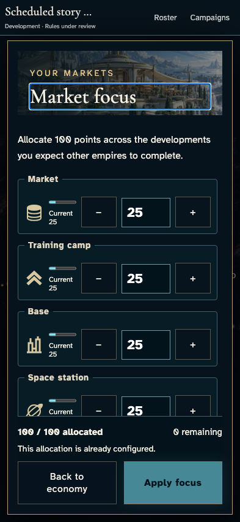
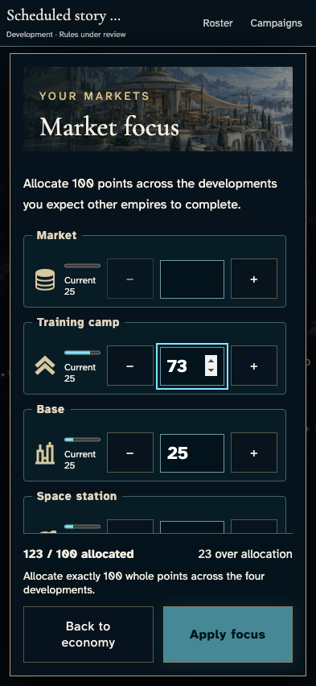
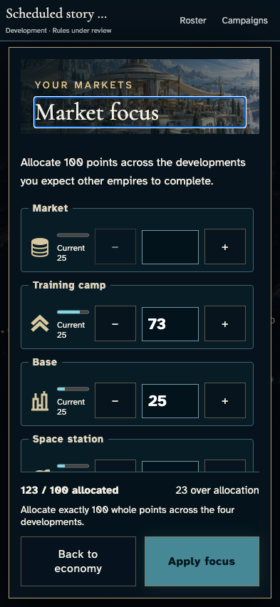
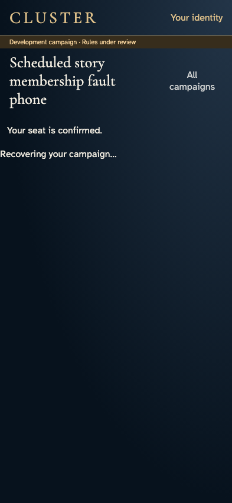
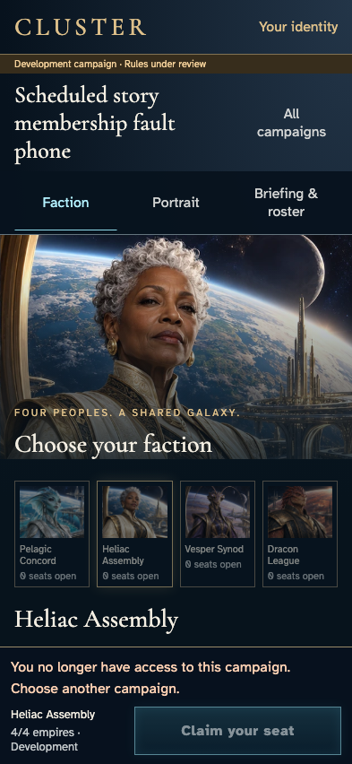

# Reject an old private view after a guarded membership fault

**Exact comparison passed.** phone · darwin-arm64. Inventory: UX-06, UX-14, UX-16.

Four commanders enter a real development campaign. The owner keeps a partial market allocation, then recovers the campaign with a real private-view digest held by a demo-only harness. A separately labelled administrative fault removes only authorization metadata; the original encrypted state, history, resources and receipts remain intact. Releasing the unchanged digest cannot reopen protected UI. Compare-and-set restoration and ordinary recovery must not resurrect the draft. This is not active Leave gameplay or hosted certification.

## 1. Ordinary Google emulator sign-in and identity save; developer entitlement is an explicit admission fixture, not a fabricated seat.

Actor: **Test harness**. **Harness control; not a player action.**

Acknowledged outcome: Explicit test control; not a player action or hosted-service certification.

## 2. Ordinary Google emulator sign-in and identity save; developer entitlement is an explicit admission fixture, not a fabricated seat.

Actor: **Test harness**. **Harness control; not a player action.**

Acknowledged outcome: Explicit test control; not a player action or hosted-service certification.

## 3. Ordinary Google emulator sign-in and identity save; developer entitlement is an explicit admission fixture, not a fabricated seat.

Actor: **Test harness**. **Harness control; not a player action.**

Acknowledged outcome: Explicit test control; not a player action or hosted-service certification.

## 4. Ordinary Google emulator sign-in and identity save; developer entitlement is an explicit admission fixture, not a fabricated seat.

Actor: **Test harness**. **Harness control; not a player action.**

Acknowledged outcome: Explicit test control; not a player action or hosted-service certification.

## 5. Create/join with ordinary player controls. The existing fixed catalogue and admission-time fixture changes no identity, payload, resource or result.

Actor: **Test harness**. **Harness control; not a player action.**

Acknowledged outcome: Explicit test control; not a player action or hosted-service certification.

## 6. Create/join with ordinary player controls. The existing fixed catalogue and admission-time fixture changes no identity, payload, resource or result.

Actor: **Test harness**. **Harness control; not a player action.**

Acknowledged outcome: Explicit test control; not a player action or hosted-service certification.

## 7. Create/join with ordinary player controls. The existing fixed catalogue and admission-time fixture changes no identity, payload, resource or result.

Actor: **Test harness**. **Harness control; not a player action.**

Acknowledged outcome: Explicit test control; not a player action or hosted-service certification.

## 8. Create/join with ordinary player controls. The existing fixed catalogue and admission-time fixture changes no identity, payload, resource or result.

Actor: **Test harness**. **Harness control; not a player action.**

Acknowledged outcome: Explicit test control; not a player action or hosted-service certification.

## 9. Set the designated browser/domain clock to12:15 UTC and deliver the real Scheduler HTTP request. Authentication and session-revocation clocks remain real. This is not hosted scheduling certification.

Actor: **Test harness**. **Harness control; not a player action.**

Acknowledged outcome: Explicit test control; not a player action or hosted-service certification.

## 10. Both commanders inspect their own authoritative allocation through keyboard controls.

Actor: **Market envoy**.

Acknowledged outcome: Both instruments show the original25-point allocation and disable an unchanged commitment.

- [x] No market write or receipt occurs; the complete campaign, both private projections and saved identity remain unchanged.

### Viewpoint: Market envoy · campaign device

### Viewpoint: Independent investor

## 11. Blank Market and enter73 camp points. The incomplete allocation remains an unsent draft.

Actor: **Market envoy**.

Acknowledged outcome: The exact partial values remain visible and Apply stays disabled.

- [x] No market write or receipt occurs; the complete campaign, both private projections and saved identity remain unchanged.

### Viewpoint: Market envoy · campaign device

### Viewpoint: Independent investor

## 12. Close and reopen the economy under normal motion, then return to reduced motion with the same unsent intent.

Actor: **Market envoy**.

Acknowledged outcome: Blank/73 survive navigation in both motion modes without a command.

- [x] No market write or receipt occurs; the complete campaign, both private projections and saved identity remain unchanged.

### Viewpoint: Market envoy · campaign device

### Viewpoint: Independent investor

## 13. Install a demo-loopback digest gate for this actual owner's current encrypted view only. Native digest bytes and all callbacks remain unchanged; the real result is delayed, never substituted.

Actor: **Test harness**. **Harness control; not a player action.**

Acknowledged outcome: Explicit test control; not a player action or hosted-service certification.

## 14. Return to Campaigns and recover the same campaign using keyboard controls; its authentic private view waits at the labelled harness boundary.

Actor: **Market envoy**.

Acknowledged outcome: Recovery is visibly pending while an actual authorized digest is held.

- [x] No market write or receipt occurs; the complete campaign, both private projections and saved identity remain unchanged.

### Viewpoint: Market envoy · campaign device

### Viewpoint: Independent investor

## 15. Guarded demo-only administrative fault: atomically remove this owner's memberUids entry and membership document. No player Leave, canonical state, private ciphertext, history, command, receipt or resource is fabricated or changed.

Actor: **Test harness**. **Harness control; not a player action.**

Acknowledged outcome: Explicit test control; not a player action or hosted-service certification.

## 16. Observe the acknowledged access-loss remedy after the separately labelled administrative fault.

Actor: **Market envoy**.

Acknowledged outcome: Real membership loss removes protected UI and player reads are denied, while the other commander stays authorized.

- [x] No market write or receipt occurs; the complete campaign, both private projections and saved identity remain unchanged.

### Viewpoint: Market envoy · campaign device

### Viewpoint: Independent investor

## 17. Release every held native digest result unchanged and wait for its promise continuation and rendered frame. Existing service/route callback fences, not the harness, decide whether the old view may display.

Actor: **Test harness**. **Harness control; not a player action.**

Acknowledged outcome: Explicit test control; not a player action or hosted-service certification.

## 18. Review the same access-loss state after the old authorized view resumes; no old galaxy or draft may return.

Actor: **Market envoy**.

Acknowledged outcome: Real membership loss removes protected UI and player reads are denied, while the other commander stays authorized.

- [x] No market write or receipt occurs; the complete campaign, both private projections and saved identity remain unchanged.

### Viewpoint: Market envoy · campaign device

### Viewpoint: Independent investor

## 19. Compare-and-set restoration restores only this fault's exact membership metadata. Any concurrent campaign or membership change fails closed; no campaign progress or private history is reconstructed.

Actor: **Test harness**. **Harness control; not a player action.**

Acknowledged outcome: Explicit test control; not a player action or hosted-service certification.

## 20. Use All campaigns and the original campaign card to recover through the real authorized service, without reload or identity save.

Actor: **Market envoy**.

Acknowledged outcome: Authoritative25-point allocations replace the cleared blank/73 draft and Apply stays disabled.

- [x] No market write or receipt occurs; the complete campaign, both private projections and saved identity remain unchanged.

### Viewpoint: Market envoy · campaign device

### Viewpoint: Independent investor

