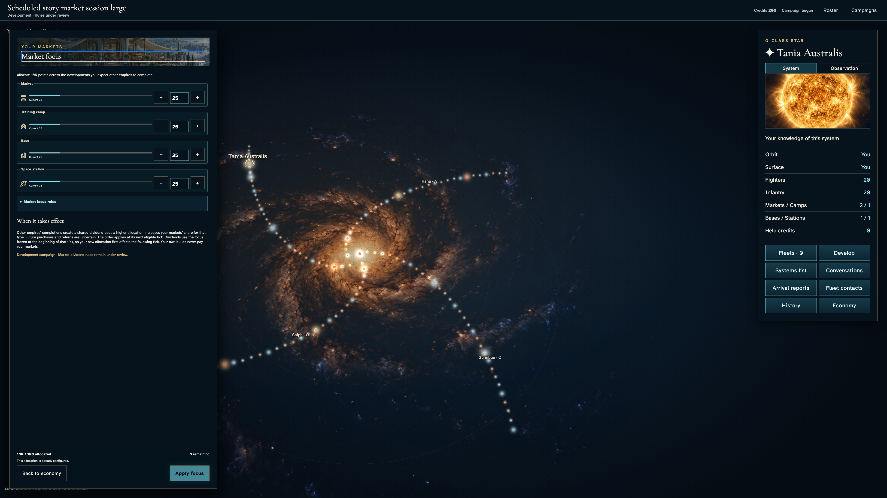
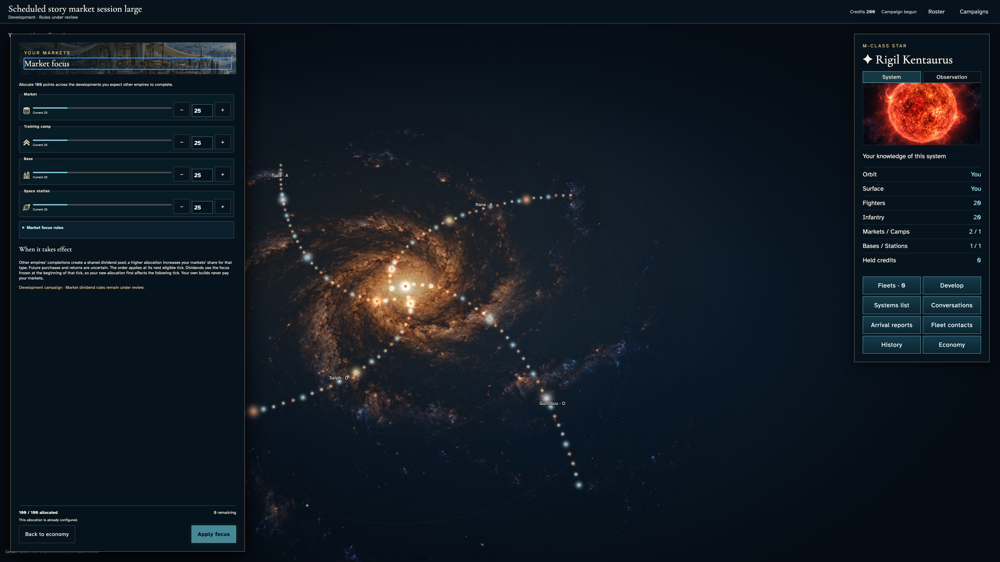
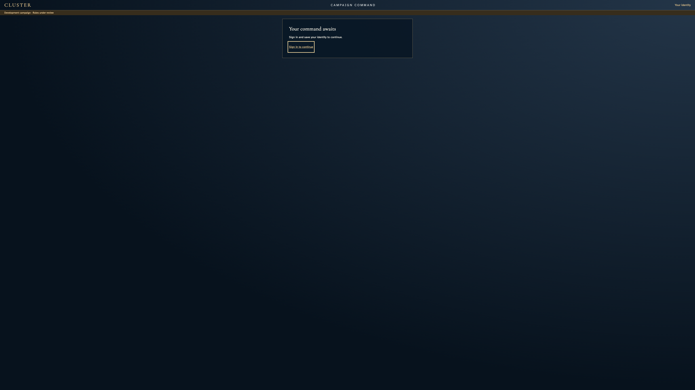
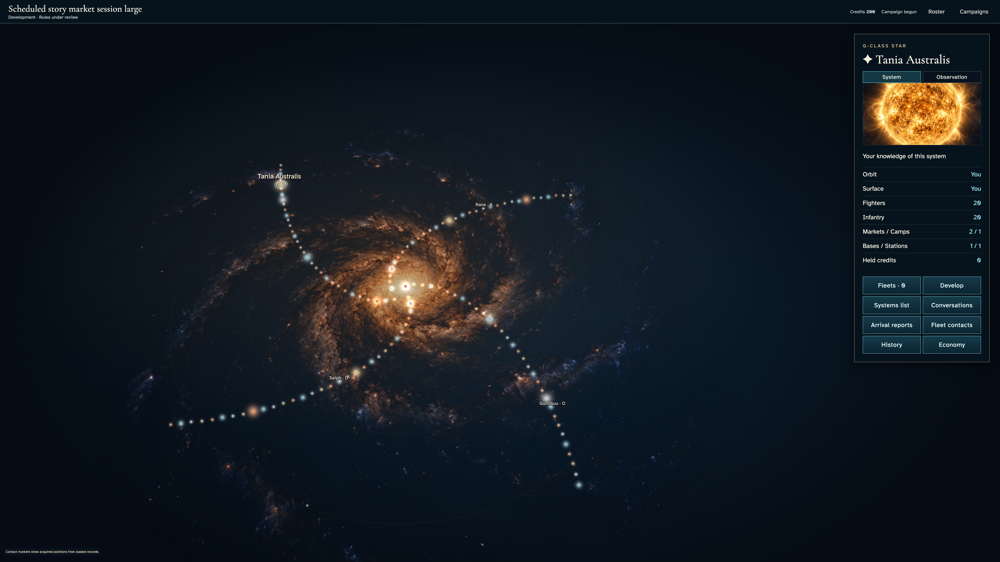

# End both account sessions while an unsent market allocation is open

**Exact comparison passed.** large · darwin-arm64. Inventory: UX-06, UX-14, UX-16.

Four commanders enter a real development campaign. A second device ends the owner's sessions through Google confirmation while the first remains on its campaign page. Partial market intent clears without sending; an unrelated player's private view remains unchanged. Fresh authentication recovers the original identity and authoritative allocation. Fixed admission/catalogue clocks and developer entitlement are explicit harness controls, not hosted acceptance. No membership fault, active Leave, market order or production tick is injected.

## 1. Ordinary Google emulator sign-in and identity save; developer entitlement is an explicit admission fixture, not a fabricated seat.

Actor: **Test harness**. **Harness control; not a player action.**

Acknowledged outcome: Explicit test control; not a player action or hosted-service certification.

## 2. Ordinary Google emulator sign-in and identity save; developer entitlement is an explicit admission fixture, not a fabricated seat.

Actor: **Test harness**. **Harness control; not a player action.**

Acknowledged outcome: Explicit test control; not a player action or hosted-service certification.

## 3. Ordinary Google emulator sign-in and identity save; developer entitlement is an explicit admission fixture, not a fabricated seat.

Actor: **Test harness**. **Harness control; not a player action.**

Acknowledged outcome: Explicit test control; not a player action or hosted-service certification.

## 4. Ordinary Google emulator sign-in and identity save; developer entitlement is an explicit admission fixture, not a fabricated seat.

Actor: **Test harness**. **Harness control; not a player action.**

Acknowledged outcome: Explicit test control; not a player action or hosted-service certification.

## 5. Create/join with ordinary player controls. The existing fixed catalogue and admission-time fixture changes no identity, payload, resource or result.

Actor: **Test harness**. **Harness control; not a player action.**

Acknowledged outcome: Explicit test control; not a player action or hosted-service certification.

## 6. Create/join with ordinary player controls. The existing fixed catalogue and admission-time fixture changes no identity, payload, resource or result.

Actor: **Test harness**. **Harness control; not a player action.**

Acknowledged outcome: Explicit test control; not a player action or hosted-service certification.

## 7. Create/join with ordinary player controls. The existing fixed catalogue and admission-time fixture changes no identity, payload, resource or result.

Actor: **Test harness**. **Harness control; not a player action.**

Acknowledged outcome: Explicit test control; not a player action or hosted-service certification.

## 8. Create/join with ordinary player controls. The existing fixed catalogue and admission-time fixture changes no identity, payload, resource or result.

Actor: **Test harness**. **Harness control; not a player action.**

Acknowledged outcome: Explicit test control; not a player action or hosted-service certification.

## 9. Set the designated browser/domain clock to12:15 UTC and deliver the real Scheduler HTTP request. Authentication and session-revocation clocks remain real. This is not hosted scheduling certification.

Actor: **Test harness**. **Harness control; not a player action.**

Acknowledged outcome: Explicit test control; not a player action or hosted-service certification.

## 10. Authenticate another independent browser as the same saved owner without resaving identity. This control device keeps real Date for Google/session confirmation.

Actor: **Test harness**. **Harness control; not a player action.**

Acknowledged outcome: Explicit test control; not a player action or hosted-service certification.

## 11. Both commanders inspect their own authoritative allocation through keyboard controls.

Actor: **Market envoy**.

Acknowledged outcome: Both instruments show the original25-point allocation and disable an unchanged commitment.

- [x] No market write or receipt occurs; the complete campaign, both private projections and saved identity remain unchanged.

### Viewpoint: Market envoy · campaign device

### Viewpoint: Independent investor

## 12. Blank Market and enter73 camp points. The incomplete allocation remains an unsent draft.

Actor: **Market envoy**.

Acknowledged outcome: The exact partial values remain visible and Apply stays disabled.

- [x] No market write or receipt occurs; the complete campaign, both private projections and saved identity remain unchanged.

### Viewpoint: Market envoy · campaign device

### Viewpoint: Independent investor

## 13. Close and reopen the economy under normal motion, then return to reduced motion with the same unsent intent.

Actor: **Market envoy**.

Acknowledged outcome: Blank/73 survive navigation in both motion modes without a command.

- [x] No market write or receipt occurs; the complete campaign, both private projections and saved identity remain unchanged.

### Viewpoint: Market envoy · campaign device

### Viewpoint: Independent investor

## 14. Open Your devices on the second device while the first stays mounted in its campaign.

Actor: **Market envoy · session control**.

Acknowledged outcome: Google confirmation is available and the first device still holds its partial allocation.

- [x] No market write or receipt occurs; the complete campaign, both private projections and saved identity remain unchanged.

### Viewpoint: Market envoy · session control

### Viewpoint: Market envoy · campaign device

### Viewpoint: Independent investor

## 15. Confirm real account-wide sign-out. The campaign device loses protected controls without reloading or navigating, while the other commander stays authorized.

Actor: **Market envoy · session control**.

Acknowledged outcome: The real session fence completes; entry confirms session end and the mounted campaign offers its signed-out remedy.

- [x] No market write or receipt occurs; the complete campaign, both private projections and saved identity remain unchanged.

### Viewpoint: Market envoy · campaign device

### Viewpoint: Market envoy · session control

### Viewpoint: Independent investor

## 16. Wait for real whole-second authentication time to pass the acknowledged revocation cutoff. No service clock or session state is changed.

Actor: **Test harness**. **Harness control; not a player action.**

Acknowledged outcome: Explicit test control; not a player action or hosted-service certification.

## 17. Follow the campaign's Sign in remedy and authenticate the original saved commander; no identity resave or market order is required.

Actor: **Market envoy**.

Acknowledged outcome: The preserved invitation returns directly to the original campaign with the saved identity revision intact.

- [x] No market write or receipt occurs; the complete campaign, both private projections and saved identity remain unchanged.

### Viewpoint: Market envoy · campaign device

### Viewpoint: Independent investor

## 18. Reopen Market focus after fresh authentication. Authoritative values return; the signed-out session's blank/73 draft does not.

Actor: **Market envoy**.

Acknowledged outcome: All four original25-point fields return and no duplicate commitment is available.

- [x] No market write or receipt occurs; the complete campaign, both private projections and saved identity remain unchanged.

### Viewpoint: Market envoy · campaign device

### Viewpoint: Independent investor

