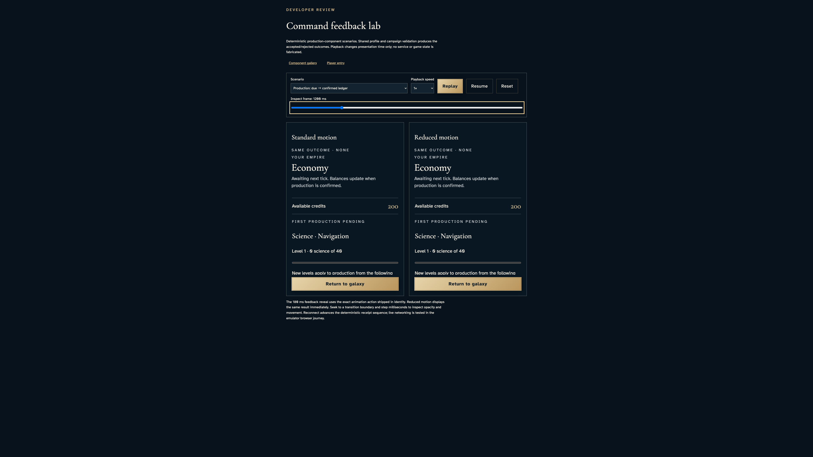
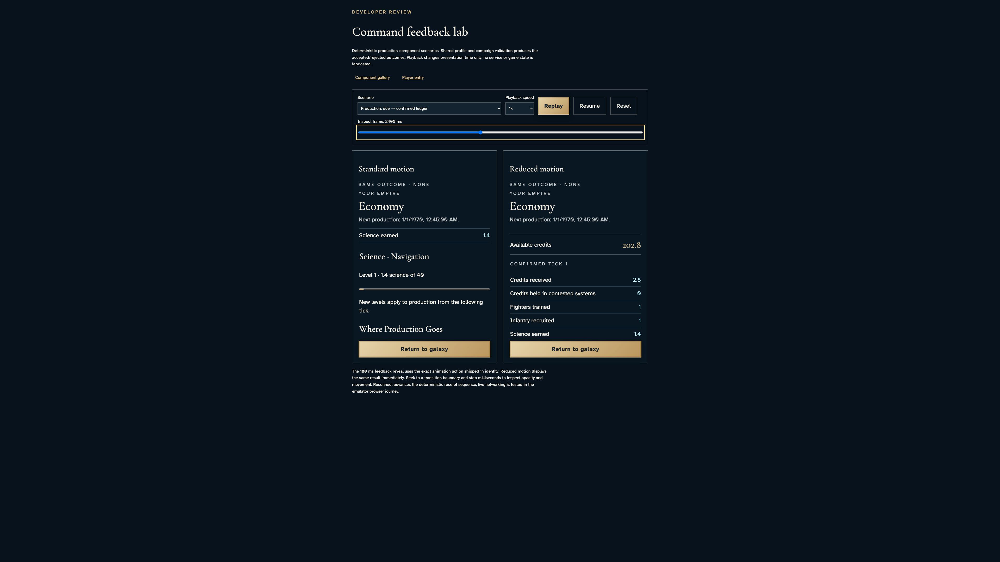
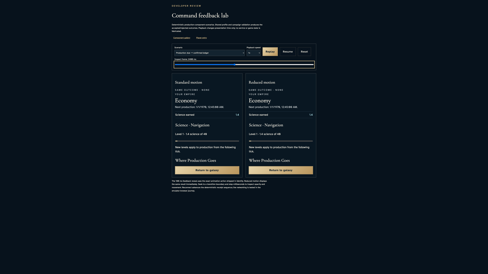
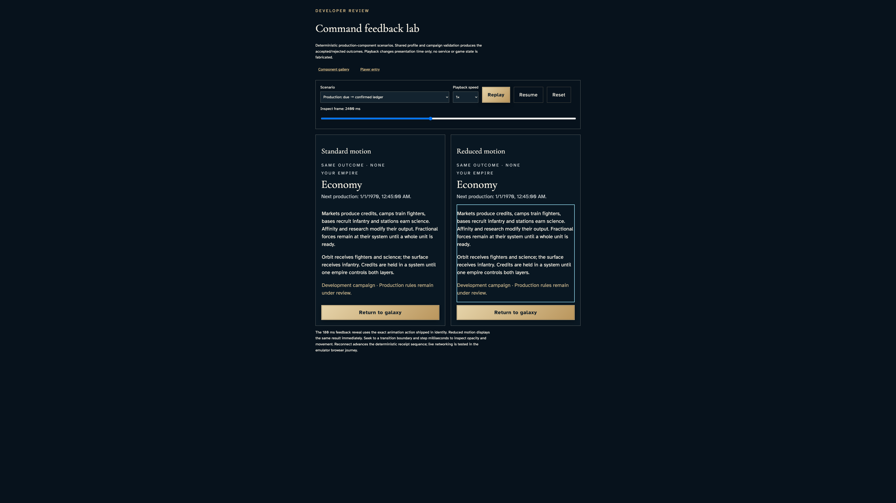
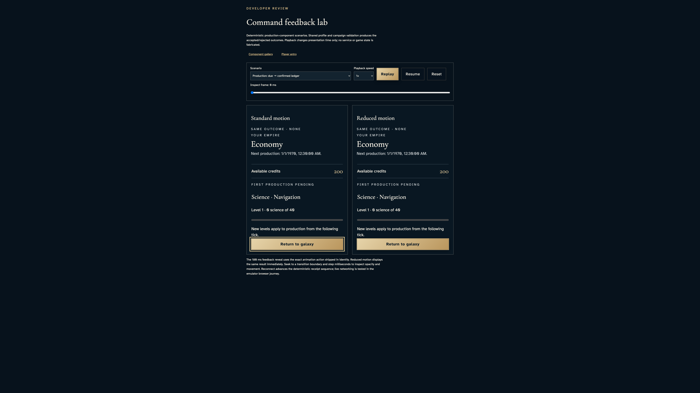

# Read scheduled and confirmed production without advancing balances early

**Exact comparison passed.** large · darwin-arm64. Inventory: UX-06, UX-14, UX-16.

A developer inspects the shipped CampaignEconomy component with the existing production-reducer lab scenario. Seeking is an explicit presentation harness, not authenticated production delivery, catch-up, authorization or conservation evidence. Standard and reduced motion retain identical facts; predecessor service and lab assertions remain intact.

## 1. Freeze only browser playback. Existing shared reducers supply the declared component scenario; no service clock, live account or persisted campaign is replaced.

Actor: **Test harness**. **Harness control; not a player action.**

Acknowledged outcome: Explicit test control; not a player action or hosted-service certification.

## 2. Open production before the first deadline and inspect the unchanged starting balance.

Actor: **Developer**.

Acknowledged outcome: Both production schedules report “Next production:” with identical text.

- [x] Both motion panes retain exactly 200 available credits.
- [x] Neither due time nor motion mode invents a confirmed tick or production ledger.

### Viewpoint: Developer · standard production summary

- [x] The labeled specimen, production schedule and available balance are contained in this upper document view.

### Viewpoint: Developer · reduced production summary

- [x] The labeled specimen, production schedule and available balance are contained in this upper document view.

## 3. Seek beyond the deadline; the schedule acknowledges waiting without prematurely awarding output.

Actor: **Developer**.

Acknowledged outcome: Both production schedules report “Awaiting next tick. Balances update when production is confirmed.” with identical text.

- [x] Both motion panes retain exactly 200 available credits.
- [x] Neither due time nor motion mode invents a confirmed tick or production ledger.

### Viewpoint: Developer · standard production summary

- [x] The labeled specimen, production schedule and available balance are contained in this upper document view.

### Viewpoint: Developer · reduced production summary

- [x] The labeled specimen, production schedule and available balance are contained in this upper document view.

## 4. Seek to the reducer-confirmed tick and inspect its new balance and original ledger facts.

Actor: **Developer**.

Acknowledged outcome: Both production schedules report “Next production:” with identical text.

- [x] Both motion panes retain exactly 202.8 available credits.
- [x] The first confirmed ledger reports 2.8 credits, no escrow, one fighter, one infantry and 1.4 science; research progress is 1400 milli-science.

### Viewpoint: Developer · standard production summary

- [x] The labeled specimen, production schedule and available balance are contained in this upper document view.

### Viewpoint: Developer · reduced production summary

- [x] The labeled specimen, production schedule and available balance are contained in this upper document view.

### Viewpoint: Developer · standard production science

- [x] The science result and progress bar are contained within the bounded ledger, alongside the return control.

### Viewpoint: Developer · reduced production science

- [x] The science result and progress bar are contained within the bounded ledger, alongside the return control.

## 5. Focus each actual ledger and press End to read science and split-control explanations while keeping Return to galaxy available.

Actor: **Developer**.

Acknowledged outcome: Both ledgers expose the production rules disclosure and preserve the confirmed science outcome.

- [x] Both motion panes retain exactly 202.8 available credits.
- [x] Reading does not change the inspected tick or transfer focus out of the last ledger.

### Viewpoint: Developer · standard production reading

- [x] The bounded ledger and return control are visible in this lower document view; keyboard reading stays inside the ledger.

### Viewpoint: Developer · reduced production reading

- [x] The bounded ledger and return control are visible in this lower document view; keyboard reading stays inside the ledger.

## 6. Activate the real Return to galaxy callback with Enter. In this documented lab it resets the scenario, preserving production UI semantics without pretending to navigate a live campaign.

Actor: **Developer**.

Acknowledged outcome: The reset callback returns playback to zero and both panes to first-production pending.

- [x] Both motion panes retain exactly 200 available credits.
- [x] Reset removes the prior ledger and restores the scheduled state in both motion panes.

### Viewpoint: Developer · standard production summary

- [x] The labeled specimen, production schedule and available balance are contained in this upper document view.

### Viewpoint: Developer · reduced production summary

- [x] The labeled specimen, production schedule and available balance are contained in this upper document view.

