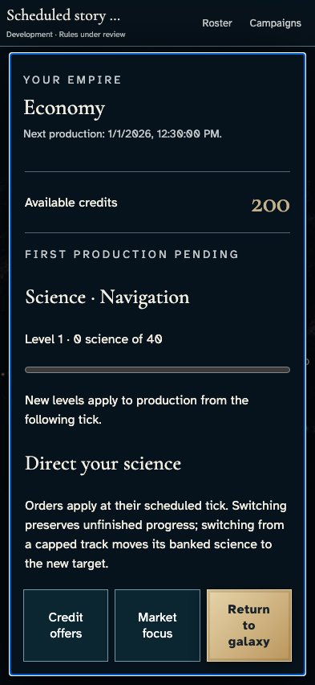
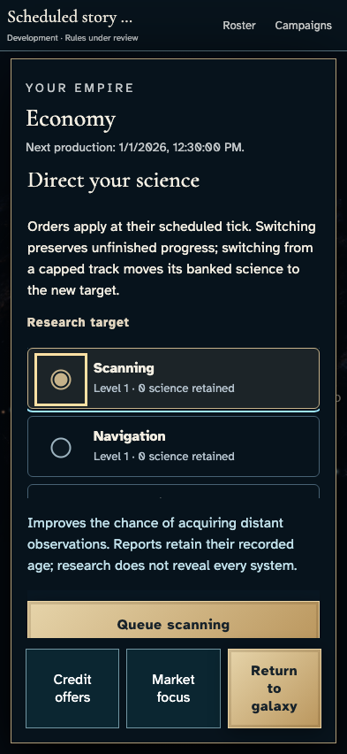
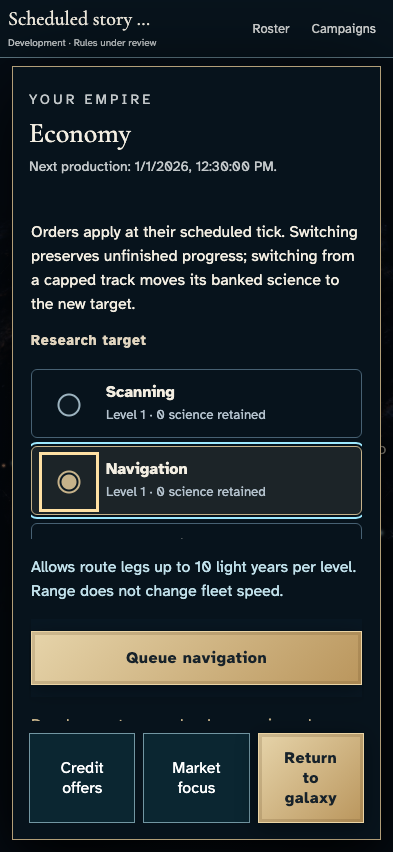
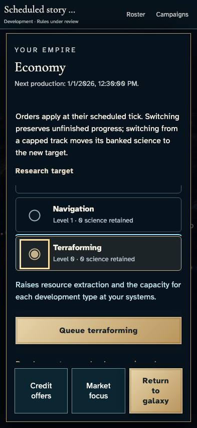
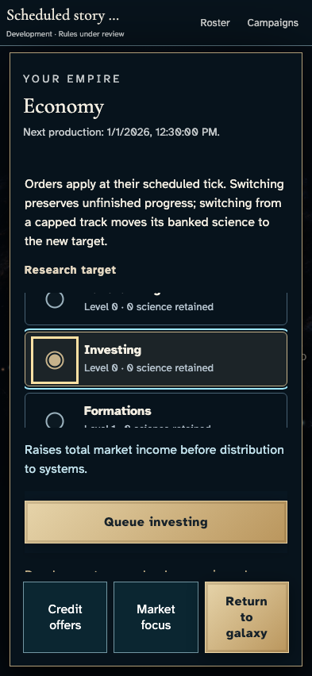
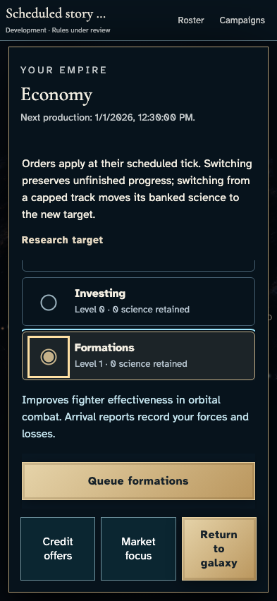
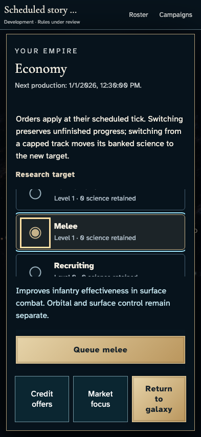
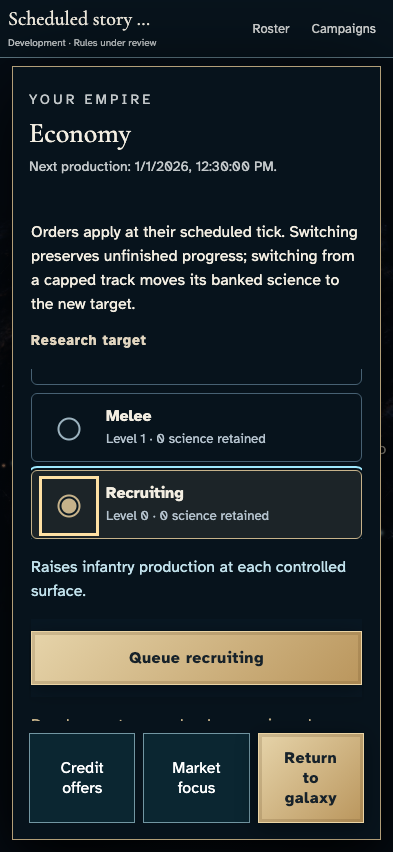
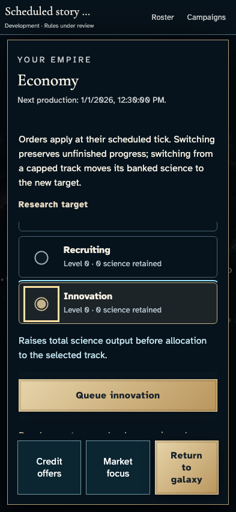
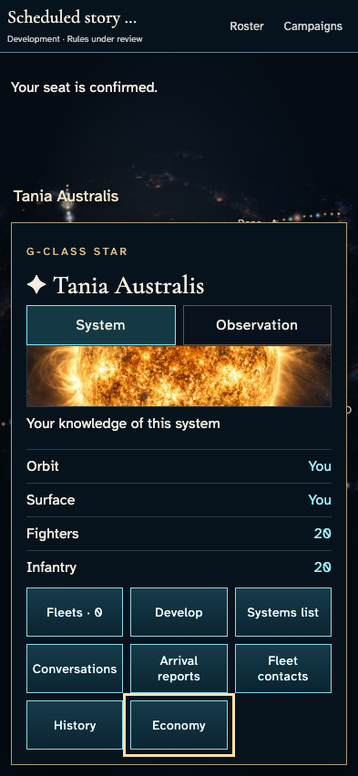

# Read research effects before committing science

**Exact comparison passed.** phone · darwin-arm64. Inventory: UX-06, UX-14, UX-16.

Four saved commanders enter an authoritative development campaign. A commander reads all eight research choices through keyboard controls while another player's private state remains unchanged. Reading and choosing do not submit an order. Capability flags come from the real private projection. Fixed admission/catalogue clocks and developer entitlement are explicitly labelled harness controls; this is not hosted scheduling or full research-effect acceptance.

## 1. Ordinary Google emulator sign-in and identity save; developer entitlement is an explicit admission fixture, not a fabricated seat.

Actor: **Test harness**. **Harness control; not a player action.**

Acknowledged outcome: Explicit test control; not a player action or hosted-service certification.

## 2. Ordinary Google emulator sign-in and identity save; developer entitlement is an explicit admission fixture, not a fabricated seat.

Actor: **Test harness**. **Harness control; not a player action.**

Acknowledged outcome: Explicit test control; not a player action or hosted-service certification.

## 3. Ordinary Google emulator sign-in and identity save; developer entitlement is an explicit admission fixture, not a fabricated seat.

Actor: **Test harness**. **Harness control; not a player action.**

Acknowledged outcome: Explicit test control; not a player action or hosted-service certification.

## 4. Ordinary Google emulator sign-in and identity save; developer entitlement is an explicit admission fixture, not a fabricated seat.

Actor: **Test harness**. **Harness control; not a player action.**

Acknowledged outcome: Explicit test control; not a player action or hosted-service certification.

## 5. Create/join with ordinary player controls. The existing fixed catalogue and admission-time fixture changes no identity, payload, resource or result.

Actor: **Test harness**. **Harness control; not a player action.**

Acknowledged outcome: Explicit test control; not a player action or hosted-service certification.

## 6. Create/join with ordinary player controls. The existing fixed catalogue and admission-time fixture changes no identity, payload, resource or result.

Actor: **Test harness**. **Harness control; not a player action.**

Acknowledged outcome: Explicit test control; not a player action or hosted-service certification.

## 7. Create/join with ordinary player controls. The existing fixed catalogue and admission-time fixture changes no identity, payload, resource or result.

Actor: **Test harness**. **Harness control; not a player action.**

Acknowledged outcome: Explicit test control; not a player action or hosted-service certification.

## 8. Create/join with ordinary player controls. The existing fixed catalogue and admission-time fixture changes no identity, payload, resource or result.

Actor: **Test harness**. **Harness control; not a player action.**

Acknowledged outcome: Explicit test control; not a player action or hosted-service certification.

## 9. Set the designated browser/domain clock to12:15 UTC and deliver the real Scheduler HTTP request. Authentication remains real. This is not hosted scheduling certification.

Actor: **Test harness**. **Harness control; not a player action.**

Acknowledged outcome: Explicit test control; not a player action or hosted-service certification.

## 10. Open each commander's economy through keyboard controls and inspect the saved research target.

Actor: **Market envoy**.

Acknowledged outcome: Both private instruments show the authoritative navigation selection before any draft change.

- [x] No research write or receipt occurs; the complete campaign, both private projections and saved identity remain unchanged.

### Viewpoint: Market envoy · campaign device

### Viewpoint: Independent investor

## 11. Use the keyboard to inspect scanning. Read the effect before choosing whether to queue; no research order is sent.

Actor: **Market envoy**.

Acknowledged outcome: The local selection acknowledges the chosen track and displays its capability-aware effect; the other commander's selection stays authoritative.

- [x] No research write or receipt occurs; the complete campaign, both private projections and saved identity remain unchanged.

### Viewpoint: Market envoy · campaign device

- [x] The complete selected explanation and queue control remain readable in the bounded research panel.

## 12. Use the keyboard to inspect navigation. Read the effect before choosing whether to queue; no research order is sent.

Actor: **Market envoy**.

Acknowledged outcome: The local selection acknowledges the chosen track and displays its capability-aware effect; the other commander's selection stays authoritative.

- [x] No research write or receipt occurs; the complete campaign, both private projections and saved identity remain unchanged.

### Viewpoint: Market envoy · campaign device

- [x] The complete selected explanation and queue control remain readable in the bounded research panel.

## 13. Use the keyboard to inspect terraforming. Read the effect before choosing whether to queue; no research order is sent.

Actor: **Market envoy**.

Acknowledged outcome: The local selection acknowledges the chosen track and displays its capability-aware effect; the other commander's selection stays authoritative.

- [x] No research write or receipt occurs; the complete campaign, both private projections and saved identity remain unchanged.

### Viewpoint: Market envoy · campaign device

- [x] The complete selected explanation and queue control remain readable in the bounded research panel.

## 14. Use the keyboard to inspect investing. Read the effect before choosing whether to queue; no research order is sent.

Actor: **Market envoy**.

Acknowledged outcome: The local selection acknowledges the chosen track and displays its capability-aware effect; the other commander's selection stays authoritative.

- [x] No research write or receipt occurs; the complete campaign, both private projections and saved identity remain unchanged.

### Viewpoint: Market envoy · campaign device

- [x] The complete selected explanation and queue control remain readable in the bounded research panel.

## 15. Use the keyboard to inspect formations. Read the effect before choosing whether to queue; no research order is sent.

Actor: **Market envoy**.

Acknowledged outcome: The local selection acknowledges the chosen track and displays its capability-aware effect; the other commander's selection stays authoritative.

- [x] No research write or receipt occurs; the complete campaign, both private projections and saved identity remain unchanged.

### Viewpoint: Market envoy · campaign device

- [x] The complete selected explanation and queue control remain readable in the bounded research panel.

## 16. Use the keyboard to inspect melee. Read the effect before choosing whether to queue; no research order is sent.

Actor: **Market envoy**.

Acknowledged outcome: The local selection acknowledges the chosen track and displays its capability-aware effect; the other commander's selection stays authoritative.

- [x] No research write or receipt occurs; the complete campaign, both private projections and saved identity remain unchanged.

### Viewpoint: Market envoy · campaign device

- [x] The complete selected explanation and queue control remain readable in the bounded research panel.

## 17. Use the keyboard to inspect recruiting. Read the effect before choosing whether to queue; no research order is sent.

Actor: **Market envoy**.

Acknowledged outcome: The local selection acknowledges the chosen track and displays its capability-aware effect; the other commander's selection stays authoritative.

- [x] No research write or receipt occurs; the complete campaign, both private projections and saved identity remain unchanged.

### Viewpoint: Market envoy · campaign device

- [x] The complete selected explanation and queue control remain readable in the bounded research panel.

## 18. Use the keyboard to inspect innovation. Read the effect before choosing whether to queue; no research order is sent.

Actor: **Market envoy**.

Acknowledged outcome: The local selection acknowledges the chosen track and displays its capability-aware effect; the other commander's selection stays authoritative.

- [x] No research write or receipt occurs; the complete campaign, both private projections and saved identity remain unchanged.

### Viewpoint: Market envoy · campaign device

- [x] The complete selected explanation and queue control remain readable in the bounded research panel.

## 19. Close the instrument with Escape after reading. Research continues on the recorded target; inspecting a choice is not an acknowledged order.

Actor: **Market envoy**.

Acknowledged outcome: Galaxy focus returns to Economy and the research instrument closes without changing the campaign.

- [x] No research write or receipt occurs; the complete campaign, both private projections and saved identity remain unchanged.

### Viewpoint: Market envoy · campaign device

### Viewpoint: Independent investor

