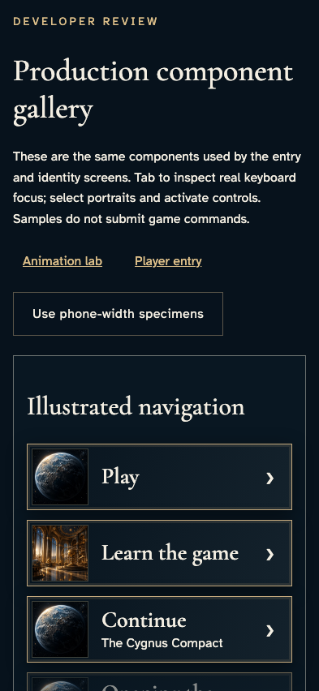
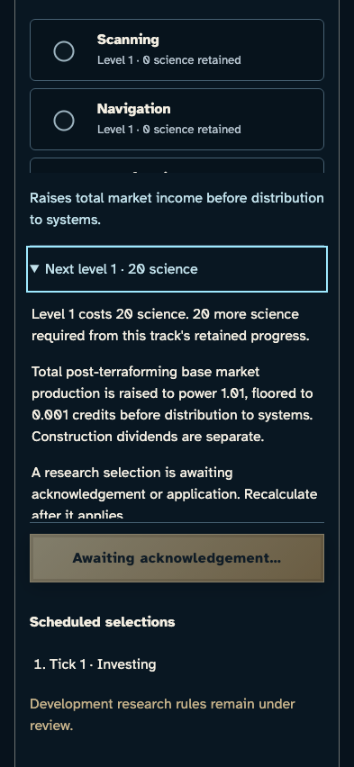
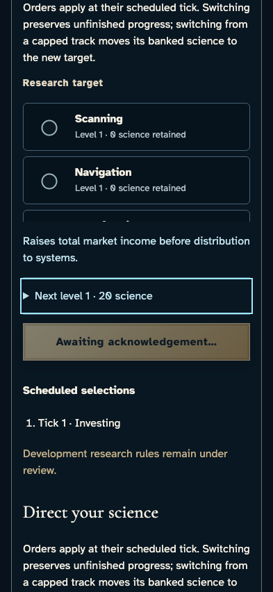
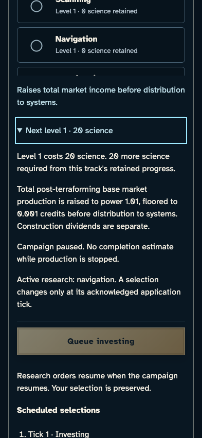
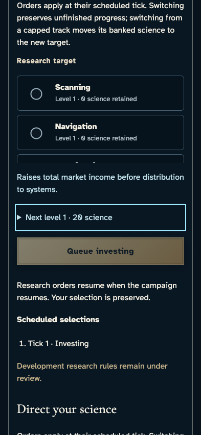
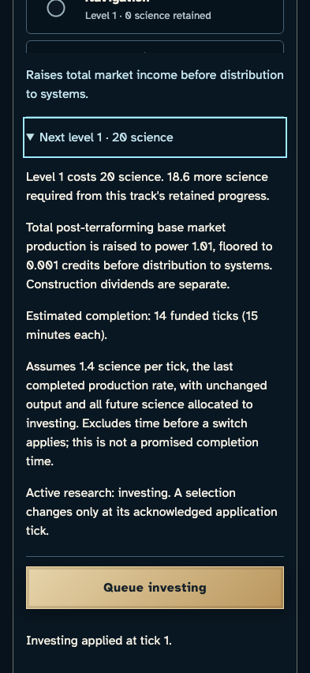
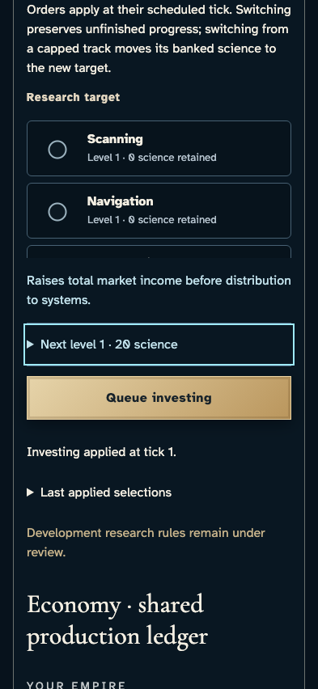

# Read research costs and qualified completion estimates

**Exact comparison passed.** phone · darwin-arm64. Inventory: UX-06, UX-14, UX-16.

A developer inspects the shipped CampaignResearch component with reducer-derived research and science ledger specimens. Keyboard disclosure changes no campaign state. Component observations are not live service acknowledgements, scheduling or authorization acceptance.

## 1. Read the developer gallery scope before inspecting research.

Actor: **Developer**.

Acknowledged outcome: The gallery explicitly says samples do not submit game commands.

- [x] All five production research specimens are available by name.

### Viewpoint: Developer · gallery scope

- [x] The full research forecast is contained after deliberate gallery scrolling, without horizontal document overflow.

## 2. Open the pending forecast with Enter and read the cost, exact effect and rate qualification.

Actor: **Developer**.

Acknowledged outcome: The native disclosure opens and retains keyboard focus; this is a local presentation outcome.

- [x] Investing costs 20 science, has the recorded 1.01 exponent, distinguishes construction dividends and explains the actual state.

### Viewpoint: Developer · pending forecast

- [x] The full research forecast is contained after deliberate gallery scrolling, without horizontal document overflow.

## 3. Close the disclosure with Space, keeping focus and the selected research choice.

Actor: **Developer**.

Acknowledged outcome: The disclosure closes without queuing research.

- [x] The investing radio remains selected.

### Viewpoint: Developer · pending collapsed

- [x] The full research forecast is contained after deliberate gallery scrolling, without horizontal document overflow.

## 4. Open the disabled forecast with Enter and read the cost, exact effect and rate qualification.

Actor: **Developer**.

Acknowledged outcome: The native disclosure opens and retains keyboard focus; this is a local presentation outcome.

- [x] Investing costs 20 science, has the recorded 1.01 exponent, distinguishes construction dividends and explains the actual state.

### Viewpoint: Developer · disabled forecast

- [x] The full research forecast is contained after deliberate gallery scrolling, without horizontal document overflow.

## 5. Close the disclosure with Space, keeping focus and the selected research choice.

Actor: **Developer**.

Acknowledged outcome: The disclosure closes without queuing research.

- [x] The investing radio remains selected.

### Viewpoint: Developer · disabled collapsed

- [x] The full research forecast is contained after deliberate gallery scrolling, without horizontal document overflow.

## 6. Open the applied forecast with Enter and read the cost, exact effect and rate qualification.

Actor: **Developer**.

Acknowledged outcome: The native disclosure opens and retains keyboard focus; this is a local presentation outcome.

- [x] Investing costs 20 science, has the recorded 1.01 exponent, distinguishes construction dividends and explains the actual state.

### Viewpoint: Developer · applied forecast

- [x] The full research forecast is contained after deliberate gallery scrolling, without horizontal document overflow.

## 7. Close the disclosure with Space, keeping focus and the selected research choice.

Actor: **Developer**.

Acknowledged outcome: The disclosure closes without queuing research.

- [x] The investing radio remains selected.

### Viewpoint: Developer · applied collapsed

- [x] The full research forecast is contained after deliberate gallery scrolling, without horizontal document overflow.

