# Inspect research selection, acknowledgement and applied history

**Exact comparison passed.** desktop · darwin-arm64. Inventory: UX-06, UX-14, UX-16.

A developer uses the shipped CampaignResearch component and shared reducer-derived lab scenario. Browser playback is a component fixture, not live order admission, production delivery or authorization evidence. Both motion modes retain the same outcome; the existing service journey remains separate.

## 1. Freeze browser playback only. The scenario calls the existing production reducers with its declared lab data; no campaign service or live account is invoked.

Actor: **Test harness**. **Harness control; not a player action.**

Acknowledged outcome: Explicit test control; not a player action or hosted-service certification.

## 2. Inspect the pending research frame and compare both motion presentations.

Actor: **Developer**.

Acknowledged outcome: Both component feedback panels report “Awaiting acknowledgement”.

- [x] Pending disables selection; recovery offers retry; accepted and applied orders remain distinct with the exact investing tick.

### Viewpoint: Developer · standard research selection

- [x] The labeled specimen and research heading are visible in this explicit upper document view.
- [x] Explicit paused motion: [aria-label="Standard motion comparison"], 1 animation(s), 180/180 ms; unchanged exact comparison.
- [x] Explicit paused motion: [aria-label="Reduced motion comparison"], 1 animation(s), 180/180 ms; unchanged exact comparison.

### Viewpoint: Developer · standard research outcome

- [x] The commitment control and complete outcome are contained in this explicit lower document view.
- [x] Explicit paused motion: [aria-label="Standard motion comparison"], 1 animation(s), 180/180 ms; unchanged exact comparison.
- [x] Explicit paused motion: [aria-label="Reduced motion comparison"], 1 animation(s), 180/180 ms; unchanged exact comparison.

[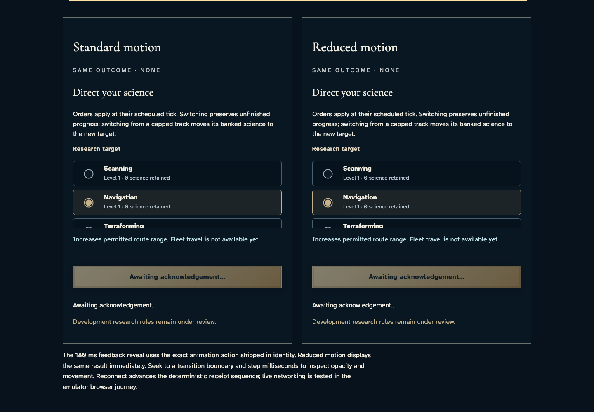](../../../../../../tests/browser/story-baselines/research-selection-lab/desktop/darwin-arm64/002-pending-2-developer-standard-research-outcome.png)

### Viewpoint: Developer · reduced research selection

- [x] The labeled specimen and research heading are visible in this explicit upper document view.
- [x] Explicit paused motion: [aria-label="Standard motion comparison"], 1 animation(s), 180/180 ms; unchanged exact comparison.
- [x] Explicit paused motion: [aria-label="Reduced motion comparison"], 1 animation(s), 180/180 ms; unchanged exact comparison.

[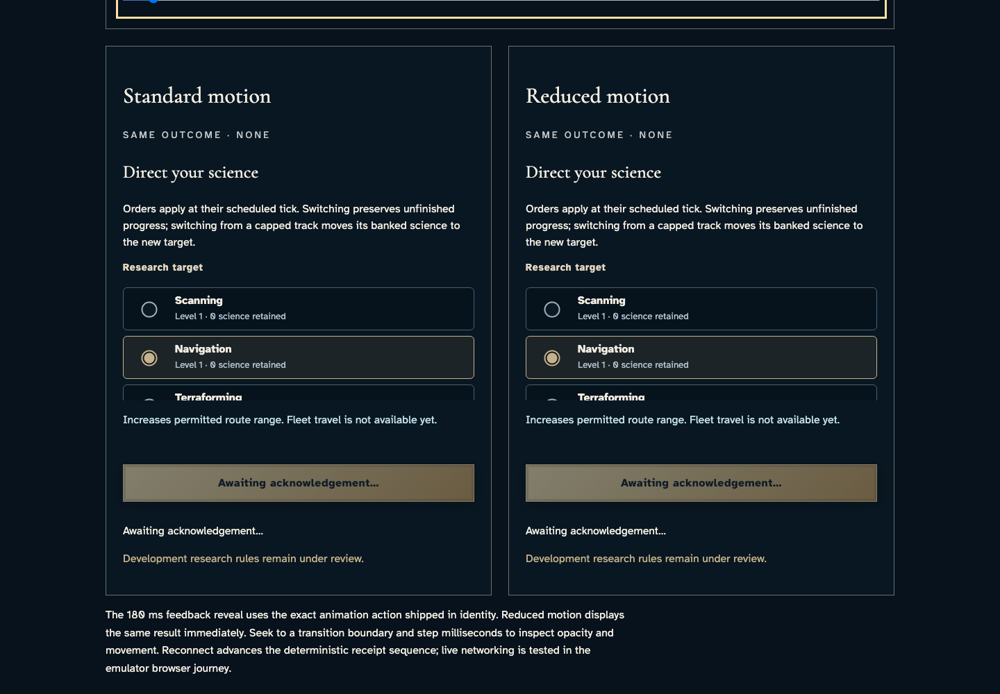](../../../../../../tests/browser/story-baselines/research-selection-lab/desktop/darwin-arm64/002-pending-3-developer-reduced-research-selection.png)

### Viewpoint: Developer · reduced research outcome

- [x] The commitment control and complete outcome are contained in this explicit lower document view.
- [x] Explicit paused motion: [aria-label="Standard motion comparison"], 1 animation(s), 180/180 ms; unchanged exact comparison.
- [x] Explicit paused motion: [aria-label="Reduced motion comparison"], 1 animation(s), 180/180 ms; unchanged exact comparison.

## 3. Inspect the interrupted research frame and compare both motion presentations.

Actor: **Developer**.

Acknowledged outcome: Both component feedback panels report “preserved”.

- [x] Pending disables selection; recovery offers retry; accepted and applied orders remain distinct with the exact investing tick.

### Viewpoint: Developer · standard research selection

- [x] The labeled specimen and research heading are visible in this explicit upper document view.
- [x] Explicit paused motion: [aria-label="Standard motion comparison"], 1 animation(s), 180/180 ms; unchanged exact comparison.
- [x] Explicit paused motion: [aria-label="Reduced motion comparison"], 1 animation(s), 180/180 ms; unchanged exact comparison.

### Viewpoint: Developer · standard research outcome

- [x] The commitment control and complete outcome are contained in this explicit lower document view.
- [x] Explicit paused motion: [aria-label="Standard motion comparison"], 1 animation(s), 180/180 ms; unchanged exact comparison.
- [x] Explicit paused motion: [aria-label="Reduced motion comparison"], 1 animation(s), 180/180 ms; unchanged exact comparison.

### Viewpoint: Developer · reduced research selection

- [x] The labeled specimen and research heading are visible in this explicit upper document view.
- [x] Explicit paused motion: [aria-label="Standard motion comparison"], 1 animation(s), 180/180 ms; unchanged exact comparison.
- [x] Explicit paused motion: [aria-label="Reduced motion comparison"], 1 animation(s), 180/180 ms; unchanged exact comparison.

[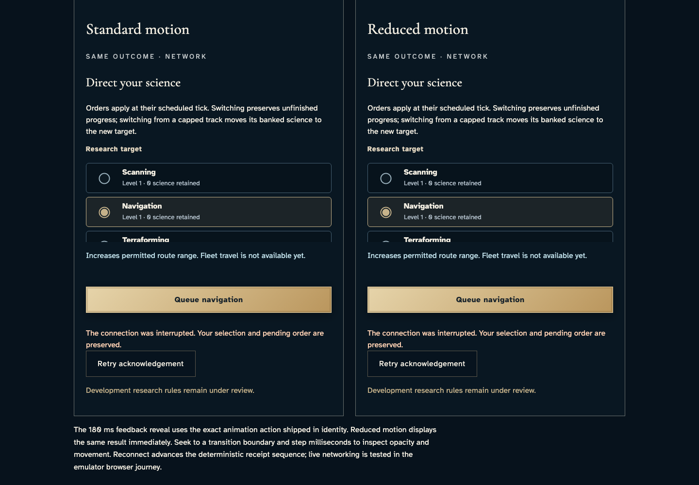](../../../../../../tests/browser/story-baselines/research-selection-lab/desktop/darwin-arm64/003-interrupted-3-developer-reduced-research-selection.png)

### Viewpoint: Developer · reduced research outcome

- [x] The commitment control and complete outcome are contained in this explicit lower document view.
- [x] Explicit paused motion: [aria-label="Standard motion comparison"], 1 animation(s), 180/180 ms; unchanged exact comparison.
- [x] Explicit paused motion: [aria-label="Reduced motion comparison"], 1 animation(s), 180/180 ms; unchanged exact comparison.

[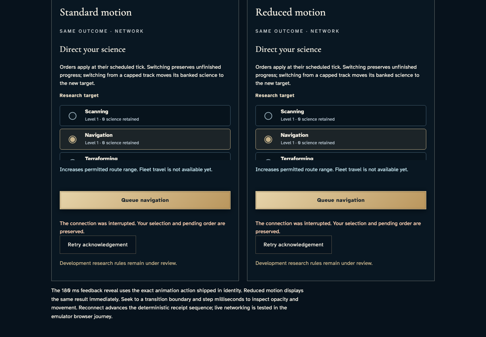](../../../../../../tests/browser/story-baselines/research-selection-lab/desktop/darwin-arm64/003-interrupted-4-developer-reduced-research-outcome.png)

## 4. Inspect the scheduled research frame and compare both motion presentations.

Actor: **Developer**.

Acknowledged outcome: Both component feedback panels report “Research order accepted”.

- [x] Pending disables selection; recovery offers retry; accepted and applied orders remain distinct with the exact investing tick.

### Viewpoint: Developer · standard research selection

- [x] The labeled specimen and research heading are visible in this explicit upper document view.
- [x] Explicit paused motion: [aria-label="Standard motion comparison"], 1 animation(s), 180/180 ms; unchanged exact comparison.
- [x] Explicit paused motion: [aria-label="Reduced motion comparison"], 1 animation(s), 180/180 ms; unchanged exact comparison.

### Viewpoint: Developer · standard research outcome

- [x] The commitment control and complete outcome are contained in this explicit lower document view.
- [x] Explicit paused motion: [aria-label="Standard motion comparison"], 1 animation(s), 180/180 ms; unchanged exact comparison.
- [x] Explicit paused motion: [aria-label="Reduced motion comparison"], 1 animation(s), 180/180 ms; unchanged exact comparison.

### Viewpoint: Developer · reduced research selection

- [x] The labeled specimen and research heading are visible in this explicit upper document view.
- [x] Explicit paused motion: [aria-label="Standard motion comparison"], 1 animation(s), 180/180 ms; unchanged exact comparison.
- [x] Explicit paused motion: [aria-label="Reduced motion comparison"], 1 animation(s), 180/180 ms; unchanged exact comparison.

[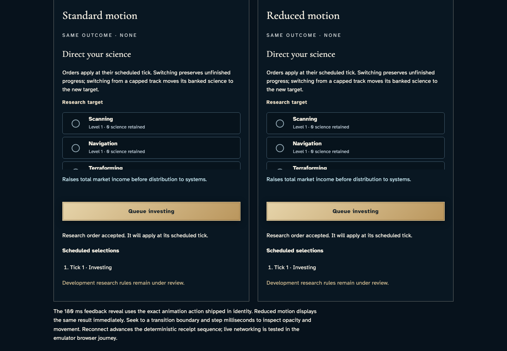](../../../../../../tests/browser/story-baselines/research-selection-lab/desktop/darwin-arm64/004-scheduled-3-developer-reduced-research-selection.png)

### Viewpoint: Developer · reduced research outcome

- [x] The commitment control and complete outcome are contained in this explicit lower document view.
- [x] Explicit paused motion: [aria-label="Standard motion comparison"], 1 animation(s), 180/180 ms; unchanged exact comparison.
- [x] Explicit paused motion: [aria-label="Reduced motion comparison"], 1 animation(s), 180/180 ms; unchanged exact comparison.

[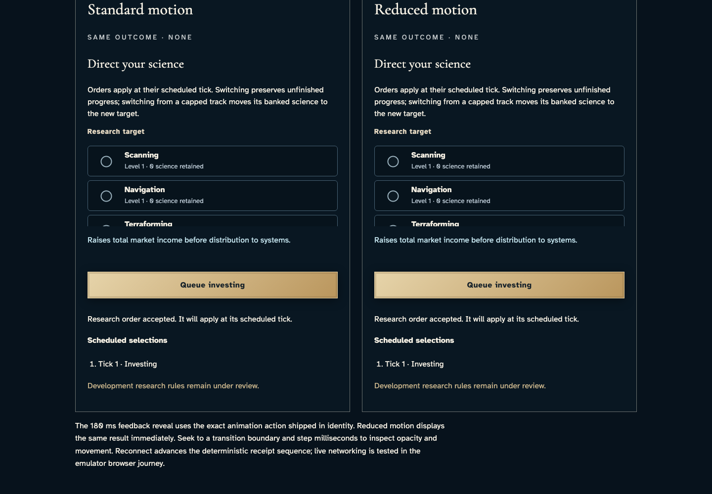](../../../../../../tests/browser/story-baselines/research-selection-lab/desktop/darwin-arm64/004-scheduled-4-developer-reduced-research-outcome.png)

## 5. Inspect the applied research frame and compare both motion presentations.

Actor: **Developer**.

Acknowledged outcome: Both component feedback panels report “Research applied at tick 1”.

- [x] Pending disables selection; recovery offers retry; accepted and applied orders remain distinct with the exact investing tick.

### Viewpoint: Developer · standard research selection

- [x] The labeled specimen and research heading are visible in this explicit upper document view.
- [x] Explicit paused motion: [aria-label="Standard motion comparison"], 1 animation(s), 180/180 ms; unchanged exact comparison.
- [x] Explicit paused motion: [aria-label="Reduced motion comparison"], 1 animation(s), 180/180 ms; unchanged exact comparison.

### Viewpoint: Developer · standard research outcome

- [x] The commitment control and complete outcome are contained in this explicit lower document view.
- [x] Explicit paused motion: [aria-label="Standard motion comparison"], 1 animation(s), 180/180 ms; unchanged exact comparison.
- [x] Explicit paused motion: [aria-label="Reduced motion comparison"], 1 animation(s), 180/180 ms; unchanged exact comparison.

[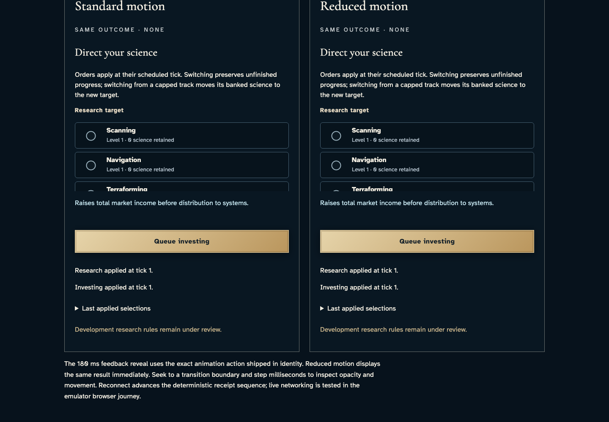](../../../../../../tests/browser/story-baselines/research-selection-lab/desktop/darwin-arm64/005-applied-2-developer-standard-research-outcome.png)

### Viewpoint: Developer · reduced research selection

- [x] The labeled specimen and research heading are visible in this explicit upper document view.
- [x] Explicit paused motion: [aria-label="Standard motion comparison"], 1 animation(s), 180/180 ms; unchanged exact comparison.
- [x] Explicit paused motion: [aria-label="Reduced motion comparison"], 1 animation(s), 180/180 ms; unchanged exact comparison.

[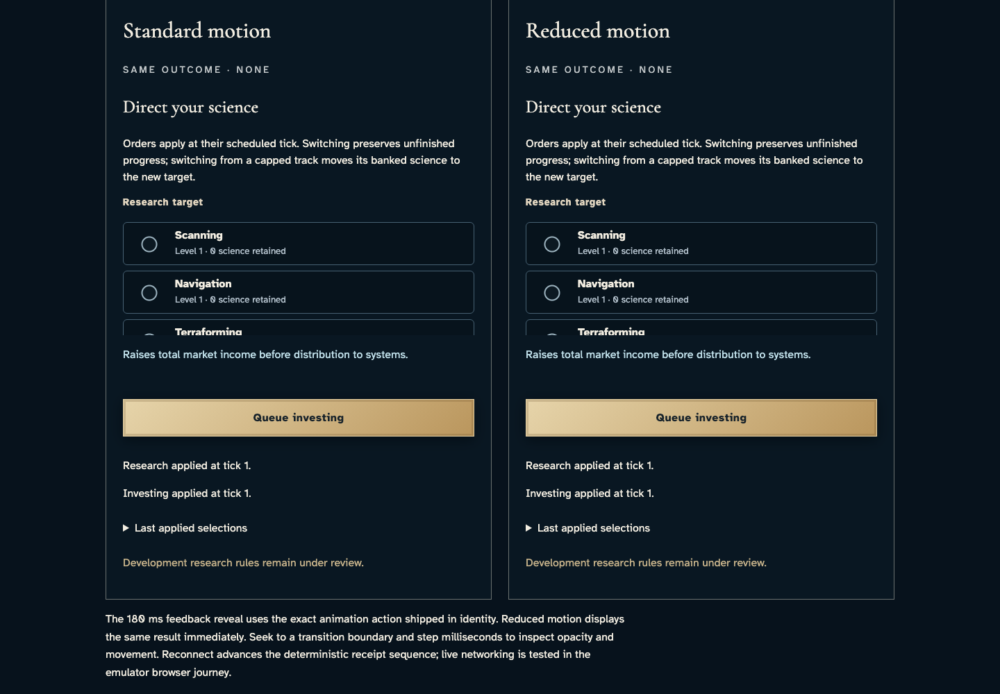](../../../../../../tests/browser/story-baselines/research-selection-lab/desktop/darwin-arm64/005-applied-3-developer-reduced-research-selection.png)

### Viewpoint: Developer · reduced research outcome

- [x] The commitment control and complete outcome are contained in this explicit lower document view.
- [x] Explicit paused motion: [aria-label="Standard motion comparison"], 1 animation(s), 180/180 ms; unchanged exact comparison.
- [x] Explicit paused motion: [aria-label="Reduced motion comparison"], 1 animation(s), 180/180 ms; unchanged exact comparison.

## 6. Open the actual applied-selection disclosure by keyboard in both panes.

Actor: **Developer**.

Acknowledged outcome: Both opened histories identify the applied investing order at tick one.

- [x] The applied history does not reintroduce an outstanding order.

### Viewpoint: Developer · standard research selection

- [x] The labeled specimen and research heading are visible in this explicit upper document view.
- [x] Explicit paused motion: [aria-label="Standard motion comparison"], 1 animation(s), 180/180 ms; unchanged exact comparison.
- [x] Explicit paused motion: [aria-label="Reduced motion comparison"], 1 animation(s), 180/180 ms; unchanged exact comparison.

### Viewpoint: Developer · standard research outcome

- [x] The commitment control and complete outcome are contained in this explicit lower document view.
- [x] Explicit paused motion: [aria-label="Standard motion comparison"], 1 animation(s), 180/180 ms; unchanged exact comparison.
- [x] Explicit paused motion: [aria-label="Reduced motion comparison"], 1 animation(s), 180/180 ms; unchanged exact comparison.

### Viewpoint: Developer · reduced research selection

- [x] The labeled specimen and research heading are visible in this explicit upper document view.
- [x] Explicit paused motion: [aria-label="Standard motion comparison"], 1 animation(s), 180/180 ms; unchanged exact comparison.
- [x] Explicit paused motion: [aria-label="Reduced motion comparison"], 1 animation(s), 180/180 ms; unchanged exact comparison.

[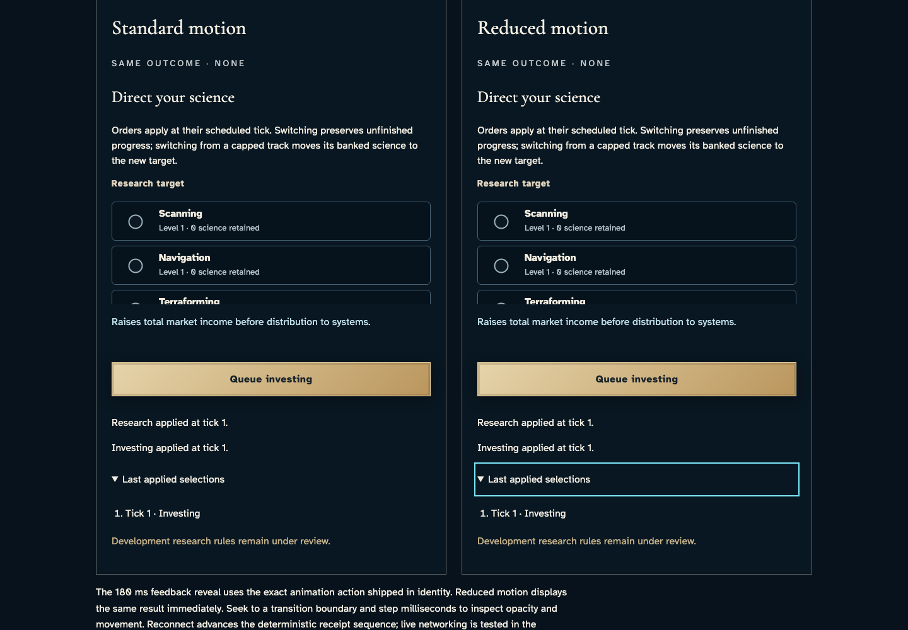](../../../../../../tests/browser/story-baselines/research-selection-lab/desktop/darwin-arm64/006-applied-history-3-developer-reduced-research-selection.png)

### Viewpoint: Developer · reduced research outcome

- [x] The commitment control and complete outcome are contained in this explicit lower document view.
- [x] Explicit paused motion: [aria-label="Standard motion comparison"], 1 animation(s), 180/180 ms; unchanged exact comparison.
- [x] Explicit paused motion: [aria-label="Reduced motion comparison"], 1 animation(s), 180/180 ms; unchanged exact comparison.

[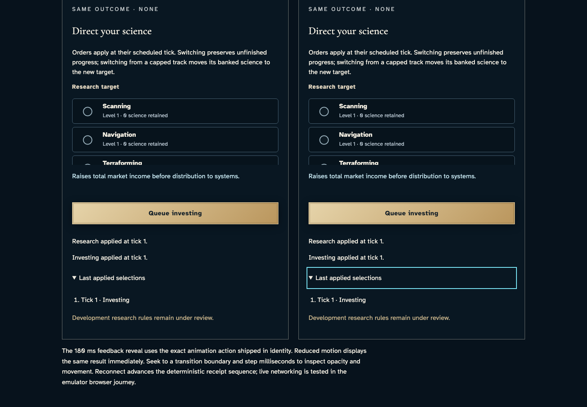](../../../../../../tests/browser/story-baselines/research-selection-lab/desktop/darwin-arm64/006-applied-history-4-developer-reduced-research-outcome.png)

## 7. Choose investing and activate Queue by keyboard. The lab resets to pending while the actual component retains its choice and moves focus to acknowledgement.

Actor: **Developer**.

Acknowledged outcome: The component retains investing, disables repeat submission and focuses the acknowledgement group.

- [x] Reset removes applied history and the retained choice remains a local component selection, not a new acknowledged order.

### Viewpoint: Developer · standard research selection

- [x] The labeled specimen and research heading are visible in this explicit upper document view.
- [x] Explicit paused motion: [aria-label="Standard motion comparison"], 1 animation(s), 0/180 ms; unchanged exact comparison.
- [x] Explicit paused motion: [aria-label="Reduced motion comparison"], 1 animation(s), 180/180 ms; unchanged exact comparison.

### Viewpoint: Developer · standard research outcome

- [x] The commitment control and complete outcome are contained in this explicit lower document view.
- [x] Explicit paused motion: [aria-label="Standard motion comparison"], 1 animation(s), 0/180 ms; unchanged exact comparison.
- [x] Explicit paused motion: [aria-label="Reduced motion comparison"], 1 animation(s), 180/180 ms; unchanged exact comparison.

[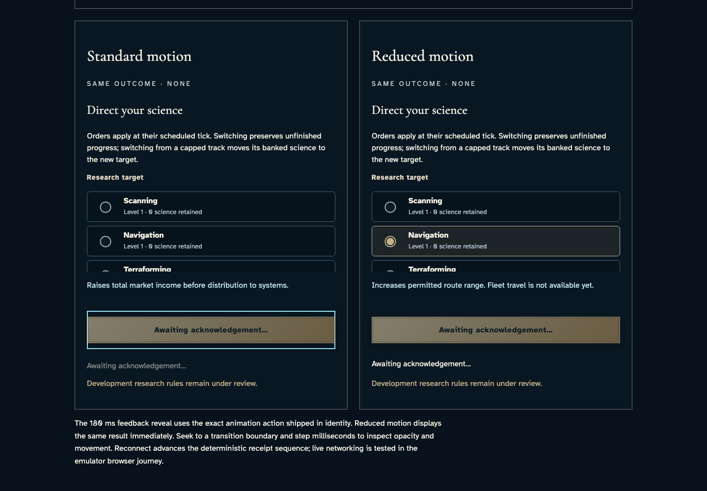](../../../../../../tests/browser/story-baselines/research-selection-lab/desktop/darwin-arm64/007-queue-preserved-choice-2-developer-standard-research-outcome.png)

### Viewpoint: Developer · reduced research selection

- [x] The labeled specimen and research heading are visible in this explicit upper document view.
- [x] Explicit paused motion: [aria-label="Standard motion comparison"], 1 animation(s), 0/180 ms; unchanged exact comparison.
- [x] Explicit paused motion: [aria-label="Reduced motion comparison"], 1 animation(s), 180/180 ms; unchanged exact comparison.

[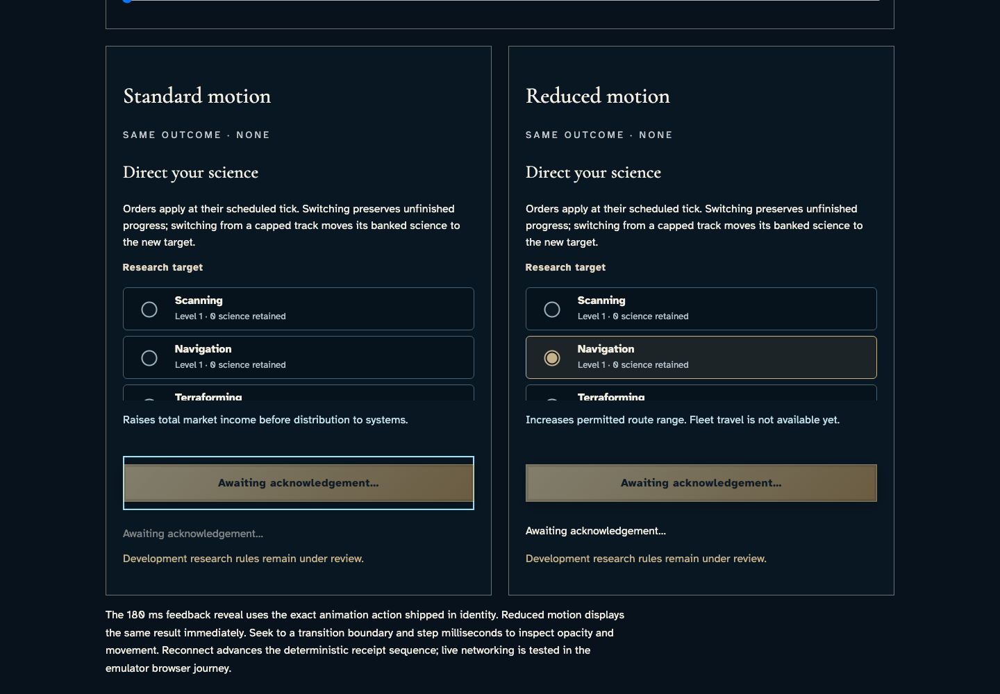](../../../../../../tests/browser/story-baselines/research-selection-lab/desktop/darwin-arm64/007-queue-preserved-choice-3-developer-reduced-research-selection.png)

### Viewpoint: Developer · reduced research outcome

- [x] The commitment control and complete outcome are contained in this explicit lower document view.
- [x] Explicit paused motion: [aria-label="Standard motion comparison"], 1 animation(s), 0/180 ms; unchanged exact comparison.
- [x] Explicit paused motion: [aria-label="Reduced motion comparison"], 1 animation(s), 180/180 ms; unchanged exact comparison.

