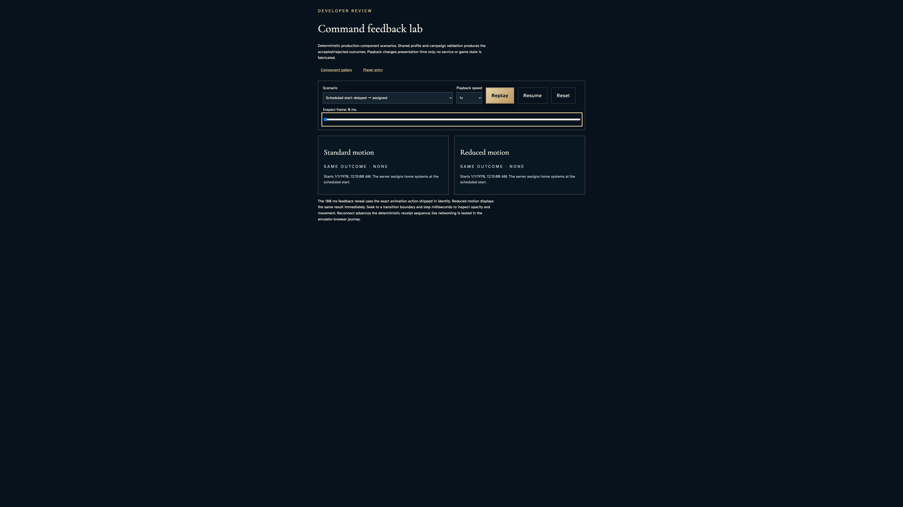
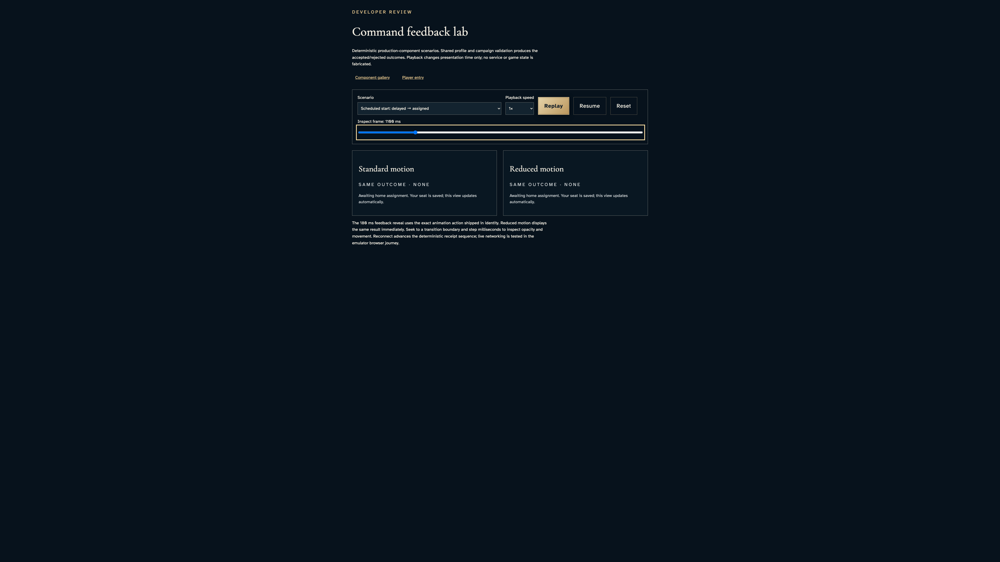
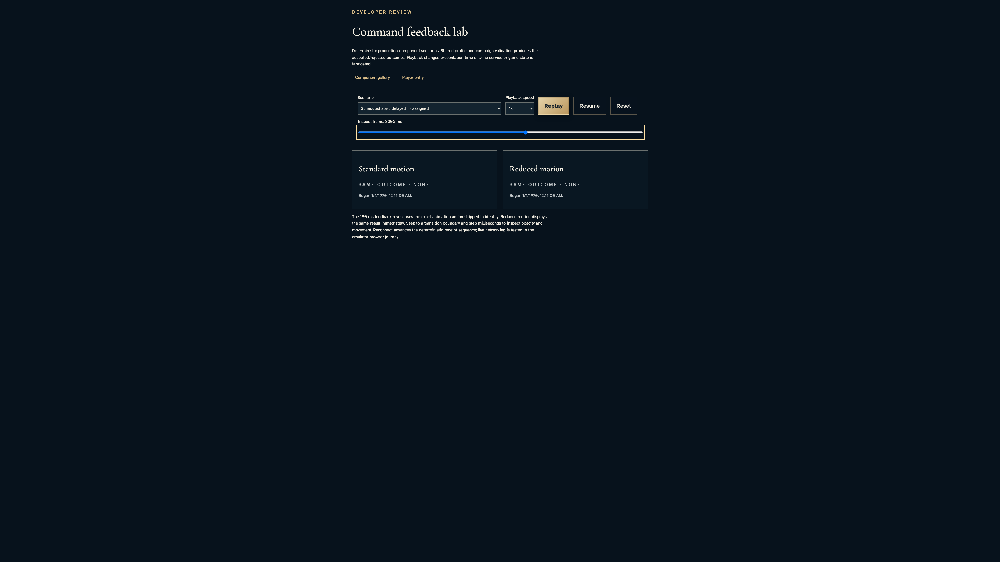
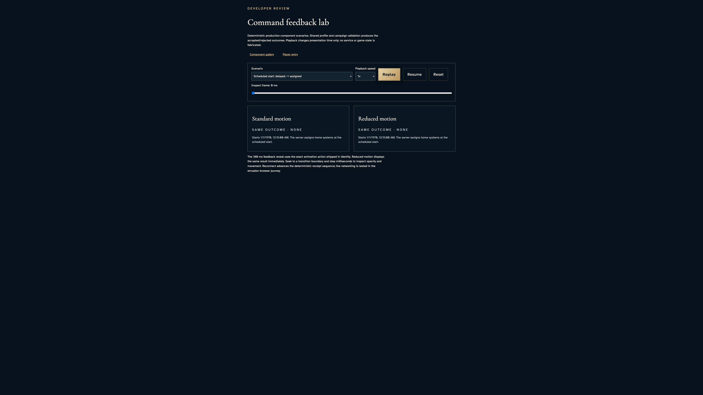

# Inspect scheduled start and delayed assignment without changing outcomes

**Exact comparison passed.** large · darwin-arm64. Inventory: UX-02, UX-14, UX-16.

A developer inspects the actual CampaignStartStatus component with explicit deterministic laboratory frames. Scheduled, delayed and begun copy match across the comparison panes. This fixture is not scheduler delivery, roster assignment, hosted timing or service acceptance; the independent multiplayer story supplies separately scoped service evidence.

## 1. Freeze only browser presentation time. The lab's declared scheduled-frame input selects the status; no live campaign or scheduler is invoked.

Actor: **Test harness**. **Harness control; not a player action.**

Acknowledged outcome: Explicit test control; not a player action or hosted-service certification.

## 2. Read the scheduled start and server-assignment explanation.

Actor: **Developer**.

Acknowledged outcome: Both production presentations report “Starts” with identical text.

- [x] The scenario and inspected time remain explicit; no interactive campaign orders are offered by these status specimens.

### Viewpoint: Developer · standard lifecycle presentation

- [x] The whole labeled specimen and outcome fit inside the reference viewport.

### Viewpoint: Developer · reduced lifecycle presentation

- [x] The whole labeled specimen and outcome fit inside the reference viewport.

## 3. Seek past the scheduled boundary and read the preserved-seat delay message.

Actor: **Developer**.

Acknowledged outcome: Both production presentations report “Awaiting home assignment” with identical text.

- [x] The scenario and inspected time remain explicit; no interactive campaign orders are offered by these status specimens.

### Viewpoint: Developer · standard lifecycle presentation

- [x] The whole labeled specimen and outcome fit inside the reference viewport.

### Viewpoint: Developer · reduced lifecycle presentation

- [x] The whole labeled specimen and outcome fit inside the reference viewport.

## 4. Seek to the assigned frame and distinguish begun status from pending assignment.

Actor: **Developer**.

Acknowledged outcome: Both production presentations report “Began” with identical text.

- [x] The scenario and inspected time remain explicit; no interactive campaign orders are offered by these status specimens.

### Viewpoint: Developer · standard lifecycle presentation

- [x] The whole labeled specimen and outcome fit inside the reference viewport.

### Viewpoint: Developer · reduced lifecycle presentation

- [x] The whole labeled specimen and outcome fit inside the reference viewport.

## 5. Reset the lab to the same scheduled presentation without inventing another campaign.

Actor: **Developer**.

Acknowledged outcome: Both production presentations report “Starts” with identical text.

- [x] The scenario and inspected time remain explicit; no interactive campaign orders are offered by these status specimens.

### Viewpoint: Developer · standard lifecycle presentation

- [x] The whole labeled specimen and outcome fit inside the reference viewport.

### Viewpoint: Developer · reduced lifecycle presentation

- [x] The whole labeled specimen and outcome fit inside the reference viewport.

