# Consent to one earlier diplomatic message

**Exact comparison passed.** large · darwin-arm64. Inventory: UX-10, UX-14, UX-16.

Independent commanders use authenticated development-provider commands. The creator shares one of two earlier messages; the recipient reviews and accepts its scope, then reloads. An uninvolved commander never receives the room or either message. Admission uses the labelled emulator clock and actual scheduler endpoint, not injected state. Managed-key and fault journeys remain separate coverage.

## 1. Ordinary emulator sign-in and identity save, with explicit developer entitlement and fixed browser Date; timers continue normally.

Actor: **Test harness**. **Harness control; not a player action.**

Acknowledged outcome: Explicit test control; not a player action or hosted-service certification.

## 2. Ordinary emulator sign-in and identity save, with explicit developer entitlement and fixed browser Date; timers continue normally.

Actor: **Test harness**. **Harness control; not a player action.**

Acknowledged outcome: Explicit test control; not a player action or hosted-service certification.

## 3. Ordinary emulator sign-in and identity save, with explicit developer entitlement and fixed browser Date; timers continue normally.

Actor: **Test harness**. **Harness control; not a player action.**

Acknowledged outcome: Explicit test control; not a player action or hosted-service certification.

## 4. Ordinary emulator sign-in and identity save, with explicit developer entitlement and fixed browser Date; timers continue normally.

Actor: **Test harness**. **Harness control; not a player action.**

Acknowledged outcome: Explicit test control; not a player action or hosted-service certification.

## 5. Create/join through ordinary campaign controls. Fixed catalogue and admission clock are test controls; no seat, message or command outcome is injected.

Actor: **Test harness**. **Harness control; not a player action.**

Acknowledged outcome: Explicit test control; not a player action or hosted-service certification.

## 6. Create/join through ordinary campaign controls. Fixed catalogue and admission clock are test controls; no seat, message or command outcome is injected.

Actor: **Test harness**. **Harness control; not a player action.**

Acknowledged outcome: Explicit test control; not a player action or hosted-service certification.

## 7. Create/join through ordinary campaign controls. Fixed catalogue and admission clock are test controls; no seat, message or command outcome is injected.

Actor: **Test harness**. **Harness control; not a player action.**

Acknowledged outcome: Explicit test control; not a player action or hosted-service certification.

## 8. Create/join through ordinary campaign controls. Fixed catalogue and admission clock are test controls; no seat, message or command outcome is injected.

Actor: **Test harness**. **Harness control; not a player action.**

Acknowledged outcome: Explicit test control; not a player action or hosted-service certification.

## 9. Advance the designated browser/domain clock to 12:15 UTC and deliver the actual emulator Scheduler HTTP request. This does not certify hosted scheduling.

Actor: **Test harness**. **Harness control; not a player action.**

Acknowledged outcome: Explicit test control; not a player action or hosted-service certification.

## 10. Create a private room while the recipient and outsider inspect their own empty directories.

Actor: **Nacre envoy**.

Acknowledged outcome: The authoritative room appears only for its creator.

- [x] No viewpoint has an uncaught application error.
- [x] The outsider's UI and serialized authorized view contain neither private room nor either message.
- [x] The future recipient cannot see the room before invitation.

### Viewpoint: Nacre envoy

[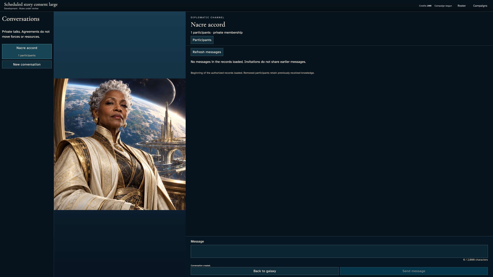](../../../../../../tests/browser/story-baselines/selected-history-consent/large/darwin-arm64/010-private-room-1-nacre-envoy.png)

### Viewpoint: Dawn listener

[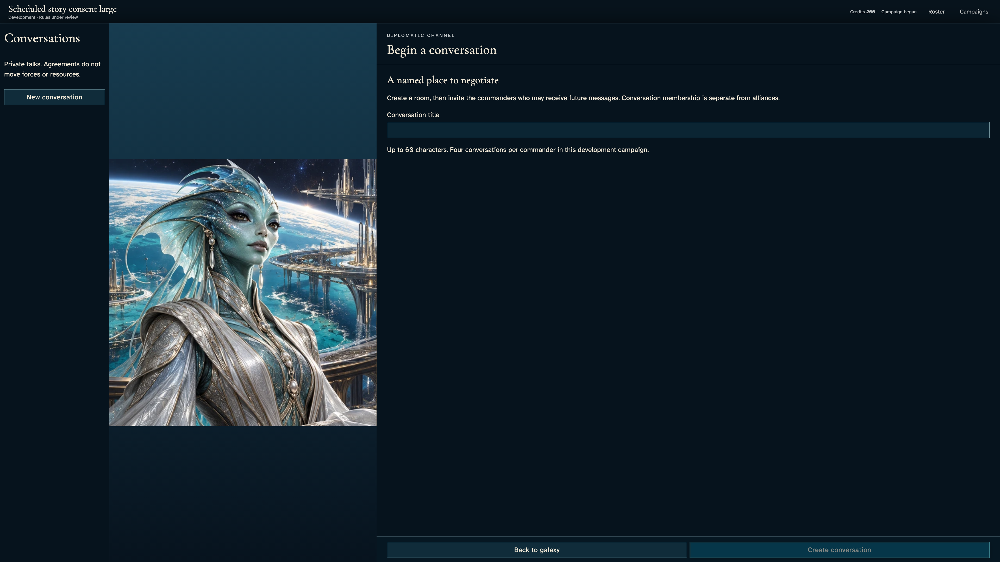](../../../../../../tests/browser/story-baselines/selected-history-consent/large/darwin-arm64/010-private-room-2-dawn-listener.png)

### Viewpoint: Outer witness

## 11. Send a reserve-route message that stays private.

Actor: **Nacre envoy**.

Acknowledged outcome: The command is acknowledged as Message sent and appears in the creator's authorized messages.

- [x] No viewpoint has an uncaught application error.
- [x] The outsider's UI and serialized authorized view contain neither private room nor either message.
- [x] The acknowledged composer clears its submitted text.

### Viewpoint: Nacre envoy

## 12. Send the rendezvous message that will be selected.

Actor: **Nacre envoy**.

Acknowledged outcome: The command is acknowledged as Message sent and appears in the creator's authorized messages.

- [x] No viewpoint has an uncaught application error.
- [x] The outsider's UI and serialized authorized view contain neither private room nor either message.
- [x] The acknowledged composer clears its submitted text.

### Viewpoint: Nacre envoy

[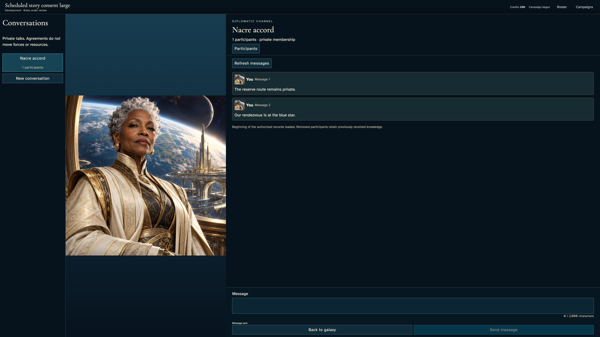](../../../../../../tests/browser/story-baselines/selected-history-consent/large/darwin-arm64/012-earlier-message-2-1-nacre-envoy.png)

## 13. Select Dawn listener and exactly one earlier message; keep the reserve route unselected.

Actor: **Nacre envoy**.

Acknowledged outcome: The invitation control identifies one selected earlier message.

- [x] No viewpoint has an uncaught application error.
- [x] The reserve message remains unchecked and stale send feedback is absent.

### Viewpoint: Nacre envoy

[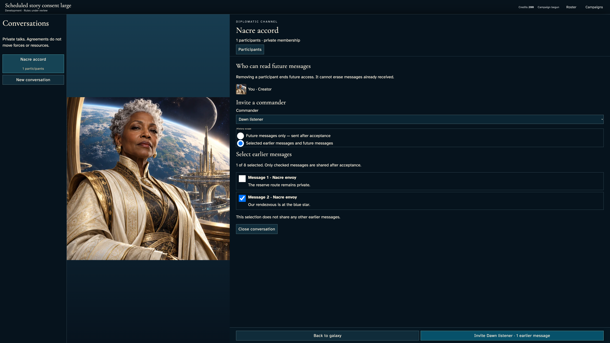](../../../../../../tests/browser/story-baselines/selected-history-consent/large/darwin-arm64/013-choose-history-1-nacre-envoy.png)

## 14. Send the selected-history invitation; the recipient sees scope and provenance but no message body before consent.

Actor: **Nacre envoy**.

Acknowledged outcome: The independently authenticated recipient receives the one-message invitation.

- [x] No viewpoint has an uncaught application error.
- [x] The outsider's UI and serialized authorized view contain neither private room nor either message.
- [x] Neither message body is present in the recipient's UI or serialized authorized projection before consent.

### Viewpoint: Nacre envoy

[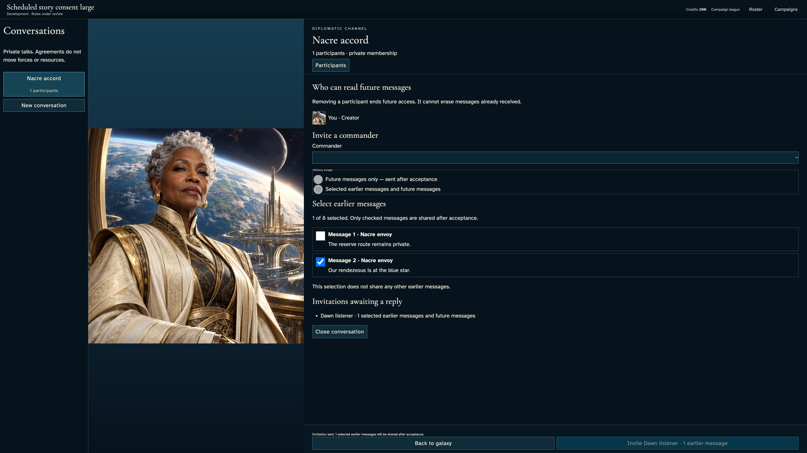](../../../../../../tests/browser/story-baselines/selected-history-consent/large/darwin-arm64/014-invite-1-nacre-envoy.png)

### Viewpoint: Dawn listener

[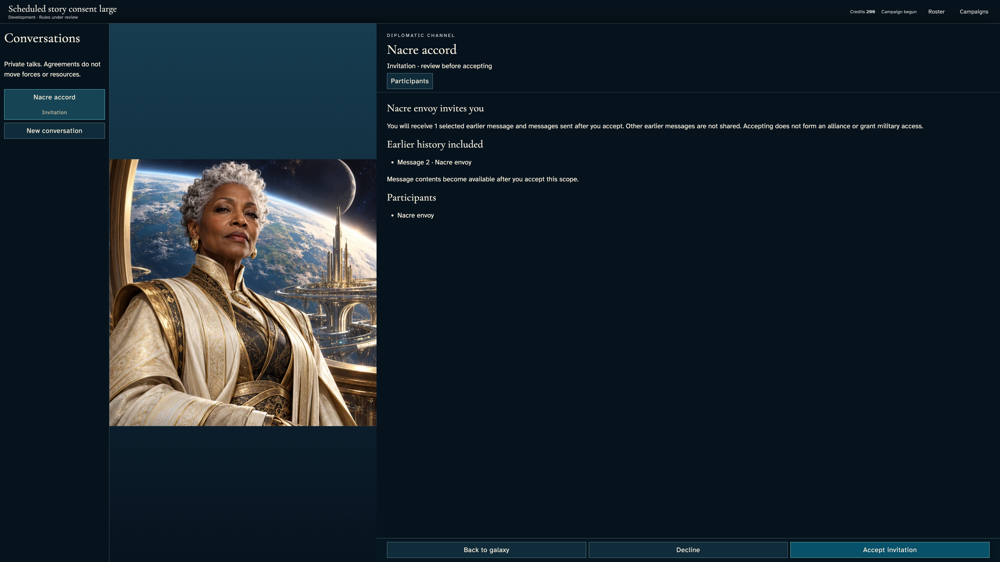](../../../../../../tests/browser/story-baselines/selected-history-consent/large/darwin-arm64/014-invite-2-dawn-listener.png)

### Viewpoint: Outer witness

## 15. Accept the invitation using the keyboard. Only the selected earlier message becomes readable, with its sharing provenance.

Actor: **Dawn listener**.

Acknowledged outcome: The accepted membership publishes the selected message to the recipient.

- [x] No viewpoint has an uncaught application error.
- [x] The outsider's UI and serialized authorized view contain neither private room nor either message.
- [x] Keyboard Home and bounded reading reveal the complete shared message, author and provenance while the commitment rail stays visible.
- [x] Acceptance makes exactly one authoritative revision, excludes the reserve message, and names the sharing commander.

### Viewpoint: Nacre envoy

[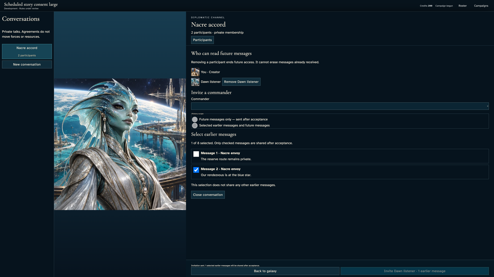](../../../../../../tests/browser/story-baselines/selected-history-consent/large/darwin-arm64/015-consent-1-nacre-envoy.png)

### Viewpoint: Dawn listener

### Viewpoint: Outer witness

## 16. Reload and reopen the accepted room without resending acceptance or expanding its history grant.

Actor: **Dawn listener**.

Acknowledged outcome: The recovered authorized messages still contain the selected rendezvous note.

- [x] No viewpoint has an uncaught application error.
- [x] The outsider's UI and serialized authorized view contain neither private room nor either message.
- [x] Keyboard Home and bounded reading reveal the complete shared message, author and provenance while the commitment rail stays visible.
- [x] Recovery causes no extra revision and never exposes the unselected message.

### Viewpoint: Dawn listener

[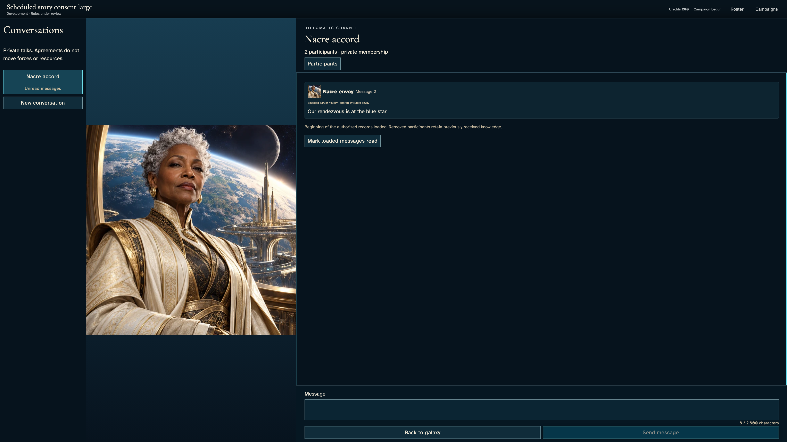](../../../../../../tests/browser/story-baselines/selected-history-consent/large/darwin-arm64/016-recover-consent-1-dawn-listener.png)

### Viewpoint: Outer witness

[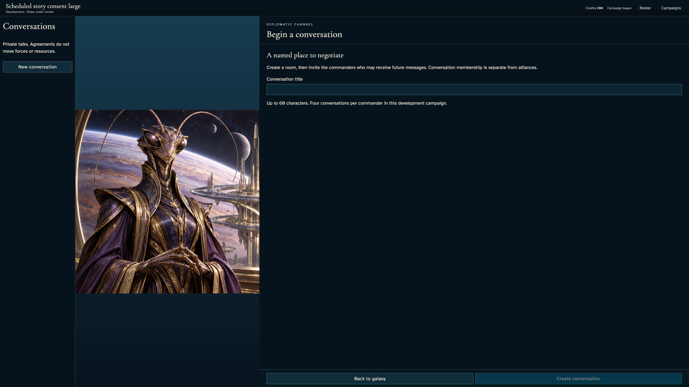](../../../../../../tests/browser/story-baselines/selected-history-consent/large/darwin-arm64/016-recover-consent-2-outer-witness.png)

## 17. Escape closes the conversation and restores keyboard focus to its opening control.

Actor: **Dawn listener**.

Acknowledged outcome: The chart returns focus to Conversations.

- [x] No viewpoint has an uncaught application error.
- [x] Private conversation details are no longer visible.

### Viewpoint: Dawn listener

[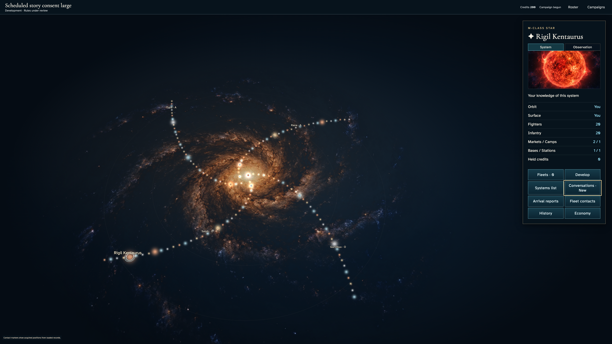](../../../../../../tests/browser/story-baselines/selected-history-consent/large/darwin-arm64/017-return-to-chart-1-dawn-listener.png)

## 18. The creator reviews removal of the consenting listener before committing it.

Actor: **Nacre envoy**.

Acknowledged outcome: The removal confirmation is available without changing membership.

- [x] No viewpoint has an uncaught application error.
- [x] The outsider's UI and serialized authorized view contain neither private room nor either message.

### Viewpoint: Nacre envoy

[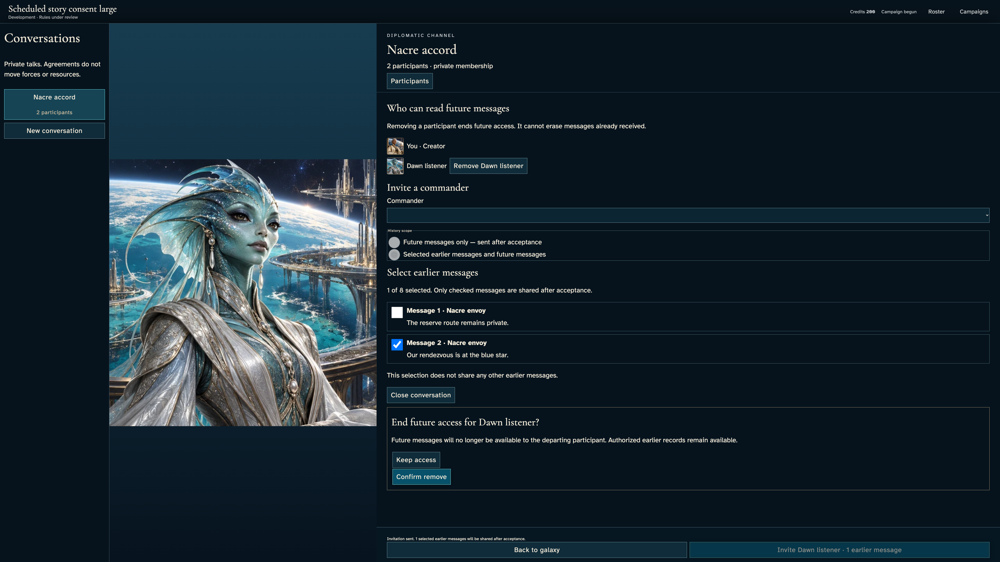](../../../../../../tests/browser/story-baselines/selected-history-consent/large/darwin-arm64/018-review-removal-1-nacre-envoy.png)

## 19. Confirm removal with the keyboard. The listener retains already shared history while current conversation access ends.

Actor: **Nacre envoy**.

Acknowledged outcome: The listener sees authoritative access-ended feedback and cannot compose a new message.

- [x] No viewpoint has an uncaught application error.
- [x] The outsider's UI and serialized authorized view contain neither private room nor either message.
- [x] Exactly one revision removes the listener without expanding previous history.

### Viewpoint: Nacre envoy

### Viewpoint: Dawn listener

### Viewpoint: Outer witness

## 20. The creator sends a new private message after removal; neither the former member nor outsider receives it.

Actor: **Nacre envoy**.

Acknowledged outcome: Message sent acknowledges the command and the creator can read its text.

- [x] No viewpoint has an uncaught application error.
- [x] The outsider's UI and serialized authorized view contain neither private room nor either message.
- [x] Removed and outsider recipients receive no post-removal message in UI or serialized views.
- [x] The post-removal message commits exactly once.

### Viewpoint: Nacre envoy

[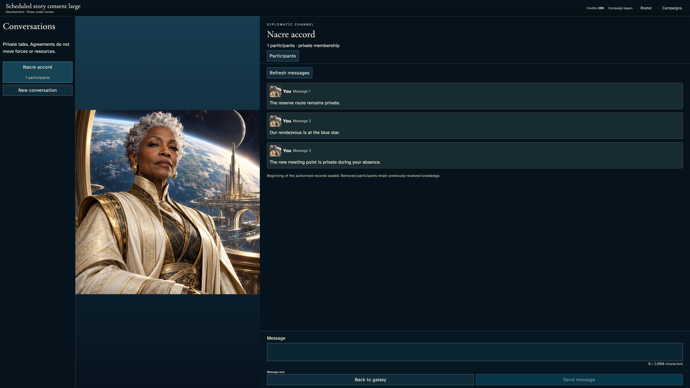](../../../../../../tests/browser/story-baselines/selected-history-consent/large/darwin-arm64/020-message-after-removal-1-nacre-envoy.png)

### Viewpoint: Dawn listener

[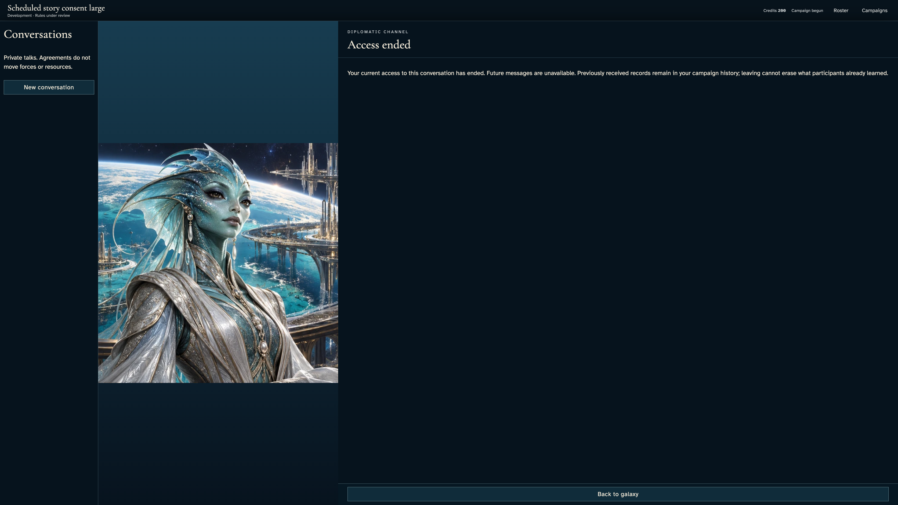](../../../../../../tests/browser/story-baselines/selected-history-consent/large/darwin-arm64/020-message-after-removal-2-dawn-listener.png)

### Viewpoint: Outer witness

## 21. Reload, then open Campaign history to recover the selected message received before removal. The live room is no longer accessible.

Actor: **Dawn listener**.

Acknowledged outcome: The accepted-consent record exposes the previously received rendezvous message.

- [x] No viewpoint has an uncaught application error.
- [x] The outsider's UI and serialized authorized view contain neither private room nor either message.
- [x] Reload and both motion preferences preserve the exact revision and exclude ungranted messages from historical reading.

### Viewpoint: Dawn listener

[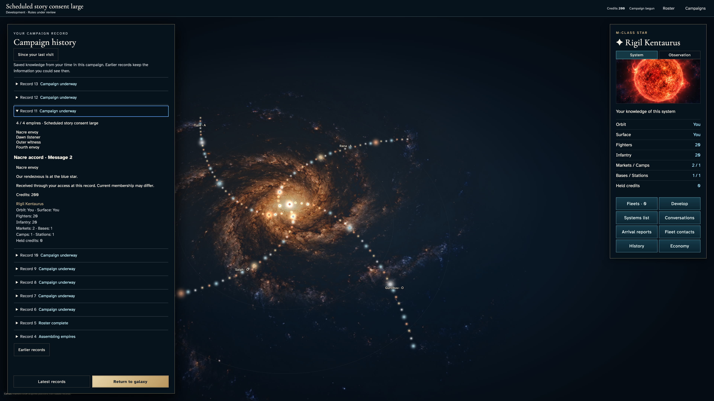](../../../../../../tests/browser/story-baselines/selected-history-consent/large/darwin-arm64/021-recover-retained-history-1-dawn-listener.png)

### Viewpoint: Outer witness

## 22. Escape closes retained history and restores focus to History on the galaxy.

Actor: **Dawn listener**.

Acknowledged outcome: Focus returns to History.

- [x] No viewpoint has an uncaught application error.
- [x] No private history panel remains visible.

### Viewpoint: Dawn listener

[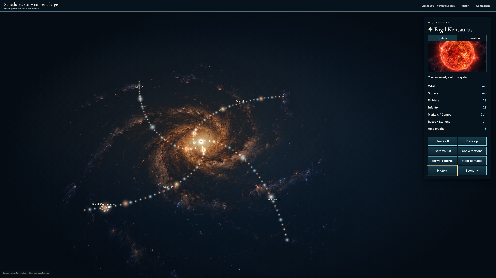](../../../../../../tests/browser/story-baselines/selected-history-consent/large/darwin-arm64/022-leave-retained-history-1-dawn-listener.png)
