# Consent to one earlier diplomatic message

**Exact comparison passed.** phone · darwin-arm64. Inventory: UX-10, UX-14, UX-16.

Independent commanders use authenticated development-provider commands. The creator shares one of two earlier messages; the recipient reviews and accepts its scope, then reloads. An uninvolved commander never receives the room or either message. Admission uses the labelled emulator clock and actual scheduler endpoint, not injected state. Managed-key and fault journeys remain separate coverage.

## 1. Ordinary emulator sign-in and identity save, with explicit developer entitlement and fixed browser Date; timers continue normally.

Actor: **Test harness**. **Harness control; not a player action.**

Acknowledged outcome: Explicit test control; not a player action or hosted-service certification.

## 2. Ordinary emulator sign-in and identity save, with explicit developer entitlement and fixed browser Date; timers continue normally.

Actor: **Test harness**. **Harness control; not a player action.**

Acknowledged outcome: Explicit test control; not a player action or hosted-service certification.

## 3. Ordinary emulator sign-in and identity save, with explicit developer entitlement and fixed browser Date; timers continue normally.

Actor: **Test harness**. **Harness control; not a player action.**

Acknowledged outcome: Explicit test control; not a player action or hosted-service certification.

## 4. Ordinary emulator sign-in and identity save, with explicit developer entitlement and fixed browser Date; timers continue normally.

Actor: **Test harness**. **Harness control; not a player action.**

Acknowledged outcome: Explicit test control; not a player action or hosted-service certification.

## 5. Create/join through ordinary campaign controls. Fixed catalogue and admission clock are test controls; no seat, message or command outcome is injected.

Actor: **Test harness**. **Harness control; not a player action.**

Acknowledged outcome: Explicit test control; not a player action or hosted-service certification.

## 6. Create/join through ordinary campaign controls. Fixed catalogue and admission clock are test controls; no seat, message or command outcome is injected.

Actor: **Test harness**. **Harness control; not a player action.**

Acknowledged outcome: Explicit test control; not a player action or hosted-service certification.

## 7. Create/join through ordinary campaign controls. Fixed catalogue and admission clock are test controls; no seat, message or command outcome is injected.

Actor: **Test harness**. **Harness control; not a player action.**

Acknowledged outcome: Explicit test control; not a player action or hosted-service certification.

## 8. Create/join through ordinary campaign controls. Fixed catalogue and admission clock are test controls; no seat, message or command outcome is injected.

Actor: **Test harness**. **Harness control; not a player action.**

Acknowledged outcome: Explicit test control; not a player action or hosted-service certification.

## 9. Advance the designated browser/domain clock to 12:15 UTC and deliver the actual emulator Scheduler HTTP request. This does not certify hosted scheduling.

Actor: **Test harness**. **Harness control; not a player action.**

Acknowledged outcome: Explicit test control; not a player action or hosted-service certification.

## 10. Create a private room while the recipient and outsider inspect their own empty directories.

Actor: **Nacre envoy**.

Acknowledged outcome: The authoritative room appears only for its creator.

- [x] No viewpoint has an uncaught application error.
- [x] The outsider's UI and serialized authorized view contain neither private room nor either message.
- [x] The future recipient cannot see the room before invitation.

### Viewpoint: Nacre envoy

[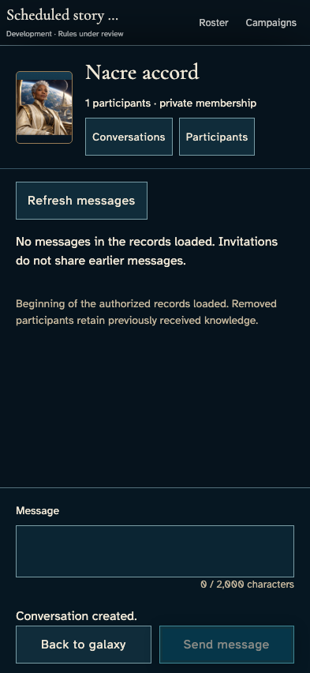](../../../../../../tests/browser/story-baselines/selected-history-consent/phone/darwin-arm64/010-private-room-1-nacre-envoy.png)

### Viewpoint: Dawn listener

[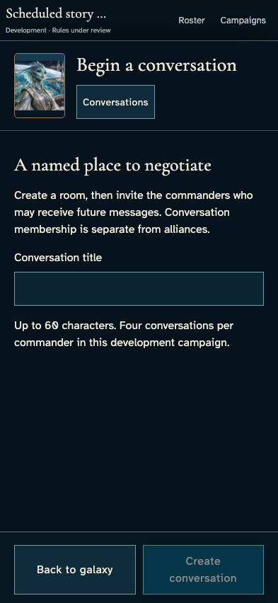](../../../../../../tests/browser/story-baselines/selected-history-consent/phone/darwin-arm64/010-private-room-2-dawn-listener.png)

### Viewpoint: Outer witness

## 11. Send a reserve-route message that stays private.

Actor: **Nacre envoy**.

Acknowledged outcome: The command is acknowledged as Message sent and appears in the creator's authorized messages.

- [x] No viewpoint has an uncaught application error.
- [x] The outsider's UI and serialized authorized view contain neither private room nor either message.
- [x] The acknowledged composer clears its submitted text.

### Viewpoint: Nacre envoy

[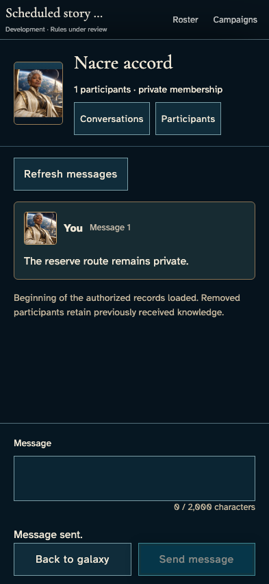](../../../../../../tests/browser/story-baselines/selected-history-consent/phone/darwin-arm64/011-earlier-message-1-1-nacre-envoy.png)

## 12. Send the rendezvous message that will be selected.

Actor: **Nacre envoy**.

Acknowledged outcome: The command is acknowledged as Message sent and appears in the creator's authorized messages.

- [x] No viewpoint has an uncaught application error.
- [x] The outsider's UI and serialized authorized view contain neither private room nor either message.
- [x] The acknowledged composer clears its submitted text.

### Viewpoint: Nacre envoy

[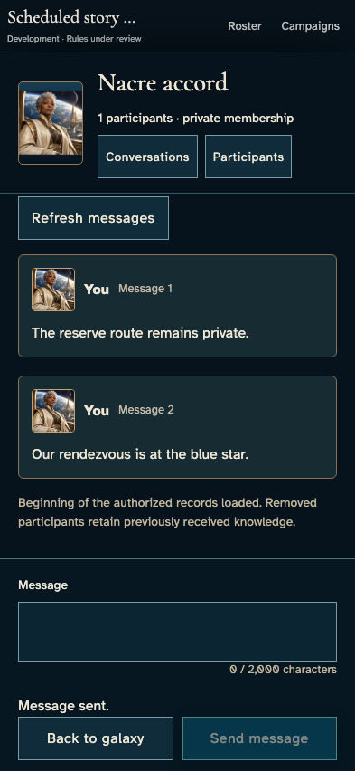](../../../../../../tests/browser/story-baselines/selected-history-consent/phone/darwin-arm64/012-earlier-message-2-1-nacre-envoy.png)

## 13. Select Dawn listener and exactly one earlier message; keep the reserve route unselected.

Actor: **Nacre envoy**.

Acknowledged outcome: The invitation control identifies one selected earlier message.

- [x] No viewpoint has an uncaught application error.
- [x] The reserve message remains unchecked and stale send feedback is absent.

### Viewpoint: Nacre envoy

[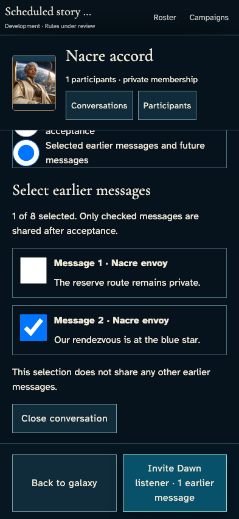](../../../../../../tests/browser/story-baselines/selected-history-consent/phone/darwin-arm64/013-choose-history-1-nacre-envoy.png)

## 14. Send the selected-history invitation; the recipient sees scope and provenance but no message body before consent.

Actor: **Nacre envoy**.

Acknowledged outcome: The independently authenticated recipient receives the one-message invitation.

- [x] No viewpoint has an uncaught application error.
- [x] The outsider's UI and serialized authorized view contain neither private room nor either message.
- [x] Neither message body is present in the recipient's UI or serialized authorized projection before consent.

### Viewpoint: Nacre envoy

[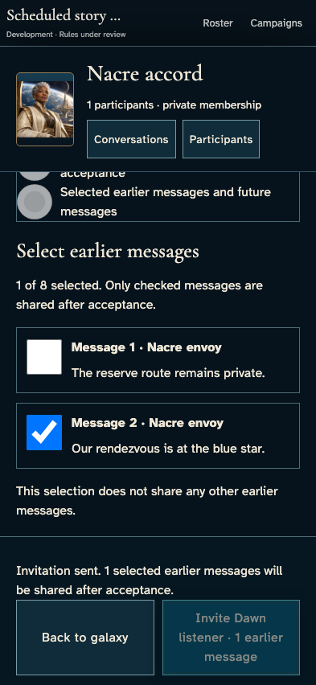](../../../../../../tests/browser/story-baselines/selected-history-consent/phone/darwin-arm64/014-invite-1-nacre-envoy.png)

### Viewpoint: Dawn listener

[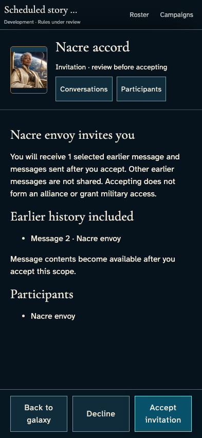](../../../../../../tests/browser/story-baselines/selected-history-consent/phone/darwin-arm64/014-invite-2-dawn-listener.png)

### Viewpoint: Outer witness

## 15. Accept the invitation using the keyboard. Only the selected earlier message becomes readable, with its sharing provenance.

Actor: **Dawn listener**.

Acknowledged outcome: The accepted membership publishes the selected message to the recipient.

- [x] No viewpoint has an uncaught application error.
- [x] The outsider's UI and serialized authorized view contain neither private room nor either message.
- [x] Keyboard Home and bounded reading reveal the complete shared message, author and provenance while the commitment rail stays visible.
- [x] Acceptance makes exactly one authoritative revision, excludes the reserve message, and names the sharing commander.

### Viewpoint: Nacre envoy

### Viewpoint: Dawn listener

[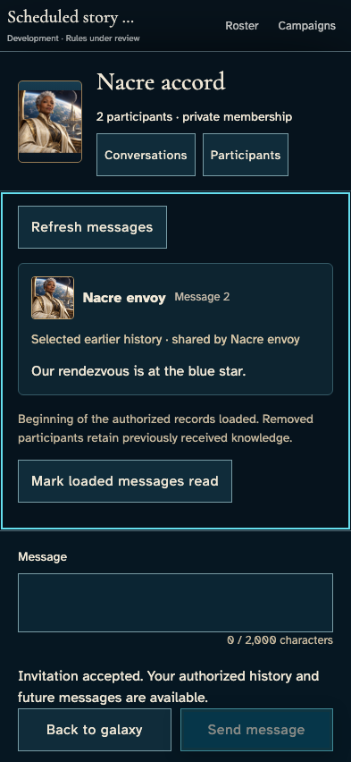](../../../../../../tests/browser/story-baselines/selected-history-consent/phone/darwin-arm64/015-consent-2-dawn-listener.png)

### Viewpoint: Outer witness

## 16. Reload and reopen the accepted room without resending acceptance or expanding its history grant.

Actor: **Dawn listener**.

Acknowledged outcome: The recovered authorized messages still contain the selected rendezvous note.

- [x] No viewpoint has an uncaught application error.
- [x] The outsider's UI and serialized authorized view contain neither private room nor either message.
- [x] Keyboard Home and bounded reading reveal the complete shared message, author and provenance while the commitment rail stays visible.
- [x] Recovery causes no extra revision and never exposes the unselected message.

### Viewpoint: Dawn listener

[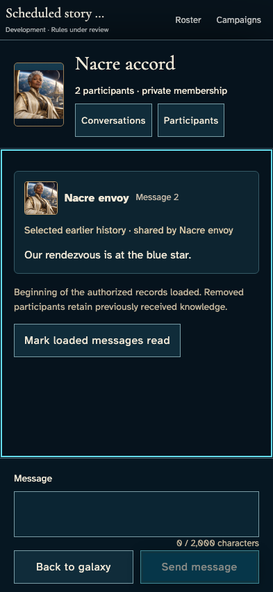](../../../../../../tests/browser/story-baselines/selected-history-consent/phone/darwin-arm64/016-recover-consent-1-dawn-listener.png)

### Viewpoint: Outer witness

## 17. Escape closes the conversation and restores keyboard focus to its opening control.

Actor: **Dawn listener**.

Acknowledged outcome: The chart returns focus to Conversations.

- [x] No viewpoint has an uncaught application error.
- [x] Private conversation details are no longer visible.

### Viewpoint: Dawn listener

[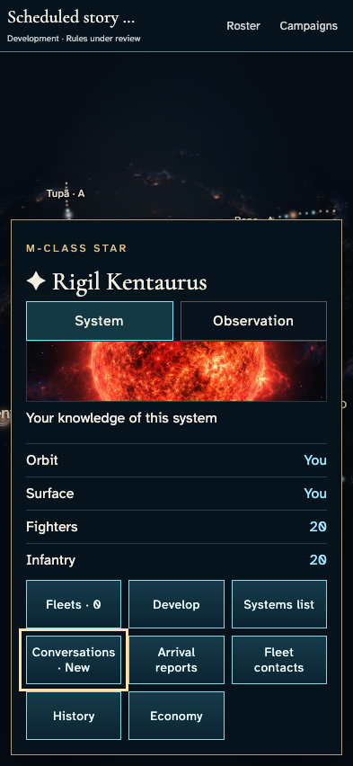](../../../../../../tests/browser/story-baselines/selected-history-consent/phone/darwin-arm64/017-return-to-chart-1-dawn-listener.png)

## 18. The creator reviews removal of the consenting listener before committing it.

Actor: **Nacre envoy**.

Acknowledged outcome: The removal confirmation is available without changing membership.

- [x] No viewpoint has an uncaught application error.
- [x] The outsider's UI and serialized authorized view contain neither private room nor either message.

### Viewpoint: Nacre envoy

[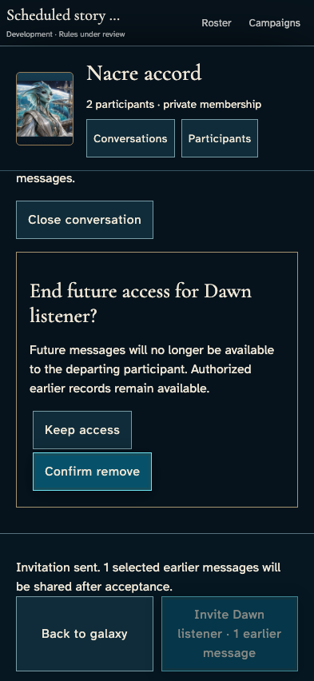](../../../../../../tests/browser/story-baselines/selected-history-consent/phone/darwin-arm64/018-review-removal-1-nacre-envoy.png)

## 19. Confirm removal with the keyboard. The listener retains already shared history while current conversation access ends.

Actor: **Nacre envoy**.

Acknowledged outcome: The listener sees authoritative access-ended feedback and cannot compose a new message.

- [x] No viewpoint has an uncaught application error.
- [x] The outsider's UI and serialized authorized view contain neither private room nor either message.
- [x] Exactly one revision removes the listener without expanding previous history.

### Viewpoint: Nacre envoy

[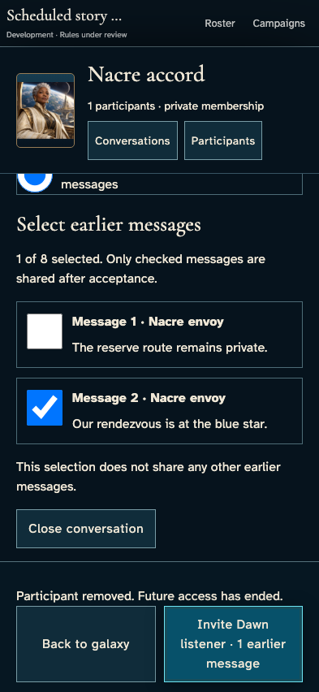](../../../../../../tests/browser/story-baselines/selected-history-consent/phone/darwin-arm64/019-remove-current-access-1-nacre-envoy.png)

### Viewpoint: Dawn listener

### Viewpoint: Outer witness

## 20. The creator sends a new private message after removal; neither the former member nor outsider receives it.

Actor: **Nacre envoy**.

Acknowledged outcome: Message sent acknowledges the command and the creator can read its text.

- [x] No viewpoint has an uncaught application error.
- [x] The outsider's UI and serialized authorized view contain neither private room nor either message.
- [x] Removed and outsider recipients receive no post-removal message in UI or serialized views.
- [x] The post-removal message commits exactly once.

### Viewpoint: Nacre envoy

[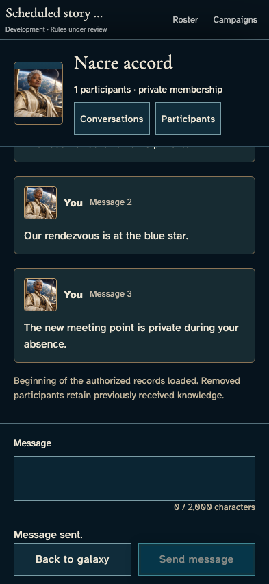](../../../../../../tests/browser/story-baselines/selected-history-consent/phone/darwin-arm64/020-message-after-removal-1-nacre-envoy.png)

### Viewpoint: Dawn listener

[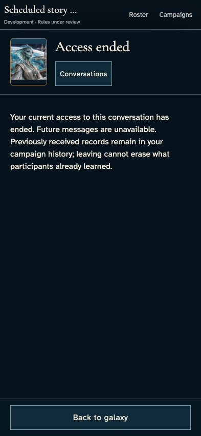](../../../../../../tests/browser/story-baselines/selected-history-consent/phone/darwin-arm64/020-message-after-removal-2-dawn-listener.png)

### Viewpoint: Outer witness

## 21. Reload, then open Campaign history to recover the selected message received before removal. The live room is no longer accessible.

Actor: **Dawn listener**.

Acknowledged outcome: The accepted-consent record exposes the previously received rendezvous message.

- [x] No viewpoint has an uncaught application error.
- [x] The outsider's UI and serialized authorized view contain neither private room nor either message.
- [x] Reload and both motion preferences preserve the exact revision and exclude ungranted messages from historical reading.

### Viewpoint: Dawn listener

[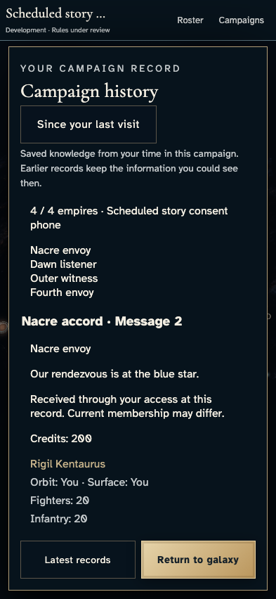](../../../../../../tests/browser/story-baselines/selected-history-consent/phone/darwin-arm64/021-recover-retained-history-1-dawn-listener.png)

### Viewpoint: Outer witness

## 22. Escape closes retained history and restores focus to History on the galaxy.

Actor: **Dawn listener**.

Acknowledged outcome: Focus returns to History.

- [x] No viewpoint has an uncaught application error.
- [x] No private history panel remains visible.

### Viewpoint: Dawn listener

[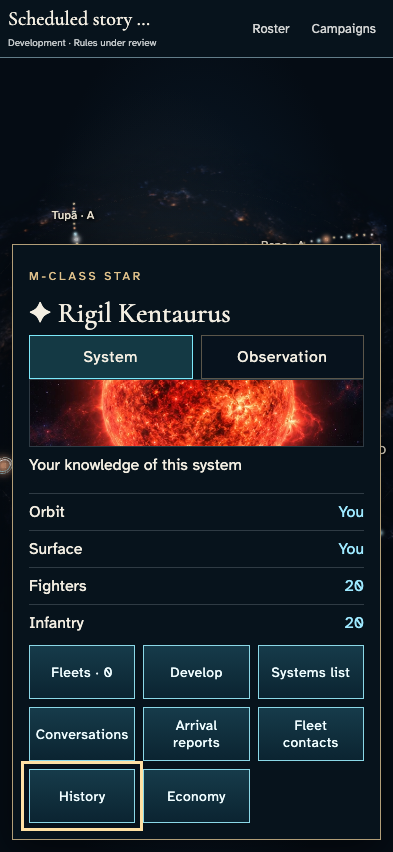](../../../../../../tests/browser/story-baselines/selected-history-consent/phone/darwin-arm64/022-leave-retained-history-1-dawn-listener.png)

## 23. Write a private reply and wait for this browser's durable draft acknowledgement without sending it.

Actor: **Nacre envoy**.

Acknowledged outcome: Browser storage acknowledges the saved draft without presenting it as a sent message.

- [x] No viewpoint has an uncaught application error.
- [x] Unsent drafts never change canonical state or appear in other recipients' projections.

### Viewpoint: Nacre envoy

[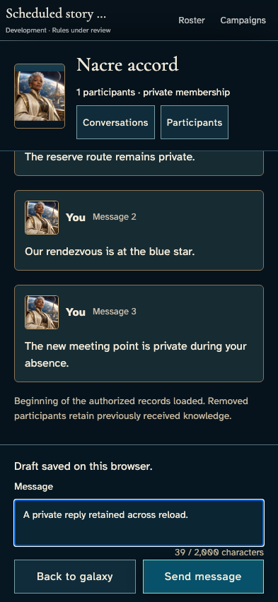](../../../../../../tests/browser/story-baselines/selected-history-consent/phone/darwin-arm64/023-save-private-browser-draft-1-nacre-envoy.png)

## 24. Reload the creator's session and open a second authenticated tab. Both recover the same unsent reply from this browser.

Actor: **Nacre envoy**.

Acknowledged outcome: Both composers recover the exact saved text.

- [x] No viewpoint has an uncaught application error.
- [x] Unsent drafts never change canonical state or appear in other recipients' projections.

### Viewpoint: Nacre envoy

[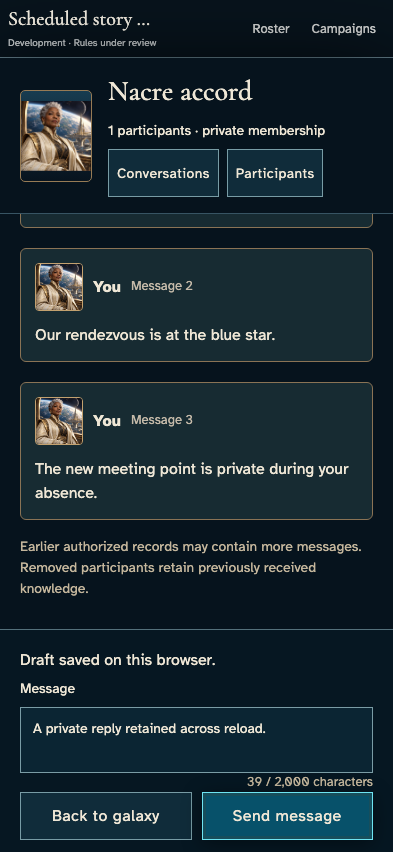](../../../../../../tests/browser/story-baselines/selected-history-consent/phone/darwin-arm64/024-recover-draft-in-two-tabs-1-nacre-envoy.png)

### Viewpoint: Nacre envoy · second tab

## 25. Save a new reply in the first tab, then edit the second tab. The conflict preserves the second tab's text and blocks sending until resolved.

Actor: **Nacre envoy**.

Acknowledged outcome: The second tab explains the competing saved draft without discarding its local text.

- [x] No viewpoint has an uncaught application error.
- [x] Unsent drafts never change canonical state or appear in other recipients' projections.
- [x] Conflict remedies and composer remain in the visible fixed footer.

### Viewpoint: Nacre envoy

### Viewpoint: Nacre envoy · second tab

[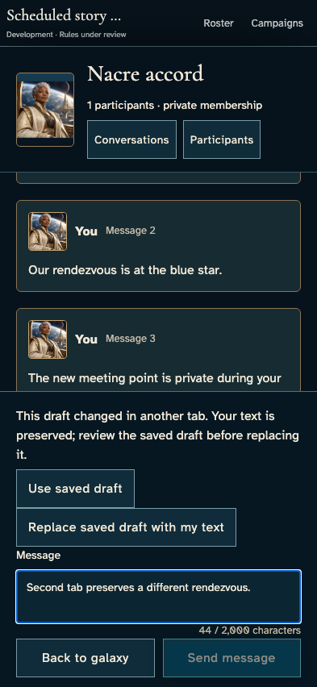](../../../../../../tests/browser/story-baselines/selected-history-consent/phone/darwin-arm64/025-preserve-conflicting-draft-2-nacre-envoy-second-tab.png)

## 26. Use the keyboard to choose the first tab's saved reply explicitly. No message is sent by resolving the conflict.

Actor: **Nacre envoy**.

Acknowledged outcome: The chosen saved reply replaces local text and clears the conflict.

- [x] No viewpoint has an uncaught application error.
- [x] Unsent drafts never change canonical state or appear in other recipients' projections.

### Viewpoint: Nacre envoy · second tab

## 27. Send the explicitly chosen reply. Only the creator's current membership receives it; former members and outsiders receive nothing.

Actor: **Nacre envoy**.

Acknowledged outcome: Message sent acknowledges the recovered reply and clears its composer.

- [x] No viewpoint has an uncaught application error.
- [x] Exactly one message sequence and campaign revision are committed, without the discarded text or unauthorized recipients.

### Viewpoint: Nacre envoy · second tab

[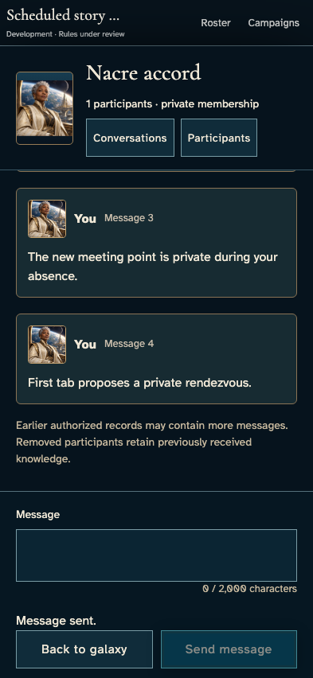](../../../../../../tests/browser/story-baselines/selected-history-consent/phone/darwin-arm64/027-send-recovered-draft-once-1-nacre-envoy-second-tab.png)

### Viewpoint: Outer witness

## 28. Reload the sending tab. The sent reply remains in authorized history, and its saved draft stays cleared without a duplicate send.

Actor: **Nacre envoy**.

Acknowledged outcome: Reload restores the sent message with an empty composer.

- [x] No viewpoint has an uncaught application error.
- [x] Recovery and motion preferences preserve one committed effect and privacy.

### Viewpoint: Nacre envoy · second tab

[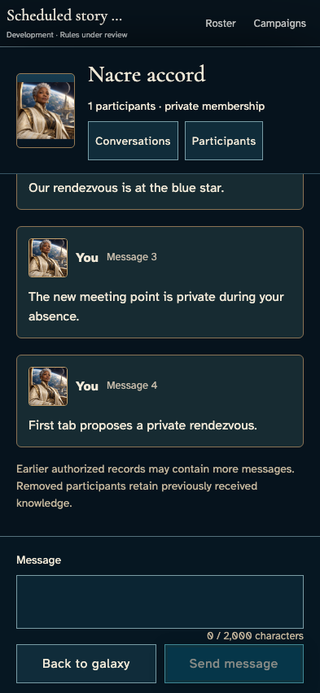](../../../../../../tests/browser/story-baselines/selected-history-consent/phone/darwin-arm64/028-recover-cleared-draft-1-nacre-envoy-second-tab.png)

## 29. Reload the first tab and save a new unsent proposal. Reload the second tab to recover the same browser draft before editing independently.

Actor: **Nacre envoy**.

Acknowledged outcome: Both tabs recover the same unsent proposal.

- [x] No viewpoint has an uncaught application error.
- [x] Draft decisions leave the complete canonical campaign unchanged and disclose no text to removed members or outsiders.

### Viewpoint: Nacre envoy

### Viewpoint: Nacre envoy · second tab

[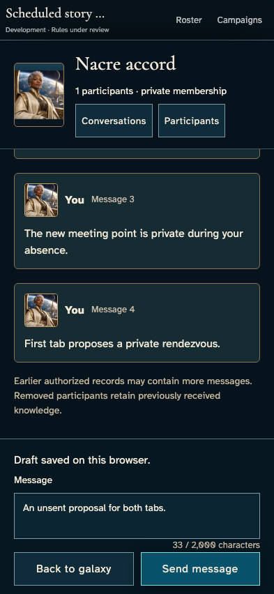](../../../../../../tests/browser/story-baselines/selected-history-consent/phone/darwin-arm64/029-prepare-replacement-choice-2-nacre-envoy-second-tab.png)

## 30. Save a northern rendezvous in the first tab, then propose a southern rendezvous in the second. Keep both texts available while choosing which draft to retain.

Actor: **Nacre envoy**.

Acknowledged outcome: A revision conflict preserves the second tab's proposal and blocks sending.

- [x] No viewpoint has an uncaught application error.
- [x] Draft decisions leave the complete canonical campaign unchanged and disclose no text to removed members or outsiders.
- [x] Both explicit choices remain visible before any scrolling.

### Viewpoint: Nacre envoy

[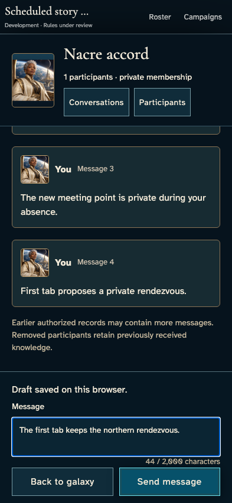](../../../../../../tests/browser/story-baselines/selected-history-consent/phone/darwin-arm64/030-review-competing-replacement-1-nacre-envoy.png)

### Viewpoint: Nacre envoy · second tab

[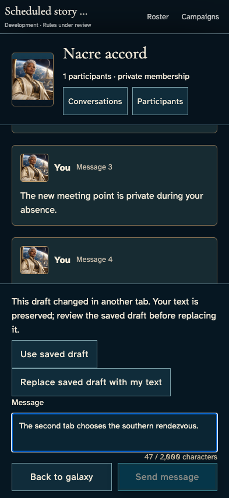](../../../../../../tests/browser/story-baselines/selected-history-consent/phone/darwin-arm64/030-review-competing-replacement-2-nacre-envoy-second-tab.png)

## 31. Choose Replace saved draft with my text using the keyboard. This explicit choice saves the southern proposal without sending it.

Actor: **Nacre envoy**.

Acknowledged outcome: Browser storage acknowledges the chosen local text and clears the conflict.

- [x] No viewpoint has an uncaught application error.
- [x] Draft decisions leave the complete canonical campaign unchanged and disclose no text to removed members or outsiders.

### Viewpoint: Nacre envoy · second tab

## 32. Reload both tabs. Each recovers the explicitly chosen southern proposal, still unsent. Other commanders receive neither discarded nor chosen text.

Actor: **Nacre envoy**.

Acknowledged outcome: Both authenticated tabs recover the replacement from durable browser storage.

- [x] No viewpoint has an uncaught application error.
- [x] Draft decisions leave the complete canonical campaign unchanged and disclose no text to removed members or outsiders.
- [x] Normal and reduced motion preserve the chosen text and unsent state.

### Viewpoint: Nacre envoy

[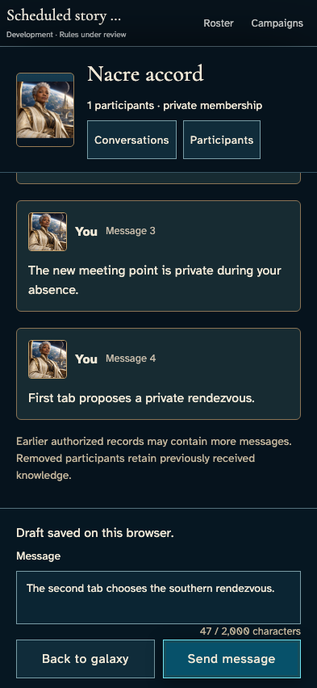](../../../../../../tests/browser/story-baselines/selected-history-consent/phone/darwin-arm64/032-recover-chosen-local-proposal-1-nacre-envoy.png)

### Viewpoint: Nacre envoy · second tab

### Viewpoint: Outer witness

## 33. Withhold only actual conversation.send RTDB frames before ingress. Other traffic passes through; no payload, identity, receipt or state is replaced.

Actor: **Test harness**. **Harness control; not a player action.**

Acknowledged outcome: Explicit test control; not a player action or hosted-service certification.

## 34. Send the saved southern proposal by keyboard. The interrupted connection leaves it awaiting acknowledgement, not presented as a sent message.

Actor: **Nacre envoy**.

Acknowledged outcome: The interface explicitly waits for acknowledgement and retains the submitted text; this is not service acceptance.

- [x] No viewpoint has an uncaught application error.
- [x] An undelivered command changes no canonical state and exposes no draft to removed members or outsiders.

### Viewpoint: Nacre envoy · second tab

[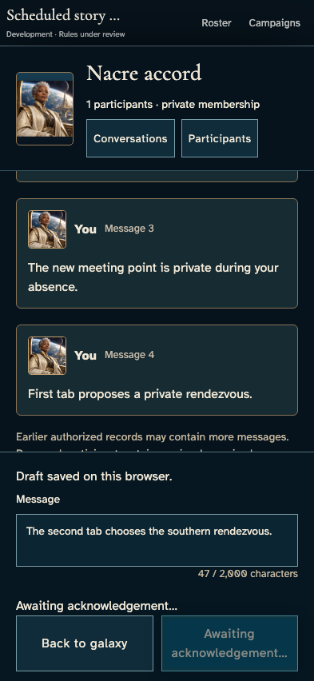](../../../../../../tests/browser/story-baselines/selected-history-consent/phone/darwin-arm64/034-submit-replacement-awaiting-acknowledgement-1-nacre-envoy-second-tab.png)

### Viewpoint: Outer witness

## 35. Try sending from the other tab. The shared durable order prevents a second logical send and offers recovery of the unfinished order.

Actor: **Nacre envoy**.

Acknowledged outcome: The other tab explains the unfinished order and preserves its text.

- [x] No viewpoint has an uncaught application error.
- [x] An undelivered command changes no canonical state and exposes no draft to removed members or outsiders.

### Viewpoint: Nacre envoy

[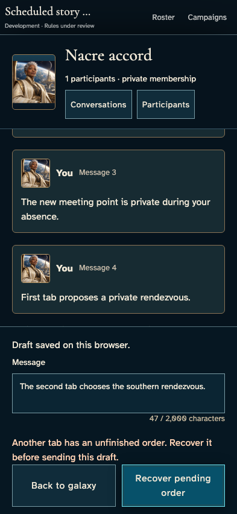](../../../../../../tests/browser/story-baselines/selected-history-consent/phone/darwin-arm64/035-protect-pending-send-from-second-tab-1-nacre-envoy.png)

## 36. Reload the sending tab. The durable command restores the matching conversation and original submitted text, then offers retry when acknowledgement remains unavailable.

Actor: **Nacre envoy**.

Acknowledged outcome: Recovery opens the correct room and offers Retry same command with the original proposal intact.

- [x] No viewpoint has an uncaught application error.
- [x] An undelivered command changes no canonical state and exposes no draft to removed members or outsiders.
- [x] The retry control remains fully visible before scrolling.

### Viewpoint: Nacre envoy · second tab

[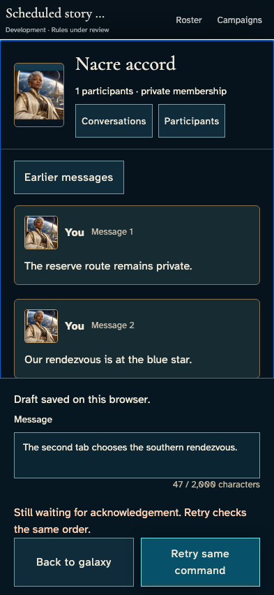](../../../../../../tests/browser/story-baselines/selected-history-consent/phone/darwin-arm64/036-reload-interrupted-send-1-nacre-envoy-second-tab.png)

## 37. Retry the original order with Enter. Retained transport frames keep the same command path and encrypted payload; the proposal remains pending.

Actor: **Nacre envoy**.

Acknowledged outcome: The interface returns to awaiting acknowledgement without clearing the proposal.

- [x] No viewpoint has an uncaught application error.
- [x] An undelivered command changes no canonical state and exposes no draft to removed members or outsiders.

### Viewpoint: Nacre envoy · second tab

[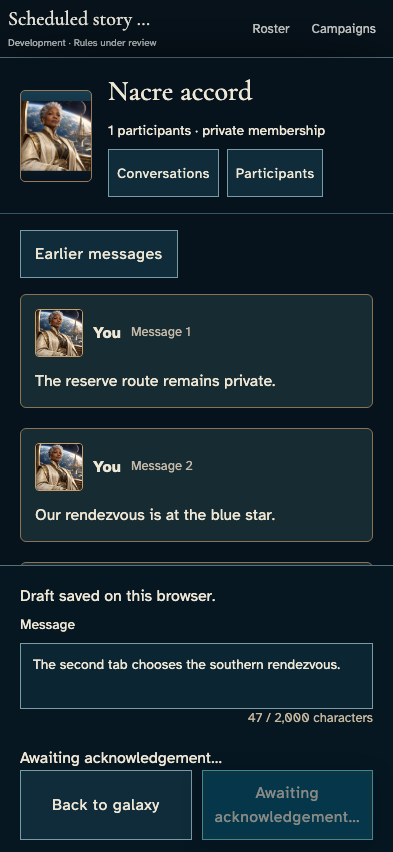](../../../../../../tests/browser/story-baselines/selected-history-consent/phone/darwin-arm64/037-retry-original-message-command-1-nacre-envoy-second-tab.png)

## 38. Release retained frames on still-active connections to actual RTDB ingress. Retransmissions retain their original command path and encrypted payload; no service result is injected.

Actor: **Test harness**. **Harness control; not a player action.**

Acknowledged outcome: Explicit test control; not a player action or hosted-service certification.

## 39. Read the accepted message after delivery returns. The original send clears its composer exactly once; other commanders receive no private contents.

Actor: **Nacre envoy**.

Acknowledged outcome: The real service acknowledges Message sent and the submitted composer clears.

- [x] No viewpoint has an uncaught application error.
- [x] One authoritative receipt, campaign revision and message sequence acknowledge the original command; private projections exclude its contents.
- [x] The acknowledged message is fully readable within bounded conversation details.

### Viewpoint: Nacre envoy · second tab

### Viewpoint: Outer witness

## 40. Reload after acceptance. The empty composer and one authorized message survive; the durable submitted order has been cleared.

Actor: **Nacre envoy**.

Acknowledged outcome: The sent proposal is retained in history without restoring a pending order or unsent text.

- [x] No viewpoint has an uncaught application error.
- [x] One authoritative receipt, campaign revision and message sequence acknowledge the original command; private projections exclude its contents.
- [x] IndexedDB contains no unfinished order and motion preferences preserve the single accepted outcome.

### Viewpoint: Nacre envoy · second tab

[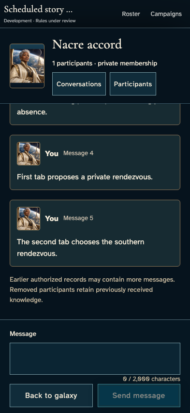](../../../../../../tests/browser/story-baselines/selected-history-consent/phone/darwin-arm64/040-recover-acknowledged-send-1-nacre-envoy-second-tab.png)

## 41. Save a new unsent note before leaving this browser session. Saving a draft is not sending a message.

Actor: **Nacre envoy**.

Acknowledged outcome: Browser storage acknowledges the exact private draft.

- [x] No viewpoint has an uncaught application error.
- [x] Account switching changes no campaign or saved identity and never publishes the unsent draft.

### Viewpoint: Nacre envoy · second tab

[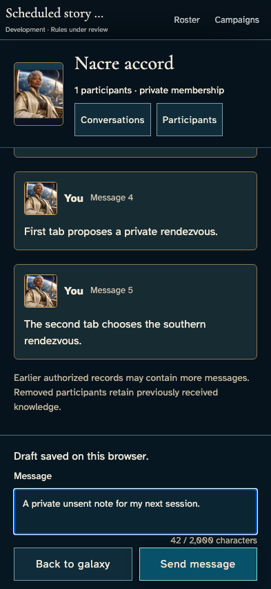](../../../../../../tests/browser/story-baselines/selected-history-consent/phone/darwin-arm64/041-save-account-private-draft-1-nacre-envoy-second-tab.png)

## 42. Use keyboard Sign out on the identity panel. This ends the browser session without publishing or discarding the saved note.

Actor: **Nacre envoy**.

Acknowledged outcome: Entry confirms the signed-out session with Play and no account identity control.

- [x] No viewpoint has an uncaught application error.
- [x] Account switching changes no campaign or saved identity and never publishes the unsent draft.

### Viewpoint: Nacre envoy · second tab

## 43. Sign into the same browser as the existing uninvolved commander and open this campaign's conversations. This account must not recover the first commander's room or draft.

Actor: **Outer witness**.

Acknowledged outcome: The authenticated outsider sees an empty conversation directory and no recovered private composer.

- [x] No viewpoint has an uncaught application error.
- [x] Account switching changes no campaign or saved identity and never publishes the unsent draft.

### Viewpoint: Outer witness · same browser

[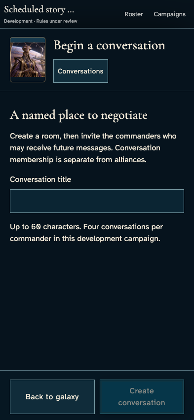](../../../../../../tests/browser/story-baselines/selected-history-consent/phone/darwin-arm64/043-other-account-on-same-browser-1-outer-witness-same-browser.png)

### Viewpoint: Outer witness

## 44. Sign out the second account before returning the browser to its original commander.

Actor: **Outer witness**.

Acknowledged outcome: The second account has signed out and its private campaign surface is closed.

- [x] No viewpoint has an uncaught application error.
- [x] Account switching changes no campaign or saved identity and never publishes the unsent draft.

### Viewpoint: Outer witness · signed out

## 45. Sign back into the original account without saving the identity again. Open its private room and recover the exact unsent note retained on this browser.

Actor: **Nacre envoy**.

Acknowledged outcome: Only the original account recovers its private room and unsent note.

- [x] No viewpoint has an uncaught application error.
- [x] Account switching changes no campaign or saved identity and never publishes the unsent draft.
- [x] The restored composer and commitment remain visible; normal/reduced motion preserve the unsent text.

### Viewpoint: Nacre envoy · second tab

### Viewpoint: Outer witness

## 46. Invite the removed commander again, explicitly choosing only messages sent after acceptance. The unsent browser note is not shared by this choice.

Actor: **Nacre envoy**.

Acknowledged outcome: The invitation offers future-only scope with no selected earlier messages.

- [x] No viewpoint has an uncaught application error.
- [x] Selecting scope sends no command or campaign mutation.

### Viewpoint: Nacre envoy · second tab

[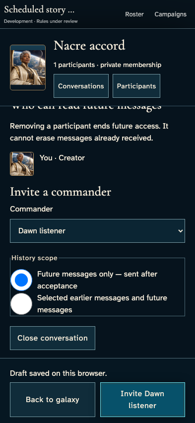](../../../../../../tests/browser/story-baselines/selected-history-consent/phone/darwin-arm64/046-choose-future-only-readmission-1-nacre-envoy-second-tab.png)

## 47. Send the future-only invitation. The removed commander opens the renewed offer without receiving messages sent during their absence.

Actor: **Nacre envoy**.

Acknowledged outcome: The returning commander receives an invitation explaining future-only access.

- [x] No viewpoint has an uncaught application error.
- [x] Renewed access never reveals unshared or absence-period messages in the returning player's UI or serialized projection.
- [x] One revision adds only an invitation, not membership or a message.

### Viewpoint: Nacre envoy · second tab

[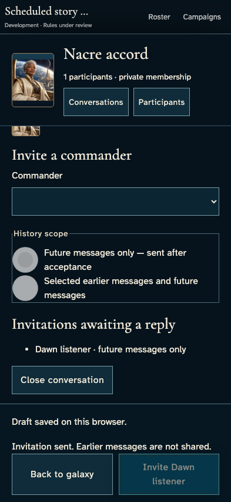](../../../../../../tests/browser/story-baselines/selected-history-consent/phone/darwin-arm64/047-offer-renewed-conversation-access-1-nacre-envoy-second-tab.png)

### Viewpoint: Dawn listener

[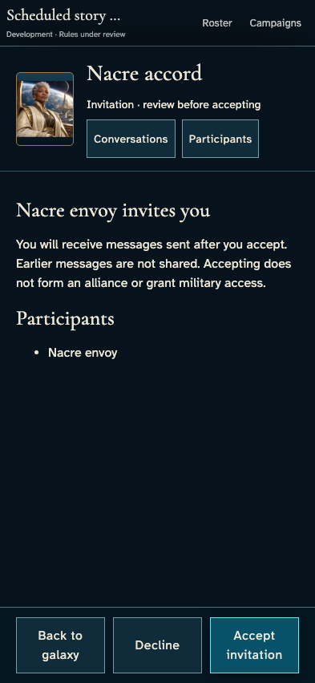](../../../../../../tests/browser/story-baselines/selected-history-consent/phone/darwin-arm64/047-offer-renewed-conversation-access-2-dawn-listener.png)

### Viewpoint: Outer witness

## 48. Accept the renewed invitation by keyboard. Membership resumes for future messages without granting the missing interval.

Actor: **Dawn listener**.

Acknowledged outcome: The returned member receives an enabled composer.

- [x] No viewpoint has an uncaught application error.
- [x] Renewed access never reveals unshared or absence-period messages in the returning player's UI or serialized projection.
- [x] Exactly one acceptance revision restores membership without creating a message.

### Viewpoint: Dawn listener

[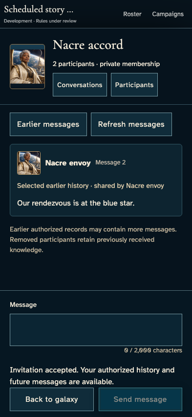](../../../../../../tests/browser/story-baselines/selected-history-consent/phone/darwin-arm64/048-accept-renewed-future-access-1-dawn-listener.png)

### Viewpoint: Nacre envoy · second tab

[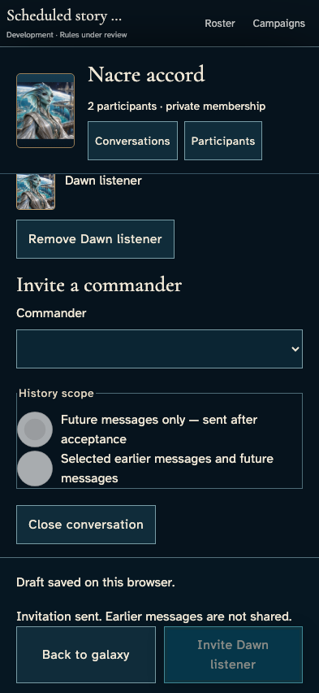](../../../../../../tests/browser/story-baselines/selected-history-consent/phone/darwin-arm64/048-accept-renewed-future-access-2-nacre-envoy-second-tab.png)

## 49. Return to the saved unsent note, deliberately replace it with a welcome message, and send after the returning commander has accepted.

Actor: **Nacre envoy**.

Acknowledged outcome: Message sent is acknowledged and the returned member receives the welcome.

- [x] No viewpoint has an uncaught application error.
- [x] Renewed access never reveals unshared or absence-period messages in the returning player's UI or serialized projection.
- [x] One new message reaches exactly the current members, with no outsider disclosure.

### Viewpoint: Nacre envoy · second tab

[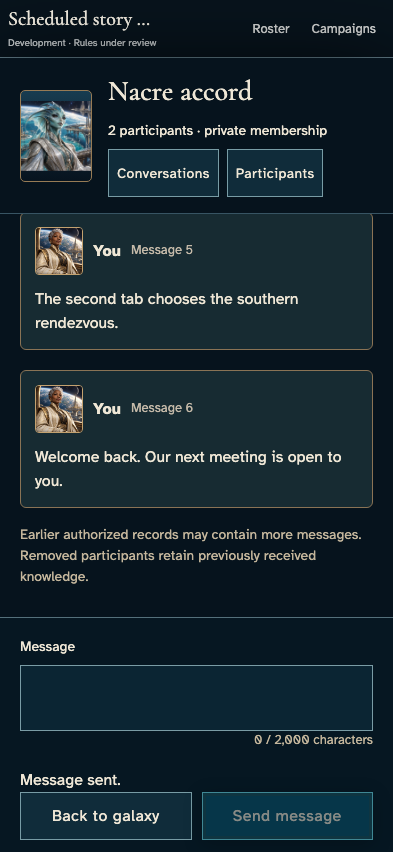](../../../../../../tests/browser/story-baselines/selected-history-consent/phone/darwin-arm64/049-send-after-renewed-consent-1-nacre-envoy-second-tab.png)

### Viewpoint: Dawn listener

[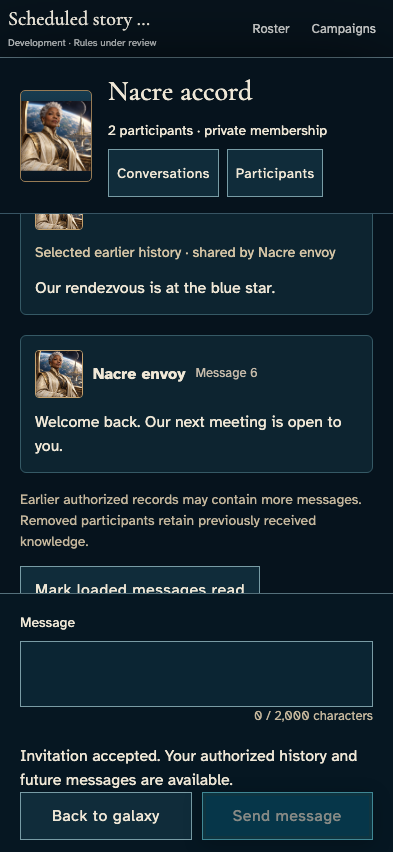](../../../../../../tests/browser/story-baselines/selected-history-consent/phone/darwin-arm64/049-send-after-renewed-consent-2-dawn-listener.png)

### Viewpoint: Outer witness

## 50. Reload the returning commander's campaign and read the welcome. Renewed access preserves its boundary across recovery and motion preferences.

Actor: **Dawn listener**.

Acknowledged outcome: The returned member recovers the welcome in authorized history.

- [x] No viewpoint has an uncaught application error.
- [x] Renewed access never reveals unshared or absence-period messages in the returning player's UI or serialized projection.
- [x] Reload changes no message or membership revision and keeps the welcome readable without exposing the absence interval.

### Viewpoint: Dawn listener

[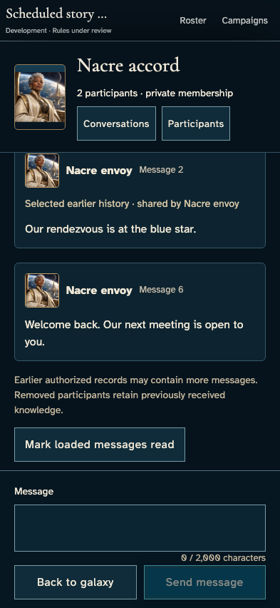](../../../../../../tests/browser/story-baselines/selected-history-consent/phone/darwin-arm64/050-recover-renewed-message-boundary-1-dawn-listener.png)

### Viewpoint: Outer witness

