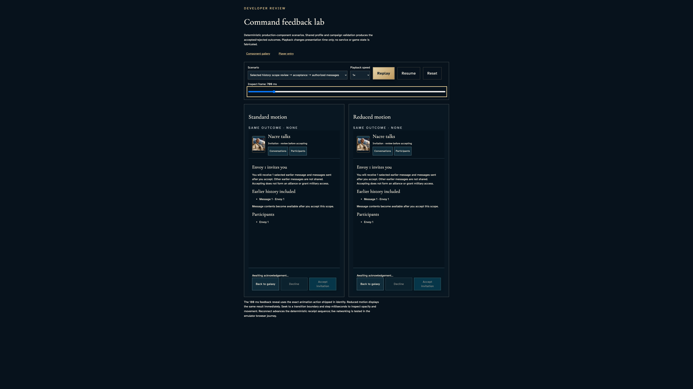
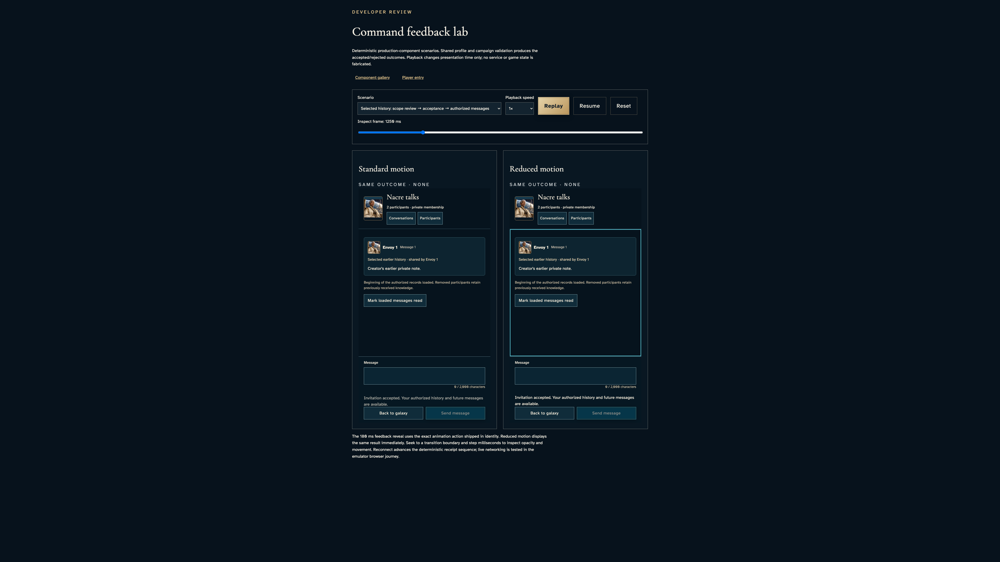
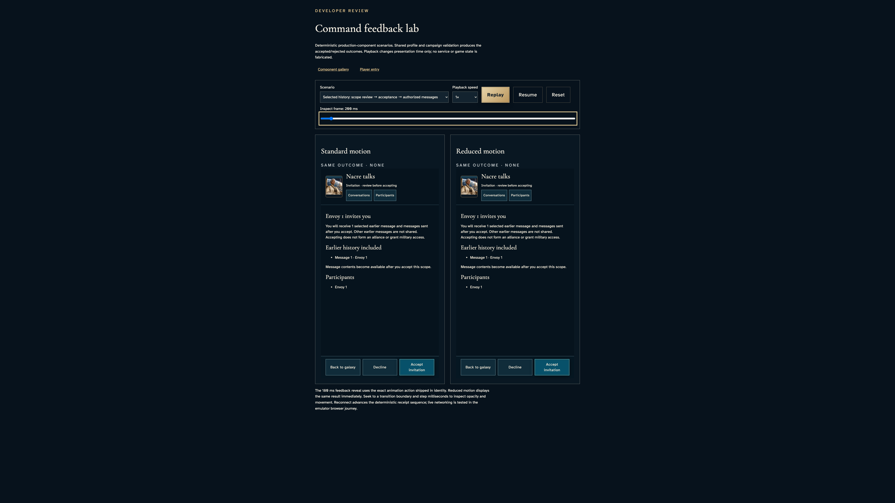

# Inspect selected-history consent before and after acceptance

**Exact comparison passed.** large · darwin-arm64. Inventory: UX-10, UX-14, UX-16.

A developer inspects the recipient's invitation and accepted projections in the shipped Conversations component. The existing lab scenario derives these views through shared conversation reducers. Timeline seeking is explicitly a presentation harness, not a delivered accept command, authenticated recipient grant or end-to-end encryption proof. Its command callbacks remain inert; the live privacy/service assertions remain separate and unchanged.

## 1. Freeze browser playback only. Shared reducers derive the existing selected-history views; no authenticated account, live command, service clock or stored grants are replaced.

Actor: **Test harness**. **Harness control; not a player action.**

Acknowledged outcome: Explicit test control; not a player action or hosted-service certification.

## 2. Select the recipient's sharing scenario and focus each real Accept invitation control without committing consent through an inert lab callback.

Actor: **Developer**.

Acknowledged outcome: Both invitation views disclose one selected earlier message and explain that acceptance grants neither alliance nor military access.

- [x] Before consent, only the selected message identifier is disclosed; the earlier private contents and authorized message list are absent.

### Viewpoint: Developer · recipient in standard motion

- [x] The actual conversation surface and commitment footer remain contained; conversation details use their bounded scroll region.
- [x] Explicit paused motion: [aria-label="Standard motion comparison"], 1 animation(s), 180/180 ms; unchanged exact comparison.
- [x] Explicit paused motion: [aria-label="Reduced motion comparison"], 1 animation(s), 180/180 ms; unchanged exact comparison.

### Viewpoint: Developer · recipient in reduced motion

- [x] The actual conversation surface and commitment footer remain contained; conversation details use their bounded scroll region.
- [x] Explicit paused motion: [aria-label="Standard motion comparison"], 1 animation(s), 180/180 ms; unchanged exact comparison.
- [x] Explicit paused motion: [aria-label="Reduced motion comparison"], 1 animation(s), 180/180 ms; unchanged exact comparison.

## 3. Seek to the existing pending-acceptance specimen. This timeline action is not a live acceptance request.

Actor: **Developer**.

Acknowledged outcome: Both panes report the same pending campaign acknowledgement.

- [x] Before consent, only the selected message identifier is disclosed; the earlier private contents and authorized message list are absent.
- [x] Pending disables both consent and decline without exposing the selected contents.

### Viewpoint: Developer · recipient in standard motion

- [x] The actual conversation surface and commitment footer remain contained; conversation details use their bounded scroll region.
- [x] Explicit paused motion: [aria-label="Standard motion comparison"], 1 animation(s), 180/180 ms; unchanged exact comparison.
- [x] Explicit paused motion: [aria-label="Reduced motion comparison"], 1 animation(s), 180/180 ms; unchanged exact comparison.

### Viewpoint: Developer · recipient in reduced motion

- [x] The actual conversation surface and commitment footer remain contained; conversation details use their bounded scroll region.
- [x] Explicit paused motion: [aria-label="Standard motion comparison"], 1 animation(s), 180/180 ms; unchanged exact comparison.
- [x] Explicit paused motion: [aria-label="Reduced motion comparison"], 1 animation(s), 180/180 ms; unchanged exact comparison.

## 4. Inspect the actual acceptance feedback at 50 ms in standard motion and its settled 180 ms reduced-motion counterpart; use Home to read the same authorized message from its beginning.

Actor: **Developer**.

Acknowledged outcome: Both motion panes report the exact accepted-membership outcome despite different presentation times.

- [x] The same single selected message and sharing disclosure exist in each motion mode.

### Viewpoint: Developer · recipient in standard motion

- [x] The actual conversation surface and commitment footer remain contained; conversation details use their bounded scroll region.
- [x] Explicit paused motion: [aria-label="Standard motion comparison"], 2 animation(s), 50/180 ms; unchanged exact comparison.
- [x] Explicit paused motion: [aria-label="Reduced motion comparison"], 2 animation(s), 180/180 ms; unchanged exact comparison.

### Viewpoint: Developer · recipient in reduced motion

- [x] The actual conversation surface and commitment footer remain contained; conversation details use their bounded scroll region.
- [x] Explicit paused motion: [aria-label="Standard motion comparison"], 2 animation(s), 50/180 ms; unchanged exact comparison.
- [x] Explicit paused motion: [aria-label="Reduced motion comparison"], 2 animation(s), 180/180 ms; unchanged exact comparison.

## 5. Seek to the reducer-accepted recipient projection and use keyboard Home to read the complete selected message and its sharing provenance.

Actor: **Developer**.

Acknowledged outcome: Both panes show the same accepted membership feedback and selected earlier private note.

- [x] Acceptance removes the invitation controls and exposes no extra messages or unselected history.

### Viewpoint: Developer · recipient in standard motion

- [x] The actual conversation surface and commitment footer remain contained; conversation details use their bounded scroll region.
- [x] Explicit paused motion: [aria-label="Standard motion comparison"], 2 animation(s), 180/180 ms; unchanged exact comparison.
- [x] Explicit paused motion: [aria-label="Reduced motion comparison"], 2 animation(s), 180/180 ms; unchanged exact comparison.

### Viewpoint: Developer · recipient in reduced motion

- [x] The actual conversation surface and commitment footer remain contained; conversation details use their bounded scroll region.
- [x] Explicit paused motion: [aria-label="Standard motion comparison"], 2 animation(s), 180/180 ms; unchanged exact comparison.
- [x] Explicit paused motion: [aria-label="Reduced motion comparison"], 2 animation(s), 180/180 ms; unchanged exact comparison.

## 6. Reset the lab by keyboard and recover the unaccepted scope without retaining previously displayed message contents.

Actor: **Developer**.

Acknowledged outcome: Both panes return to enabled invitation controls with no prior acknowledgement text.

- [x] Before consent, only the selected message identifier is disclosed; the earlier private contents and authorized message list are absent.
- [x] Reset restores the initial scenario rather than preserving accepted membership.

### Viewpoint: Developer · recipient in standard motion

- [x] The actual conversation surface and commitment footer remain contained; conversation details use their bounded scroll region.
- [x] Explicit paused motion: [aria-label="Standard motion comparison"], 1 animation(s), 180/180 ms; unchanged exact comparison.
- [x] Explicit paused motion: [aria-label="Reduced motion comparison"], 1 animation(s), 180/180 ms; unchanged exact comparison.

### Viewpoint: Developer · recipient in reduced motion

- [x] The actual conversation surface and commitment footer remain contained; conversation details use their bounded scroll region.
- [x] Explicit paused motion: [aria-label="Standard motion comparison"], 1 animation(s), 180/180 ms; unchanged exact comparison.
- [x] Explicit paused motion: [aria-label="Reduced motion comparison"], 1 animation(s), 180/180 ms; unchanged exact comparison.

